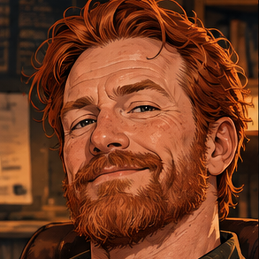

# Grave Shift crew board

Director: CLAUDE DIRECTOR (agent `claude`; D-145, D-146; lead since 2026-10-15). Rewritten 2026-10-15 (CL-199); the road to 1.0 added the same day. Jerry reads the **Crew Panel** (`crew/Open Crew Panel.bat`); agents start
every session with **`node crew/crew.mjs me <you>`** (your card, requests waiting for you, your queue, the test slot, the
commands). Rules: `AGENTS.md`. The old board, whole: `crew/archive/board-2026-10-15.md`.

Claude and Jerry write this file. Agents change only their own task's box, which `crew.mjs in` (▶) and `out --done` (✓)
do; a task Jerry gives you in chat goes on your queue by itself when you check in with its id.

## Game-test slot

Game tests on a computer go through its queue (Jerry, 2026-10-15). Since D-143 (Jerry, 10 Nov: "open as many as you
think is feasible without cooking the machine"), several at once where the computer has the room: the PC up to its
slots (auto, never over 3), each start 30 s after the last and only with free memory, quiet cores and a cool, unfilled
graphics card; a crash puts it back to one at a time for 20 minutes. Anything that starts the game goes through it:
`node crew/crew.mjs slot run <you> <task> --checks "<what you check>" -- <command>` (`--exclusive` for speed
measurements: they run alone). It waits for its turn, runs one instance with `--jobs 1`, closes it and releases.
Jerry's own game or inspector always comes first, and alone: nothing new starts while he waits. While you wait, keep
coding. If your session ends before your turn: `node crew/crew.mjs wait <you> "<what is ready>"` (it says "Changes
ready; waiting for testing slot" on your card and on Jerry's panel). The full suite is one coordinated job (Claude 2's,
in its cloud). Claude's cloud is a separate computer; it keeps to one instance there. `AGENTS.md` rule 16 has it all.

## Waiting on

One line per thing others can't go on without: `- **<who>** · <task> · waiting: <agents>`. The panel's "Needs you" box
reads it; a line whose task ids are all finished drops off by itself.

## Orders from Jerry

Newest first, the ones still in force. Older ones: `crew/archive/board-2026-10-15.md` and the archives it names.

- **2026-11-17 · J168: Tripo as a LOOK-ONLY reference for our code models.** (Jerry, in chat, ~22:05Z) "What if we just export them and then use the updated models tripio comes up with as reference to recreate in code?" Plan: (1) Claude 6 builds a review-only exporter: every LIVE zombie (14 types) as a static, posed (live-mode standing idle, paws/feet solved), world-baked GLB with its base colours (+ OBJ fallback), each < 50 MB, into Claude outputs/J168/export/ (gitignored); plus a review-only GLB viewer page with the same camera rule as AG-341 (three r175 GLTFLoader/GLTFExporter kept in review/J168/lib, NOT in the game). (2) Jerry runs them (or the AG-341 front/side/back pictures) through Tripo on his own account and saves the results in Claude outputs/J168/tripo/<type>/. (3) Antigravity renders each Tripo result next to ours on the 5080 (same camera, four lights); the crew lists the shape differences; Jerry picks; the owners recreate the picked shapes IN CODE as shape passes. Tripo files are reference only: never in the repo, never loaded by the game, never shipped. SHAMBLER IN (22:35Z): Jerry's Tripo shambler (Claude outputs/J168/tripo/shambler/Shambler.glb, 17,664 tris, 2K texture, 1 m tall as exported) - Jerry: "Definitely the wanted anatomy and look." Side-by-side vs LIVE: Claude outputs/J168/shambler-ours-vs-tripo.jpg. What ours lacks, biggest first: (1) a smaller skull-shaped head (sunken cheeks, brow, open jaw) on a VISIBLE neck with tendons (ours: a big box head on the shoulders); (2) sloped shoulders with deltoids/traps (ours square); (3) lean arms that taper: deltoid, biceps, elbow, forearm to a thin wrist, bigger hands (ours even tubes); (4) a slim ribcage under a hanging tank top with armholes (ours a box vest); (5) trousers with knees, a cargo pocket, torn knee (ours straight tubes); (6) taller lace-up boots. KEEP ours: the hunched shamble pose (the reference is an A-pose), a jaw that moves (the reference's scream is baked in), colour zones only (fine skin paint stays out of code). CC-359 (Claude 3, the shared humanoid body's owner): the shambler from this reference, plan first; shares the anatomy kit with CC-358 (player: neck, sloped shoulders, tapered sleeves). BOMBER IN (22:45Z): Claude outputs/J168/tripo/bomber/Bomber.glb (16,674 tris); side-by-side Claude outputs/J168/bomber-ours-vs-tripo.jpg. What ours lacks: (1) a round, jowly human head with a double chin sunk into the shoulders (ours a green box head); (2) diseased FLESH skin (pale yellow-pink, red blotches) with the green only in the sacs and belly (ours lime green all over); (3) heavy fat upper arms, thick forearms, big hands (ours thin tubes); (4) sacs that BULGE out of the skin, purple veins, sacs on the shoulders/back too; (5) a torn open leather vest (ours a grey collar); (6) thick legs in baggy torn cargo trousers + big boots (ours balloon thighs over thin calves). KEEP ours: the sacs' night glow (gameplay), the hunch/pose. DO NOT copy: the hole in the lower back (a Tripo artefact). CC-360 (Claude 3, his B3 body): the bomber from this reference, plan with CC-359. CAVE GUARD IN (22:50Z): Claude outputs/J168/tripo/caveguard/Caveguard.glb (30,411 tris); side-by-side Claude outputs/J168/caveguard-ours-vs-tripo.jpg. What ours lacks: (1) a body of twisted ROOTS / bark sinew with FEWER, BIGGER stone plates in the right places (shoulders, forearms, knees, skull, spine) and green moss on them (ours: many small even grey tiles, a polka-dot look); (2) a stone SKULL head with a heavy brow and a fang-filled jaw; (3) huge hands with long curved claws (ours blocky pads); (4) a lean sinewy build, narrow waist, long arms, taller spikes along the spine and shoulders. KEEP ours: the knuckle-walk/gallop (the claws must curl in a gallop), the hit column and soles fixed tonight. Owner of the guardian bodies (studio/zombie-guardian-detail.js): plan after GP152 + GP150; no work before that. BRUTE / DEMON / COLOSSUS IN (23:05Z): Claude outputs/J168/{brute,demon,colossus}-ours-vs-tripo.jpg. BRUTE lacks: muscle forms (biceps, forearms, calves), a leather harness with straps, a belt + leather skirt, knee pads, armoured bracers, real boots (ours: flat block feet on plates), bigger hands; OPEN for Jerry: the Tripo brute wears a HELMET (headshot gameplay) and yellow hazard paint (our no-markings rule: shapes yes, paint no unless Jerry says). DEMON lacks: a lean, tall, sinewy body, bone spikes on shoulders/arms/spine, lava-crack glow on chest and palms, long clawed fingers, clawed feet (ours blocky), a skull face; OPEN for Jerry: keep our big hand flames or go to Tripo's glowing palms. COLOSSUS lacks: a WOODEN CRATE rack with a floor and rope lashings and the stones sitting INSIDE it (this answers GP150's stone support: FYI ChatGPT), shoulder-strap harness, cargo trousers, wrapped wrists, big hands; grey-violet skin (ours red like the brute and demon: 3 red giants, Tripo's colours tell them apart); OPEN for Jerry: our gold shield block on the left shoulder has no match in Tripo's. PLAYER IN (23:20Z): Claude outputs/J168/tripo/player/Player.glb (53k tris); side-by-side Claude outputs/J168/player-ours-vs-tripo.jpg + gear close player-tripo-gear-close.jpg. Jerry: "Tripo made a few mistakes with the straps and the pistol on the player, but other than that it seems like a really solid reference." It shows all five J166 points: sloped shoulders + a visible neck under a lower collar, sleeves full at the top tapering to a tabbed cuff, thighs that meet with baggy knees and a thigh pocket, a lower cap crown, a relaxed stand with soft elbows. Also: tall lace-up boots, a compact backpack between the shoulder blades, two pouches high on the chest rig. DO NOT copy: the pistol (it floats up out of a tube holster), the backpack straps that hang loose and the loose strap ends; keep OUR pistol, holster and strap routing. This is the CC-358 target (Claude 3). FERAL IN (03:00Z): Claude outputs/J168/tripo/feral/Feral.glb (10k tris); side-by-side Claude outputs/J168/feral-ours-vs-tripo.jpg. What ours lacks: (1) a predator CROUCH: knees deeply bent, wide stance, weight forward (ours: straight legs, jackknifed at the hip into a plank); (2) gaunt anatomy: ribs, spine, shoulder blades, stringy arms; (3) a smaller gaunt head with a jutting jaw (ours a big box head); (4) BIG clawed hands with long fingers spread, long-toed bare feet; (5) pale grey-beige flesh (ours green). KEEP: its speed/attack read, the hit column. Owners: shared humanoid body (Claude 3, out) + feral motion/stance (the approved z._feralStanceActive seam); plan when Claude 3 is back or with Jerry's pick of a stand-in. MILITARY IN (03:08Z): Claude outputs/J168/military-ours-vs-tripo.jpg. Ours lacks: lean, sloped-shoulder proportions and slim limbs (ours boxy), short rolled sleeves with bare gaunt forearms, a FITTED plate carrier (ours a box sticking out), a smaller gaunt head on a visible neck under the helmet with a chin strap, belt pouches, taller boots. Owner: shared humanoid body (Claude 3) + military kit (ChatGPT, GP146); plan later. SURVIVORS next (Jerry 03:10Z): AG-353 shoots okafor/brandt/pike into Claude outputs/J168/survivor-views/; Tripo results go to tripo/survivor-<name>/. Survivor views SENT 03:20Z (Claude outputs/J168/survivors-for-tripo.jpg). GUARDIAN + SCREAMER IN (03:25Z): Claude outputs/J168/{guardian,screamer}-ours-vs-tripo.jpg. GUARDIAN: Jerry's is an organic bone-and-flesh beast (huge fanged maw, bony spikes along the back and arms, muscled ape body, big clawed hands and feet), ours a pale stone/plate 'mech' with a cage head: an identity change; plan with ChatGPT (guardian source) after the cave guard. SCREAMER lacks: long lank hair, a smaller gaunt head, dark cracked-vein skin pattern, thin limbs with long fingers, a black sleeveless top (ours blue vest), bare feet; keep the tongue and the scream rings. Owner: shared humanoid body (Claude 3) + screamer (studio/zombie-screamer-appearance?), plan later. SURVIVORS 03:40Z (survivor-brandt/okafor-ours-vs-tripo.jpg; Tripo GLBs face -Z, rendered turned 180): BRANDT Tripo = realistic build, boonie hat kept, chest rig + small back panel with bedroll, rolled short sleeves with elbow pads, knee pads, tan/brown digital camo; Tripo DROPPED his ammo bandolier (plain strap), aviators and beard (stubble only): keep ours unless Jerry says. OKAFOR Tripo = patrol cap, goatee/mustache (NOT wanted, D-205), 4-mag chest rig, radio antenna on the left strap, rifle slung barrel-up behind the right shoulder, bedroll pack, and the WHITE BAND is a thin armband on the left sleeve (ours reads as an oversized green box with a white stripe on the left forearm: slim it toward the armband). Both: slimmer real proportions, smaller hands/boots than ours. Pike GLB not in yet.
- **2026-11-17 · J167: send Jerry ALL the zombie models as they land, so he can get a good look (standing; widens J157).** (Jerry, in chat, ~20:58Z) "Good work. Please sent me all the zombie models that land so we can get a good look at them." (1) NOW: Antigravity shoots the whole LIVE roster on the 5080 (AG-341: all 12 types: shambler, brute, feral, screamer, military, bomber, spitter, spider, demon, colossus, guardian, caveguard; front, 3/4, side, back at noon and night, plus a head close-up; same camera for every type, no gear swaps); the Director checks it and sends every type to Jerry, labelled with what is still being worked on. (2) From now on every landing that changes how a zombie looks gets its landed 5080 sheet to Jerry the same hour (the landing agent asks Antigravity for the landed set; the Director sends it). SENT 21:45Z: AG-341 all 12 sheets + a true-size line-up (review/AG-341/00-lineup-true-size.jpg). Next: leaper + drowned, screamer re-framed on the body.
- **2026-11-17 · J166: the player fix (J164 items 1-8 + laces + slimmer pouches) LANDS NOW; then a SHAPE + POSE pass: "Better but still super weird look".** (Jerry, in chat ~20:10Z, with a front screenshot and two stock reference renders, look only, never in the repo; he picked the options:) land the current J164 package once the last wrist-cord/sleeve check is clean and the 5080 same-loadout set looks right; then, still NO joint moves (gun holds and first person untouched): (1) sloped shoulders with traps and a visible neck (lower the funnel collar), (2) sleeves full at the top tapering to a normal cuff (no flared tubes), (3) thighs that meet and a crotch seam instead of the bulb, (4) a lower cap crown, (5) a relaxed standing pose (soft elbows, hands turned in, a little weight shift). Director's annotated sheet: /mnt/user-data/outputs/zombies-2026-11-17/player-what-reads-weird.jpg (sent to Jerry).
- **2026-11-17 · J165: KR-7 light press = option C, THUMB-ONLY (Claude 1's recommendation); pistol high grip: GO on the direction, all bars kept (call delegated to Claude 1).** (Jerry, in Claude 1's s22 chat, relayed by Claude 1 at 10:36Z/10:38Z; the Director confirms the plan:) Claude 5's still press + ChatGPT 2's V5b inlet pad (model APPROVED at the picture 10:47Z) + Claude 1's thumb-only hand solve on ChatGPT 2's datum -> one combined first-person sheet (four lights, press + release, hip + ADS) to the Director and Claude 6 -> one landing together. Pistol high grip lands only with GT-20115 guard v5, after its land sheet (0.78 -> 0.5 mm, support overlap, trigger close, gates).
- **2026-11-17 · J164: the player's "skin-only" fix, Jerry's go: taper the trouser legs, slimmer lower boots, head + cap ~10-12% smaller, belt pouches pulled in; NO bone or joint changes (D-196).** (Jerry, in chat, ~09:27Z, on the Director's least-work advice) "It's a difficult decision because we want to do the least amount of work possible and avoid a ton of changes that come with modifying the player. He can still be stylized and not completely anatomically correct, but I just wonder what will take the awkwardness and uncanniness out of it with the least amount of headache. Thoughts?" ... "Ok go for it. Let's do those 4 suggestions."
- **2026-11-17 · J163: the PLAYER's proportions are off ("the legs are massive for the rest of the body"): proportions and silhouette first, like the zombies (D-195).** (Jerry, in chat, ~09:15Z, with a male reference silhouette, look only) "Man there is something off about the player. We have to have gone through 5 iterations at this point and it still hasn't really arrived. It seems proportionally strange doesn't it? Like the legs are massive for the rest of the body? Here is a picture of a male silhouette, I wonder what ours looks like by comparison the same pose."
- **2026-11-17 · J162: Jerry APPROVED the fat bomber B and legs B at today's heights (D-194).** (Jerry, in chat, ~08:01Z, on the s31 sheets; asked "1. Is fat bomber B the one? 2. Are the legs B proportions OK at today's heights?") "1. Yes 2. Yes" Also tonight: (~07:13Z) "Switch all models to fable 5.2, we have less than an hour until usage resets. Let's use it." / (~07:15Z) "At 2am we switch back." (done 08:00Z: the crew back on Opus 5.5).
- **2026-11-17 · J161: zombie HANDS AND ARMS that move while chasing, unique per type; no more hands stuck out palm-toward-the-player (D-193).** (Jerry, in chat, ~07:13Z) "A lot of the zombies' hands are just sticking out palm towards the player. Maybe we can use some of our recent hand work to give them movement when chasing. Unique hand and arm movements from each zombie variant"
- **2026-11-17 · J160: LEGS option B on the shared humanoid body; the BOMBER fatter, between the first concept and Claude 3's A, with the extending about-to-burst stomach (D-192).** (Jerry, in chat, ~07:02Z, on the legs-length and bomber A sheets) "1. Option B  For the bomber we need a fat ratio somewhere between the first concept and 2nd. I like the extending about to burst stomach."
- **2026-11-17 · J159: on EVERY zombie, check for floating parts and for realistic movement: feet and hands oriented right, moves a real body could make (D-191).** (Jerry, in chat, ~03:45Z, on the Zombie Shapes Review page) "Looks good. I think two things to check on all of them are floating parts on them and the other is to make sure that they move realistically. Look at feet and hands, make sure the orientation looks correct. That they could really move that way in the real world." "Looks good" = Claude 3's s27 shared humanoid body APPROVED by Jerry (smaller heads kept).
- **2026-11-17 · J158: proportions and silhouette FIRST on every zombie; the screamer is reopened (D-190).** (Jerry, in chat, ~00:15Z, on the screamer sheet) "That is not going to do for a final version unfortunately. Look at the way the shoulders attach and the hips. It's not that bad except those are major proportion issues. The silhouette of the screamer is wrong. On all the zombie I am probably more concerned about how they look proportionally and the shape of them than I am detailed textures." Claude 3 fixes the shared humanoid body's shoulders, hips, arm length and torso depth before CC-356 LODs; ChatGPT 2 silhouette sheets for every special type before more detail; ChatGPT's variation is build/shape first. Every zombie gets a silhouette sheet (flat black, front/side/back/3-4, the marine beside) and Jerry OKs proportions before it lands.
- **2026-11-17 · J157: send Jerry every zombie model as it's finished (standing).** (Jerry, in chat, ~00:05Z) "Could you please send me any updated zombie models that get finished as well?" The Director sends Jerry the 5080 four-light sheet (plus the head close-up) of every zombie that lands and passes review, in chat, as it happens. Sent so far (00:07Z): shambler, brute, feral, faces before/after, screamer. Owners: keep your accepted live sheets in review/<card>/ so they can be sent.
- **2026-11-17 · (DONE 05:12Z: fixed on live 959091ac, AG-324 verified) J156: the main world's tree canopies sit on the ground, then pop up to their spot as you move (not zombie work).** (Jerry, in chat, ~00:00Z) "The tree's are pretty messed up in the main world. The foliage is on the ground and then pops up to it's correct spot everywhere you go. If we could fix that it would be much appreciated." Claude 1 (claude4): find the cause, fix at the source, before/after walk on the 5080; named loan of the canopy lines in index.html, lands with Claude 2's OK.
- **2026-11-16 · Antigravity is back on Gemini Carbon 4: it runs the play build commit now, then a 5080 look of the build (D-188).** (Jerry, in chat, ~20:30Z, after the PC was offline 06:40-20:25Z) "We are back online." "AntiGravity is back up running Gemini Carbon 4." His picks: Antigravity runs Claude Commit.bat for the frozen play build (AG-316, commit only, no push); then the 5080 look of the committed build (AG-317: shambler, brute, vertex colour, saw fist + throttle, rotary press, the known 3P aim miss, fps on night 2). He is not playing yet: the PC test slot stays open. On COMMITTED the freeze lifts and the landings resume in plan order (feral first).
- **2026-11-15 · (COMMITTED 16 Nov 20:28Z by Jerry: 52513082e, not pushed (GitHub HTTP 500); freeze lifted 20:33Z, landings in plan order: feral, faces, J151 15 + (b) line, launcher row) J155: PLAY BUILD TONIGHT (D-186).** (Jerry, in chat, ~20:00Z) "Is it possible to knock everything out say before 10PM ... I really want play tonight, but if not that's cool." Director's answer: not all five passes, but a reviewed play build: freeze 03:00Z (9 PM Central), Jerry commits and plays by 10 PM Central. In: what has landed and passed review (zombie contact, senses if the nightsim holds, shambler body if t222 + the 48-crowd frame check pass, brute if v18 passes, saw hand, gun fixes). Then his playtest notes. Second reviewer Claude 6 for hand/gun sheets (D-187).
- **2026-11-15 · J154: THE ZOMBIE PASS, five passes, starting as D-182's last fixes finish (D-184).** (Jerry, in chat, ~05:45Z) "As you are finishing up the last of the fun fixes we should start on the zombies for this week. The Zombie Pass." (1) Model fidelity and variation: "as much care with their model fidelity and detail as we have shown with the player"; the skulls they drop "look like the zombie they came from more accurately"; zombies of the same type vary so it is not "the same copy-and-paste enemies": "Variants in color, slight variations in shape, variations in detail". (2) Individual intelligence and horde behavior: each acts independently and knows when it is part of a larger group; looks for opportunities to exploit and hurt the player, cooperates, knows its role, strengths and shortcomings; no clipping into each other ("too much"): a bump or hit physically moves the other one; coordinated attacks on the player's structures looking for exploits; more idle and player-detection behavior by type. (3) Gore: "continue to push and refine the game's gore system... get creative and let's push the boundaries... make it fun to kill zombies." (4) Animation and movement: "really reactive and feel alive. All their movements and behaviors get fleshed out." (5) Performance: "solely dedicated to having the new systems perform as optimally as possible." Same bar as the player (D-181): judged at the eye in four lights; AGENTS' 60 fps with 48 zombies holds throughout.
- **2026-11-14 · J153 note 40: lighting option 2 (D-183).** (Jerry, in chat, ~05:00Z, after the C0/C1/C2 sheet: "Lighting option 2".) C2: neutral hemisphere sky/ground everywhere, an indoor fill in Training while its lights are on, plus the game's picture grade 1.05/1.15. Claude 7 builds it (CG-6) on the Director's loan; native before/after sheet for Jerry.
- **2026-11-13 · The last pass on the playtest issues: all 41 J153 notes and the ~15 deferred items, then zombies (D-182).** (Jerry, in chat, ~22:35Z) "We are going to do these current ones and the 15 from previous before moving on. But this will be the last of those issues we are going to touch before moving on to zombies." Scope is closed: the J153 notes (handoffs/2026-11-13-jerry-J153-playtest-notes.md) and the items deferred to after the playtest (on CL-361). Nothing new joins this pass; anything else found goes on a list for after zombies. When CL-361 is empty, zombies.
- **2026-11-13 · J153: the playtest notes, 41 items; GO: the third-person rework, then zombies (D-181).** (Jerry, in chat, ~17:15-18:40Z while playing 175151cf6 with his friend; the list in his words with his screenshots: handoffs/2026-11-13-jerry-J153-playtest-notes.md and review/J153-playtest/.) ~17:50Z: "The third person rework and then zombies." ~18:55Z: "Alright we are done...GO! AG is out of usage so you and ChatGpt are going to have to work through it on your own." First the third-person rework: CB-333 (Claude 2: the camera, the aim, point blank), CC-350 (Claude 3: the carry rig), CE-12 (Claude 5: every weapon's third-person handling); ChatGPT: GP-20133 (full-auto lag), GP-20134 (ammo buy buttons). Then zombies. Antigravity is out of usage: nobody pokes it; commits are Jerry's, by Claude Commit.bat, from the Director's commit job. The other J153 notes wait on CL-361 in order. The review bar (D-181): a hand passes only with visible contact at the palm, the webbing and the thumb, judged from the eye (first person) or the third-person camera, never by a number alone.
- **2026-11-13 · J151: the playtest notes, 62 items (D-179).** (Jerry, in chat, ~00:35Z, after playing 3d2b9a623 23:04-00:24Z; full list in his words with owners and priorities: handoffs/2026-11-13-jerry-J151-playtest-notes.md; screenshots review/J151-playtest/.) Priority: P1 bugs he hits all the time (1 3P camera, 4 camo glitch, 8 floating gear, 10 floating red dot, 12 trigger pulled on ammo-switch unload, 13 birdshot pellets, 14 red dot slides ADS, 30/31 laser drawn under text / through the armory, 34 chainsaw glow, 38 chainsaw starts before the cord, 45 Training collision and floaty decals, 53 lingering sizzle) first; then P2 hands and clipping, P3 model changes (revolver smaller grip, shotgun bigger, KR-7 Draco fore end, cans bigger + camo, launcher hinge), P4 effects (impacts, muzzle flash, flames, burn decals, fumes), P5 features (laser switch-on animation, Armory overhaul, gun icons, Watchman first person, shoot out lights, destructible terminals and blast shields). The pump shotgun's can stays (he's testing it). **(00:50Z, Jerry, D-180: "You are allowed to spin up as many Claude agents as you need. I have 50% usage left and one Claude full reset. I have a buddy coming over tomorrow at 10am to play-test so the more we are able to get knocked out beforehand the better" (10am his time = 16:00Z 13 Nov; FREEZE and final commit ~15:00Z). Then zombies. Note 4 detail: "Camo resize glitch is persistent in 1st person on arms and all weapons throughout the training area." NEW note 63: "an insane amount of flickering textures throughout the training area" (P1). New agents: Claude 7 (camo + flicker), Claude 8 (lasers, the floating optic, Training collision/decals), Claude 9 (heavy-gun J151 work in weapon-heavy.js).)**
- **2026-11-12 · J150: the KR-7 (AK) pistol grip rebuilt (D-178).** (Jerry, in chat, 19:30Z, after a side render of the grip: CLAUDE DIRECTOR listed what is wrong; Jerry: "2 & 1 are the answer I am looking for. We want pic related.") 1 = it is a flat plank, not a grip (straight sides, uniform thickness, flat faces); 2 = the top does not seat into the gun (it hangs under a black wedge with an angled seam). He sent a reference photo of an ergonomic wooden AK grip. The proportion freeze (J149) is lifted for this one part. Claude 6 (CF-3) first in its KR-7 pass; then Claude 1 refits the AK fist on it and Claude 5 re-solves VM_TRIGGER.ak; third person checked by Claude 1 (TP hold).
- **2026-11-12 · (CLOSED 23:01Z: pushed 3d2b9a623; CE-9b thumb on selectors/safeties follows ~00:30Z) J149: the weapon detail, controls, camo and cartridges are IN this round, done in 4-6 hours (D-177).** (Jerry, in chat, 17:10Z) "1. Scratch real proportions. The proportions look fine for now. bevels and chamfers, slide serrations, screws and pins (do this). safeties, selectors, charging handles and bolt catches as separate moving parts the hands can work (do this) 2. Do this 3. Do this. That is included in the workload. I don't understand what takes a day to implement these changes. Could you break it down for me and come up with possible solutions to have the work done in 4-6 hours?" He approved the plan (17:14Z): three modelers in parallel (ChatGPT 2 the sidearms: pistol, revolver, Wasp; Claude 3 the long guns: GW-4, KR-7, sniper, Breacher, pump shotgun, after CC-344 part 2; a NEW Claude 6 the heavy file: minigun, Watchman MG, launcher, flamer, chainsaw); Claude 2 writes shared helpers first (bevels, serrations, screws/pins); lighter checks (one four-light sheet per gun, one suite at the end, one Antigravity look on the 5080); Claude 5 puts the hands on the new controls in one batch; ChatGPT after the hitch: the camo glitch on the Training guns and the cartridge gaps. Target: done by about 23:00Z (5 PM Jerry's time).
- **2026-11-12 · J148: close this round; weapon work to what shows in play (D-176).** (Jerry, in chat, 17:00Z: "We have been on this current workload for like three days now. What's left?"; picked "Visible only".) GT-20076 (no part through another) counts only what can be seen in play: first person, at the hip, on the rack, third person; overlaps hidden inside a model are no longer chased. GT-20077 (the fidelity pass), GT-20079 (camo per part), GT-20080 (cartridges) and CD-4 (the first-person weapon round) are PARKED for Jerry's next round of notes. Today's list closes the round: GP-20122 idle hitch (ChatGPT), CD-1 AK fist + CE-2 index (Claude 1, Claude 5), CE-8 minigun reload (Claude 5), CC-344 legs out of the kit (Claude 3), CB-313, CB-314 and the suite reds (Claude 2), GT-20076 visible items (ChatGPT 2). Then a commit and a summary for Jerry.
- **2026-11-12 · The ChatGPTs on GPT-6.1 Sol, about 1/5 of Astra's price; full workloads (D-175).** (Jerry, in chat, 16:52Z, with a price table: GPT-6 Astra flagship $10/$50 per 1M tokens, GPT-6.1 Sol mid-tier $2/$10) "I think they can still take on pretty decent workloads. We are using 1/5 the tokens." Both set to GPT-6.1 Sol at Medium by CLAUDE DIRECTOR (16:53Z). GP-20122 (the idle GC hitch) goes BACK to ChatGPT with its loans (it has the traces); Claude 2 keeps the suite, CB-313, CB-314 and its backlog. GT-20096 stays with Claude 1 (started, chains into his AK fist). ChatGPT 2 keeps the full GT-20076 queue.
- **2026-11-12 · The ChatGPTs are back; effort to Medium to stretch the credits to the 18th (D-174).** (Jerry, in chat, 16:47Z) "GPT is back online. I would probably switch to a model that consumes less credits to stretch it to the 18th." Jerry picked: same models, effort High to Medium (ChatGPT GPT-6 Sol, ChatGPT 2 GPT-6 Astra; set by CLAUDE DIRECTOR 16:50Z). The D-173 moves stand to save their credits: GP-20122 (the idle GC hunt) stays with Claude 2, GT-20096 (AK guard) with Claude 1. ChatGPT: a short note on where its 15:57Z vendor edit stands, release the GP-20122 loans to Claude 2, then GP-20120 and its Training/UI cards. ChatGPT 2: finish pump #12, then the rest of GT-20076 (not the AK).
- **2026-11-12 · ChatGPT and ChatGPT 2 out of usage until 18 Nov 15:27 local (D-173).** (Jerry asked CLAUDE DIRECTOR to check, 16:37Z: "Might be out of usage.") Their window: "You're out of Codex and Work usage", reset Nov 18 3:27 PM; both stopped about 16:00Z. Add Credits / Upgrade is money and Jerry's call. Until then: GP-20122 (the idle GC hitch) and its loans (vendor/three/three.webgpu.js, index.html tick/updateMarinePose, world/training-cutaway.js, core/body-limits.js) go back to Claude 2, who also checks ChatGPT's last unreviewed vendor edit (15:57Z) and ChatGPT 2's pump #12 grip (studio/weapon-longarms.js 15:52Z) in the suite; GT-20096 (the AK guard room) is lent to a fresh Claude 1 with its AK fist after; the rest of GT-20076 and GP-20120 wait for them.
- **2026-11-12 · J147: stop hunting the gear bug; fresh sessions (D-172).** (Jerry, in chat, 16:10Z) "On the gear: stop hunting for the bug, if it shows up again I will let you know. Ask for your fresh sessions." CB-311 parked until Jerry sees it again. Fresh Claude 2, Claude 3 and Claude 5 asked for at 16:10Z; Claude 1 when GT-20096 (AK guard room) lands.
- **2026-11-12 · J146: a green tritium dot on the revolvers front sight post, glowing at night (D-171).** (Jerry, in chat, 04:40Z) "Change the front sight post of the revolver to have a green tritium dot because it is impossible to see. Would be cool if it illuminates at night as well." GT-20091 (ChatGPT 2, next).
- **2026-11-12 · J145: the smoke wisps evaporate a little faster (D-170).** (Jerry, in chat, 03:55Z) "The smoke whisps look good but they need to evaporate a little faster. They linger just a little too long and it is very noticeable when you walk through them." The wisps keep their look; their life is about a third shorter and they thin out when the camera is close: GT-20089b (ChatGPT 2).
- **2026-11-12 · J144: after a PC restart: still major hitches; stuck in the infirmary; the laser and flashlight leave the gun on a knife stab (D-169).** (Jerry, in chat, 03:05Z) "PC restarted. Some of the performance was definitely on the machine. Still running into major hitches. Found a glitch where if you die in the training area with the watchman MG shouldered you cannot leave the infirmary. Glitch when using knife with lasered weapon or weapon with flashlight on. The laser detaches from gun and so does the flashlight beam." (a) The hitches: AG-313, first. (b) Dying in Training with the Watchman MG shouldered leaves him unable to leave the infirmary: GP-20114 (ChatGPT, with Claude 2 for the carry state). (c) A knife stab with the laser or the gun light on: the beam and the laser stay where the gun was instead of following it (or switch off while the gun is lowered): CE-7 (Claude 5).
- **2026-11-12 · J143: the chainsaw keeps running through a knife stab; Training is insanely slow (D-168).** (Jerry, in chat, 02:40Z) "Training area slow. Insanely slow. It might be the machine though. Player does not need to pull cord on chainsaw every time he knifes after chainsaw running." (a) Once the saw has started, a knife stab (and a vault, dive, draw or reload) does not stop the engine: it idles and the stab plays; only putting the saw away, an empty tank, swimming, the mortar or going down stop it, and the next draw still takes one pull (GP-188): GP-20113 (ChatGPT, first after RESUME). (b) Training performance: AG-313 first after RESUME (the machine and the crews leftovers before the code).
- **2026-11-12 · J142: Jerry plays (02:35Z): five notes (D-167).** (Jerry, in chat, with a picture: review/J142/jerry-gear.png, third person from above in the Training Ground) "What the hell is going on with the gear here? Also the performance is terrible. The akimbo weapons do not have the smoke and heat effect. Left thumb on pistol is wrong. Revolver left hand grip wrong." (a) The carried gear on his back is a loose cage of rails with wheels hanging off his side: CB-311 (Claude 2, with the gear art owner). (b) Performance: AG-313, after Jerry says where. (c) Akimbo guns get the barrel heat and smoke wisp too: GT-20089 (ChatGPT 2, game/barrel-heat.js lent). (d) and (e) The support hand: the left thumb on the pistol and the left hand on the revolver: CD-8 (fresh Claude 1 for first person; Claude 2 checks third person). Fix in the cloud while Jerry plays; land after RESUME.
- **2026-11-12 · J141: half speed on stairs, to see how it plays (D-166).** (Jerry, in chat, 01:20Z) "Lets slow it to half and see how that plays." On a stair flight he moves at half his ground speed (walking 7.4 to 3.7 m/s, sprinting halved the same way), so each boot lands on its tread and the gait reads as climbing. One named knob (STAIR_SPEED_SCALE = 0.5) so Jerry can tune it after he tries it. Movement: Claude 2 (CB-310); the legs on the treads: Claude 3 (CC-343 part 3, option C). A side-view clip goes to Jerry.
- **2026-11-12 · Fresh sessions for Claude 1, 3 and 5; Antigravity out of model quota (D-165).** (Jerry, in chat, 23:47Z) "Free session whenever you want." Fresh Claude 1 (23:53Z), Claude 3 (00:12Z), Claude 5 (00:14Z). Antigravity's Opus hit its plan quota about 23:00Z (refreshes 13 Nov 18:05 local); 'Enable Overages' is money and Jerry's call. Until then: no 5080 looks (cloud captures), and the commit jobs wait on Jerry's choice of who runs Claude Commit.bat. Last push b9b3f9d1f (21:15Z). **Update 00:20Z:** Jerry suggested a model switch; Antigravity's usage page showed Gemini 0% left this week and Claude/GPT models 100%, so CLAUDE DIRECTOR switched it to Claude Sonnet 5.5 (medium) and nudged it to run the 00:20Z commit job first, then its queue.
- **2026-11-11 · Usage restored: GPT reset, Antigravity on Opus 5.5 (D-164).** (Jerry, in chat, 21:30Z) "GPT usage Reset. AG switched to Opus." D-162's limits are lifted. Antigravity (Claude Opus 5.5, high): AG-310b, then AG-309b, and 5080 looks again for what Jerry will see. ChatGPT off standby: CB-292's Training Ground part back to it. ChatGPT 2: repeat timing runs only when they'd change a decision. Commits stay about every 2 h.
- **2026-11-11 · Antigravity moves to a Claude model (D-163).** (Jerry, in chat, 20:05Z) "I can switch AG to a Claude or GPT model of your choosing within AntiGravity because there is still use left on those." CLAUDE DIRECTOR's pick: the strongest Claude model Antigravity offers. Jerry (20:08Z): "when AG runs out it will switch to Opus 5.5 high." Until then Gemini 4 Carbon works under D-162's limits. On the switch Antigravity re-reads AGENTS.md and its card, checks in with --model, and keeps the git rule (only Claude Commit.bat). Its D-162 limits lift once it's on Claude: AG-310, the commit jobs, the ceiling's look, then AG-309b; 5080 looks again for what Jerry will see.
- **2026-11-11 · Usage is short: Antigravity and ChatGPT spend only on what matters (D-162).** (Jerry, in chat, 20:00Z) "9% Weekly usage left for antigravity. 14% for GPT but I have a reset left for ChatGPT." CLAUDE DIRECTOR's plan: Antigravity keeps the commit jobs (every ~2 h now), finishes AG-310, and takes only the 5080 look of Jerry's ceiling (GP-20108); no other 5080 looks (the Claudes use their cloud captures), AG-309b parked. ChatGPT does GP-20107 and GP-20108 only; CB-292 goes back to Claude 2. ChatGPT 2 keeps the weapon list but drops repeat High timing runs unless draws change, and renders each comparison once.
- **2026-11-11 · J140: the Training Ground gets a real ceiling now that there's first person (D-161).** (Jerry, in chat, 19:58Z) "Now that we have first person the training area needs an actual ceiling." Today the range has none (black above the lamp strips at the eye); the hangar has its trusses and deck. Every place the eye can look up in the Training Ground gets a real ceiling; third person's overhead camera still sees down into the rooms. GP-20108 (ChatGPT), Antigravity's 5080 look.
- **2026-11-11 · J139: the range targets' supports go behind the plate, not in front of it (D-160).** (Jerry, in chat, 15:40Z) "From a picture I saw it appears as if the supports are up front instead of the target." He is right: world/training.js puts the uprights and crossbars on the firing-line side of the plate (since AG-281), so they cross the silhouette. They go behind it; the head also gets a neck so it doesn't float above the body. GP-20102 (ChatGPT).
- **2026-11-11 · J138: the chainsaw's front handle bar is a smooth rail, not basic shapes stuck together (D-159).** (Jerry, in chat, 15:27Z) "Add fidelity to the bar that is gripped on the chainsaw. Looks a little too much like basic shapes stuck together instead of a smooth rail." One continuous bent tube with smooth bends, the rubber grip moulded onto it, real mounts where it meets the body. GT-20083 (ChatGPT 2).
- **2026-11-11 · The chainsaw's first-person view stays as it is (D-158).** (Jerry, in chat, 15:27Z) "Keep chainsaw view." Option B: lower and right at view 48, the one in the game now. Nobody changes it before his playtest.
- **2026-11-11 · J137: a melee practice dummy in the Training Ground (D-156).** (Jerry, in chat, 15:08Z) "Sure! Cool idea." (to: a practice dummy near the bench for the knife, machete, katana and chainsaw, since the range plates are out of reach). Antigravity: AG-308 (the model); ChatGPT: GP-20101 (placement and hits).
- **2026-11-11 · First person unarmed: no hands (D-157).** (Jerry, in chat, 15:08Z) "No hands." With no weapon, his hands stay at his sides and none show at the eye; CE-5 keeps it that way.
- **2026-11-11 · J136: the revolver's cylinder turns on every trigger pull (D-155).** (Jerry, in chat) "I'm not sure if the cylinder is rotating on every trigger pull with the revolver. If not could you please ensure that it is." And (Jerry, in chat, 08:58Z) "Same cylinder check with the grenade launcher as well." Claude 5: CE-6, first.
- **2026-11-11 · J135: the KR-7's wood furniture texture is too crude (D-154).** (Jerry, in chat) "Could you please get someone to update the wood furniture texture of the AK? It is just a little too crude." ChatGPT 2: GT-20082.
- **2026-11-11 · The weapons' mesh budget: CLAUDE DIRECTOR balances performance and looks (D-152).** (Jerry, in chat) "That is fine. As long as performance is not too severely affected. I will let you decide on the balance between performance and visual fidelity." Decided: t38 measures what is drawn, real draws per equipped gun at most 35 and the twelve summed under 260 (the same number, now of draws); every mesh still counted and reported, with a ceiling of 300 against bloat; the 5080 frame time with each gun in hand. No packed palette.
- **2026-11-11 · The guns' display sizes stay for now (D-153).** (Jerry, in chat) "If they are off by only a small margin and they fit the aesthetic of the game we could probably get away with that margin of error. I would keep them for now. After play testing I will see if there is any major outliers." ChatGPT 2's real-display.json numbers are kept for that playtest.
- **2026-11-10 · Claude 5 takes the first person's motion from Claude 1 (D-151).** (Jerry, in chat) "We are on ultra plan now. So we may be able to run one more agent. Up to you on if it's worth it." CLAUDE DIRECTOR: worth it, for the longest queue on the board (the hands: the fits, then every action, control and reload). Claude 1 keeps the fits and the eye pass (CD-1, CD-4); Claude 5 (Opus 5.5 High) takes the motion (CE-1, CE-2, CE-3, CE-4, CE-5).
- **2026-11-10 · J134 (standing): no full-auto weapon has ammo types; X stays the shotgun's (D-150).** (Jerry, in chat) "We keep X for shotgun. I'm going to institute a rule that will stand. No full-auto weapons will have different ammo types." A gun that can fire full-auto, the sear pistol included, keeps one ammo; X is its fire selector. Types only on guns that never fire full-auto (the pump shotgun now); X changes their ammo.
- **2026-11-10 · J133: the ammo system (D-149).** (Jerry, in chat) "Ammo needs to be fleshed out a little more. The cartridges must reflect their real-world counterparts on all guns. Primarily the spent casings. For shotgun ammunition types the shell casings are a different color depending on what type has been expended. Slugs are most effective and cost the most, buckshot is a little more effective than birdshot (the typical round) and more expensive. Use X to change ammunition types. If the player changes ammunition types he will first have to unload the current ammunition and put in the new ones. He retains the ejected ammunition. A system for this will need to be created." CB-294 (the system), GT-20080 (cartridges, cases, hulls), GP-20083 (Armory and HUD), CE-3 (the hands).
- **2026-11-10 · J130-J132: controls worked by hand; barrel smoke; the barrel and suppressor glow (D-148).** (Jerry, in chat) "Make sure safety's, selector switches, and actions on guns are physically manipulated by player." "Slight smoke whisp effect from barrel of gun depending on how long you have been firing." "For machine guns or extensive use of weapons have the barrel glow red and fade depending on it's use. That would apply as well to suppressors when they are on." CE-2 and GT-20077 (the controls), AG-290 (the heat: smoke and glow).
- **2026-11-10 · CLAUDE DIRECTOR and Claude 1; the director checks every 10 minutes (D-146).** (Jerry, in chat) "Name your hand fitting agent as Claude 1 on the Board and I want you to change your name to: CLAUDE DIRECTOR. As director I want you to check every 10 minutes." Agent ids stay: `claude` is CLAUDE DIRECTOR, `claude4` is Claude 1 (task ids CL- and CD-).
- **2026-11-10 · Claude is the game director; Claude 1 has the hands (D-145).** (Jerry, in chat) "Since everyone is bothering you why not have a dedicated new agent just deal with hands and make you the permanent game director. That way your job is only to manage and review other agents and coordinate and let another instance of opus do the heavy lifting you were doing." Claude plans, keeps the board and the crew going, answers their questions first and reviews every sheet before it reaches Jerry; he does no heavy lifting. Claude 1 (Opus 5.5, High) takes the hands and the first person.
- **2026-11-10 · The Training Ground only, until Jerry is satisfied (D-144).** (Jerry, in chat) "Put the 1.2 work on the backburner. We are going to work on the systems within the training area exclusively until I am satisfied before moving onto the rest of the game and resuming work there." Only what you can see, hold or use in the Training Ground: the hands, the guns, the marine, the Armory and workbench, the range and its targets, no clipping anywhere in it. The rest of the game waits in "Parked" under the queues. And: when a card is done, take the next one; end a session only when your queue is empty or you are blocked.
- **2026-11-10 · The crew is six: Claude 3 and ChatGPT 2 join; Antigravity on Gemini 4 Carbon (D-141, D-142).** (Jerry, in chat) "Spinning up another Opus 5.5 running on high to help with heavy lifting... You are still the one in charge." "We are also going to spin up another instance of ChatGPT." "Anti-Gravity is now Gemini 4 Carbon." Claude leads; Claude 3 has the marine's body, fabric and head (CC-), ChatGPT 2 on GPT-6 Astra (High) every weapon's model (GT-), ChatGPT keeps the zombies, the words and the Armory.
- **2026-11-10 · No clipping, no wrong bends, then another weapons pass (J126-J129; D-138, D-139, D-140).** "No one part of the hand may clip through another part of the hand. No part of the hand may clip through any part of a weapon. No part of the players' arms or legs may clip through any game object." "No portion of the player's body may bend or rotate in an anatomically inaccurate way unless upon player death or it makes sense visually." "No fabric or material will clip through another." Then "yet another Fidelity Pass on all weapons" (GT-20077, CL-342). He holds further notes until the crew is done.
- **2026-11-10 · Muse and Cursor are retired; Opus 5.5 is in charge.** (Jerry, in chat) "Muse and Cursor are retired. Opus 5.5 is in charge." Cursor's open tasks and jobs (git and the commits, tools, the engine core, the game-test queue) need new owners from Claude (rule 23); until then do not send requests to Cursor.
- **2026-11-10 · The crew was four (D-134; six since D-142) and works by D-135.** "Grokbot comes free with cursor. He is cut and I am going to cut muse." "Implement these changes as you see fit." (the slot for the GPU looks and Jerry, one owner per job, pictures as proof, small commits, less paperwork, his notes to Claude first).
- **2026-11-08 · The laser/light attachment (D-123; the looks kept, J44).** "Laser/light attachment will be a single attachment now purchased at the kiosk. Each will fit as it should on the guns in the armory." "Colt python with rmr and laser light attachment." With his pictures (docs/jerry/refs-2026-11-08/): the stainless Python with a barrel rail, a ported comp, an RMR and a light; the pistol's guard-mounted combo (green laser); "M4 with ACOG on top and laser/light on side rail". docs/fps/manuals/laser-light.md, python.md, m4.md; GP-20066, GP-20058, GP-20055. Then "Keep the looks I'm just showing attachment points and laser/light combo styles for each gun." (J44): every gun keeps its look (the revolver stays J37's S&W; the GW-4 and the Wasp theirs); the photos give only where the optic and the unit sit and the unit's style. "AA-12 with prism and laser/light" (J43: a tube light at the top's front on the right; his photo's prism, but J50 gives the Breacher the RMR only); "For the sniper use the same design laser light as the M4." (J45). "Mortar gets no laser light. But 240B gets a PEQ 16" (J46). "No attachment for flame thrower. It produces ambient light from flames." (J47). "Add the quad rail to the M4. Just to specify it gets an ACOG not a scope." (J49). The optics per gun (J50): GW-4 and KR-7: ACOG (RMR on top), prism, RMR; sniper: its scope only (the NX8 look); pistol: RMR; revolver: prism, RMR; Wasp: RMR; shotgun: prism, RMR; Breacher-12: RMR; rotary gun: RMR; launcher: RMR (J52); the M240 COMES WITH the ACOG and the PEQ-16 laser/light, standard, not bought (J52); the mortar, flamer, chainsaw and blades: no optic slot (optics.md's table). "M40 come with ACOG. Not purchasable attachment for it, also comes with laser light. Launcher can take red dot." (J52; "M40" read as the M240).
- **2026-11-08 · The manual pass (D-122).** "I do not want Grok Bot to work on these weapons for now. He's too prone to mistakes to get them right when it needs to be this detailed, he can do rough mockups. I want ChatGPT to do a first-round fix of all the weapons that I provide links to the operating manuals and then you do a second round of polish." Then "For optic upgrades" (prism, RMR, ACOG, NX8): armory upgrades, his answer. The manuals, the digests, the order and the cards: docs/fps/manual-pass.md and docs/fps/manuals/. He uploads the six that could not be read.
- **2026-11-07 · The fidelity upgrade (D-121).** "I want the same methodology and attention to care now given to updating the models themselves. Let's do a Fidelity upgrade." The twelve guns, the knife, machete and katana, the grenade: real-gun detail, still our style, the references measured and never copied. The yardstick, the parts per model, the owners and the sheet: docs/fps/fidelity.md. J20 with it: "Gun camo needs to look painted on and cover the whole gun. When a camo is selected for a gun, the suppressor put on the gun needs to adopt that selected camo." (GP-20045.)
- **2026-11-02 · The week's orders and his 1.2 notes (D-111).** Notes first: J52-J69, docs/jerry/2026-11-02-1.2-notes.md. Then: (1) "Really nail the feel of FPS gameplay" (docs/specs/fps-pass.md, Claude and ChatGPT, "a systematic approach"); (2) "Find ways to maximize Performance"; (3) how the places, the story and the play flow together (CL-296). A fix for one of his notes is done when it is checked his way: his launcher, his view, the place he named.
- **2026-11-02 · Claude runs the week (D-110).** Jerry is away until Monday 9 November: "push on your own with development... If you are happy with 1.2 at any time you can just go to 1.3 and onward." Publishing and money stay his.
- **2026-11-02 · Every soldier is a man (D-108).** "Okafor is a male... None of the soldiers are female." He and him for every soldier, everywhere; fixed in the game's text and every doc.
- **2026-11-02 · The story brief is Track S, 1.3 to 1.5 (D-109).** "Don't implement anything into 1.2 that isn't absolutely necessary." docs/specs/story-track-s.md (Edition 2).
- **2026-10-31 · Half the wildlife (D-107). "It really should be a bit more of a rarity to see them." Ground wildlife, nests and fish halved (Claude); the bugs and flocks in GP-19999.
- **2026-10-31 · The utilities (D-106).** Each mini-game switches on one of the HQ's utilities, Myst-style: power, communications, the infirmary, plumbing, the workshop, the alarm, iron, the Hush. CL-289.
- **2026-10-31 · The woods plan answered (D-105).** The map only what he has found; the drop into a landing clearing; thickness by performance and play; chainsaw shortcuts yes; each place its own foliage and events too; the layout from above as drawn. CL-287.
- **2026-10-31 · The headroom (D-104).** Stay on this game; "Is there anything else we can implement in the current game to like 5X the performance headroom?" CL-288 (AG-170 first).
- **2026-10-31 · The woods (D-103).** The places hidden by trees and terrain, paths open and closed, building on some ground, curiosity by day and terror by night, each place its own, the drop-in like being lost in the woods. CL-287.
- **2026-10-31 · The story map's three answers (D-102).** The chain's blockers and keys as the story map has them ("In play we will see if they hold"); the camps out to 110-160 m; the survivors wait for night 3 and are neither seen nor spoken to before their introduction. CL-285.
- **2026-10-29 · Four more for 1.2 (D-98).** "All four great ideas!": the volume sliders, a speed check in the suite, the wildlife and hiding places following the groves, each grove's night sound. All parked until his 1.1 playthrough.
- **2026-10-29 · A second test lane, later (CL-276).** One slot for everything timed; a second lane for pictures and counts that pauses while a timed check runs. "Slate that for implementation at your convenience."
- **2026-10-29 · The 1.2 score from F:\Music (D-97).** "We should be able to score everything from the individual zombies coming out in training to every night having a unique track. Locations and events as well as cues getting close to things, completing missions ... We are going to scrap all other music." The plan: docs/audio/music-1.2.md. After the 1.1 playthrough; nothing of it in 1.1.
- **2026-10-26 · The late-game cash ends at about $4,200 (D-93).** "Money ending at roughly $4,200." The late kill pay falls 6 % a night from night 8 to a 0.40 floor from night 17.
- **2026-10-26 · The sound and UI principles approved (D-92).** "UI is good." Sound: "no noise unless it's: 1. Immersive 2. Impactful."
- **2026-10-25 · The mortar has no upgrades; the machete's teeth on its edge; the Uzi's sights clear (D-91).** "I saw updated models for mortar upgrades. We are getting rid of upgrades for the the mortar so those extra models can dissapear." "Machete serrations should be on blade not on top of machete." "Uzi sights need to be usable, right now the charging handle gets in the way." Grokbot: GB-234, GB-235.
- **2026-10-25 · The base game first: co-op on hold; another playthrough when the road is done (D-90).** Jerry: "Once you
  guys have finished out 1.1 let me know and I will do another play through." ... "Hold off on co-op. We are still quite far
  away from finishing the base game." Nobody starts co-op work. When the road's work is finished and tested in one build (the
  notes, the sweep, the principles passes; `docs/road-to-1.1.md`), Claude tests it whole and tells Jerry, and he plays it through.
- **2026-10-24 · The principles (D-89).** Jerry sent the universal animation principles and the universal 3D asset principles (AGENTS.md rules 18-19), with his rule: never judge a model from code, render it and look. Claude wrote the art direction above them (`docs/art-direction.md`, Jerry reviews it). Every existing model and move goes through a principles pass by its owner, fixing what breaks a principle, between road items: "this game is created by iteration, not one-shot perfection" (CL-267, GP-19970, GB-233, AG-126). Sound and UI principles next (CL-268). The flight recorder: his exact moment replayed (CL-266, CU-160). The story chain's spec: `docs/specs/story-chain.md` (CL-263).
- **2026-10-24 · The road to 1.1: the sweeps, the rules and the playthrough notes (D-88).** Jerry played 1.0 through and sent the placement and transition sweeps, the 15 rules of spatial world design and the look (`docs/world-design.md`), the 12 rules of quest design and the five questions (`docs/quest-design.md`), and 31 notes (`docs/jerry/2026-10-24-playthrough-notes.md`, N1 to N31). His calls: "Sweeps lead, notes in parallel" (Claude and Antigravity sweep the world location by location; everyone else takes the notes in their own areas), and the story chain, the Hollows, the way into the day missions and the relay are designed and built without his review ("Design and build, I play it after"). The plan: `docs/road-to-1.1.md`. Every placement follows world-design.md; every quest answers quest-design.md's five questions in its spec before it's built. Model polish is unfrozen: first person shows the guns, hands and reloads up close.
- **2026-10-20 · The AI disclosure video at the start is off for now (CL-225).** "Could you disable the AI disclaimer in the beginning for now? I am going back and forth on whether I want to include it or not." `assets/intro/disclaimer.js` `ENABLED = false`: the game goes straight to the studio intro. Nothing is deleted; `true` brings it back, `?disclaimer=1` plays it once, `DWDisclaimer.preview()` over the menu. Until he decides, don't rebuild or remove it. itch.io's own AI question is still answered yes (D-84).
- **2026-10-21 · The title load stays about 14 s for 1.0 (D-85).** Asked whether to accept ~14 s (the warm-up that keeps nights stutter-free), show the title early, or cut back toward 6 s, Jerry chose to accept ~14 s for 1.0.
- **2026-10-20 · 1.0 on itch.io, Steam with 1.1 (D-84).** "Yeah that sounds good to me. I can have friends play the itch.io version and give us notes and criticism for the steam release." The itch.io build is the desktop download, on a restricted, password-protected page (his friends get the password); the music and sounds are all from paid Suno and ElevenLabs plans (Jerry); Jerry presses publish.
- **2026-10-20 · Co-op stays after 1.0, as 1.1 (D-83).** Jerry asked if 4-player co-op is feasible and whether it goes in 1.0. Feasible (the players list and `check-players` are the groundwork), but not in 1.0. Jerry: "I would just continue the route we have keeping in mind that we will implement later and then we will plan for a possible 1.1 multiplayer." D-58 stands: R7 is written when R6 closes. The rule holds: new game logic reads the players list, never `player.position`.
- **2026-10-19 · The day missions go into 1.0 (D-82).** "If you think it is wise to bundle them with 1.0 let us go ahead and do so." The six supply sites still opened with a plain E search become mini-games, as the radio mast is: `docs/specs/day-missions.md` (his designs and comments, Claude's numbers). Frame rate first: each owner finishes the cut they're on, then their mission.
- **2026-10-19 · Jerry is out of the approval loop (D-81).** "Cut me out of the loop for approval for the time being. Make decisions based on what seems best." Anything that would wait for his yes (a `crew.mjs ask`, "awaiting Jerry's approval", a Q-n) goes to Claude as a request instead; Claude decides, logs it and says why in the reply. Still his alone: deleting his files or work, money and accounts, publishing anything outside the repo (the 1.0.0 release itself), and undoing one of his own orders or decisions. Until he says otherwise.
- **2026-10-15 · Claude runs the road to 1.0.** "I am going to let you assign tasks in a way that you think will be best for 1.0. I will stop my polishing. It is up to your discretion how we get there." Agents are prompted with "Check the board". The road: above; the plan: `docs/road-to-1.0.md`. The story v3 cards (CL-86) are folded into it: wave 1 now, the rest 1.x.
- **2026-10-15 · Overhaul the crew board.** "Clean it up, overhaul it so it is easier for you guys to use. Easier for me
  to understand. Better functionality for both." Claude: CL-199 (this board, `crew.mjs me/requests/reply/wait/archive`,
  the panel's "Needs you").
- **2026-10-15 · Agents take direct work from Jerry in chat.** Check in with a new id (`crew.mjs newid`); it lands on
  your queue here by itself. Tell the owner of any file you need with `crew.mjs request`.
- **2026-10-15 · One game test at a time** (above). The queue is automatic (Cursor, CU-146).
- **2026-10-15 · Owners.** Claude: the marine's fabric (blouse, trousers, hats, gloves). Grokbot: every weapon. ChatGPT:
  every zombie's look. Antigravity: the buildables' and props' look. The table below.
- **2026-10-14 · The inspector** is how everyone looks at models and animations: the real game
  (`index.html?inspect`), never a copy (D-80). `Open Marine Inspector.bat`; agents through the slot.
- **2026-10-01 · Build the pieces; Jerry plays them.** No timed or long runs (D-71).

## Who owns what

Not sure a file is yours? Ask its owner with `crew.mjs request`; don't start it.

The portraits are Jerry's (2026-10-20), in `crew/faces/`: `<agent>.png` is the face, `<agent>-card.png` the whole card. The panel shows the face on each agent's card; click it for the whole card.

| Agent | Owns | Model (the card's `model:` is the truth) |
| --- | --- | --- |
|  CLAUDE DIRECTOR (agent `claude`, D-145) | The plan and the board; the crew's questions first; every review and sheet before Jerry; the commit jobs; Jerry's notes into named jobs. No heavy lifting. (Before D-145: the marine's body and fabric (`studio/marine-body.js`, `marine-cloth.js`, `marine-hats.js`, gloves), the ears (`ui/marine-face.js` buildEar); the inspector (`studio/inspector/`); the studio and reactions; story and sound design; D-122: every weapon's second round and final say (the hands, first person, the cycles, the sight pictures) | Claude Opus 5.5 (Fable 5.2 from ~20:20Z to ~22:50Z, 10 Nov), Cowork (cloud) |
| Claude 2 | Integration (D-137): tools and the test queue (`tools/`), the `index.html` shell, `core/*`, `vendor/*`, `package.json`, combat (`combat/*`, not the zombie looks); integration and the full suite (in its cloud). No git: Claude writes the commit jobs, Antigravity runs `Claude Commit.bat` | Claude Sonnet 5.5 (Extra), a Claude task of its own (since 2026-11-10) |
| Claude 3 | The heavy model work in Claude's lane (D-141): the marine's third-person body and fabric, his head and face | `studio/marine-body.js`, `studio/marine-cloth.js`, `studio/marine-hats.js`, `ui/marine-face.js` (the balaclava with it, from ChatGPT). No git: Claude writes the commit jobs | Claude Opus 5.5 (High), a Claude task of its own (since 2026-11-10) |
| Claude 1 (agent `claude4`) | The hands and the first person (D-145): `studio/marine-hand.js`, `marine-hand-bake.js`, `hand-contacts.js`, `hand-grips.js`, `fp-arms.js`, `game/viewmodel*.js` (the view code lent to Claude 3 for CC-342), `tools/handfit/`, `tools/hand-bake.mjs`, `tools/hand-detail.mjs`, `tools/handshot/`; t240, tcl334*, `tools/tests/clip-check.js`; `docs/fps/hand.md`. No git | Claude Opus 5.5 (High), a Claude task (since 2026-11-10) |
| Claude 5 (agent `claude5`) | The first person's motion (D-151): in `game/viewmodel.js` the fire, action, control, reload and ammo-change motion and the unarmed and other-action hands (by section; Claude 1 keeps the hold and fit code), `game/viewmodel-poses.js`'s action poses; tests of its own. No git | Claude Opus 5.5 (High), a Claude task (since 2026-11-10) |
|  ChatGPT | Every zombie's look (`studio/zombie-*.js`, `combat/demon-visual.js`, zombie fire); the marine's fitted helpers and waist (his head, face and balaclava to Claude 3, D-141); every word the player reads; the Training Ground's UI; the Armory (the weapons to ChatGPT 2, D-142) | GPT-6.1 Sol, ChatGPT/Codex |
| ChatGPT 2 | Every weapon (D-142; D-122's first round from its manual): `studio/weapon-*.js`, `frag-grenade.js`, the katana's builder, the optics and attachments; WEAPON_HOLD and VM_SOCKETS when a grip or sight moves (anything a hand touches: tell Claude, who refits the hands). No git | GPT-6 Astra (High), ChatGPT/Codex (since 2026-11-10) |
|  Antigravity | The look of the buildables and props (walls, floors, barricades, sandbags, wire, railing, platform, pillar, stairs, traps, the skeletal marine); eyes on Jerry's GPU | Gemini 4 Carbon, Antigravity |

## The road to 1.1

Grave Shift 1.0.0 shipped on 2026-10-24. The same day Jerry played it through: the sweeps, the rules and 31 notes (D-88).
The plan and why: `docs/road-to-1.1.md`. Each stage that lands, tested, becomes a 1.0.x build that Jerry uploads to itch (D-84);
Then 1.2 (the forest groupings and Jerry's 1.1 notes, D-95), and more passes until Jerry is completely satisfied with the base game; only then co-op, then the last polish and hard testing, then Steam, with no date (D-96).

**Read before you work on the world or a quest:** `docs/world-design.md` (the sweeps, the 15 rules, the look) and
`docs/quest-design.md` (the 12 rules, the five questions). A finding or a fix names the rule. **Model polish is unfrozen**
for first person (the guns, the hands, the reloads, the marine's movement).

1. **The sweeps (Claude, Antigravity):** CL-255 the tool, CL-256 location by location, AG-122 the eyes on Jerry's GPU, AG-123 the FOB and the generator, AG-124 the trapper's path.
2. **What's broken:** CL-257 the relay, CL-258 the panels in both views, CL-259 the Hollows, GP-19965 the ambulance jack, GB-227 the muzzle over water.
3. **First person, the guns, the movement:** CL-260, GB-228, GB-229 auto-reload, CL-261, CU-159 the settings.
4. **The story chain:** CL-263 (the day missions as one story, day by day; the way in; the hikers), GP-19967 the supply terminal, GP-19968 the hikers' names and pictures, CL-264 the boots.
5. **Weather, the night, sound:** CL-262 storms and wind, GB-230 night 1 at once, GP-19966 the birds, CL-265 the stinger.

## The road to 1.0

Jerry, 2026-10-15: Claude assigns the work to 1.0; Jerry stops polishing. The plan and why: `docs/road-to-1.0.md`.

**The 1.0 bar:** it works start to finish, nothing reads as a mistake or a placeholder, it stays inside its frame
budget. "Could look better" is 1.x: put it on the **1.x list** below with `crew.mjs request <you> claude "1.x: ..." --fyi`,
don't build it. **Model polish is frozen** (guns, zombies, the marine, buildables) except bugs and budget cuts.

1. **Steady the ground: done (2026-10-22).** **Frame time: met.** Night 20 at High was 31-35 fps on Jerry's 5080 against 60; it is 60 fps with a 1 % low of 50-56 from a quiet seat and no builds mid-fight (CL-211, CL-241, docs/budgets.md). **The suite: run** (AG-116): test page 4,089 pass, real renderer 740; every held red is owned (Grokbot: t74, t80, and seven weapon-hold checks on the real renderer, after Jerry restarts him). **Committed:** the crew board as ae73015; everything else as CL-243's checkpoint. The 1143a24 bundle is retired: the desktop pushes, Jerry only pulls.
2. **Finish the run**: the story's words, then its scenes; Heron's condition said out loud; the silenced night. **Done.**
   **2b. The day missions (D-82): done.** The medical convoy, the ranger cache, the hikers' kit, the trapper's path, the fuel depot, the utility truck (`docs/specs/day-missions.md`).
3. **The first hour**: the goal on day 1, a pointer to the Training Ground, clean Tips. **Done.**
4. **Night packs**: Jerry plays nights in 20-30 minute packs; his notes become tasks. **This weekend (24-25 October) he plays it through for 6-8 hours:** the build he plays is tested (GB-217), committed and pushed by Friday. His notes go in `Night Packs/Night Pack Notes.txt` (one letter a line: B broken, M mistake, F feel, P performance, I idea); "check the night pack notes" turns them into tasks.
4b. **The playtest's fixes (D-87), before Ship. Done (82d75118; night 20 met, GP-19964).** Jerry's friends played it (2026-10-23): CL-247 (third-person aim), CL-249 (first person), CL-248, AG-119, GP-19959, GP-19960, GB-221. The aim first; then the full suite and a checkpoint.
5. **Ship**: the desktop build, 1.0.0, budgets met on Jerry's PC, a green suite, the tag; the itch.io page ready for Jerry to publish (D-84); the music and sounds' licences listed for him to check. **Done (2026-10-24): 1.0.0 is tagged (v1.0.0, c6b27f63) and Jerry put the installer on itch himself. Grave Shift is 1.0.**

**New text the player reads:** add its keys to `ui/strings.js` yourself, in a block headed `// <your task id>`, English
only; ChatGPT reads every such block once (GP-19928). Re-read the file right before you save it (rule 4).

## Queues

`[>]` working · `[ ]` to do · `[!]` blocked or waiting for the test slot · `[~]` parked. Top to bottom. A task that
says "after XX-n" waits for it. Finished tasks leave the board (`crew.mjs tidy`); their reports are in `handoffs/`.
Finish what you have in progress first (and queue its game checks); then take the next.

### CLAUDE DIRECTOR

- [>] **CL-DIR** Director (fresh session)
- [>] **CL-361** **D-182: the last pass on the playtest issues, then zombies.** J153 (D-181) and the deferred items, in lanes: the third-person rework first (CB-333, CC-350, CE-12), ChatGPT GP-20133 (lag; GP-20134 done); then CD-14 hands (Claude 1), CE-13 motion (Claude 5), CG-6 look (Claude 7), GT-20106 models and magazines (ChatGPT 2), CB-335 shell/combat (Claude 2), GP-20136 UI (ChatGPT), CC-351 flag patch off (Claude 3). After zombies: GP-20130 (J151 61/62); GT-20108's Wasp plugged bore and its remaining visible pairs (found 14 Nov, outside D-182's scope). Rig-skin bone-count buckets (re-bakes rebuild its materials) + late story props in the Training warm (Claude 2, 15 Nov). CC-354b: classify the real-three tcc341 rows (belt/vest/helmet/boots) per row with a picture (Claude 3, 15 Nov). J153 13 (b): the 3P KR-7 index over the guard bar after Claude 1 moves the 3P fist forward/up; FP (a) only lands now (Claude 5/Claude 1, 15 Nov). When every lane is empty: zombies. (22:55Z, CLAUDE DIRECTOR: 39/56 done: J153 32/41 (+24), deferred 7/15 (+J151 42).)
- [x] **CL-359** Claude 5 joins: the first person's motion, from Claude 1 (D-151)
- [x] **CL-358** J134 (standing): no full-auto weapon has ammo types; X stays the shotgun's ammo key (D-150)
- [x] **CL-356** Jerry's J133 (the ammo system) into named jobs (D-149)
- [x] **CL-355** The board comes to the agents: every crew.mjs command shows what waits for you
- [x] **CL-354** Jerry's J130-J132 into named jobs (D-148); the 22:18Z check

### Claude 2
_Joined 10 Nov (D-137): the `index.html` shell, `core/*`, `tools/*`, `vendor/*`, `package.json`, `combat/*`; integration and the full suite in its cloud. No git: Claude writes the commit jobs, Antigravity runs them._
- [>] **CB-379** land CB-379 when A/B natives in; D-244 colossus throw loop side (pickup/throw/flight/hit/dodge) with Claude 7+5; watch named loans
- [>] **CB-379 D-240 R4 #1 opening hitch (433 ms, 30 alive): find the first-frame/first-hit cost, review copy** (from Jerry, in chat)
- [x] **CB-378** LAND the shadow-pass material-key fix (Director ACCEPT + ChatGPT GP-20259 native ABBA green)
- [x] **CB-374** D-237 #8 rank 1: review ChatGPT GP-20221 buffered semi press, land it (t133 kept, new tcb341 fixture, native pistol+M4)
- [>] **CB-373** D-237 #1-2 hitches + 10-of-each cost: tools/hitchhunt.mjs (new) frame recorder, native run by request
- [x] **CB-372** D-235 carried guns leave an empty rack spot (review copy first)
- [x] **CB-371** AH-7 #2 HQ Armory cage collider (landed b72be932 + tcb338)
- [>] **CB-369** D-216 step 4: engine matrix walk fix (static islands) review copy, then GU-5 review, CD-18 A1/A5, crew.mjs parseRequests loan
- [>] **CB-369 D-216 relay vault static batch (review copy first), then census + shadow cap** (from Jerry, in chat)
- [x] **CB-363** shambler jaw skin-mask packer seam (review only), then CE-18c TT-ready proof, in-page A/B, spider batch review copy, brute draws
- [x] **CB-362** cave guard corpse first-frame cost OUTSIDE updateCorpses (render/compile side), review-only; bar 149.9 ms unchanged (Director 15:14Z, for ChatGPT GP-20156); after CB-349
- [!] **CB-361** brute render cost seam: final-pose matrix sharing (review-only design)
- [x] **CB-360** camera.mjs check: a blank/black tile fails the check
- [x] **CB-359** spider head core follows ChatGPT 2's accepted skull (Director pick A), review copy
- [x] **CB-358** t222 gaps fix A+B (Director GO 18:42Z): head picks get CB-340's muzzle check; idle-step yaw is a one-frame offset steering never keeps; review copy review/CB-358, cloud proof, native t222 x3
- [x] **CB-356** land CD-17's waits-only t184 fix (game-time waits; every check and bar unchanged); before/after cloud runs; --review
- [x] **CB-355** fakethree Quaternion.angleTo as three r175 for ChatGPT GP154: review copy review/CB-355, probes, cloud smoke; land only on the Director's OK
- [x] **CB-354** t222 spawn-state hit gaps: why Feral chest (RNG 21/23/29) + Shambler front knees (RNG 4) miss; review-only, bars unchanged
- [!] **CB-353** fakethree Layers parity (mask, set/enable/disable/test as three r175) for GP-20152: review copy, cloud smoke, land on the Director's OK
- [x] **CB-349** guardian hind feet: find t164's 2.19 rad joint turn on exact d8 (GT-20121), fix in review copy, keep AG-339 soles; land only on Director OK
- [x] **CB-352** t222 back-knees 9/10 (5080): sweep the back-knee case on the standard body in the cloud, find the frames where the round passes the gap, fix the assist (index.html aim assist), review first
- [x] **CB-350** LAND run-all '// budget: <s>' (Director 15:20Z: ceiling 900 s = error; list who used one): a4e5f21c -> 36226411
- [x] **CB-351** URGENT (Director 15:30Z): feral right-leg NaN from J159c feet 6befd0a6: find the first NaN line (ChatGPT: setSide 525 via solve 499 / groundFeet 504) + minimal REVIEW fix, other 7 types bit-exact
- [x] **CB-348** LAND fakethree Box3.setFromBufferAttribute + Vector2.toArray (Director 12:40Z: ONE fix, land when it boots): c92cbfc3 -> c72db5ac; then smoke + tce4/tcl334c in the cloud
- [x] **CB-346** J162 B3-live tree rebuilt on live index 9311196f (+humanoids e67 + B3 hunk + own2) and cloud t338 t222 t93 t111 t164 vs live; then own2 t222 9/2 diagnosis (RNG draws in cache/skip path?) (CB-347 was a duplicate id, unused)
- [!] **CB-345** LAND the api.js held-frame hunk (Director loan 08:48Z): DWInspect.still copies a frame drawn in the same task; cloud inspector checks; then ChatGPT 2 reruns the 12 CB-343 shots on the 5080
- [x] **CB-344** OPUS restart: CB-343 native sheet review (ChatGPT 2's RGB0 capture), CB-344 guardian double-scale side sheet + t164 at .93/1.00/1.07 (cloud), then legs B hit column, CB-342 Plan A
- [>] **CB-343** J159 items 1/2/5 from Claude 5's audit: head spin on head hit, old knock through floor, palms-up wind-up; review-only first
- [>] **CB-342** PASS 5 card #1 (D-189): player matrix work census + design, review-only (cloud probes; no live edits)
- [x] **CB-339** **(04:18Z: CB-339b LANDED t164 77655ed2 -> e4a7469d, cloud 14/0; PC t164 12/2 RED on the guardian (feet -0.133 m, head above hitH): Claude 2 classifying; CB-339c cave column = option (a), review-only)** LAND t164 method fix (Director OK 23:33Z): tools/tests/t164.js 8d78315a -> 77655ed2
- [x] **CB-340** **(LANDED 03:59Z by Claude 2 #10: index.html 215aa643 -> 92c16361, t222 -> c199b431; cloud t222 12/0, t93 11/0)** High-3P aim fix: assist never picks ground/ankle between the knees; t222 cases; review-only first
- [x] **CB-337** **(21:33Z: LANDED 40ff6c59, live boot PASS)** WebGPU async pipeline guard (Director OK 21:03Z, proofs ChatGPT 21:17Z + ChatGPT 2 21:19Z)
- [>] **CB-336** **J154 Zombie Pass 2 (D-184/D-185), Claude 2: individual intelligence and horde behavior.** Jerry: each zombie acts independently and knows when it is part of a larger group; looks for openings to hurt the player and cooperates; knows its role, strengths and shortcomings and uses them; they don't clip into each other (much): a bump or hit physically moves the other one; coordinated attacks on the player's structures looking for weak points; more idle and player-detection behavior by type. DESIGN FIRST (to the Director, before code): per type its role, strengths and weaknesses; perception by type (sight, hearing of shots/steps/building, smell/blood, light); idle behaviors by type; group awareness (who leads, surround/flank/bait/rush, holding back until enough are there, screamer/bomber/spitter/brute roles together); structure attacks (finding the weakest wall/door/gap, focusing it, climbing where they can); body contact (separation + push, knock-on when a brute barges, no clipping beyond small overlaps); the 48-zombie budget. Then build in stages, each with a top-down replay or frame strip + tests, the Director's OK before landing. Zombie looks stay ChatGPT's; animation is pass 4 (coordinate hooks). [15 Nov 08:03Z: design approved 06:08Z; stage 1 contact OK'd 07:40Z (press reads right; batch 220/0) pending the barricade fix (a body touching a piece in the way hits it) + HP-over-time old vs fixed, then land; stage 2 senses in the cloud.]
- [>] **CB-335** **(22:55Z, CLAUDE DIRECTOR: t14 buried floor ACCEPTED (native sheet) + downhill fill ACCEPTED (side sheet), landing; t187 stand-in red on 8a7b only (native 99/0 on all three trees): Claude 2 classifying; then CB-326 (B), t228)** **(04:10Z: part 1 ACCEPTED: feet aim 3/4 on the legs, InstancedMesh shim, line endings, frozen-frame guard; suite gate running)** **D-182 last pass, shell and combat (after CB-333):** (J153 25 moved to ChatGPT GP-20137, 23:55Z) deferred: CB-326 (B), the fakethree Box3/InstancedMesh shim (t336 false-red), t228 uzi/pump reds. GP-20130 is after zombies (Jerry, D-182).
- [x] **CB-333** **(21:45Z, CLAUDE DIRECTOR: 19 ACCEPTED (station shoulder removed, on the PC); 39 + 4 on the PC, sheets due)** **J153 P1 (D-181), notes 19, 39, 4: the third-person camera and aim.** (19) The third-person camera still sticks when he turns: "Unplayable" (review/J153-playtest/16-3p-camera-stuck.png; CB-327 did not fix it). Find the cause in play, not by a metric; it passes when the turn never sticks anywhere in Training or the town. (39) The round goes where the crosshair ends: the shot goes from the muzzle to the crosshair's world point (the camera ray's hit), and his upper body and the gun pitch to that elevation (35-3p-aim-floor.png: he aims at the floor while the round hits the far wall). (4) Point blank: the dummy can't be shot up close (04-dummy-point-blank.png); the trace starts inside it; start it from behind the muzzle so a target touching the muzzle is hit. Files: index.html (the third-person camera and aim), combat/*. The pitch rides on Claude 5's holds (CE-12): send Claude 5 the hook.
- [x] **CB-332** fakethree parity (GP-20132): Object3D.getObjectByProperty as three.js (the instanced setFromObject part parked)
- [x] **CB-331** **(06:28Z: ACCEPTED on tcb333 5/0)** CE-11 ask (Claude 5): the third-person pistol's barrel follows its slide (GT-20104 contract)
- [x] **CB-330** t188: BASE.revolver 1.08 -> 1.0 after GT-20104's size normalisation (--review, Director OK)
- [x] **CB-329** t334 AK card: bare AK coat checked whole, then an ACOG via the Armory path
- [x] **CB-325** t173: the ending's rune pistol takes the rune finish on its J149 per-part coat
- [x] **CB-327** **(00:50Z: narrowed to notes 1, 12, 13; notes 10, 30, 31, 45 MOVED to Claude 8 as CH-1 with loans of the laser/attachment/decal code in index.html from you)** **J151 P1 (D-179), notes 1, 10, 12, 13, 30, 31, 45:** the third-person camera stuck on things (1); the red-dot optic floating left of the screen with the shotgun (10, screenshot 02); the trigger pulled on the ammo-switch unload (12, logic; pose to Claude 5); birdshot more pellets than buck (13, both 8 now); the laser drawn under floor text (30) and passing through armory pieces (31); collision and floaty impact decals in Training (45, Training meshes with ChatGPT). handoffs/2026-11-13-jerry-J151-playtest-notes.md
- [x] **CB-328** **(01:20Z: notes 33 and 38 MOVED to Claude 9 (CI-1, same chainsaw code); 37 stays here)** **J151 chainsaw logic (D-179), notes 33, 37, 38:** the sound with the trigger pulled and no contact (33); the chainsaw above the head when cutting in third person (37, hold; Claude 1 helps); teeth and sound only after the start cord is fully pulled (38; Claude 5 times the pull).
- [x] **CB-324** CB-317 follow-up: the hidden muzzle flash still compiles in the Training blackout warm
- [x] **CB-323** fakethree: MeshBasicMaterial says isMeshBasicMaterial (t277)
- [x] **CB-322** t217's bore probes on clean barrel slices (KR-7 z 0.78, pump z 0.92), --review approved
- [x] **CB-321** **(20:27Z, CLAUDE DIRECTOR: accepted: equipped 264/279, cold 307/319 (+1 per control on both bars stands))** t38's budgets: 260 draws and 300 cold meshes plus one per J149 named control (the list in the test)
- [!] **CB-319** t38 cold meshes: fold each gun's hidden suppressor can and laser-light unit body (J149 integration)
- [x] **CB-318** GT-20080 ask (ChatGPT 2): the live top round stays out of the extended magazine's stretch
- [x] **CB-317** J149 integration: fold the detail draws so t38's equipped total is under 260 again (Director's ask)
- [x] **CB-316** **(19:00Z, CLAUDE DIRECTOR: accepted (helpers, merge paths, carryGunCopy))** **J149 (D-177): shared detail helpers, FIRST (the modelers wait on them). A new file studio/weapon-detail.js (yours):** a bevelled/chamfered box and plate, a row of serration grooves on a face, instanced screw heads and pins (one draw per gun), all taking the gun's own materials; small, no per-frame cost. A short README at the top and a one-gun example sheet. Target: landed within the hour; then post a request to Claude 3, Claude 6 and ChatGPT 2 with how to call them. Then the suite, CB-313, CB-314. At the end of J149: the one full suite on the final tree.
- [ ] **CB-315** **(15:05Z, CLAUDE DIRECTOR: vendor half bar met (899.7 to 449.3 MB/60s, pipelines 386 to 385, zero errors); the 266.7 ms GC frame rides on CC-345, which ChatGPT does next)** **(13:31Z, CLAUDE DIRECTOR: Claude 2 idle since 09:51Z, so CB-315 is LENT TO CHATGPT: vendor/three/three.webgpu.js (and only the per-frame allocators the trace names), same bar as below; Claude 2 takes it back if a fresh Claude 2 starts first)** **GP-20122: the vendor allocation on a steady frame (10:45Z). Now, first.** ChatGPT's 60 s trace at the idle CIF station (review/GP-20122/collected60.json, nocamera15.json): hundreds of MB/60s collected in vendor/three/three.webgpu.js with nothing changing on screen. Find the per-frame allocators (bind groups, uniform arrays, render-object keys, temporary vectors/arrays/closures) and reuse them. Bar: vendor allocations per 60 s cut by half or more (same trace), no new pipelines, no >100 ms frame from GC in a 60 s idle run, the Training sheet identical before/after, the suite as before. Note: the cold-boot pgbPatchCanvas fix is lent to ChatGPT 2 (GT-20095); keep off those lines until it lands.
- [ ] **CB-314** **(21:37Z, CLAUDE DIRECTOR: side MOLLE part ACCEPTED (ChatGPT GP-20125: bars 8 to 1 mm, seated on the carrier, no visible change at the play camera, sleeve contact cleared); the 0.9 mm belt contact at y .87 PARKED until after J149)** **(20:48Z, CLAUDE DIRECTOR: not the bandolier: the carrier's 3 side MOLLE bars (studio/marine-body.js ~402, ChatGPT GP-20125 diagnosis). LENT to ChatGPT (those bars only); Claude 3 done for J149)** **The unarmed sleeve 2.8 mm into a hip pouch standing (from CC-344, 09:20Z). Low.** The arm swing (yours) brushes the sleeve into the hip pouch when unarmed and standing; open the swing a few degrees at the hip, tcc344 green on that row.
- [x] **CB-313** **Every boot floats 6 mm on a build floor (from CC-343h, 08:55Z). After CD-8 3P.** A build floors walk top (deckY 0.25) sits 6 mm above its planks (0.244), and the platform runs 2 cm past the boards (hw 1.02 vs 1.00). Prefer the smallest blast radius: the planks art up to 0.25 and the platform trimmed to the boards, so walking, stairs and building tests stay as they are; if the walk top must move instead, say why first. Proof: a boot on a build floor before/after (side, close), tcb310/tcc343b/t184 green.
- [x] **CB-312** test fixes: fakethree material clone owns its userData (t334), tag281 down the lane, tag292 location.origin, tcl281 grip axis, skin-merge proxy normals
- [~] **CB-311** **(16:10Z, PARKED by Jerry (J147): stop hunting; he will say if it shows up again)** **(07:23Z: GP-20118 traced every Armory, CIF and death/wake step on the 5080: no step hides the guns while the straps stay. Not reproducible so far; waiting on what Jerry did before the shot.)** **(07:05Z, CLAUDE DIRECTOR: Jerrys shot shows every gun missing, only the straps, pack and pouches. ChatGPTs 5080 watch (GP-20117, 69 one-second frames with all guns, both akimbo pairs, the Watchman, 1P/3P, firing) never lost a gun and logged no WebGPU warnings. Next: the Armory/CIF path (GP-20118); asked Jerry what he did just before.)** **J142a (Jerry, 02:35Z, with a picture): the gear on his back. First, ahead of the gate work.** review/J142/jerry-gear.png: third person from above in the Training Ground, a loose cage of green rails and drums round his shoulders with two black wheels hanging at his right hip, nothing seated on the body. Find what it is (the folded Watchman, the carry rig at index.html ~24727 that GP-20110 found rendering an empty geometry, a build or kit item?), why it looks like this (wrong pose, wrong scale, a half-folded state, parts not following the body), and fix it with its art owner (ChatGPT 2 for the Watchman art, Claude 3 for the kit). Reproduce at Jerrys camera in your cloud first. Proof: the same camera before/after, four lights, plus the rear and side views; t213 green.
- [>] **CB-309** the gate's reds in my lane: t218 (carrier pouch fixture; the sniper's reload bolt by the firing hand in third person), t188 (uzi-akimbo carries the pair)
- [x] **CB-310** **(06:20Z, CLAUDE DIRECTOR: accepted from the side strips: the 2 m flight now takes 6 pictures at 0.1 s instead of 3 (walk 7.4 to 3.7 m/s, sprint 11.8 to ~6), full pace back on the floor; sent to Jerry)** **J141/D-166 (Jerry, 01:20Z): half speed on stairs. Now, ahead of t218.** On any stair flight (the build stairs, folding stairs, the HQ stairs; not ladders) his ground speed is scaled by STAIR_SPEED_SCALE = 0.5 (one named constant), walking and sprinting, eased in and out over about 0.15 s at the top and foot so there is no snap. Camera and first-person bob follow the slower speed. Tell Claude 3 when it lands so CC-343 part 3 tunes the step to it. Proof: a test that he climbs and descends a flight at half speed and returns to full speed on the floor, existing movement tests green, and a side-view filmstrip up and down (third person) plus a first-person clip.
- [x] **CB-308** t213 (a): the receiver red is the test catching the lift mid-way (0.3 s of the 0.58 s lift); settled, 0.17 m from the joint, clear of his head; t213 waits for the lift
- [x] **CB-307** GT-20081's returns to me: fakethree Group.copy keeps name/visible (tgt20076), t334's rack seed, the heavy sleeve's paint registration (gunHeavyLook), t221/t277 fixtures; coverage kept
- [x] **CB-306** my reds: t213 (the Watchman burst: 9 cases, 9 links) and t225 (the grenade's arc), measured in the cloud first
- [x] **CB-304** t194: the carrier's magazine pouch height after CC-340's torso pivot
- [x] **CB-301** GT-20080: each gun of a pair shows its own magazine's rounds; the incoming magazine's count mid-reload
- [x] **CB-302** CE-3: the shotgun's forend worked once a shell through an ammo change's unload
- [x] **CB-303** fakethree: TubeGeometry follows its path (Frenet frames) for Claude 3's tcc341
- [x] **CB-299** GT-20079: the rack and carry copies hide the revolver's reload-only parts
- [x] **CB-297** J118: the revolver's double-action trigger lead (~0.12 s), st.triggerPull for Claude 5
- [x] **CB-296** bench.mjs --fp issues the gun it is asked for
- [x] **CB-295** CE-2 view state: fireHeld, fireMode, selector in updateViewmodel's st for Claude 5
- [x] **CB-293** GP-20078: the military's Training alarm plays the shambler motif
- [>] **CB-243** **The full suite on the current tree, reds by owner** (in your cloud copy, one worker). Since af7d792d. List each red with its owner and the change that turned it; fix the reds in your own files, ask the owners for theirs. (Was CU-243; the 9 Nov run is in its handoff.)
- [x] **CB-294** **J133 (Jerry, 10 Nov; D-149): the ammo system. After CB-243's reds list, before CB-289/291.** "Ammo needs to be fleshed out a little more. The cartridges must reflect their real-world counterparts on all guns. Primarily the spent casings. For shotgun ammunition types the shell casings are a different color depending on what type has been expended. Slugs are most effective and cost the most, buckshot is a little more effective than birdshot (the typical round) and more expensive. Use X to change ammunition types. If the player changes ammunition types he will first have to unload the current ammunition and put in the new ones. He retains the ejected ammunition. A system for this will need to be created." Yours start to finish (your CB-248 becomes it): (1) a table of ammo types per gun (a new pure module beside combat/shotgun-loads.js; any gun can have types later, the pump shotgun has three now: birdshot, the issued and cheapest round; buckshot, a little more effective and dearer; slug, the most effective and the dearest); (2) rounds are bought and counted per type (no more one-time "fitted load"); (3) X changes the type on a gun that has types (J134, Jerry standing, D-150: no full-auto weapon has types, the sear pistol included, so X is either the selector or the ammo change, never both; it still sells in build mode); (4) changing type first unloads what is in the gun, round by round, back into that type's count (he keeps them), then loads the new type, with the time a real unload and load takes and a hook Claude 5's hands follow (CE-3); (5) the ejected case is ChatGPT 2's model for that gun (GT-20080), the shotgun's hull in the fired type's colour; (6) the HUD line and the Armory rows are ChatGPT's (GP-20083): give it the state to read. Numbers: keep slug > buckshot > birdshot in effect and price; propose them in docs/ammo.md for Jerry to change. Tests for each rule; tcb248 updated with --review.
- [x] **CB-289** **Third-person arm limits (Jerry, 10 Nov: "Setting limits for extension in the arms would prevent impossible movements"). After Claude's CD-1 lands (I'll say).** In the third-person hold and the IK (`index.html`: solveArmIK, holdHand, restWrists): the wrist bends 75 deg toward the palm, 70 back, 20 toward the thumb, 35 toward the little finger (an ellipse between); the forearm twists at most 85 deg either way from neutral; the elbow never bends backwards (0 to 150 deg). The same numbers as the first person's (game/viewmodel.js WRIST_LIMITS, studio/marine-hand.js JOINT_LIMITS). A test that drives the worst holds (every gun, sprint, reload) and checks every angle stays inside; before/after shots of the worst three.
- [>] **CB-290** **(17:02Z, J148 (D-176): visible only, the same rule: clipping you can see in play)** **J126 rule 3 (Jerry, 10 Nov, standing, D-138): "No part of the players' arms or legs may clip through any game object."** Third person: the gun and arms pull back near a wall or a prop (a ray from the shoulder along the aim; the hold eases back, then up); the feet placed on the ground, stairs, ramps and props (foot IK on the walk and the stand); the elbows and knees kept out of anything near. A test that walks him past walls, doors, crates, stairs and ramps in every stance and weapon class and fails on any limb inside a collider; before/after shots of the worst five.
- [x] **CB-291** **(Reviewed by CLAUDE DIRECTOR 13:22Z: accepted: every joint inside the table, 620 samples out to 0, the harness transpose fixed, AG's GPU look PASS on elbows, carrier and turns. Three new reds fixed in the hold, not accepted: t187 the shotgun 1.96 and launcher 1.50 deg aim-follow (limit 1.5), t229 the akimbo forearm line; for the fresh Claude 2 with CB-290.)** **(08:52Z: back to Claude 2, a fresh session from 08:53Z; Claude 3 drops it.)** **(07:18Z: Claude 2's session ended; step 1 (Claude 2's drafts in Claude outputs/cb291/: patch291.py, body-limits.draft.js, tcb291.draft.js, body-limits.test.draft.mjs) and (a) the hips follow the aim past 45 deg, lent to Claude 3 after CC-342's J108; the shoulders' twist with carrierClearance stays with it.)** **J127 (Jerry, 10 Nov, standing, D-139): No portion of the player's body may bend or rotate in an anatomically inaccurate way unless upon player death or it makes sense visually for that specific case.** Third person, after CB-289 (it folds in): one table `core/body-limits.js` for every joint (neck, spine, shoulders, elbows, the forearm's twist, wrists, hips, knees, ankles; the wrist and hand numbers taken from Claude's, studio/marine-hand.js JOINT_LIMITS and game/viewmodel.js WRIST_LIMITS), every third-person pose, clip, hold and IK solve clamped by it, death left out, and any other exception listed in the table with its reason (named by Jerry or Claude). A test that samples every clip in every stance and weapon class (walk, run, sprint, crouch, jump, reload, melee, throw, the holds) and fails on any angle out of range; before/after shots of the worst five.
- [x] **CB-305** **(07:18Z: Claude 2's session ended (idle since 06:12Z, context full); lent to ChatGPT after GP-20092: the four tests and armoryDisplayKinds in index.html.)** **ChatGPT's GP-20090 asks: your tests and the rack. Next for Claude 2 (before CB-291's (a)).** t262 and tcl301 take the pair through the Armory (the second gun in a secondary slot: pairInLoadout), every pose check kept; t138 asserts the same 4 magazines before the stow, on the shelf and after, without clearing the live ledger (+ a workbench buy case); t180: armoryDisplayKinds shows the carried guns on the rack again within t38's mesh budget. No test weakened (--review where an expectation changes).
- [>] **CB-292** **(23:13Z, CLAUDE DIRECTOR: the Training Ground part accepted: the walk rects inset at five walls and the bench, 0 of 216 walk/run/crouch/turn cases with a limb in anything, the doorway still passable; next time keep the same loadout in before/after pictures.)** **(21:31Z: the Training Ground part back to ChatGPT (D-164); Claude 2 keeps CB-307 and CB-290.)** **(20:02Z: back to Claude 2 (D-162: ChatGPT's usage is short), after CB-307.)** **(10:10Z: the Training Ground part accepted: six stations flush, 13 paint overlays at 1-1.5 mm with polygonOffset, t336 29/0; the map waits for Jerry.)** **(08:33Z: the Training Ground part lent to ChatGPT (Claude 2's session ended): the walking test, the exceptions file, its own fixes, other breaches to their owners by request; the map waits for Jerry.)** **J128 (Jerry, 10 Nov, standing, D-140): the sweep, nothing floating, nothing through anything. The Training Ground first (D-144); the map when Jerry says.** Where things sit in the world (`index.html` and `core/*`): every placed object (trees, rocks, props, buildables, pickups, the range's targets and computer) on the ground or its support, on slopes too, none in the air and none sunk past where it should sit; no two placed objects inside each other. A test that walks the whole map and the Training Ground and lists every breach with its place; the exceptions list (`core/clip-exceptions.js`: what flies, bullets, effects, and named cases with their reason). Breaches in another lane go to its owner by request.
- [x] **GP-20110** **(00:55Z, CLAUDE DIRECTOR: parts 1-2 accepted: entry console 22 to 15; the roughness, ember, Training impact normal and zero-vertex draw are gone; first-hit marks and the entry view look the same. Part 3 below.)** **A clean console at the Training entry (GP-20105's leftovers). Now.** The live entry logs 2 MeshBasicNodeMaterial roughness warnings, 3 'missing ember attribute', 27 'missing normal', 3 'missing position', one zero-vertex draw, and four 404s (version, sound levels, perf log): review/GP-20105/entry-armory.json. Find what makes each (the mesh/material and its file), fix the ones in your lane, send the rest to their owners with the exact object (copy me); the 404s: the right path or don't request it. Done when the Training entry and a minute of play log no warnings or 404s (or each one left has an owner and a reason), and nothing looks different (same cameras).
### Claude 3
_Joined 10 Nov (D-141), a Claude task on Claude Opus 5.5 (High): the heavy model work in Claude's lane, the marine's third-person body and fabric (`studio/marine-body.js`, `marine-cloth.js`, `marine-hats.js`) and his head (`ui/marine-face.js`). Claude writes these cards and reviews the work._
- [>] **CC-369** D-241 smooth joins: shambler hips shelf first, then boot-to-leg on every kind; review copies + before/after front/side/back
- [>] **CC-368** D-237 #4 option A: marine head 0.82x + neck base +4 cm (review copy + before/after)
- [!] **CC-367** CE-23 torn neck stump instead of the red ball (D-232): review copy + sheet
- [!] **CC-366** D-237 item 7: per-zombie look variation (no new draws): plan + 10-of-a-kind line-up sheet, review only
- [!] **CC-365** D-225 dummy brain chip: new studio/zombie-dummy-chip.js + setDummyChip hook, fits per Training kind, sheet
- [>] **CC-364** D-216 lever 3: marine draw merge/proxy review copy (48 main + 25 shadow) with Claude 2; then CI-1 skins
- [>] **CC-363** D-218 Training pass 1 models for Claude 7 (CG-1 loans, review copies first) + CC-359 jaw batch after CE-22 LOOK
- [x] **CC-362** option A (Director 16:08Z): shambler-only shoulder marker + a proposed reader line for ChatGPT's joins; review only, tears-probe before/after
- [>] **CC-358** J166/D-198 player SHAPE + POSE pass: PLAN first (CF-15 + Tripo player targets), review-only
- [x] **CC-361** D-205 survivors plan (Brandt, Okafor) from J168 ours-vs-Tripo, plan only
- [>] **CC-359** shambler PRODUCTION REBUILD PLAN (AG-357 -> real rig), review-only plan, no source edits
- [!] **CC-357** J164/D-196 marine skin-only: taper trouser legs, slimmer boots, head+cap -10-12% about the neck; review copies first
- [>] **CC-355** **(04:29Z, CLAUDE DIRECTOR: s27 shared humanoid body LANDED (Jerry OK ~03:45Z, D-191): studio/zombie-humanoids.js df10086a -> f70ee154 + ChatGPT's hunks; ChatGPT 2 shooting the 5080 post-land sheet; next J159 floating parts on the humanoids, legs option review-only)** **(22:44Z: Claude 3 #11 in; shambler SHIPS tonight (LIVE={shambler}, crown fix + boot rocker); feral v4 APPROVED, lands AFTER the 03:00Z freeze; military v3 + drowned v2 review-only (sleeve caps, waist spike, face boxes); ChatGPT: carrier flare + helmet seat after GP-20146)** **J154 Zombie Pass 1 (D-184), Claude 3, after CC-354:** the humanoid zombies to the marine's fidelity: shambler, feral, military, drowned, screamer, bomber (anatomy, torn clothing and gear with real layering, decay and wounds, hands and feet, heads and faces), on named per-type sections of studio/zombie-*.js (ChatGPT owns; FYI him). Start from ChatGPT 2's baseline sheets and gap list. Per type: before/after sheet in four lights, close and at fighting distance in game; budgets stated; Director's OK before landing. [15 Nov 08:03Z: (b) one rebuilt shared humanoid body approved 07:06Z; shambler on it APPROVED 07:52Z (18.6k tris, gore cut points listed) with 5 fixes (forearm seam, vest value, square shoulders, blocky patches, forearm silhouette); then GPU check, headshot slice, clip tests, land; then feral, military, drowned, screamer, bomber.]
- [x] **CC-354** tcc341/tcc344 native readers: every SkinnedMesh read at its drawn vertex (getVertexPosition + blended bone normals), same 0.5 mm bars; cloud first, Director's OK before landing
- [x] **CC-353** the lag (note 2, P1): live garment deform+upload in first person / when the pose is unchanged; cloud prototype first, Director's OK before landing
- [x] **CC-352** **(07:15Z: (1) LANDED by Claude 3 #4 (index carry cb847a2e, marine-carry ca2e9012, t224 74219d5a); next the rasterised under-map for stacks, then thigh revolvers, then CC-348)** 3P clipping sweep of note 20: carried guns vs arms, legs and the held gun, every stance (CE-12 holds as they land)
- [x] **CC-351** **(03:35Z: ACCEPTED: the PGB shoulder patch and the chest flag off; blank name tape stays)** **D-182 (after CC-350): remove the flag patch from his shoulder** (Jerry, ~22:40Z: "Remove it"; his rule: no logos or markings on models). Plain shoulder; nothing else on him changes. Then the 3P clipping sweep of note 20 across every stance with CE-12's holds as they land.
- [x] **CC-350** **(03:35Z: p2 ACCEPTED: bulky pairs stacked tight, saw on its bottom, KR-7 stud, strap rows 36/0; CC-350 DONE)** **(22:58Z, CLAUDE DIRECTOR: ACCEPTED for the common loadouts by the sheets; p2 OPEN: bulky pairs (saw + minigun/launcher) ride tight, nothing >8 cm off the pack or below mid-thigh; 3 tcc347 strap rows to close)** **(20:12Z: direction OK: Breacher diagonal over the pack, mag out; handguns 4 o'clock hip first)** **J153 (D-181), notes 20, 38: the third-person carry rig, reworked the way a soldier carries.** A slung long gun lies flat against his back or side with the magazine AWAY from the body, the sling on the shoulder and no gap (31-3p-breacher-sling-gap.png, 34-3p-breacher-top.png: the Breacher's magazine toward him with a big gap); a holstered pistol rides vertical, muzzle down, on the belt or the thigh (33-3p-sideways-holster.png: sideways; 32-3p-holstered-pistol.png); nothing floats (17-3p-gear-chainsaw.png); no clipping, his right arm through the holster included. Every carried weapon and piece of gear in every stance (stand, crouch, run, aim, each weapon in hand). Sheets: the third-person camera, front/side/back/top, four lights. Files: studio/marine-body.js, studio/marine-cloth.js; index.html (the carry part) on the Director's loan; ChatGPT 2's weapon models read only. Where it differs from CC-347, this wins; t224's named left-holster rows go with it (--review).
- [x] **CC-349** **J152 (Jerry to Claude 3, ~02:05Z): "Hands at side unarmed, need to look more like this reference picture."** Third person unarmed: arms hang straight from relaxed shoulders, upper arm against the torso, elbow softly bent ~10-15 deg, hand at the front-side of the upper thigh, fingers in a soft half-fist with the thumb along the index, palms in toward the thighs, wrists straight. After CC-347 part 2, before CC-348.
- [x] **CC-347** **(10:30Z, CLAUDE DIRECTOR: part 2 ACCEPTED by the sheets: low holster on his belt, slings on him; t224 left low holster 4 rows red and NAMED (A); leg-riding left fit after the playtest)** **(07:22Z: low pack holster row moves to his belt at the back; t224 low-row spots read from rig.lowFit with the same bars (--review OK, director's loan of t224))** **(02:15Z: part 1 ACCEPTED: the warm-up stand-in gear no longer returns on a fresh entry; part 2 seats the pack holster and slings)** **J151 P1 (D-179), note 8:** gear floating off the player on a fresh reload; holsters and gear hanging loose depending on the weapon and gear setup (screenshot 01). Every holster/pouch seated in every kit+weapon combination, third person, four lights. handoffs/2026-11-13-jerry-J151-playtest-notes.md
- [x] **CC-348** **(22:55Z, CLAUDE DIRECTOR: note 42 (A) sniper bolt raceway ACCEPTED at the close sheets; landing, then release ChatGPT 2's longarms loan; 11/20/44 landed 13 Nov: CC-348 DONE on landing)** **J151 P3 (D-179), notes 11, 20, 42, 44 (the pump and the sniper move to you from Claude 6):** the pump shotgun bigger and its pump thicker for a real grip (11); the GW-4 can bigger and camo-able (20); the sniper bolt's moving part carries its own metal instead of clipping through the receiver (42); the top of the sniper stock takes camo (44).
- [x] **CC-346** **(19:35Z, CLAUDE DIRECTOR: Claude 3's GW-4 accepted (forward assist + port cover controls, pins, ribs); the KR-7 is Claude 6's (CF-3 grip, then detail), the Breacher ChatGPT 2's (GT-20098))** **(19:27Z: split: Claude 3 the GW-4; Claude 6 the KR-7; ChatGPT 2 the Breacher (all in weapon-longarms.js by function block))** **(18:30Z: sniper and pump shotgun moved to Claude 6 (CF-2); Claude 3 keeps GW-4, KR-7, Breacher)** **J149 (D-177): the long guns detail, controls and camo: GW-4, KR-7, sniper, Breacher, pump shotgun. After CC-344 part 2. LOAN: studio/weapon-longarms.js (those five makers and their helpers) and studio/weapon-pump-grip.js; ChatGPT 2's visible GT-20076 work there is done, coordinate by request if it touches them.** Per gun (D-177): (a) bevels and chamfers where the light catches, the slide/grip serrations, the screws and pins (Claude 2's helpers in studio/weapon-detail.js once landed); (b) every real control as its own named part in userData.controls with a sensible pivot (safety, selector, charging handle, bolt catch or slide stop, mag release, hammer, pump), so Claude 5's hands can work them; (c) camo only on what would be painted (no triggers, bores, bolts, lenses, dials), attachments painted in their spots; NO proportion changes (Jerry scratched those). First 30 min: post a per-gun audit of what is missing in (a)(b)(c) as a request to CLAUDE DIRECTOR. Checks are lighter (D-177): per gun one four-light sheet (noon, overcast, dusk, night) at the eye, the hip and the rack, same camera before/after, and that file's tests green; no fleet-wide fingerprint per part; Claude 2 runs one full suite at the end. Handoff + request for review per gun as each is done.
- [x] **CC-345** **(15:31Z, CLAUDE DIRECTOR: accepted (ChatGPT, on loan): marine-skin 50.2 to 1.9 MB/60s, rebakes still fire on source/material changes (verify.mjs), the CIF view the same before/after (same camera, mean diff 0.75/255). The 283 ms idle GC frame stays with GP-20122)** **(14:55Z, CLAUDE DIRECTOR: no Claude 3 running, so CC-345 is LENT TO CHATGPT (with CB-315): studio/marine-skin.js per-frame arrays and matrices only, same bar; the marine identical before/after (same camera))** **GP-20122: marine-skin allocation (10:45Z). After CC-344 part 2.** 49 MB/60s collected in studio/marine-skin.js at the idle CIF station (review/GP-20122/collected60.json): reuse its per-frame arrays and matrices. Bar: under 5 MB/60s on the same trace, the marine identical before/after (same camera).
- [>] **CC-344** **(18:30Z, CLAUDE DIRECTOR: part 2 accepted (pouches on the belt, leg under them; tcc344 legs 0). tcc341 gloves/vest reds routed to Claude 1 + Claude 2)** J128 (D-140): the kit's measure: every kit part (vest, pads, pack, belt and pouches, helmet) against the body's moving parts (arms, legs) in every stance, a test, fixes in my files, the rest by request
- [x] **CC-340** **J125 (Jerry, 10 Nov; was CL-340): the player model's anatomy and his head.** "We are going to refine the anatomical fidelity of our player model. And the head." From his references (in his messages to Claude; looked at, never copied: ask Claude for what they showed): the proportions first (head, skull, jaw, neck, shoulders, chest, arms, legs), then one surface for the body where its parts meet, then the head (brow, cheekbones, sockets, nose, mouth, jaw, ears). What shows is what matters: the head and neck, the shoulders and arms in the uniform. Every joint inside a body's range (J127, AGENTS rule 25), nothing through anything (J128, rule 24). Rules 18 and 19 (the art direction, the asset principles): look at it in the inspector and from the game's own cameras, a sheet each round for Jerry (Claude sends it).
- [x] **CC-343** **(08:55Z, CLAUDE DIRECTOR: part 3 done (CC-343h): crouched at a deck edge facing off, the rear boot no longer turns on its toe out in mid-air and the front boot steps in; both boots on the boards (side strip, before/after); tcc343b 37/0; regressions green. The 6 mm float on every build floor goes to Claude 2 as CB-313.)** **(06:20Z, CLAUDE DIRECTOR: part 3 (CC-343g) accepted: the step locked to the treads at half speed, 2 treads a step walking, 3 sprinting, 1 crouched (STAIR_CADENCE_MAX), the boots on the treads up and down (tcc343b 36/1); left: the deck edge crouched; sent to Jerry)** **(15:06Z: Jerry OK'd fresh sessions (15:03Z): back to Claude 3 (fresh from 15:10Z), then tcc341's two cloth reds and the kit's J128.)** **(10:56Z: Claude 3's context is nearly full and it hadn't started; back to Claude 2 with CB-290's arms (after CB-291's regression), Claude 3's card notes have its write-up; a fresh Claude 3 session is listed for Jerry.)** **First person: his body turns with the view (AG-288 find 1). Now, first in your new session.** Your finding: 0.4 m from the range console, looking at it, player.rotation.y stays facing away while the first-person view turns, so the eye looks back over his shoulder into his shirt and pack (half the screen at -37 degrees pitch). Jerry will hit this every time he uses the console. Find what stops the turn (a turn-clearance guard against solids?) and make first person hold: the body faces where the view faces, or nothing of him draws in front of the eye; lent to you: index.html's player turning and first-person body sections (name them in --touch; tell Claude 2). A test: at the console and against a wall, pitched -37 and -60 degrees, no part of him in the view's lower half but his arms and gun. Before/after at the eye.
- [x] **CC-341** **J128 (Jerry, 10 Nov, standing, D-140; was CL-341): the marine's fabric, layer on layer.** Third person: every layer of his kit outside the one under it (skin, shirt, vest and plate carrier, belt and pouches, the gloves' cuffs under the sleeves, the balaclava and helmet over the head, the boots over the trousers) in every clip and stance; a test that poses him through every clip and fails on any layer more than 0.5 mm inside the one under it; before/after shots of the worst five. (The first-person sleeve and the glove's cuff are Claude's, CL-334: done.)
- [x] **CC-342** **(Reviewed by CLAUDE DIRECTOR 10:21Z: accepted: the laser on the sight line looking down, the ACOG view kicks and settles, the NX8 lenses coated, the saw lower at FOV 48 (Jerry may still pick 54 from sheet-saw.jpg), the flamer hose clear of the arms.)** **J108, J109, J119, J120, J121, J123: the view in first person (was CL-338; D-144). After CC-341.** The optics' recoil; the laser's bend looking down; the sniper's see-through front and the gun gone sooner on the scope-in; the chainsaw lower with the FOV in; the Breacher's stock in the aim; the flamer's hose through the arm. In game/viewmodel.js's view code (lent by Claude 1 for this card: name the sections in --touch; the hands stay Claude 1's).

### Claude 1
_Joined 10 Nov (D-145), Claude Opus 5.5 (High): the hands and the first person, from Claude; since D-151 the fits and the eye pass, the motion is Claude 5's. Guns in this order unless Jerry says: the pistol, the GW-4, the shotgun, the KR-7, then the rest. Each gun's hands to Antigravity (AG-286) for the four lights, then a sheet to Claude._
- [>] **CD-28** D-240 R4 #2: first Wasp Q 531 ms (362 ms carry re-seat before the draw) -> warm the carry seats at loadout; review copy + LOOK. Then t224 Wasp pack- depth, CD-26 A, CD-24 C foreHold
- [x] **CD-25** D-240 #3 Wasp draw review copy: gun up on the first firing frame (viewmodel) + the Wasp carry-fit stall cause (GP-20254)
- [>] **CD-24** D-237 #8 rank 5 A+B review copy: first-person gun change on the game's swap time + snap on a shot; new test t344
- [x] **CD-23** D-237 #5 AK bolt clips through the gun on reload: first-person hand/arm side, review copy
- [x] **CD-21b** land the unarmed grenade arm review copy (Director ACCEPTED 08:23Z) + t343 to Claude 2
- [x] **CD-22** M4 bolt-release slap: natural support arm/elbow path (Jerry D-237 #6), review copy first
- [x] **CD-21** D-236 unarmed first person: no arms, sleeves, gloves or hands at any look angle
- [x] **CD-20** D-224 straighten the first-person left (support) thumb on the pistol; check every gun's support thumb
- [x] **CD-19** CI-1 colour audit: first-person gun + glove colours under day, night+flashlight and the Training lamps; list what reads wrong (too shiny/dark/wrong hue) with crops, to the Director. Review-only. Then help Claude 2 with CD-18 A1/A5 when he asks
- [x] **CD-18** D-218 pass 1 WEAPONS: inventory every weapon rack/pickup/ammo/prop in Training (scale, floating/clipping, rack model = in-hand model) for Claude 7 (CG-1) + Director; FP look under range lights crops for Claude 9 (CI-1). Review-only first
- [x] **CD-17** t184 old hand reds (R-hand below shoulder 0.24 m, near knee 0.60 m) + gun-direction 0.15 rad: review-only diagnosis, bars unchanged
- [x] **CD-15** **(DONE 05:12Z: LANDED 04:26Z by Claude 2 (index.html 92c16361 -> 959091ac, cloud tree tests 93/0); AG-324 5080 post-land walk on live: 0 crowns below trunk top, 0 pop-ups, noon + night; J156 CLOSED)** J156 tree canopy pop-up: find the cause (read-only first), then a fix on the named loan of the canopy lines in index.html
- [>] **CD-14** **(22:44Z: pistol high grip = option A AFTER the freeze: ChatGPT 2 undercuts the trigger guard, then Claude 1 refits ~12 mm higher; tce4 reds shotgun/ak/revolver/launcher: VM_LIGHT row loan to Claude 1, Claude 5 lands his saw throttle in viewmodel-poses.js first; tonight only if Claude 6 approves before 03:00Z)** **(06:18Z: part 1 accepted; #8 revolver NOT shipped (fails at the eye): back to Claude 1 last, with a loan of the revolver reload's elbowL path; now 17+16 sniper, 28, 22/24, 18, 46, pistol high grip, then tce4 light-press fit)** **D-182 last pass, the hands:** J153 1 (pistol left thumb hooks over the back), 3 (akimbo Wasp thumbs a lump), 6 (revolver grips), 7 (revolver single vs akimbo size mismatch: the hold; ChatGPT 2 if it's the model), 8 (revolver hand clips on reload), 16 (sniper trigger finger sticks out), 17 (sniper left hand floats: webbing and thumb), 18 (chainsaw right hand wraps the handle; the throttle pull is Claude 5's), 22 (flamer finger inside the guard), 24 (arm clips the extended flamer tank), 28 (Breacher left hand a flat paddle); deferred: J151 46 (sniper flashlight thumb, tce4), the paired pistol overtravel. D-181's bar: visible contact at palm, webbing and thumb, judged from the eye. (J153 notes by number: handoffs/2026-11-13-jerry-J153-playtest-notes.md; screenshots review/J153-playtest/)
- [x] **CD-13** **(10:08Z: 3P revolver two-hand refit ACCEPTED; Claude 1 stood down)** **(06:20Z, CLAUDE DIRECTOR: revolver refit, pump refit, KR-7 (29) ACCEPTED; next GW-4 (16), Breacher (58))** **(04:05Z, CLAUDE DIRECTOR: sniper (40), flamer (54) and chainsaw (39) MOVED to Claude 7 as CG-3 to shorten your queue; yours: the revolver refit (GT-20104), the pump refit (CC-348), GW-4 (16), KR-7 (29), Breacher (58). Claude 8 has a DIRECTOR'S LOAN of game/viewmodel.js eyeHideSet + setEyeHide for note 10)** **J151 P2 hands (D-179), notes 3, 5, 16, 29, 39, 40, 54, 58:** pistol firing hand and palm tighter, support thumb's top half wraps (3); Wasp single support thumb around the back, not pointing down (5); GW-4 support thumb around the quad rail (16); KR-7 thumb around the grip (29); chainsaw right hand with three fingers in the guard and the index resting on it (39); sniper hand fully round the grip (40); flamethrower hands and grip (54); Breacher support thumb around the fore end (58). Four-light first person before/after per gun. handoffs/2026-11-13-jerry-J151-playtest-notes.md
- [x] **CD-12** **(07:05Z: + WEAPON_HOLD.m4.fore 0.32 -> 0.29 in the same loan)** **(06:20Z, CLAUDE DIRECTOR: GO after the Breacher: DIRECTOR'S LOAN of WEAPON_HOLD.{uzi,ak,aa12,shotgun,sniper}.fore, values only; land by ~11:00Z)** **(22:47Z, NEXT ROUND)** t228: the third-person support fists off their long-gun forends (uzi, ak, aa12, shotgun, sniper; 51-90 deg): the same cause as CD-11 (fore anchors too far forward); loan of WEAPON_HOLD.*.fore from Claude 2.
- [x] **CD-11** **(22:38Z: loan of WEAPON_HOLD.m4.fore (index.html, one value) approved: third-person four lights, t195/t228/t229; other guns' t228 support fists = follow-up card, not tonight)** t195: the M4 support hand along its forend (57 deg)
- [x] **CD-10** **(22:26Z, CLAUDE DIRECTOR: flex cap ACCEPTED: gloves on the grip, cuffs inside the sleeves in tcc341's stance; aimed ahead unchanged; tcc341 16/0; loan closed)** **(21:26Z: loan widened to TP_FLEX + tpCapFlex above holdHand and the one call in the CD-9 post-step after holdFreeShoulders)** **(20:48Z, CLAUDE DIRECTOR: cause found (stances aim 65-75 deg left; TP_FIT bends wrists 60+ deg). Loan of holdHand (index.html, that function only) for the flex cap AFTER the Wasp refit and AK fist; t229/t228 handguns/tcc341 green, four-light pictures, tell Claude 2. Aim-up 29 deg twist and 34 deg right vest PARKED until after J149)** lent: tcc341: the TP_FIT hold's wrist roll onto the forearm (pronation), the wrist keeps the bend
- [x] **CD-9** **(14:55Z, CLAUDE DIRECTOR: the wiring accepted from the landed sheets (four cameras, four lights, tinted): pistol index along the frame, support thumb forward; revolver support hand wrapping the firing fist; t229 76/0, t228 handguns green (gripFit, --review OK). Loan returned to Claude 2. Goes in the next commit and to Jerry)** **(13:22Z, CLAUDE DIRECTOR: TP_FIT accepted from the sheets (four cameras, four lights, tinted): pistol index along the frame, support thumb forward; revolver support hand wraps the firing fist. Claude 2 idle since 09:51Z, so the wiring is LENT TO YOU: index.html poseHands / holdWeapon third-person hold for pistol and revolver (WEAPON_HOLD.pistol/.revolver), as your trial hold (shoulder kept inside before the gun is placed, hold point/pole tuned for the revolver wrist); t229 green with no test change; plus tools/tests/fakethree.mjs BufferAttribute.applyMatrix4 (the suite dies at load on weapon-sidearms.js). Proof: the same four cameras before/after on the PC tree)** **A third-person fit for the pistol and revolver hands (J142d/e in third person, 09:20Z). For the fresh Claude 1, now.** Claude 2 (handoffs/2026-11-12-claude2-CD-8-3p.md, Claude outputs/CD-8-3p/): first persons VM_FIT poses are solved for the first-person forearm; in third person the forearm reaches the gun from elsewhere, so the firing index points off the side. Run the grip solver (tools/handfit) on the third-person arm for the pistol and revolver: firing hand and support hand (Jerry: support thumb forward along the frame; revolver support hand wrapping the firing fist, fingers under the guard, thumb forward), wrist turn with roll and finger poses, as a VM_FIT-like table for third person; Claude 2 wires it. Proof: the four close third-person cameras before/after, four lights, contacts clean.
- [x] **CD-8** **(06:20Z, CLAUDE DIRECTOR: accepted: the pistol support thumb forward along the frame; the revolver support hand wraps the firing fingers under the guard, thumb up the frame below the cylinder; clean (pistol 0.2/0.2, revolver 0.0/0.3); Claude 2 checks third person)** **(05:28Z, CLAUDE DIRECTOR: part 1 accepted: the pistol support thumb lies forward along the frame under the slide (export six views, before/after); next the firing thumb onto it, then the revolver support hand)** **J142d/e (Jerry, 02:35Z): the support hand. For the fresh Claude 1, after Claude 5s GW-4/Wasp knuckle raise.** "Left thumb on pistol is wrong. Revolver left hand grip wrong." In first person: the support hands thumb on the pistol (thumbs forward along the frame, under the slide, not on or through it) and the support hand on the revolver (wrapped round the firing fist, fingers under the guard, thumb forward beside the firing thumb, not over the cylinder gap). Compare against the reference photos (look only). Claude 2 checks the same two in third person (holdFreeShoulders/heldGunOn). Proof: the export with the arms (cam, eye, four sides) and the real game in four lights, before/after.
- [>] **CD-1** **(18:36Z, CLAUDE DIRECTOR: the AK fist on GT-20096 accepted (index clean in front of the blade); CE-2 .ak next (Claude 5); the Wasp refit after GT-20093)** **(15:06Z: a fresh Claude 1 from 15:08Z: the GW-4 thumb with the forearm below the gun, the revolver's support cup via a support-elbow target, the revolver's index within the trigger's reach, the remaining reds.)** **(08:52Z: back to Claude 1, a fresh session from 08:55Z (Jerry's OK, 08:47Z); Claude 5 lands the revolver's two hands and hands it back.)** **(07:44Z: Claude 1's session ended (idle since 06:34Z, context full); the rest of the fixes lent to Claude 5 before CE-4: the revolver's two hands, the shotgun's firing fingers, the GW-4 thumb, the grip length, then the clip reds. A fresh Claude 1 session is listed for Jerry. The guns' display-scale calibration (ChatGPT 2's real-display.json) is parked until the fits settle.)** (was CL-334) **J101: a new, detailed hand (first and third person). Now, first.** Rounded fingers with three joints and knuckles, palm pads, the web, a thumb with a real base joint (opposition), the glove and the bare hand; the rig's API kept (pose f/t, points, the grip channel); every gun's hands refitted; sheets.
- [~] **CD-4** **(17:02Z, PARKED by Jerry (J148, D-176) until his next round of notes)** (was CL-342) **J129 (Jerry, 10 Nov): the weapons' second round, first person (D-122). Gun by gun, as each gun's GT-20077 lands (D-144).** Each gun at the eye after ChatGPT 2's pass: the sight picture, the hands refitted with the solver, the materials and light; a sheet per gun for Jerry.

### Claude 5
_Joined 10 Nov (D-151), Claude Opus 5.5 (High): the first person's motion, from Claude 1. The hands' fits (where each finger sits on each gun) are Claude 1's and are your start pose; you make them move: the trigger, the controls (ChatGPT 2's userData.controls), the actions (its pose hooks), the reloads and the ammo change (Claude 2's CB-294 hook). Gun by gun, the pistol and GW-4 first._
- [x] **CE-26** D-244 colossus sack reach + baseball-pitch throw motion (review copy, with Claude 7)
- [>] **CE-23** D-232 zombie death poses: ground-fitted settle + 4-6 rests per kind (design + review copy)
- [>] **CE-22** shambler jaw swing (max ~.2 rad) + LOOK sheet; then CE-18e spider feet cost + end hover
- [x] **CE-20** Reviews: CB-349 v9 pick + CD-14 #8 reload lines
- [!] **CE-18** CE-16a spider final-pose feet seam in my zombie-feet.js (review copy, bars unchanged; tip from tipLocal or the knee's own claw vertices)
- [x] **CE-17** CE-16c brute legR ankle: clampAnkle holds the stop on the reader's own twist (review copy, bars unchanged)
- [x] **CE-15** J161 hands design FINAL with Claude 1: fold his rig answers into the approved table; design only, no game files
- [x] **CE-16** motion-owner triage (Jerry's restart prompt, 19 Nov): spider feet seam, D-199 joint-whip family, brute legR ankle, t184 crouch slide; review only, bars unchanged
- [x] **CE-14** D-187 second reviewer for the Director (D-210): look at the sheets the Director names, post review notes; read-only
- [>] **CE-13** **D-182 last pass, the motion (after CE-12):** J153 9 (revolver trigger finger pulls, single and akimbo), (10 moved to ChatGPT GP-20144, 22:08Z), 11 (GW-4 reload bends impossibly; slap the bolt release with the palm), 13 (KR-7 trigger finger pulls), 18 (chainsaw throttle pull), (41 cigarette moved to ChatGPT GP-20140) deferred: the flamer and sniper trigger moves (CE-10 41a), the rotary light press, CE-10 residuals, J151 42 (sniper bolt), (J151 9 laser switch-on moved to ChatGPT GP-20140). (J153 notes by number: handoffs/2026-11-13-jerry-J153-playtest-notes.md; screenshots review/J153-playtest/)
- [>] **CE-12** **(20:28Z, CLAUDE DIRECTOR: Wasp leave + pistol arc LANDED (d168ac44); KR-7 carry thumb change-over (ce12h) ACCEPTED, land after gates; then t229 and CE-13) (07:15Z: t187 shotgun butt ACCEPTED; part 2 (a) in progress (Claude 5 #3): wraps on the 3P glove mesh, pistol and GW-4 in-hand <=0.7 mm with contact; seated mag/well, slide claw, dropping mag, shotgun port, Wasp next; then the pistol reload's fast first leg, t229, CE-13)** **J153 (D-181), note 20: every weapon's third-person handling, reworked.** Holds, reloads, the ammo change, the chainsaw start ("Noticed how bad the chainsaw start looked in 3rd person"), draw and holster, melee and the cigarette, for every weapon, so they read right from the third-person camera: the hands on the gun with visible contact at the palm, webbing and thumb (D-181's bar), the support hand on the fore end, nothing through the gun, the tank or the body, inside core/body-limits.js. Files: index.html (the third-person hold and action parts) and game/tp-fit.js with tools/handfit/ on the Director's loan (Claude 1 stood down). Claude 2's aim pitch (CB-333) rides on top; Claude 3's carry rig (CC-350) is where a gun comes from and goes to. Sheets: the third-person camera, each weapon, each action, four lights.
- [>] **CE-10** **(08:08Z: 41 = (c) index resting on the guard for the playtest; trigger move (a) after; 46 after the playtest unless a fresh Claude 5)** **(08:00Z, CLAUDE DIRECTOR: P2(a) reload hands (17, 23, 28, 43) + pistol .96 V fix ACCEPTED; next 41 (sniper trigger row) by ~12:00Z)** **J151 (D-179) after CE-9b, notes 14, 12, 17, 23, 28, 41, 43, 46:** P1: the red dot sliding while firing the shotgun ADS (14), the trigger finger on the ammo-switch unload (12, with Claude 2); P2: GW-4 arm through reload and flashlight (17), forearm through the KR-7 extended mag (23) and KR-7 reload (28), sniper trigger finger (41), sniper reload left hand (43), thumb through the sniper on the flashlight (46). handoffs/2026-11-13-jerry-J151-playtest-notes.md
- [>] **CE-11** **(08:45Z: Claude 5 #5 ended ~08:05Z; revolver index rest -> Claude 7; 46 -> Claude 7; rest after the playtest)** **(06:20Z: note 2 ACCEPTED)** **(06:06Z, CLAUDE DIRECTOR: note 9 (laser switch-on) MOVED to Claude 8 as CH-2, note 32 (chainsaw vibrate) to Claude 9 as CI-2, note 60 done by Claude 9 (CI-1); yours: 2 (landed, in review), then CE-10 P2, then 15)** **J151 later (D-179), notes 2, 9, 15, 32, 60:** the pistol reload's slide and barrel motion on ChatGPT 2's new model (2); the laser switch-on uses the flashlight's animation (9); the hand collecting the ejected shells on an ammo switch (15); the running chainsaw vibrates slightly (32); Watchman first person on Claude 6's model (60).
- [>] **CE-9** **(06:20Z: tce4 light press ACCEPTED (--review stricter OK); residuals into CE-10 P2)** **(22:26Z: part 2 (CE-9b thumb on selectors/safeties) to fresh Claude 5 #4 (~2 h), then GT-20101 .45 reload contact, then tce4 light-press)** **(21:18Z, CLAUDE DIRECTOR: part 1 ACCEPTED (25 VM_CONTROLS rows on 12 guns, tce9 126/0; charging handles stay with the reloads' work). OPEN as CE-9b after the Wasp sweep and .ak re-solve: the firing thumb onto the selector on X (KR-7, GW-4, Breacher) and onto the rifles' safety as the gun comes up; four-light strips with the hand showing; ETA asked)** **J149 (D-177): the hands on the new controls, one batch near the end (about 21:00Z).** As the modelers land each gun's new userData.controls (safety, selector, charging handle, bolt catch/slide stop, mag release, hammer, pump), add their VM_CONTROLS rows (state and reload use) in one pass; one strip per gun. Until then CE-8, CE-2 Wasp, CE-2 .ak.
- [x] **CE-8** **(17:50Z, CLAUDE DIRECTOR: accepted from the eye strip: the drum leaves right and down, swapped below the frame on the right, 0/48 crossing, tce8 11/0)** **The minigun eye reload: the drum crosses the receiver (from ChatGPT 2, 15:00Z). Back to Claude 5 (16:10Z: fresh Claude 5; Claude 1 never picked it up). viewmodel-poses.js minigun reload rows.** At the eye the right-mounted drum travels across the receiver to the left (x +0.140 to -0.083) and 3 of 48 reload phases still cross the fitted right plate (ChatGPT 2 has the measured phases and transforms). Keep the drum on its own side through the reload; the hands follow. Proof: the reload strip at the eye before/after (same frames), four lights, 0 of 48 crossing, tce/t-reload tests green.
- [x] **CE-7** **(04:37Z, CLAUDE DIRECTOR: accepted from the night filmstrips: in first person the laser no longer floats ~1 m off in mid-air through the swing, the line and the light go dark while the view gun is put away and come back on its lenses as it rises; third person unchanged on the body gun; tce7 12/0 (8/4 on the old code))** **J144c (Jerry, 03:05Z): a knife stab with the laser or the gun light on: the laser and the beam detach from the gun. Next after the revolver index lands.** While the knife swings, the gun is lowered or put away but the laser line and the light cone keep their old origin. Make both follow the gun every frame through the stab (or go dark while the gun is off the aim and come back with it), first person and third person (Claude 2s holds; lend what you need). Proof: filmstrips of a stab with the laser and with the light, both views, before/after, night.
- [x] **CE-1** (was CD-2) (was CL-348) **GT-20075's actions in first person. Now, beside CD-1 (the hands' refits stay Claude 1's).** ChatGPT 2's revolver doubleActionPose (full cock .88, down at 1) and the GW-4/KR-7/Wasp recoilBoltPose (port strokes .072/.066/.048) driven by each shot, in both view copies; the hands refitted where the KR-7's fore-end and grip and the Breacher's light switch moved; tcl281's radio shadow and sleeve/forearm fails (review/GT-20075/tcl281.txt).
- [>] **CE-2** **(21:48Z, CLAUDE DIRECTOR: Wasp on GT-20093's final guard accepted, no code change (tcl334b 5/0); .ak re-solve on Claude 1's 21:22Z fist in progress)** **(10:45Z, CLAUDE DIRECTOR: m4 + aa12 accepted from the zoom sheets (same camera): the GW-4 index sits in the guard clear of the bottom bar and presses its blade (tcl334c m4 4.9 to 0.4 mm); the Breacher index on its blade, pressing at 30 ms (0.2 mm). Next: the AK index, then CE-4 machete/katana)** (was CD-3) (was CL-336) **J103, J110, J112, J114-J116, J119, J130: the hands at work. Gun by gun, as Claude 1's CD-1 fits land.** (J130, Jerry 10 Nov: "Make sure safety's, selector switches, and actions on guns are physically manipulated by player." Every safety, selector, charging handle, bolt catch, slide stop, hammer and pump the player uses is worked by a finger or the hand, on the part ChatGPT 2 gives a pose hook.) ** The trigger finger in the guard, pulling the trigger each shot (pistol, Wasp, all); the pistol's slide racked in view on the default pistol; the fire selector worked by the fingers; the support hands on the shotgun's pump and the GW-4's, KR-7's and Breacher's fore-ends (the web on the gun, the thumb round, the pump's centre line where the fingers meet the palm); the pistol's support grip tighter.
- [x] **CE-3** (was CD-5) (was CL-326) **J76-J83, J133: the reloads and actions redone. Gun by gun, as Claude 1's CD-1 fits land.** (J133, Jerry 10 Nov: changing ammo type, the hand unloads the gun round by round and keeps the rounds, then loads the new ones; Claude 2's CB-294 gives the hook.) ** The shotgun's reload redone (J76): the gun tilts up a little, the left hand takes a shell from a pocket pinched between thumb, index and middle finger and pushes it into the tube, no arm round the gun. The revolver (J78): true counts: the unfired rounds come out into his palm, the spent ones drop to the floor, the same number go back in; the elbow kept out of the screen's right. The launcher (J80): no speedloader: one grenade into each empty chamber, only what is missing. The sniper's bolt (J79): palm down over the bolt, pinched with thumb, index and middle finger, no arm round or through the rifle; the stock not vanishing when the scope comes off. The Breacher's bolt hand (J77) and the flamer's tank palmed (J81) without clipping; the chainsaw's pull-start on starting, in first person and a better pull in third (J82); the minigun's reload checked once GP-20071 lets him buy ammo (J83). Needs GP-20070's model hooks for the revolver's rounds and the launcher's chambers.
- [x] **CE-6** **(Reviewed by CLAUDE DIRECTOR 12:42Z: accepted: the revolver's cylinder steps one chamber per pull with the hammer, first and third person and the pair, the launcher's drum one per shot, no reload snaps (tce6 15/0, 5080 four lights PASS). Follow-ups: the launcher's fired chambers show spent cases (drumNoses flags, Claude 5), the revolver's index onto the trigger (Claude 1's re-wrap, then VM_TRIGGER).)** **(09:57Z: Claude 5's audit: first person turns, third person never (resetReloadAnim puts the cylinder and drum back to base every frame; no per-shot drum turn). Fix approved: indexChambers in index.html (lent), the world gun owns the index, the view mirrors it.)** **J136 (Jerry, 11 Nov): the revolver's cylinder and the grenade launcher's drum each turn one chamber on every trigger pull. First for the fresh Claude 5 session, before CE-4.** Prove it in the running game, not only in tests: first person (CE-2's cylinderTurn in game/viewmodel.js, driven by the visible chamberNoses) and third person (the held gun in index.html; syncDualWeaponParts copies the right gun's cylinder to the offhand), single and akimbo, six shots and a dry pull: each pull turns the next live chamber up under the hammer (60 degrees, the same way every time), the hammer rises with it (J118), nothing turns on a reload's close except what the rounds need. Check ChatGPT 2's GT-20081 instancing kept the chamberNoses' visible flags (the count that drives the turn); if a part is missing in third person, it's a loan from CLAUDE DIRECTOR (the call site in index.html). A filmstrip at the eye of six pulls and the same from the third-person camera, four lights for the look; a test that fails if a pull doesn't index. The grenade launcher the same way: its six-round drum (userData.drum, CL-306) turns one chamber per shot (60 degrees) in first and third person, the next round behind the barrel, the fired case staying in its chamber until the reload dumps them (GT-20080's cases).
- [x] **CE-4** **(09:05Z, CLAUDE DIRECTOR: the knife stab row accepted: in first person the gun drops out of sight first, then a thrust toward the middle and back, the gun returns (was: the gun vanished on frame 1 and a slash); tce4b 17/0. Left: the machete and katana, the grenade throw.)** **(16:57Z, CLAUDE DIRECTOR: part 3 accepted at the eye: the HQ ladder climbs with W, the roof holds him, fists close over the rungs; the third-person side view comes with Antigravity's look.)** (was CD-6) (was CL-307) **The hands' other actions in first person (J16, D-119/120): the knife, machete and katana swings, the grenade throw, the mortar, building and E, the ladder and the mast climb, empty hands and the flashlight. After CL-306.** Each as the sign-off sheet's rows: real hands doing the real thing (a throw winds up and follows through; a knife thrust and a chop; the ladder's hands on the rungs), fluid, nothing snapping. With their owners' parts.
- [x] **CE-5** **(17:18Z, CLAUDE DIRECTOR: done by CE-4 part 3 (the HQ ladder's hands at the eye) and D-157 (unarmed shows no hands); the tower and mast are third person.)** (was CD-7) (was CL-317) **The hands without a gun in first person: unarmed and on a ladder (the audit; D-118). Now.** game/viewmodel.js keeps the last gun's arms with the gun put away and poses the hands from VM_HANDS (game/viewmodel-poses.js): unarmed, both hands easy at the bottom corners with a breathing bob; on a ladder, each hand on the rung the body's own climb put it on (CL-180's _lad.hand targets, world space, mirrored into the view), gripping over it. index.html st.hands (updateViewmodel). The mortar and the fuel can keep the body's arms (their props are in his hands). Cloud strip p24-hands first; then the 5080 look.

### Claude 6
_Joined 12 Nov (D-177), Claude Opus 5.5: the heavy guns for J149. Claude writes these cards and reviews the work._
- [>] **CF-28** D-243 player measure vs 1.80 m; D-242 brute P2 #4 #5 #8 #9 #10; spitter P3; scoreboard
- [>] **CF-27** D-242 spitter pass 2 + brute pass 2 (10 each, review copies, before/after, LOOK); scoreboard
- [>] **CF-26** D-242 spitter pass 1 (10 issues, review copy), then bomber, brute; D-242 scoreboard. CF-25 D-241 joins list DONE
- [>] **CF-25** D-241 joins list (review/D-241/joins-list.md) for Claude 3; CF-24 ceiling confirmed live e550d07c
- [>] **CF-24** confirm CF-23 shutter satin landed (GP-20243); D-237 #4 A/B/C exact numbers + measurement test, review-only; #13 hangar fidelity items with Claude 8
- [>] **CF-23 D-237 #4 3P proportions vs real 1.8 m soldier + CI-3 rig; #13 Training props below gun fidelity (with Claude 8); review-only** (from Jerry, in chat)
- [x] **CF-22** CH-3 fidelity #4 #5 #8 #9 #10 #19, review copies first
- [x] **CF-21** D-227 keypad housing + D-228 flicker line, Director loan of the keypad/screen lines
- [>] **CF-20** Training real-world scale audit (D-218 pass 1, review-only)
- [>] **CF-19 Training Area placement audit (D-218): automated CPU scene audit tool + JSON + ranked report for Claude 7; review-only** (from Jerry, in chat)
- [>] **CF-18 (g) J168: spider P5 model42 vs Tripo (record + leftovers); landed CC-359 s42 shambler skull vs Tripo; Pike GLB** (from Jerry, in chat)
- [>] **CF-18 (f) J168: Spider P5 (GT-20130/31) vs Tripo spider: body height, footprint, knee height, hook length, eyes; CC-359 step-4 shambler skull when landed; Pike GLB** (from Jerry, in chat)
- [>] **CF-18 (e) J168 watch: CC-359 v7 head vs Tripo when Claude 3 builds it; brute fist next rev; Pike GLB** (from Jerry, in chat)
- [>] **CF-18** J168 round 3 (look-only): spider polish22 vs Tripo, CC-358 s11 player vs Tripo, CC-359 shambler builds vs AG-357 pass 7, Pike when in
- [x] **CF-17** J168 follow-ups: survivors + spider vs Tripo proportions
- [x] **CF-16** CF-16 LOAN (Director 23:55Z): finish J164 / CC-357 c: re-anchor index hunks on 668e97a3 + seat the stray belt mags; review copies first
- [x] **CF-15** J168 CF-15: silhouette overlays + proportion tables, ours vs each Tripo model (look-only)
- [x] **CF-14** J168: review-only GLB exporter + viewer for the 14 LIVE zombies (Tripo look-only reference), game untouched
- [>] **CF-12** **D-187 second reviewer, Claude 6 (claude6):** reviews the hand/gun/pose sheets of Claude 1 (CD-14) and Claude 5 (CE-13) at the eye, four lights, to crew/REVIEW-CHECKLIST.md; verdicts APPROVED / FIX / ESCALATE as a reply AND a direct request AND a note; never lands or edits game files; escalates zombies, AI, ownership/loans, test expectation changes and cross-owner items to the Director. (15 Nov 20:15Z)
- [~] **CF-11** **(06:15Z: Claude 6's session ended (idle since 04:10Z): MOVED to Claude 7 inside CG-3, director's loan of the sniper bipod block)** **(06:06Z, CLAUDE DIRECTOR) J151 note 40 enabler (Claude 7's CG-3, option A):** the sniper's folded bipod (two rods + collars, gun y -59..-81 mm, x +-10..30, z 340-600) runs under the forend exactly where the support palm wraps. Fold it like a real bipod: flush up beside/inside the forend (or forward of z 440) so the palm can rise 20-30 gun mm. LOAN: studio/weapon-longarms.js, the sniper's bipod block only (Claude 3 #5 will touch the sniper receiver for note 42 later: coordinate by --fyi, different block). Deployed bipod (if any) unchanged. Side + underside before/after, first person at the eye, four lights; the gun's tests green; --fyi Claude 7 when landed (he refits the hand).
- [x] **CF-8** **J151 P1 (D-179), notes 34, 53:** the chainsaw glowing when the trigger is pulled (34); the flamer sizzle lingering after the flames are out (53). handoffs/2026-11-13-jerry-J151-playtest-notes.md
- [x] **CF-9** **(06:22Z, CLAUDE DIRECTOR: ACCEPTED (21, 22, 24, 25, 27); tight crop of the grip-to-guard gap (26) owed)** **J151 KR-7 (D-179), notes 21, 22, 24, 25, 26, 27:** a fat Draco-style fore end the support hand wraps (21; reference described in the notes file); the rectangle on the left side removed, or made an obvious detailed optic side-mount (22); the can bigger and camo-able (24); the magazine takes camo (25); the grip-to-guard gaps filled (26, screenshot 03); wood or synthetic furniture, synthetic camo-able (27, model side; ChatGPT wires the Armory choice).
- [ ] **CF-10** **(00:50Z: MOVED to Claude 9 as CI-1 (weapon-heavy.js for J151 after your CF-8); you keep CF-8 then CF-9 KR-7)** **J151 heavy guns (D-179), notes 35, 36, 50, 51, 52, 55, 56, 60:** chainsaw fumes (35) and faster teeth (36); flamer gauge shows the fuel left, dials and notches tritium (50), flames less sprite-like (51), tank camo-able (52); launcher projectiles a bit faster (55) and a hinge that clearly doesn't pass through the cylinder's center, reload motion kept (56, screenshot 10); Watchman MG first-person model (60, not the mortar).
- [~] **CF-7** **(22:58Z, Jerry: "I am going to test out the silencer so we will refrain from shrinking it for now." PARKED until his notes)** **(22:47Z, NEXT ROUND, Jerry's call)** the pump shotgun's can is 3.87x its barrel (60 mm radius vs bar 3.2 = ~49 mm): a visible size change, so it waits for Jerry; t217 stays red until then (no bar change).
- [x] **CF-6** **(22:38Z: report accepted: the KR-7 was 1.591 long (muzzle 1.02) on 7 Nov and 1.344 (0.855) since before 12 Nov 15:52Z; J149 did not change its length; picture review/CF-4/kr7-length-nov7-vs-now.jpg goes to Jerry with the J149 summary)** **(22:26Z, CLAUDE DIRECTOR)** report only: when did the KR-7 muzzle move to z 0.855 (t217 probe at 0.99)? compare overall/barrel length across today's trees; side-by-side whole-gun side view if the AK got visibly shorter.
- [x] **CF-5** **(22:26Z, accepted: t217's 2 new reds are the probe (past the KR-7 muzzle, through the shotgun crown); Claude 2 fixes PROBE z with --review)** **(22:18Z, CLAUDE DIRECTOR)** after pass B: t217's two new can reds (KR-7 'in proportion -0.00x', shotgun 3.43x): what the test now reads; fix the model if the barrel really changed; by ~22:50Z.
- [x] **CF-4** **(22:26Z, CLAUDE DIRECTOR: pass B accepted: 25 green, no open red of Claude 6's)** **(21:18Z: the KR-7 ridge restored to the approved grip 577fb2d2 (checked); tcb294b pistol case length red is not Claude 6's, goes in the gate report)** **(21:03Z: 2 reds fixed in own files (flamer igniter onto the collar face; KR-7 finger ridge softened: picture asked, Jerry signed off on the 20:12Z grip); ETA ~22:10Z)** **J149 gate pass B (20:27Z, CLAUDE DIRECTOR):** with Claude 2 (CB-243 pass A): the tests for the minigun, Watchman, launcher, flamer, chainsaw, sniper, pump shotgun and KR-7 (gun, hold, rack, eye, clip, t38 names) on the current PC tree, one worker; reds by owner to Claude 2 and the Director; fix only your own files; by ~21:45Z.
- [x] **CF-3** **(20:27Z, CLAUDE DIRECTOR: softened grip accepted and sent to Jerry: rounded top-rear hump seated flush, rounded toe lip, flatter base, no markings. Next: Claude 1 AK fist refit, then Claude 5 VM_TRIGGER.ak)** **(20:07Z, Jerry: "Soften it": the rounded top-rear hump and the rounded toe lip with a flatter base go in now)** **(19:47Z, CLAUDE DIRECTOR: the rebuilt grip landed (flush seat, palm swell, finger ridge, framed stippled panels, walnut); sent to Jerry for his call. Suggested softening: the top-rear overhang ends in a sharp point, the bottom toe reads as a downward hook. Rest of the KR-7: no change (audit). Claude 1 refits the AK fist now)** **J150 (Jerry, 19:30Z): the KR-7 pistol grip rebuilt. FIRST in your KR-7 pass (studio/weapon-longarms.js, makeAkModel's grip and its helpers; loan).** Jerry's reference (a photo of an ergonomic wooden AK grip, shown to CLAUDE DIRECTOR only; look-only, described here): (1) SEAT: the grip's top is a flat seat flush against the underside of the receiver along its whole length, from just behind the trigger guard back toward the stock; no black wedge or gap showing between grip and receiver from the side. (2) SHAPE (side profile, same rake as now): at the top rear a short overhang that juts back under the receiver (the web of the hand sits under it), then the back edge dips in (concave) and swells out into a palm swell, then runs down to the base; the front edge comes down from the back of the trigger guard nearly straight with one soft finger ridge about a third of the way down; the bottom flares out, the front-bottom corner kicking forward into a rounded toe lip; all edges radiused, the cross-section rounded, not a flat slab. (3) SURFACE: two recessed, finely stippled panels on each side (an upper and a lower one, the lower the larger), each framed by a smooth raised wood border a few mm wide, a smooth band between them; everything else smooth wood. (4) MATERIAL: walnut matching the stock and handguard, the grain visible (lighter and redder than today's near-black brown). Our own grip with those features, not a copy of any maker's product: NO lettering, NO logos. Proof: the same true-side camera as Claude outputs/ak-grip/grip-side.png before/after, plus a three-quarter view, four lights; the hand fits stay sane (tell Claude 1 the moment it lands so he refits the AK fist; Claude 5 then re-solves VM_TRIGGER.ak); t333 and tgt20076 as before. Then the rest of the KR-7 detail pass.
- [x] **CF-2** sniper safety part (pump shotgun audited, no change)
- [x] **CF-1** **(18:30Z, CLAUDE DIRECTOR: all five accepted (minigun, Watchman MG, launcher, flamer, chainsaw); Watchman painted with the minigun pick. Next CF-2: the sniper and the pump shotgun (loan from CC-346))** **J149 (D-177): the heavy guns detail, controls and camo: minigun, Watchman MG (M240), launcher, flamer, chainsaw (studio/weapon-heavy.js, yours for J149; studio/weapon-minigun-panel.js too). Now.** Per gun (D-177): (a) bevels and chamfers where the light catches, the slide/grip serrations, the screws and pins (Claude 2's helpers in studio/weapon-detail.js once landed); (b) every real control as its own named part in userData.controls with a sensible pivot (safety, selector, charging handle, bolt catch or slide stop, mag release, hammer, pump), so Claude 5's hands can work them; (c) camo only on what would be painted (no triggers, bores, bolts, lenses, dials), attachments painted in their spots; NO proportion changes (Jerry scratched those). First 30 min: post a per-gun audit of what is missing in (a)(b)(c) as a request to CLAUDE DIRECTOR. Checks are lighter (D-177): per gun one four-light sheet (noon, overcast, dusk, night) at the eye, the hip and the rack, same camera before/after, and that file's tests green; no fleet-wide fingerprint per part; Claude 2 runs one full suite at the end. Handoff + request for review per gun as each is done. If you finish early, ask CLAUDE DIRECTOR for one of Claude 3's guns.

### Claude 7

- [>] **CG-7 D-244 colossus: rack+stones off, heavy sack, fist-x2 rock, baseball-pitch throw (plan first, review copy)** (from Jerry, in chat)
- [>] **CG-7** D-229 first (switch to the monitor's spot, monitor moves), then CG-7 sheet 1 fidelity + D-230 tray; review copies first
- [>] **CG-6** **(06:20Z: 26/29 and 23 ACCEPTED; note 40 OPTION 2 (D-183) LANDED 24ddd95c and ACCEPTED at the eye on ChatGPT's native sheets (GP-20143), sent to Jerry; t288 row next (--review OK), then 23 native rerun and 5 (camo))** **D-182 last pass, the look:** J153 5 (camo resize persists: a third cause after CG-1; 05/06-camo-*.png), 26 (launcher cylinder takes camo), 29 (minigun barrel rings take camo), (23 flicker moved to ChatGPT GP-20139, 00:58Z) 40 (the game and Training look dark and muted; 36-training-dark-muted.png: before/after at four lights, Jerry's eye, not a number). (J153 notes by number: handoffs/2026-11-13-jerry-J153-playtest-notes.md; screenshots review/J153-playtest/)
- [>] **CG-5** **(10:30Z: revolver trigger rest ACCEPTED; note 46 deferred to after the playtest)** Director's 08:22Z/08:45Z: note 46 (sniper flashlight thumb 4.6 mm, tce4) + GT-20104's last blocker (revolver index rest in its guard, tcl334b)
- [x] **CG-4** **(08:08Z, CLAUDE DIRECTOR: ACCEPTED by ChatGPT 2's native paired sheets)** **(07:20Z, CLAUDE DIRECTOR, from ChatGPT 2's GT-20104 pair probe)** the akimbo second pistol's barrel follows its slide like the first (back 4 mm, then 10 mm down and -0.05 rad, home locked): in the eye when firing and in the world on the reload. DIRECTOR'S LOANS: Claude 5's view barrel driver call for the off-hand gun only; Claude 2's world off-hand barrel follow beside the synced off-hand slide (index.html, that block only). Evidence review/GT-20104/pair-barrels-before.json; ChatGPT 2 reruns the native pair check. tce11, tcb333, tce10 green. By ~12:00Z.
- [x] **CG-3** **(08:45Z: bipod tweak ACCEPTED (legs parallel ~6 mm under the barrel); Claude 7 next: note 46 + VM_TRIGGER.revolver rest (director's loans, Claude 5 out))** **(07:20Z, CLAUDE DIRECTOR: sniper (40) + bipod fold ACCEPTED; small tweak: legs parallel and close under the barrel)** **(06:20Z: flamer index stays resting on the guard for the playtest; moving the flamer trigger + VM_TRIGGER.flamer after it)** **(06:15Z: + the sniper bipod fold (was CF-11): LOAN of studio/weapon-longarms.js, the sniper's bipod block only; legs folded flush beside/inside the forend so the palm rises 20-30 gun mm; --fyi Claude 3 (he touches the receiver for note 42, a different block); side/underside before/after, four lights; then the support hand (40))** **(06:25Z, CLAUDE DIRECTOR: chainsaw (39) + flamer grip (54) ACCEPTED; flamer index onto the trigger on a DIRECTOR'S LOAN of VM_TRIGGER.flamer; sniper (40) waits on Claude 6's CF-11 bipod tuck)** **(04:05Z, CLAUDE DIRECTOR: from Claude 1's CD-13) J151 P2 hands (D-179), notes 40, 54, 39:** sniper: the support hand fully round the grip (40); flamethrower: hands and grip (54); chainsaw: right hand with three fingers in the guard, the index resting naturally against it (39). LOAN: studio/hand-grips.js and studio/hand-contacts.js, the sniper, flamethrower and chainsaw entries only (name them in --touch; Claude 1 keeps the rest of those files and tools/handfit/; --fyi Claude 1 before each land). Trigger-finger motion stays Claude 5's (41, 39 trigger): send him a --fyi when a grip moves. Per gun: first person before/after in four lights (same camera), the hand-fit numbers, that file's tests green; a review request per gun.
- [>] **CG-1** **J151 P1 (D-179/180), note 4: the camo resize glitch** (Jerry: "persistent in 1st person on arms and all weapons throughout the training area"; "again and again"). Find why the camo pattern's scale changes in first person (arms sleeves and every gun's per-part camo) in Training, fix it at the root so it can't come back, and add a test that would have caught it. Four-light first person before/after on the arms and 3+ guns. Context: ChatGPT's GP-20123 Training camo fix; J149 camo-per-part (all modelers).
- [x] **CG-2** **(01:20Z: MOVED to Claude 10 as CJ-1)** **J151 P1 (D-180), new note 63: "an insane amount of flickering textures throughout the training area"** (likely z-fighting: coplanar decals, floor text, stripes, wall panels; or depth precision). Find every flickering surface in Training (walk the area at the eye and third person), fix them (polygonOffset/separation/near-far), test that catches coplanar faces.

### Claude 8

- [>] **CH-3 D-237 #13: next open items in my lane (kiosk edges, alarm label angle), keep ranking current** (from Jerry, in chat)
- [>] **CH-3 D-237 #13: #1 kiosk screen + #6 alarm label review copy (waiting native pair + Director LOOK)** (from Jerry, in chat)
- [>] **CH-3 D-237 #13: tunnel-ribs native pair, split the open list with Claude 6/7, first item in my lane (review copy first)** (from Jerry, in chat)
- [>] **CH-3** D-237 item 13: Training fidelity audit (rank props/textures below the gun bar)
- [>] **CH-1 land 4+6+7 (Director ACCEPTED 18:05Z): pause/settings buttons, wheels, HUD 11 px floor in ui/ui-kit.css** (from Jerry, in chat)
- [>] **CH-1 landing 4: pause + settings buttons to the style guide (sheet C) - mapping buttons** (from Jerry, in chat)
- [>] **CH-1 AH-4 menu replay fixes (#10 #11 #12 #17 #18 + AH-6 #7): mapping causes; fixes planned in my ui/ui-kit.css** (from Jerry, in chat)
- [~] **CH-2** **(06:15Z: Claude 8's session ended (idle since 04:41Z): (1) t240 to Claude 2 in the suite/final gate; (2) note 9 after the playtest)** **(06:06Z, CLAUDE DIRECTOR) (1) t240 regression:** on the 04:50Z tree t240 fails 'holstered: both hands relaxed (0.72, 0.72)' (Claude 1's heads-up): edits to game/viewmodel.js / the poses since 03:00Z (your eyeHide, Claude 7's CG-1 st.eye, Claude 5's CE-9 fingerPose ...). Find which change did it (cloud, by md5/hunk), then ask its owner for the fix or a loan; no test changes. **(2) J151 note 9 (from Claude 5's CE-11):** "I like the flashlight switch-on animation. I want the same one used when turning on the laser." Loan by request from Claude 5 (motion: the flashlight press entries) and Claude 2 (the laser toggle call site). First person before/after, the press in frames, four lights; tests green.
- [>] **CH-1** **(03:58Z, CLAUDE DIRECTOR: 30/31/45 ACCEPTED (Armory rack draws, beam stops on it, tch1 12/0). Note 10: DIRECTOR'S LOAN of game/viewmodel.js eyeHideSet + setEyeHide (Claude 1 heads-down); re-merge on the current file (CG-1 landed there), tch1b + tcg1 + viewmodel tests)** **J151 P1 (D-179), notes 10, 30, 31, 45 (from Claude 2's CB-327):** the red-dot optic floating left of the screen with the shotgun (10, screenshot 02); the laser drawn under floor text and objects (30, screenshot 06); lasers passing through things they should stop on, like armory pieces (31, screenshot 05); weird collision and floaty impact decals on some Training objects (45). Code in index.html is Claude 2's: take a named loan for each function from Claude 2 by request.

### Claude 9

- [>] **CI-3 step 1 tune 7: read tcz905 (GP-20279), handgun ready fix, land path; then 2a/2bc, D-239 back load** (from Jerry, in chat)
- [>] **CI-3 step 1: read tcz904a-e, pick the tcc341 depth setting, re-base on CB-378** (from Jerry, in chat)
- [>] **CI-3 step 1 t6: fix the 61 mm shotgun firing-hand miss (GP-20242) in the review copy, sheet, native pass 4** (from Jerry, in chat)
- [>] **CI-3** D-237 item 4 3P movement overhaul PLAN step
- [!] **CI-2** **(07:05Z, CLAUDE DIRECTOR: ACCEPTED by the motion maps; Claude 9 stood down)** **(06:06Z, CLAUDE DIRECTOR) J151 note 32 (from Claude 5's CE-11):** "The chainsaw should vibrate slightly when running." A small idle/throttle shake of the saw (and the hands with it) in first and third person, stronger on throttle, none when off; not on the camera. Loan by request from Claude 5 for the chainsaw motion entry (you know the saw from CI-1). Frames before/after at the eye (a few frames to show the shake), four lights; tests green.
- [>] **CI-1** **(06:22Z, CLAUDE DIRECTOR: ACCEPTED)** **J151 heavy guns (D-179), notes 35, 36, 50, 51, 52, 55, 56, 60 (from Claude 6's CF-10), studio/weapon-heavy.js after Claude 6's CF-8 lands:** chainsaw gas fumes while running (35), teeth spin faster (36); flamer gauge shows fuel left, dials and notches tritium (50), flames less sprite-like (51), tank camo-able (52); launcher projectiles a bit faster (55), a hinge that clearly doesn't pass through the cylinder's center, reload kept (56, screenshot 10); Watchman MG first-person model, not the mortar (60; Claude 5 does the motion).

### Claude 10

- [>] **CJ-10 casings v2 land after ChatGPT native + Director LOOK; D-240 R4 effects 1-3; D-244 rock hit offer** (from Jerry, in chat)
- [>] **CJ-10** D-240 per-gun muzzle flash: review copy ready (e10aa1c2), waiting Director loan + ChatGPT native strip; then land; casings step 2 ready
- [>] **CJ-8 land A+B+C (Director ACCEPT, Claude 2 loan) after ChatGPT native LOOK; then per-gun muzzle flash review copy** (from Jerry, in chat)
- [x] **CJ-8** D-240 CJ-7 follow-up: outdoor round debris (ground clods, drum chip) small, dirt/metal coloured, fewer, tumbling, no new draws; then spawnDust hexagon check with Claude 2; then muzzle flash/casing sheet
- [>] **CJ-7** D-237 #11 outdoor round hits by surface (Claude 7 keeps Training's HITFX; I take the outdoor path): sparks/splinters/dust by surface + softer dust motes, review copy + sheet to the Director
- [x] **CJ-5** CH-3 #20 lamps off: exit signs + emergency lamps (emissive only), review copy + before/after lamps-off sheet
- [x] **CJ-4** CE-24 help: per-kind trait tables as review files
- [x] **CJ-3** CH-3 #13: skull window display skulls -> real skulls (skull-drop.js specimen, one draw each)
- [x] **CJ-2** D-233 real skulls for the skull drops: new studio/skull-drop.js, loan ask to Claude 2
- [x] **CJ-1** **(06:22Z, CLAUDE DIRECTOR: ACCEPTED)** **(04:03Z, CLAUDE DIRECTOR: landed part ACCEPTED by the flicker maps (shared x=-8 wall 8651->966 day, ~6000->30 dusk/night). index.html armory-surround hunk = DIRECTOR'S LOAN; fakethree.mjs NOT before the freeze (winding helper inside t337). Next: gate-labels, firing-line, build-floor-high dusk/night)** **J151 P1 (D-180), new note 63: "an insane amount of flickering textures throughout the training area"** (from Claude 7's CG-2): walk Training at the eye and in third person, list every flickering surface (z-fighting between coplanar decals, floor text, stripes, wall panels; depth precision from near/far), fix each on named loans from the owners (world/training*.js ChatGPT's, index.html Claude 2's), and add a check that catches coplanar overlapping faces. Four-light before/after of each fixed spot.

### ChatGPT
- [x] **GP-20325** Jerry direct: animate first-person fire-mode controls and stage akimbo pistol slide motion
- [x] **GP-20324** Jerry direct: balance player travel speed against the horde
- [>] **GP-20323** Jerry direct: audit and fix third-person player appearance, kit, clipping and motion
- [x] **GP-20322** Join and feather the two FOB tire tracks into the gravel
- [x] **GP-20320** Jerry direct: improve sun and contact shadows across forest, actors and structures within the frame budget
- [x] **GP-20319** Jerry direct: tune player movement response and camera feel
- [x] **GP-20321** Jerry direct: audit all first-person weapon reloads and fix clipping and animation defects
- [>] **GP-20318** Jerry direct: audit and fix zombie combat readability and reactions
- [x] **GP-20317** Jerry direct: ground and refine the non-tree foliage across habitats
- [>] **GP-20315** Jerry direct: first-person Wasp, revolver, shotgun and AK hands, AK magazine grip and trigger animation
- [x] **GP-20316** Jerry direct: preserve swimming and wave-clear perspective and give the final kill positive feedback
- [!] **GP-20314** Jerry direct: double player movement speed
- [!] **GP-20313** Jerry direct: first-person pistol support-hand placement
- [>] **GP-20312** Jerry direct: fix first-person tree shadow pop and cone-shaped understory
- [!] **GP-20311** Jerry direct: refine the FOB Threshold yard props and placement
- [!] **GP-20310** Jerry direct: responsive individual trees and seamless forest detail
- [x] **GP-20309** D-244 Colossus fabric sack and baseball pitch, Jerry direct ownership
- [!] **GP-20308** D-242 Brute Pass 2 paired native proof and guarded landing
- [!] **GP-20307** D-242 Drowned Pass 2 exact rebase and native proof
- [x] **GP-20306** D-242 Shambler Pass 2 matched native motion turn and original gates
- [x] **GP-20305** CI-3 tune 7 exact native firing-elbow sweep and original controls
- [x] **GP-20304** CE-23 v7b native burst timing, fitted torn ends and original gates
- [x] **GP-20303** CE-25 native Training finisher held ADS and Q-swap proof
- [x] **GP-20302** D-242 Demon Pass 2 native turn, motion, cost and originals
- [x] **GP-20301** D-242 combined Guardian and Caveguard Pass 1 native proof and guarded landing
- [x] **GP-20300** D-242 Colossus Pass 1 native proof and guarded landing
- [x] **GP-20299** D-242 Spitter Pass 2 accepted scoped native proof and guarded landing
- [x] **GP-20298** D-242 Feral Pass 1 guarded landing and live originals
- [x] **GP-20297** D-242 Feral Pass 1 review-only geometry and native proof
- [x] **GP-20296** CG-7 bench v2 matched original t336 floor recheck
- [x] **GP-20295** CH-3 #13 kiosk and alarm original gates on landed 22afb368
- [!] **GP-20294** D-242 Military Pass 1 review-only geometry and native proof
- [x] **GP-20293** D-242 Brute Pass 1 guarded landing and native proof
- [x] **GP-20292** D-242 Drowned lace seating and source line-ending repair
- [x] **GP-20291** D-242 Brute Pass 1 review-only geometry and native proof
- [x] **GP-20290** D-242 Drowned Pass 1 guarded landing and native proof
- [x] **GP-20289** D-242 Drowned Pass 1 review-only geometry and native proof
- [x] **GP-20288** D-242 Spitter Pass 1 guarded landing and native proof
- [x] **GP-20287** D-242 Spitter Pass 1 review-only geometry and native proof
- [x] **GP-20286** Director loan CB-375 and CB-376 native gates and guarded landing
- [x] **GP-20285** D-240 Round 4 native live Training feel and scorecard
- [x] **GP-20284** CE-23 v6 native burst timing and torn-end review
- [x] **GP-20283** CJ-10 native per-gun casing review
- [x] **GP-20282** D-242 Shambler Pass 1 guarded landing and native proof
- [x] **GP-20281** CG-7 s3 firing bench native review and original gates
- [x] **GP-20280** CH-3 kiosk bevels and alarm label native pair with original gates
- [x] **GP-20279** CI-3 exact tcz905 handgun and M4 diagnostic series native
- [x] **GP-20278** D-242 Shambler P1 close motion proof for hem knee and boot
- [x] **GP-20277** CJ-10 v3 landed native original flash and integration gates
- [x] **GP-20276** CC-368 landed marine head neck native ADS smoke and originals
- [x] **GP-20275** CJ-10 v3 native muzzle light offset, plume and timing review
- [x] **GP-20274** D-242 Shambler P1 native front side back and original joint gates
- [x] **GP-20273** CJ-10 v2 native pistol revolver minigun muzzle flash review
- [x] **GP-20272** D-242 Demon P1 approved landing and native after photographs
- [x] **GP-20271** CD-25 landed Wasp and pistol native swap verification and Round 3 rows
- [x] **GP-20270** D-242 Demon pass 1 native comparison motion spawn cost and original gates
- [x] **GP-20269** CJ-10 native per-gun muzzle flash frame pair and minigun timing
- [x] **GP-20268** D-242 Shambler native walk attack and death baseline strip
- [x] **GP-20267** CJ-8 landed original regression gates on exact 1d001839
- [x] **GP-20266** D-242 native current player front side back portrait
- [x] **GP-20265** CJ-8 native outdoor drum ground and launcher effects pair
- [x] **GP-20264** CI-3 tcc341 native pack and vest depth diagnostics on the rebased proposal
- [x] **GP-20263** D-241 native front side back portraits of every live zombie type
- [x] **GP-20262** CF-24 Training range ceiling native pair, pan and guarded landing
- [x] **GP-20261** CC-368 s51 exact native ADS parity plus original fit and bill gates
- [x] **GP-20260** CE-23 v5 and CC-367 s51 exclusive native kill timing and three floor cases
- [x] **GP-20259** CB-378 D-240 shadow material key native ABBA, pictures and original gates
- [x] **GP-20258** CI-3 tune 6 exact native pass 4 with original controls
- [x] **GP-20257** CG-7 s2 whiteboard sharps bin and medic mug exact native comparison and original gates
- [x] **GP-20256** CB-373 D-240 native mixed fight CPU profile with and without sampling
- [x] **GP-20255** CH-3 Training and HQ kiosk and alarm exact native pair, review only
- [x] **GP-20254** D-240 Wasp versus pistol first-person swap cause, review only
- [x] **GP-20253** D-240 softer zombie hit flash at 0.22 over 70 ms
- [x] **GP-20252** D-240 full native gunplay Round 2 and red hit flash comparison
- [x] **GP-20251** CD-24 A+B original native gates and trusted-Q D-240 Round 2
- [x] **GP-20250** CD-23 verify landed KR-7 empty reload rack natively
- [x] **GP-20249** CJ-7 land accepted outdoor round impacts on Director loan
- [x] **GP-20248** D-240 launcher flamer and chainsaw confirmed reticle marks, review first
- [x] **GP-20247** CJ-7 exact outdoor surface impact native before and after
- [x] **GP-20246** CG-7 native concrete dust alpha witness
- [x] **GP-20245** CG-7 joint2 guarded landing preserving CF-23 and CC-366 with original gates
- [x] **GP-20244** CC-366 exact s50 guarded Shambler landing and original gates
- [x] **GP-20243** CF-23 exact satin shutter guarded landing and original Training gates
- [!] **GP-20242** CI-3 tune 5 exact native pass 3 with original test controls
- [x] **GP-20241** CF-23 native closed and half-down satin shutter review
- [x] **GP-20240** CJ-5 native emergency lamp and EXIT bloom check
- [x] **GP-20239** D-240 CF-FEEL round 1 native gunplay scorecard and top three issues
- [x] **GP-20238** CB-373 landed native originals, B ABBA and D-only GPU checks
- [!] **GP-20237** CC-368 exact native head and neck originals and matched views, review-only
- [x] **GP-20236** D-237 #9 world-space gun smoke, GT follow-up review only
- [x] **GP-20235** CB-373 Guardian call-in and ten-Bomber allocation churn, review only
- [x] **GP-20234** CB-373 Armory open hitch, review-only on Director assignment
- [x] **GP-20233** D-237 #8 rank 4, one confirmed-hit mark per trigger
- [x] **GP-20232** D-237 #8 rank 6, clarify ammo and spare magazine decisions
- [x] **GP-20231** D-219 live Training 10 of each kind, M4 and pistol performance baseline
- [x] **GP-20230** CH-2 Phase 3 live kind information and after-action results review
- [x] **GP-20229** CI-3 tune 4 native pass 2, paired unchanged gates and per-gun support angles
- [x] **GP-20228** CB-373 BD six exclusive native hitch and allocation runs for Claude 2
- [x] **GP-20227** CH-3 and CF-22 latest live 1920 native cameras and Training originals
- [x] **GP-20226** CC-366 s49 exact native Shambler look and exclusive hitch check
- [x] **GP-20225** Training sandbags and hose reel exact baked-surface collision
- [x] **GP-20224** CH-2 Phase 2 scheduled waves, practice settings, campaign replay and dummy chip
- [x] **GP-20223** CB-374 native t133 tcb341 and two real Training hits after live landing
- [x] **GP-20222** CH-3 #1 landed Training tiles native originals and six matched camera views
- [x] **GP-20221** D-237 rank 1 buffered eligible semi press, exact review copy
- [x] **GP-20220** D-237 #8 rank and prove Training combat feel proposals
- [x] **GP-20219** CI-3 step 1 low-ready original native gates, receipts in my review folder
- [x] **GP-20218** CB-373 P1 GP-74 isolate marine idle pose cost on actual Training frames
- [x] **GP-20217** CE-18g bank v2 current-live strict48 paired spider gate on Director cover
- [x] **GP-20216** CD-21 exact native unarmed eye angles and restored M4
- [x] **GP-20215** CD-20 exact native support-thumb before and after in Training
- [x] **GP-20214** CJ-3 native HQ and Training skull cabinet seating and eye glow
- [x] **GP-20213** D-228 CF-21 native Training post flicker, keypad and closed shutter look
- [!] **GP-20212** D-232 CE-23 and CC-367 exact native Training death sequence and floor-height stump checks
- [x] **GP-20211** D-237 CB-373 native v3 first-kill pipeline trace on live, exclusive
- [x] **GP-20210** D-237 CB-373 A native exact live vs countdown pool-fill, exclusive
- [x] **GP-20209** D-237 CB-373 v2 exclusive native Training phase-attributed trace
- [x] **GP-20208** CG-7 step 2 Training prop bridge joint review, named shell loan
- [x] **GP-20207** D-237 #1-2 CB-373 native Training hitch trace and per-kind steady frame cost
- [x] **GP-20206** CB-372 frozen Armory rack native before and after
- [x] **GP-20205** D-237 item 10 Training marks on gate, shutter and infirmary fence
- [x] **GP-20203** D-237 item 3 player slow motion and final kill only
- [x] **GP-20204** D-229 console stays fixed when the light switch moves
- [x] **GP-20202** CJ-2 native old and new skull-drop captures and original gates
- [x] **GP-20201** CI-2 landed view fill native originals, same-page cost and look
- [x] **GP-20200** CC-364 landed native marine merge verification for ChatGPT 2
- [x] **GP-20199** CH-1 live final menu tour and landed CIF guards
- [x] **GP-20198** D-231 Supply Terminal Builds-first: review and original shop gates
- [x] **GP-20197** CH-2 phase 1 review: mixed Training roster, stock presets and 3 local saves
- [x] **GP-20196** CE-18g bank v2 native claw contact strips
- [x] **GP-20195** CI-2 first-person view fill and glove native A/B, 40 shots
- [x] **GP-20194** CH-1 L8/L9 native landed gates and exact CIF v3
- [x] **GP-20193** CH-2 alarm mock revision for D-223 and Claude 8 LOOK notes
- [x] **GP-20192** CD-18 native Training Armory rack before/after for Claude 2
- [x] **GP-20191** CG-2 story pass landed Training native lamp pairs (cover for ChatGPT 3)
- [x] **GP-20190** CE-18g bank lift native range/rank contact strips and same-page cost
- [x] **GP-20189** CH-1 native CIF v2, Armory v2 and title layout rechecks
- [x] **GP-20188** D-221/D-222 Training HQ zombie alarm spec and real-CSS mock
- [x] **GP-20187** CB-369 hidden walk v2 native strict48 A/A and ABBA (cover for ChatGPT 2)
- [x] **GP-20186** CH-1 Training HUD grenade, MedPen and spare round copy review
- [x] **GP-20185** CH-1 localize Supply and Armory cash balance header (named loan review)
- [x] **GP-20184** CE-18g native range and rank transition strips for Claude 5
- [x] **GP-20183** CH-1 Training Supply and Armory Resupply hint copy, review-only named loan
- [x] **GP-20182** Cover CH-1 landing 8 Armory native comparison for ChatGPT 3
- [x] **GP-20181** Cover CH-1 landings 4, 6 and 7 native gates and 14-shot look for ChatGPT 3
- [x] **GP-20180** CE-18g native same-page spider cost split for Claude 5
- [x] **GP-20179** Cover CH-1 landing 5 CIF native comparison for ChatGPT 3
- [x] **GP-20178** CH-1 Training countdown incoming count and plural names
- [x] **GP-20177** AH-7 item 6: nearest eligible HQ south station and immediate matching prompt
- [x] **GP-20176** AH-7 item 5: newly bought Armory gun uses the first empty carried slot
- [x] **GP-20175** CI-1 review-only native noon and flashlight skin comparisons for bomber, colossus, leaper
- [x] **GP-20174** AH-4 item 3: balance the Training gate tunnel light at the mouth, review only
- [x] **GP-20173** AH-4 item 8: Sample Intake specimen skulls at the existing rendering budget
- [x] **GP-20172** AH-4 item 5: move north Training minigun off gate sign, review first
- [x] **GP-20171** AH-1 items 10 11 18 20: match Training control and menu copy to current behavior
- [x] **GP-20170** AH-1 item 7: shared HQ station supports and connected supply kiosk hood, review first
- [x] **GP-20169** AH-1 item 2: diagnose blank Armory workbench weapon preview on real renderers, review copy first
- [x] **GP-20168** P0 Training WebGPU freeze after shader warm-up deadline (AH-1/AH-2)
- [x] **GP-20167** CC-363 CE-22 landed Shambler jaw batch original native WebGPU t222 gate
- [x] **GP-20166** D-218 CH-1 Training pause, economy, deployment and HUD catalogue copy
- [x] **GP-20165** D-218 CG-1 Training Ground native BEFORE tour, 36 paired placement views
- [x] **GP-20164** D-218 CI-1 capture Training Area zones, zombie lighting, pickups, and weapon sheets
- [x] **GP-20163** Military camo from existing seeded birth; exact cache and five-tile horde review
- [x] **GP-20162** CC-359 moving Shambler jaw: shell mask, hinge-only join and cold/warm cache (review only)
- [x] **GP-20161** CC-362 option A Shambler shoulder join reader and matched native walk crops (review only)
- [x] **GP-20160** Split native Spider24 model / CB-359 head core / CE-18b feet cost, diagnosis only
- [!] **GP-20159** Director23:03 separate followup: diagnose preexisting Cave Guard upperback shoulder darkroundpatch; REVIEW only on fresh landed74f918, preserve physical surfaces/rig/other13; art rule38
- [x] **GP-20158** CC-359 Director17:12b approved C3 atlas batch proposal: REVIEW-only optional atlas preservation in owned zombie-concepts; legacy meshes unchanged, no production landing
- [x] **GP-20157** CC-359 existing C3 owner request: REVIEW-only neck metadata fallback and shambler headCore fit on latest v6 neck-base rig; preserve all other kinds and original gates; no production edits
- [x] **GP-20156** Director01:55 named REVIEW-only loan: caveguard CORPSE ground and ankle fix in index deadroll/updateCorpses; fresh actual bacbc14 baseline, original bars, no other kind or live source edits; Claude2 integrates landing
- [x] **GP-20155** Director19:40 next D203 STEP2: fewer larger mossy plates, stone skull/brow/fangs and rooted spines; REVIEW copy only, exact current native baseline
- [x] **GP-20154** D203 STEP1c Director04:55 named world/cave-guardian.js guardian pose/damp REVIEW loan: diagnose six OLD actual C5 shoulder/elbow/plantar reds, original ranges/noallowances/contacts/silhouette; exactindexlines BEFORE anyindex edit
- [x] **GP-20153** D203 CaveGuard step1 REVIEW ONLY: lean bark/root V torso and root-bundle forearms, native before/after with Body7 soles/gallop/hit/head bars retained; GP152 v36 unlanded parked after failed parity
- [!] **GP-20152** Director22:16 J159 Leaper floor in rest/every state, REVIEW copies first; preserve hips and t93/t111; AG statue/live/hit/sleep proof · Director 04:31Z: v36 original t330 x2 FAILED (14/4, new handR .40 / handL .55 reds) -> PARKED unlanded; production stays 668/f625; leaper float (J167) still OPEN, revisit after cave guard step 1.
- [x] **GP-20151** J164 D196 marine belt-pouch pull-in review on C3 tapered thighs; upper kit waits torso surfaces
- [!] **GP-20150** J159 item6 elbow hinges: diagnose per-kind sideways/backwards bends, review-only source fixes and original C5 sampler; J161 chase arms later · Director 03:50Z: A palm contact PARKED, no more metal-rack reroutes (Tripo colossus = wooden crate; design its opening around A-true-top-reach-bound-v1.json in the colossus restyle). ChatGPT order: GP152 isolation + t330 x2, then CAVE GUARD (D-203), then colossus crate plan
- [x] **GP-20149** Director04:01 followup: safe unchanged-input marine-turn skip and required matrix scope; strict poses, acceptance QUIET WINDOW
- [x] **GP-20148** D189 marine-turn.apply CPU: compute needed matrices once; bit-exact turn poses and quiet-window profile; Director assigned before GP-20146.
- [!] **GP-20147** D189 Pass5 foliage performance at same near look; audit merged chunks, shadows, trampler shader and distance LOD; review before landing
- [x] **GP-20145** Director loan: exact reviewed t228 reload row and one native run
- [!] **GP-20146** **J154 Zombie Pass 1 (D-184), ChatGPT, after the FP sleeve lag item:** (a) per-individual VARIATION for every type: a seed per zombie drives skin tone and decay colour, clothing colours, wear and dirt, slight shape (height, build, limb and head proportions within believable limits), and detail (wounds, missing parts, torn clothing, accessories, hair) so no two of a type match, stable for that zombie's life and cheap (instancing/material-variant friendly, the 48-zombie budget kept). (b) SKULLS that look like the zombie they came from: per type and carrying that individual's features (jaw, teeth, horns/plates, helmet or gear remnants, colour). Sheets: a crowd of 12 of one type side by side (before/after) in four lights, and each skull next to its zombie; Director's OK before landing. [15 Nov 08:03Z: look contract approved 06:42Z (makeZombieLook, run-seed stream, neutral-reset pools, post-cache P/N/C); named index loan (imports, makeZombieMesh, skinZombieMesh lookParts, SKULL_LOOK/makeSkullMesh/drop pool, award forwarding) live only after sheets OK; blockout notes 07:17Z: real skin/value/build range, a real skull with the glow, per-zombie and per-type skulls; adds ChatGPT 2's colossus pack builder call in zombie-ability-visuals.js after OK.]
- [x] **GP-20144** **(22:08Z, CLAUDE DIRECTOR: moved from Claude 5's CE-13 to spread the load)** **D-182 last pass, J153 note 10:** "For some reason cartridges remain present in cylinder during revolver akimbo reload." With two revolvers, the spent cases stay in each cylinder through the reload; on the single revolver they are ejected when the cylinder swings out and the extractor is pushed, then fresh rounds go in. Make the pair copies do the same, each on its own beat (GB-300). Logic and the pair's reload parts only; the hands and the reload motion stay Claude 5's (loan by request); keep ChatGPT 2's whole .44 cartridges (GT-20108). Sheet: a few frames across the akimbo reload, first and third person, before/after, four lights; Director's OK before landing.
- [x] **GP-20143** Director first priority: matched native lighting option2 before/after, Training and outdoor four lights
- [x] **GP-20142** Director note23 live shadow followSun native walking measurement, look-only
- [x] **GP-20141** Director-routed Claude7 CG-6 native camo probe, look-only
- [x] **GP-20140** **(04:12Z, CLAUDE DIRECTOR: ACCEPTED by the detail/gameplay frames: the cigarette now sits between two fingers at his lips instead of a fist on the mouth, lowers for the exhale and flick; laser beam on at the finger press; frame budget held)** **D-182 last pass (moved from Claude 5's CE-13 to spread the load):** J153 41: make the cigarette chain-smoking animation look better (Jerry: "Someone make the cigarette chain smoking animation look better lol. It's time for an update."): the hand to the mouth with the cigarette between the index and middle finger, the drag, the ember brightening, the smoke out, flick the ash, first and third person; then J151 9: the laser switch-on (the thumb/finger presses the module's switch when the laser comes on). Named loans from Claude 5 (game/viewmodel-poses.js, the 3P action part) by request. Sheets: key frames at the eye and from the 3P camera, four lights (night for the ember).
- [x] **GP-20139** **(01:30Z, CLAUDE DIRECTOR: the paint-overlap part ACCEPTED (288 coplanar pairs to 0, 25-59% fewer flagged pixels); the shadow crawl Claude 7 found is the other cause: CG-6 keeps it)** **D-182 last pass (moved from Claude 7's CG-6):** J153 23: flicker along the fence base and the stripe edge (Jerry: "Flickering along this edge"; review/J153-playtest/19-flicker-fence-edge-a.png, 20-flicker-fence-edge-b.png). Claude 10's CJ-1 Training flicker work (review/CJ-1/, its flicker table) is the history: find what still z-fights there (coplanar faces, decal offset, depth precision), fix by named loan from the owner, and prove it with the same flicker-pixel measure before/after plus Jerry's two views at four lights.
- [x] **GP-20138** Restore UNKNOWN-only UTF8 write fallback under C2 named loan; preserve normal path/content
- [x] **GP-20137** **(00:58Z, CLAUDE DIRECTOR: ACCEPTED: drop 0.22/1.39/5.56 m at 10/25/50 m, launch/fuse/blast unchanged, LAUNCHER_GRAVITY one constant for Jerry to tune)** **D-182 last pass (moved from CB-335 to spread the load):** J153 25: the grenade launcher's rounds fly too straight; after a short distance they lose altitude and arc down under gravity (Jerry: "After a while they need to start losing altitude"). Ask Claude 2 for a named loan of the projectile code in combat/* or index.html; keep damage, blast and the launcher's feel otherwise; sheet: a side-view trajectory at 10/25/50 m before/after plus the 3P and 1P view of a long shot.
- [!] **GP-20136** **(20:28Z, CLAUDE DIRECTOR: J153 27 found DONE 13 Nov (loose rounds, verified); J151 15 live-shell catch parked on Claude 5's CE-13)** **D-182 last pass, UI and game (after GP-20133):** J153 27 (launcher and revolver rounds held loose in the inventory, no magazine grouping); deferred: J151 15 (collecting shells). GP-20130 is after zombies (Jerry, D-182).
- [x] **GP-20135** Director GP34 follow-up: short pack label aligns emplacement card rows
- [!] **GP-20133** **(20:28Z, CLAUDE DIRECTOR: wrap stays; Training passes; OUTDOOR still red, mostly the akimbo pistol pair 31-40%: ONE Chrome trace (outdoor pistol pair full mag vs idle, top-10 self time per frame) to the Director, then fix the top item; target every full-auto weapon outdoors within 10% after the first mag)** **(07:15Z: GP33 V1 LANDED (dc9f6536, exact poses, ~87% fewer matrix walks, solver CPU -64%); V2 dropped; full Training full-auto budget still open; next the lake-ripple guard)** **J153 P1 (D-181), notes 2, 28: lag on every full-auto weapon (the akimbo pistols too).** Profile first (the current tree only; no d52e2139f snapshot, 19:16Z): the per-shot cost by part (muzzle flash and its light, impacts and decals, the exact traces, the cases, sound, smoke). Send the breakdown to the Director before changing code. Fixes in your files; the others by request to their owner (the impacts: ChatGPT 2's GT-20105). Through the slot with --exclusive. It passes when a full magazine on the uzi, the KR-7, the minigun and the akimbo pistols holds frame time within ~10% of not firing.
- [x] **GP-20134** **(20:55Z, CLAUDE DIRECTOR: ACCEPTED by the before/after shop shots: carried/cap and pack size on each offer, success flash, Ammo full; clicks always bought (136/136), the lost click not reproduced: Jerry checks in play)** **J153 (D-181), note 37: the Watchman and mortar ammo buy buttons need mashing.** One click buys one, every time; find why and check every buy button in the shop.
- [x] **GP-20132** Reproduce Director-routed t336 non-finite lighting and containment floor bounds before changing code
- [x] **GP-20131** Urgent CB-327 follow-up: shotgun drill18pellet scoring and minimal copy update
- [~] **GP-20128** **(00:50Z: MOVED to Claude 7 as CG-1 (Jerry: camo resize glitch in first person on the arms and all weapons in Training); ChatGPT sends Claude 7 its GP-20123 findings)** **J151 P1 (D-179), note 4: 'Camo glitch again and again!'** (where and on what: asked of Jerry). Find it with Claude 3; it may be the Training camo glitch you fixed in GP-20123 coming back. handoffs/2026-11-13-jerry-J151-playtest-notes.md
- [x] **GP-20129** **(07:20Z: KR-7 furniture switch (27) ACCEPTED by the Armory pictures; ChatGPT stood down)** **(06:28Z, CLAUDE DIRECTOR: 6/19/47/48/59 ACCEPTED; now the KR-7 wood/synthetic Armory switch (27) on Claude 6's landed setKr7Furniture, by ~11:00Z; the 3P aim follow-up after the playtest)** **J151 P5 (D-179), notes 6, 19, 47, 48, 59:** the workbench 3D rotate lag (6); the dummy moved between the shooting table and range control, a foot or two off the wall, facing the player, with more reaction to shots and melee (19); the machete and restock into the main Armory menu, an Armory overhaul (47); accurate gun icons in the Armory and weapon wheel (48); better security-door keypads (59, screenshot 11); the KR-7 wood/synthetic choice in the Armory (27, with Claude 6).
- [!] **GP-20130** **(22:40Z, Jerry, D-182: AFTER ZOMBIES)** **J151 P5 (D-179), notes 61, 62, design first:** shooting out the lights; Training terminals destroyed with an animation when shot or grenaded (then unusable); build-room terminals covered by bulletproof blast shields when the alarm goes off; the infirmary fence becomes a blast shield; a grenade thrown into the infirmary tossed straight back at the player. Write a one-page design for Jerry before building (Claude 2 for the shell side).
- [x] **GP-20127** **(22:18Z, CLAUDE DIRECTOR)** the 717 ms first pistol shot: cold boot, draw, fire once x3 (+ Uzi, revolver once); repeat or not, and what is new on first shot; report by ~22:45Z.
- [x] **GP-20126** **(21:37Z, CLAUDE DIRECTOR)** the 18 combat-action frame gaps (GP-20124) measured clean: 12 guns draw/fire/reload with no screenshots in those stages, one game per lease, PC tree; each gap over 50 ms by action/gun, first use vs repeat, cause if the trace shows it; fix only your files, the rest to Claude 2; by ~22:30Z.
- [x] **GP-20125** CB-314 bandolier side clearance for unarmed sleeves
- [x] **GP-20124** **J149 QA sweep on the 5080, as Jerry will play it (19:00Z). Now, and again after the last long gun lands (~21:30Z).** Like GP-20120: through the slot, real input where you can: Training in 1P and 3P; every gun drawn, fired, reloaded, at the eye and at the hip (the new controls, the screws/serrations, the camo per part, the fired cases and the live rounds); the Armory racks and the CIF; the Watchman carried and fired; the akimbo pairs; the knife/machete/katana/grenade; a death and the infirmary wake. Log every frame over 100 ms with what was happening, every console error, anything that looks wrong (oversized or floating parts like the revolver slab, missing guns on racks, wrong paint), with a screenshot per finding, each sent to its owner. A short report to CLAUDE DIRECTOR. Keep runs short (credits).
- [x] **GP-20123** **(18:50Z, CLAUDE DIRECTOR: accepted: 11 live/spent pairs at real dimensions (sheet), fired-primer strikes on spent cases and shells (before/after close-up), live pistol and GW-4 rounds exported; the Training camo glitch was already fixed in GP-20045 (audit of 12 guns))** **J149 (D-177): the camo glitch on the Training guns (J106; AG-201 per-gun tile sizes) and the cartridge gaps (J133). After GP-20122.** Loans: core/camo.js and studio/weapon-finish.js for the glitch; studio/weapon-casings.js for the cartridges. Cases and shell colours already exist; add the dented primer on spent cases, the live round where a reload or an open action shows it, and one sheet of each gun's round and case beside its real dimensions. Four-light before/after for the camo glitch.
- [x] **GP-20122** **(18:36Z, CLAUDE DIRECTOR: accepted: the idle CIF hitch absent in two exclusive 60 s runs after the traceTraining scalar (was 233-420 ms GC frames), allocations 303 to 176 MB/15s, all equivalence tests pass. Caveat kept: measured at the CIF station idle; Jerry plays it next)** **(17:26Z, CLAUDE DIRECTOR (world owner): two more loans to ChatGPT, allocation-only: world/training.js segmentBox (scalarize its slab temporaries) and world/training-ballistics.js traceTraining; with a ray-box equivalence test (same hits on a large random set) before profiling)** **(16:53Z, CLAUDE DIRECTOR (D-175): back to ChatGPT with all four loans; Claude 2 stays off these files)** **(16:40Z, CLAUDE DIRECTOR (D-173): ChatGPT out of usage until 18 Nov. Back to Claude 2 with all four loans, after the suite: first check ChatGPT's unreviewed vendor edit of 15:57Z (keep it if the suite is green and allocations hold, else say so), then the idle GC hitch, same bar)** **(15:42Z, CLAUDE DIRECTOR: the owners are off (Claude 2 since 09:51Z, Claude 1 since 14:50Z), and the hitch is Jerry's top complaint, so LENT TO CHATGPT for allocation-only changes (reuse scratch objects/arrays, no behavior change): vendor/three/three.webgpu.js updateByType/get/equals (extends CB-315), index.html tick and updateMarinePose, world/training-cutaway.js, core/body-limits.js. Bar: no frame over 100 ms in an exclusive unprofiled 60 s idle run at the CIF station (or the remaining source named), the CIF view the same before/after (same camera), tests for the touched files green; one handoff per file group)** **(10:45Z, CLAUDE DIRECTOR: part 1 accepted: the camera broadphase 158 to 17 MB/60s, hit math unchanged. Routed: three.webgpu.js steady-frame allocation to Claude 2 (CB-315), marine-skin to Claude 3 (CC-345). Yours next: the remaining 133 ms GC hitch and the ~3,650 draw calls at the CIF station: a table of what draws, by owner, with the biggest three cut in your lane)** **A 331 ms world render with 157 MB of garbage at the CIF station, without opening it (from GP-20121, 10:02Z). After GP-20121.** Exclusive 5080 control run: standing at the CIF station, a 116.7 ms and a 333.3 ms frame (a 331.6 ms world render and a 157 MB GC). Find what allocates that much there (per-frame arrays, rebuilt geometry, canvas textures) and stop it; Jerry feels this as a hitch. Proof: the same control run before/after, no frame over 100 ms in 60 s at the station, heap sawtooth flat.
- [x] **GP-20121** **(10:45Z, CLAUDE DIRECTOR: accepted: first open 23-24 ms sync, repeat 6-8 ms, closes ~1 ms, pipelines unchanged; Training entry 0.52 s faster with the shared-device warm (the +1.94 s is gone); the CIF sheet identical (mean diff 0.5/255))** **The CIF first open/close hitch (from GP-20120, 08:42Z). After the GP-20120 handoff.** Exclusive 5080 run: first CIF open 200/467/733 ms frames, close 600 ms, second open 133 ms (review/GP-20120/cif-perf.json). Loan: index.html openCIF, closeCIF, dressFrame and the CIF preview warm-up; ui/cif.js is yours. Bar: no frame over 100 ms on first open, close and second open; 0 new render pipelines during them; Training entry not longer by more than 0.5 s (medians of 3); the CIF sheet identical before/after.
- [x] **GP-20120** **A Training QA sweep on the 5080, as Jerry plays it (07:56Z, after the GP-20119 retake).** Find what Jerry would hit before he does. Through the slot, real input where you can: enter Training (1P and 3P), each drill at the range console, the Armory (buy, fit, Move to shelf), the CIF, the stairs (walk, sprint, crouch), knife stabs with the laser and light on, the akimbo pairs, the chainsaw (draw, stab, back), the launcher, a death and the infirmary wake, carrying the Watchman and mortar. Log every frame over 100 ms with what was happening, every console error, and anything that looks wrong (a picture each). Report a ranked list; fix what is yours, name the owner for the rest. No game edits outside your lane.
- [x] **GP-20119** **tag292 red: Range: Firing Line base kick rail created (07:23Z, now).** Claude 2 fixed tag292s imports (CB-312); it now runs 43/1 on the firing lines base kick rail. Find whether the kick rail is missing in the game (world/training-firing-line.js or the Training build) or the test reads a stale name since the range changes (GP-20102/GP-20108/GP-20109); fix the game if missing, or update the test under --review (Director OK) if the rail exists under a new name. Proof: tag292 44/0 and a picture of the rail.
- [x] **GP-20118** **CB-311 lead: are the guns hidden while the straps stay, around the Armory or the CIF? (07:05Z, now)** Jerrys shot (review/J142/jerry-gear.png): every gun missing, the straps, pack and hip pouches drawn, bright Training tiles. Your 5080 watch never reproduced it in play. You own the Armory and CIF: in third person, step through open Armory, preview turn, buy, fit, Move to shelf, close; open CIF, change kit, close; and the Training death and wake. After each step check every carried gun mesh is visible (and its straps), with a close back shot. Report the first step where guns vanish and straps stay; fix it if it is yours, else name the owner.
- [x] **GP-20117** Run Claude 2 CB-311 5080 watch probe and report vanished-gun frames
- [x] **GP-20116** CB-311 5080 visual reproduction from Jerry's gear picture
- [x] **GP-20115** **(04:37Z, CLAUDE DIRECTOR: accepted: the saw HUD shows Running from the first draw and drops it when holstered)** Refresh the chainsaw ammo HUD on actual engine audio start and stop; capture matched Training draw proof
- [x] **GP-20114** **(04:26Z, CLAUDE DIRECTOR: accepted: at a Training death the carried Watchman MG and mortar are set down where he fell (HP and belt kept), the fuel can goes back to its pump; after recovery the HUD is the pistol, not the Watchman carry/build banner, and W walks him out through the infirmary fence (same view before/after). t182 wall red is separate: Claude 2.)** **J144b (Jerry, 03:05Z): dead in Training with the Watchman MG shouldered, he cannot leave the infirmary. Right after GP-20113.** Reproduce: Training, shoulder the Watchman MG, die, respawn in the infirmary, try to leave. Find what holds him (the carry state not cleared on death, the infirmary exit or fence checking it, the MG left in a half-carried state) and fix it at the cause: on death the carried MG is dropped or returned cleanly and every carry flag resets. Claude 2 owns the carry state (lend what you need from him). Also check the same with the mortar and the fuel can. Proof: a test for die-while-carrying then leave, and a short in-game run.
- [x] **GP-20113** **(04:01Z, CLAUDE DIRECTOR: accepted: audio check passed, the engine keeps running through the stab.)** **(03:55Z, CLAUDE DIRECTOR: accepted on the state: ready stays ready through the real knife input in 1P and 3P (was off then a new pull). One check left: the HUD never shows Running in the probe (audio not started), so prove the engine sound stays on through a stab in one run with audio allowed)** **J143a (Jerry, 02:40Z): no pull cord after a knife stab. First after RESUME (small).** updateSawStart (index.html ~22201) passes available: knifeAnimT <= 0 (and !vault, !diving, swapT, marineDraw, reloading) into stepSawStart (game/chainsaw-animation.js), which drops phase to off, so the engine stops and the next use needs a pull. Keep a started saw ready (idling, engine sound on) through a knife stab, vault, dive and draw; stop it only when the saw is put away, the tank is empty, swimming, the mortar, downed or the game ends; the next draw still takes one pull (GP-188). Proof: node test for the phases, then in game: start, stab, back to the saw with no pull; first and third person.
- [x] **GP-20109** **(00:55Z, CLAUDE DIRECTOR: accepted from the matched 5080 closeups: the sprinkler heads clamp the pipe, the beam and duct clashes are gone, the baffle ends seat on the deck without the hangers; six ballistic solids stop rounds 8.6 mm behind the face; t38/t182/t219/t310 89/0. Materials unchanged from AG-311s four-light look, so no recheck.)** Fix ceiling contact gaps and add ballistic solids to six safety baffles
- [x] **GP-20111** **(04:50Z, CLAUDE DIRECTOR: accepted against the 100 ms bar: four exclusive Armory runs, 1P and 3P twice each: worst action 50 ms, 0 over 100 ms, 0 new render pipelines; Training entry median 9254 to 9242 ms (no cost); the four-row sheet identical. The sporadic 116-367 ms RAF gaps seen earlier on a busy machine are not proven gone.)** **AG-310bs leftovers: the Armory open and mod hitches (00:55Z). Now, before GP-20110 part 3.** Loan: index.html warmArmoryPics, trainingWarmCompile, armoryPicture, armoryPreview and the Armory panel builder. (1) Build the Armory panel DOM once, hidden, during the Training warm-up, so the first pistol open is not 100-133 ms. (2) In the warm-up, fit and unfit one mod per gun (revolver prism, AA-12 and shotgun parts, M4, flamer) so the first mod is not 50-100 ms. Prove it with qa/2026-11-11-AG-310b/ag310b-verify.mjs, 1P and 3P, --exclusive, two runs each: every open, mod, buy and close under 50 ms, warm-up not longer by more than 0.5 s. Same four-row visual sheet before/after (bench, preview, swatches, CIF turntable).
- [x] **GP-20112** **(06:20Z, CLAUDE DIRECTOR: accepted: from the firing line the launcher shell wrecks the up plates again (same camera before/after), tcb250 24/24 unchanged)** **The launcher blast wrecks the up plate again (01:16Z). After GP-20111, before GP-20110 part 3.** Since GP-20102 moved the frame behind the plate, tcb250 is 16/1: the launcher blast no longer wrecks the up plate. Fix it in the range-target code (ChatGPT), tcb250 UNCHANGED. Proof: tcb250 and tag281 green, a before/after of the blast from the firing line.
- [ ] **GP-20110 part 3** **The rest of the entry console (00:55Z). After GP-20111.** Loans: index.html laser beam (~20129), carry rig empty geometry (~24727), blood pool (~45860); core/version.js, core/takes.js, assets/intro/opening-perf.js and tools/serve.mjs for the four 404s (a quiet miss when the file is absent, or the /__perflog route). core/skin-merge.js shadow proxy normal stays Claude 2s unless he lends it. Proof: the same entry probe, console down to the two Chrome powerPreference lines, same entry and first-hit pictures.
- [x] **GP-20104** Diagnose Watchman carried fold t213 vertical extent **(18:57Z, CLAUDE DIRECTOR: unblocked: GT-20085 lowered the folded carry; rerun the carry/height checks.)**
- [x] **GP-20103** Guard prep checklist against non-Node key event targets
- [x] **GP-20095** Restore third-person marine framing in Training Ground corridor station blend
- [x] **GP-20094** Measure production folded Armory rack draw cost of carried guns
- [x] **GP-20093** Keep third-person Training range aim on lane while station shoulder frames idle approach
- [x] **GP-20079** **J128 (standing, D-140): the zombies in motion, nothing through anything. After GP-20078.** GP-20076 seated every part at rest; in the arena they walk, run, attack, take hits and die: the clip check in those poses (every part against every other, a few frames per clip), the camera framed on each so the sheet proves it (GP-20076's walk sheet missed several), fixes, a test.

- Later (1.x): the hood's soft ear bulge and the strap rims (Claude's request).

_The retired agents' queues (Cursor, Grokbot, Muse): `crew/archive/board-queues-2026-11-10-retired.md` (D-134, D-137)._
- [x] **GP-20082** **AG-288 find 3 (D-140): the CIF counter's corbel blocks slice through the RETURN IT IN ONE PIECE sign (ui/cif-exterior.js:27). After GP-20079, before GP-20081.** Seat the corbels beside or under the sign, nothing through it; a before/after at the eye (review/AG-288/finds-sheet.jpg has the before).
- [x] **GP-20083** **J133 (Jerry, 10 Nov; D-149): the Armory and HUD for ammo types. After GP-20082; with Claude 2's CB-294.** Buy rounds by type at the Armory (birdshot, buckshot, slug: price rising), the counts per type, the HUD's ammo line showing the loaded type and what is carried, the X hint when a gun has types, the words (your strings for CB-248's rows are part of it). Reads the state CB-294 exposes; before/after at the eye.
- [x] **GP-20081** **The range's drills, played through (D-144). After GP-20079.** GP-20078 started all 45 drills; now play each to its end on the real renderer (through the slot): the targets it calls for appear and fall, the timer, the score and the record are right and saved, a failed and a passed run both end cleanly, the range computer's screens and words read well at the eye (no cut-off or overlapping text, J105's kind), the Training Ground's hint panel says what is true. Fix what is yours (UI, words, ui/range-targets.js); request the rest with a picture. A report to CLAUDE DIRECTOR: drill by drill, pass or what broke.
- [x] **GP-20084** **The Training Ground's words and screens at eye level (D-144; J105, J108). Now, beside GP-20083.** Every sign, console, terminal, Armory menu, HUD line and drill screen in the Training Ground, read at the eye in the four lights and at 1280 and 390 px: no text cut off or overlapping, no clipped panels, one spelling throughout (US "color", J108), one capitalisation style per screen (e.g. the drill result's "shot accuracy" beside "Run time"), every label true to what it does. A same-camera before/after sheet per screen you change, and a list of every screen checked.
- [x] **GP-20085** **J126 rule 3 / J128 (D-138, D-140): the Training Ground's stations are solid; the eye never goes inside one. Now (Claude 3's CC-343 find).** At the range console (ui/range-targets.js) the player can stand 0.4 m off its face; pitched -60 the first-person eye (with J52's look-down shift, 0.18 m forward) ends 2 cm inside the cabinet and the view shows the wall through it (Claude outputs/CC-343/a-console-60-flick.png). Give the console a solid so he stands at least PLAYER_RADIUS from its face, then every station of yours that sticks out of a wall the same way (kiosks, the CIF counter, the Armory workbench and shelves, the zombie call panel, the range computer). A test that walks into each face and looks down -60: the eye stays outside every one. A before/after at the eye per station.
- [x] **GP-20086** **J126 rule 3 / J128 (D-138, D-140): the zombies against the Training Ground's world. After GP-20083.** Each zombie kind the call panel spawns, walking, attacking, hit and dying near the arena's walls, cages, doors and stations: no limb or part through any wall, prop or station, no corpse through the floor or floating over it, nothing stuck inside a wall. A test per kind at the worst spots (corners, against a cage, a death against a wall) and a same-camera before/after for each fix.
- [x] **GP-20087** **GP-20085's other half: the third-person camera and the dive never inside a station or a wall. After GP-20086.** In third person, at every station GP-20085 made solid and in the Training Ground's tight spots (corridors, the Armory room, the range bench), the camera pulls in before it would enter a wall or a station, and a dive into one stops at its face. A test and a before/after per spot.
- [x] **GP-20090** **CB-243's reds in your files (handoffs/2026-11-11-claude2-CB-243.md). After GP-20087.** t138, t180, t262, tcl301, t212, t318, t320: rerun each on the current tree first (recent work may have cleared some), then fix the ones still red in your files; ask the owner for any that turn out not yours. A line per test in the handoff: cleared by whom, or fixed how.
- [x] **GP-20091** **(Reviewed by CLAUDE DIRECTOR 07:08Z: accepted; the faced station and its prompt in frame at every spot, the fade clears the pulled-wall view.)** **GP-20087's follow-up: the close third-person framing in the Training Ground. Now (your queue was empty; reviewed 06:24Z: GP-20087 accepted, the camera never leaves the room now).** At the CIF and the Armory the pulled-in camera looks straight down at the floor past the marine's helmet: the station he faces isn't in view and its 'E' prompt floats over bare floor. When a wall pulls the camera in, keep the view useful: lift the pitch toward where he faces (over the shoulder), fade the marine (helmet first) once the camera is within about 0.6 m of him, and keep the faced station in the frame with its prompt on it. The same ten spots, same cameras before and after, in the four lights; Antigravity's GPU look at the end. game/training-camera-collision.js and the Training camera wiring in index.html.
- [x] **GP-20092** **GP-20091's follow-up: the orbit camera's 5.42 m jump at the 3.8 m approach point. Now.** Walking toward a station the third-person eye jumps 5.42 m in one step at 3.8 m out (before and after GP-20091 alike). Find what snaps it (the collision path switching between two hits, the station envelope's edge, the pull's target) and make the approach continuous: no step over about 0.5 m per frame anywhere on the 41-step approach, at every station; the station stays in frame. The filmstrip before and after (same steps), four lights, and the test. game/training-camera-collision.js and the Training camera wiring in index.html.
- [x] **GP-20096** **(Reviewed by CLAUDE DIRECTOR 10:33Z: accepted: reply picks the replier's request by date/title/sender/recipient, 7/0; t17 deterministic and stricter, 3 green runs.)** **Two of Claude 2's tool jobs, lent (Claude 2 is on CB-290). Now.** (1) crew/crew.mjs 'reply' matching: when the same title went to several recipients (or several requests share words), reply must pick the one addressed to the replier, matching on date, title, sender and recipient, and say which it answered; crew.mjs's own tests (notes.test.mjs and its siblings) cover the duplicate-title case; nothing else in crew.mjs changes. (2) t17 is flaky (green/red/green on three trees): find why (timing, a race, a shared slot) and make it deterministic without loosening what it checks (--review if an expectation must change). Lent: crew/crew.mjs's reply path and its tests, tools/tests/t17.js.
- [x] **GP-20097** **A playthrough of the Training Ground, start to finish, before Jerry's next playtest. Now.** Scripted through the slot and looked at like a player: enter, the kiosk buy, the CIF uniform, the Armory (stow, take out, the rack), every gun on the range (fire, reload, ammo types on the shotgun, the burn targets with the flamer, the launcher), every drill on the console, the lights switch, the reset and leaving. List every bug and rough edge with a picture and where (words, prompts, timing, UI overlap, a station that doesn't answer, a target that misbehaves, a sound missing); fix what's in your files (range, UI, words, Armory, zombies); the rest to their owners by request. A short report Jerry can read.
- [x] **GP-20098** **(Reviewed by CLAUDE DIRECTOR 12:31Z: accepted: the corridor freeze 1115/504/491/586 ms to 194/26/28/28 ms; the wording fixed; the entry time to AG-304.)** **AG-301's worst hitch: the cutaway walls' 0.5-1.1 s freeze, and GP-20097's two wording edges. Now.** (1) world/training-cutaway.js (lent): when a wall shell crosses opacity 0.995 its material flips transparent and needsUpdate, and WebGPU rebuilds the pipeline (491-1115 ms freezes in the west corridor to the infirmary and hangar, every light). Pre-build a solid and a fading material per shell, compile both at entry, and swap between them instead of toggling; the fade looks the same. The trace before/after on Antigravity's route. (2) The two wording edges you found (index.html, lent): the HUD's hard-coded 'Bullets' on the launcher and flamer (grenades, fuel), and the Training CIF's 'four camos' heading that contradicts what it shows.
- [x] **GP-20099** **(Reviewed by CLAUDE DIRECTOR 13:45Z: accepted: 45/45 drills and records, interruptions, the record-time rounding fixed, every sound once; the chainsaw can't reach the downrange plates by design (a melee dummy asked of Jerry).)** **GP-20097's unverified half: the drills' scores, the chainsaw on a target, and every action's sound. Now.** (1) All 45 drills played to the end through the slot: each one's score, time, pass/fail and the record on the board match what happened (shots, hits, time), and a drill can't be broken by switching guns, reloading, leaving the bench or burning its target; (2) the chainsaw against a range target: contact, damage, the hit marks, nothing through the stand; (3) the sounds: every action in the Training Ground (each gun's shot, reload steps, dry fire, the ammo switch, the stations' E, the console, the lights, the doors, the burn, the launcher's pop) fires its sound once, at the right moment, from the right place (a listener probe, not by ear), and none is missing or doubled. Fix what's in your files; the rest to their owners; a short addendum to REPORT.md for Jerry.
- [x] **GP-20100** **(17:18Z, CLAUDE DIRECTOR: accepted. The wall check costs 0.03 ms a call (about 0.013 ms a frame); fired while pulled up, the round starts outside the wall, hits the wall and scores nothing behind it.)** **(15:36Z, CLAUDE DIRECTOR: the pictures are right (pulled back, muzzle up, both hands on, all 12 clear) and Claude 2's cloud gate passed with no new reds; the hold call site goes back to Claude 2. Still open before the card closes: the probe's ms per frame and what firing does while pulled up.)** **CB-290's arms half, lent (Claude 2's session ended; J126 rule 3, standing). Now.** In third person the gun and arms ease back near a wall or prop so no part of the arms (or the gun) goes through it: a ray (or a short capsule sweep) from the shoulder along the aim; as the muzzle nears a surface the hold eases back, then up (the classic weapon pull-back), smoothly and without changing where the aim point is when he's clear; the elbows kept out of what's near. A test that walks him past walls, doors, crates and the stations in every stance and weapon class and fails on any arm or gun part inside a collider; before/after of the worst five in the four lights. Lent: index.html's third-person hold pose and arm IK call site (Claude 2's updateCarryPose/solveArmIK area: add your pull-back before the IK, don't rewrite it) and core/body-limits.js read-only. The legs half (foot IK) waits for a fresh Claude 2 or 3.
- [x] **GP-20101** **(19:00Z, CLAUDE DIRECTOR: accepted with the retakes (the 3P saw hit with both in frame, front/back closes); J137 sent to Jerry.)** **(16:57Z, CLAUDE DIRECTOR: accepted bar two pictures: the dummy behind the bench, five weapons mark it, wobble, sounds, the console counts and resets; the dummy scores by the zombie melee rule in third person. Retake the 3P saw hit from the normal camera with both in frame, and front/back closes after all nine hits once AG-308's contrast lands.)** **J137 (Jerry, 11 Nov): the melee dummy's place and hits. After GP-20100.** Put Antigravity's dummy (AG-308) where the marine can walk up to it near the bench (not in a lane, not blocking a station or the firing line), solid to walk into (no clipping, J128), taking hits from the knife, machete, katana, chainsaw and the rifle butt if there is one: each hit lands where the blade meets it (marks from AG-308), a wobble, the hit's sound, and a simple counter on it or the range board (hits and damage) that the console's reset clears; guns still shoot it (it takes holes). The range drills and targets unchanged. A test for each weapon's contact; four lights.
- [x] **GP-20102** **J139 (Jerry, 11 Nov, D-160): the range targets' frame behind the plate. Now, ahead of GP-20101 (which waits on AG-308's model).** world/training.js, the targets: the plate faces the firing line (-z), but the backing uprights (z = -0.028) and crossbars (z = -0.059) from AG-281 are on the -z side, so from the line three white bars and two crossbars cross the silhouette and its rings (review/GT-20076/gpu-aa12/shots/factory-eye-hip-noon.jpg). Put the frame behind the plate (the side away from the line), touching it with no gap and nothing through it. The plate falls either way when shot (t.fall): check the fall and the lying-down pose both ways so the frame never goes through the hazard plate or the base (J128); change the frame or the pivot if it must. Also the head disc floats about 11 cm above the shoulders (PLATE_ART: head bottom v 122, shoulder top v 145): give it a neck in the drawn art and in onSilhouette alike (a hit on the neck scores as plate). Done when: from the firing line on every lane only the silhouette shows, no bar across it; from the side and from behind the frame sits behind the plate; falling forward and back nothing passes through the stand; before/after from the same cameras, four lights; world/training.test.mjs passes with new checks (every frame part on the far side of the plate from the line; the neck is on the silhouette); hits still land and score as before.
- [x] **GP-20105** **The Training Ground walked end to end after today's changes (D-144). Now.** Play it as Jerry will, through the slot, in both views: enter (the blackout), the armory and lockers, buying and loadouts, every weapon at the bench (draw, fire, reload, ADS, the pull-back near walls), the range drills from the console, the targets falling and rising, the melee dummy with every blade and the saw, the HQ ladder and roof, the doors, lights switch and exit. Watch the console the whole way: any error or warning is a defect. Note at the eye anything through anything (J128), floating, popping, a prompt or word that's wrong or cut off, a HUD panel over something it shouldn't cover, a hitch over 50 ms. Done when: a list in your handoff (each with a picture and where), the ones in your lane fixed (UI, words, range, Training modules) with before/after, and the rest sent as requests to their owners (copy me).
- [x] **GP-20106** **(18:42Z, CLAUDE DIRECTOR: accepted: the Armory reads clean while open, the purchase notice shows once it closes.)** **GP-20105's first find: the Armory's purchase banners cover Primary 1 and the heading. After GP-20105.** In the Training Armory, #bigBanner pop-ups (e.g. REVOLVER PAIR) sit over the first primary slot and the panel's heading (review/GP-20105/03-workbench-after.png, 05-armory-first-person.png). Hide #bigBanner only while the Training Armory modal is open (ui/training.css), so the purchase still confirms in the modal. Done when: before/after at the same camera, a browser check that the banner shows again once the modal closes, both views.
- [x] **GP-20107** **(20:10Z, CLAUDE DIRECTOR: accepted: the bake had completed, only the late hush read threw; the warning is gone, the HQ looks the same, t38/t182/t219/t310 pass.)** **GP-20105's find: the HQ bake is skipped on every Training entry. Now.** The console logs 'HQ bake skipped, ReferenceError: Cannot access hush before initialization' at makeHouse (index.html ~28069): makeHouse reads hush, which is declared with const much later (~46456), so the bake throws and the HQ's still parts stay unbaked (more draws than they should be). Fix the cause (makeHouse must not touch hush at build time, or hush's state is declared before the world is built), not by catching it. Done when: the entry logs no bake error, the HQ bakes (its draw count before/after listed), nothing in the HQ looks different (same cameras, four lights), the Training tests and t38 pass. Then CB-292's Training Ground part (lent to you at 08:33Z).
- [x] **GP-20108** **(21:27Z, CLAUDE DIRECTOR: accepted with AG-311 (the 5080 look: four lights, lights off, the lanes, third person hidden, the ceiling impact); sent to Jerry.)** **J140 (Jerry, 11 Nov, D-161): a real ceiling over the Training Ground. Next, right after GP-20107 (ahead of CB-292).** First walk it at the eye and list every place you can look up and see black or sky (the range over the lanes and the firing line, the apron, the armory and lockers, the passage, the infirmary bay, the HQ and ladder, anything else). Then build each one a ceiling that belongs there: an indoor range's concrete or steel deck with overhead safety baffles across the lanes (angled steel faced with wood or rubber), its light fixtures between them (the lamps move up or new fixtures; the wall switch still puts them all out), a duct and a sprinkler line; plain rooms a finished ceiling with their fixtures; the hangar keeps its trusses and deck. Nothing through anything, nothing floating (J128), no logos or markings. Third person: the overhead camera must still see into the rooms: the ceilings face down (unseen from above) and anything hanging under them (baffles, fixtures, ducts) hides in third person the way the cutaway hides walls. Rounds that go up hit the ceiling (a solid, an impact mark). The range is now lit by its own lamps; check the four lights and the lights-off case read right at the eye (no black, no blown-out). Draws: bake the still parts to one mesh per material; list the draws before/after (t38 within D-152's spirit for the world). Done when: before/after at the eye looking up and ahead in every place on the list, the third-person view unchanged, four lights plus lights off, Antigravity's 5080 look, Training tests and t38 pass.
- [x] **GP-20089** **J120: a range target can burn up (for Antigravity's AG-296). Next, before GP-20088 (Antigravity is waiting on it).** In ui/range-targets.js: a burned state per target (hit by the flamethrower long enough; Antigravity says how long), a burned target stops scoring and taking hits and hands its place to Antigravity's pile of ash; the other targets and the drills keep working; a drill that needs a burned target says so instead of breaking; the range reset brings them back. A test for each; agree the call with Antigravity.
- [x] **GP-20088** **J128 (D-140): the four breaches Antigravity's AG-292 found in your Training Ground files. After GP-20087.** game/training-perimeter.js, game/training-infirmary-fence.js, ui/range-monitor.js and ui/cif-exterior.js (proof in review/AG-292/cross-owner/): each part seated on what holds it (no gap over 0.5 mm) and none through another, a test that fails on each, and a same-camera before/after at the eye per fix.

### ChatGPT 2
_Joined 10 Nov (D-142), GPT-6 Astra (High) in Codex: every weapon's model, moved from ChatGPT. Anything a hand touches that moves: name it in the handoff; Claude refits the hands._
- [x] **GT-20143** Wildlife models, scale and habitat-led daily routines throughout the valley
- [x] **GT-20142** D216 CC364 marine runtime merge native freshest-live strict48 ABBA, postwindow directCPU/draw census, exact standard-view pixelproof
- [x] **GT-20141** C5 optional all-matrix fallback84c90083 native fullbatch vs exact e524: same3 originalstrict48 ABBA blocks and separate CPU pair, D216 priority if arrives
- [x] **GT-20140** D216 hidden-walk native same-file ABBA plus live control, original48near brute bars and visible matrix/pixel proof
- [x] **GT-20139** CE18f full spider batch native: unchanged GT20137 control, three original30s strict48 ABBA blocks plus separate CPU pair
- [x] **GT-20138** D147 standby through10:14Z; poll requests every10min and take native validation jobs as they arrive
- [x] **GT-20137** Spider full-batch vs livee524 3 strict48 ABBA blocks, live/batch zombie CPU attribution, conditional model42 reviewLOD
- [!] **GT-20136** D216 PRIORITY cloth22 brute model/skirt draw/matrix census,jointCB369 rankedms plan then biggestreviewcut
- [x] **GT-20135** Director model42 FINISHED spider sheetv3,5viewsday/flashlightnight besidesuppliedTripo2D;captureonly
- [x] **GT-20134** CE18c owner-requested strict48Spider24 ABBA versus CE18b;QA only,same model/no landing
- [!] **GT-20133** P5 remaining polish in separate stages: rounded knees, slight legtaper/curve, ridged spiked back,dark joints/tips;<=4736/no newnodes
- [!] **GT-20132** P5 step3 face: round bulging eyes, inside/below small pair and fuller mandibles; own review on provisional35 rest;4736 cap/no newnodes
- [!] **GT-20131** P5 step2 long dark hook claws on provisional30 stance; same4736tri/no newnodes, native before after and C5 lengths
- [!] **GT-20130** Spider P5 step1 stance first: lower body35percent, wide rising thighs and continuous curved lower legs; review-only4736tri/no newnodes
- [x] **GT-20129** Director14:10 FINISHED Spider24+CB359A+CE18b look sheet now:5angles day/player flashlight night beside Tripo pixels; landing cost held
- [x] **GT-20128** Director13:10 CPU review on Spider24: freeze safe rigid local matrices, inspect static group collapse; exact poses and strict48 ABBA
- [x] **GT-20127** Review-only Spider24 model triangles; fixed head feet, strict48 ABBA and matched near far LOOK
- [!] **GT-20126** Review-only brute cloth own-cost optimization; original gates and matched walk turn look
- [x] **GT-20125** CD14 owner request: correct revolver speedloader ring plane; private one-line model review, matched pictures and geometry proof; preserve reload motion
- [x] **GT-20124** Director named CF16 loan: J164 stray magazines review-only fix; re-anchor bands/package after GP152 lands70e5; Brute1 eyes still pending
- [x] **GT-20123** C2Director ONE native tg164x3 LANDED668e vs x3 old931 served; nameworstjoints dt soles, exclusiveframetiming lease, no sourceedit
- [x] **GT-20122** CB352c ONE native A/B diag-t222kb LIVE vs c plus originalt222 c servedindex only; return Spider after
- [x] **GT-20121** Director18:40 CB349 mechanical loan: exact C2 hind-foot script/index931->d8ba, namedbackup/CRLF, originalnative t340+t164
- [x] **GT-20120** C2 CB352 ONE native diag-t222kb,100back-knee rounds/rawDIAGK/no retry; GT11source loan pending
- [x] **GT-20119** ONE native5080 t222 on exactff6c9882 using C2confirmed realtest --show --all; rawlog+hashes, no retry
- [x] **GT-20118** C2 CB-345 plain camera: ONE original12-frame CB-343 native witness, RGB and LOOK
- [x] **GT-20117** Director-approved ONE native six-case s33 live/legsB/BomberB comparison, original t338+t222
- [x] **GT-20116** Review-only KR-7 left handguard tape pressure pad and cable for C1 light-press fit
- [x] **GT-20115** Option A pistol rear-under-guard relief for ~12mm high grip; review-only prototype and same-camera four-light sheets
- [x] **GT-20114** Director urgent native GPU crash check: current chainsaw/rotary fire and close view, light presses on rotary/shotgun/pistol, finite transforms/context/frame times and per-gun shots
- [x] **GT-20113** Report only: measure native held pump FP/3P against real18.5in pump; side beside marine, no source edits
- [x] **GT-20112** J15318 saw rear handle review prototype:38mm grip/post/top bar, controls and loop outline fixed
- [!] **GT-20111** **J154 Zombie Pass 1 (D-184), ChatGPT 2:** (a) BASELINE first: in the inspector, one sheet per zombie type (all 13 + caveguard; the region variants wet/iron/root/shale/chalk/hill on one extra sheet), front/side/back/close head, four lights, the marine at the same scale beside it, and that type's dropped skull beside it; then a short written fidelity-gap list per type to the Director (what reads low next to the marine: silhouette, anatomy, clothing, decay, wounds, materials). (b) Then the special types to the marine's standard: brute, colossus, guardian/caveguard, demon, spitter, spider, leaper, on named per-type sections of studio/zombie-*.js (ChatGPT owns; FYI him). Per type: before/after sheet, four lights, plus the in-game camera at fighting distance; budgets (draws/tris) per type stated; Director's OK before landing. [15 Nov 08:03Z: baseline accepted; GT-20112 saw handle slim LANDED fa320d57; brute v10 NOT approved 07:53Z (mannequin head, eyes vanish at 6 m/night; needs brow, underbite, broken teeth, neck/traps, body care); colossus pack in his own studio/zombie-colossus.js; shotgun in-hand size check after the brute (report only).]
- [x] **GT-20110** Pump shotgun resting-index clearance: smallest blade-only review prototype; unchanged guard, pin and hand
- [x] **GT-20109** Director ONE outdoor akimbo pistol geometry-upload census; names, version bumps, actual bytes per frame; no source changes
- [x] **GT-20108** **(20:40Z: the rest goes after zombies (D-182 scope); ChatGPT 2 now: t14 native sheet for Claude 2, then the lag's writeBuffer +0.64 ms)** **(20:10Z, CLAUDE DIRECTOR: pistol trigger tip ACCEPTED (landed); revolver tip cut + complete .44 cartridges in the chambers LANDED 20:12Z (sidearms 0b1797dd) and ACCEPTED at the eye 20:16Z (landed before the look: told sheet first from now on); next the remaining visible pairs)** Director follow-up: visible weapon interfaces only; read-only pistol pair visibility triage while accepted GT20107 files stay released
- [x] **GT-20107** **(15:25Z: Jerry: start him; started in the Codex app)** **D-182 last pass, the gun-model test reds (Claude 2's suite gate, Claude outputs/cb335/gate-2026-11-14.md):** t242 (pistol crown name lost after batching; magazine 1.8/8.5 mm out of the grip), tce8 (minigun right plate/strips not findable after batching, with Claude 5), tgt20076 55/54 (sling flamer-slot2 pair with Claude 3), t188 (lengths next to him: model or reference first), t217 (shotgun can, parked CF-7?), t221 (sniper bolt knob 0.05 m right in 3P; Claude 1 holds a loan on the sniper trigger guard front), tag290 (barrel heat/wisp: model or effects). Same bar as GT-20106; no test weakened.
- [x] **GT-20106** **(02:15Z, DONE: all J153 model notes + armory bolts + flamer nozzle heat ACCEPTED; GT-20079/77 umbrellas closed; final native gate 103/0)** **(01:10Z, CLAUDE DIRECTOR: J153 12, 14, 15, 21, 30-36 ACCEPTED by the sheets; left: armory-bolt after sheet, GT-20079/77 umbrellas; the first-person mag carry refits are Claude 5's CE-13)** **D-182 last pass, the models and magazines:** J153 12 (KR-7 fore end hollow: end caps), 14 (KR-7 tritium sights), 15 (KR-7 extended mag cuts through the trigger guard), 21 (flamer gauge starts full, sweeps counter-clockwise), 30 (pistol extended mag too skinny for a .45), 31 (minigun drum mount awkward), 32 (Wasp mag too thin, flare too big), 33 (shotgun can ring gap: don't resize the can), 34 (shotgun laser attachment), 35 (GW-4 mag gap in the magwell), 36 (sniper mag sized for .308/7.62x51: ~71 mm cartridge, ~80 mm deep); deferred: armory-frame-bolts, the GT-20079/GT-20077 umbrellas. Anything a hand touches that moves: tell Claude 1. (J153 notes by number: handoffs/2026-11-13-jerry-J153-playtest-notes.md; screenshots review/J153-playtest/)
- [x] **GT-20104** **J151 P3 (D-179), notes 2, 7:** the pistol's slide locks back and the barrel's hood tilts up into the ejection port on reload like a real pistol, with nothing passing through the frame or slide (2; reference described in the notes file; Claude 5 does the motion); the revolver smaller overall, its grip slimmer so the hand can grip it and up to spec, the artifact on the hammer's top removed, more detail inside the cylinder (7).
- [x] **GT-20105** **J151 P4 effects (D-179), notes 18, 49, 57:** bigger, varied bullet impacts on walls and objects instead of one copy-paste decal (18, screenshot 11); flamer burn decals that sit on the surface and read as scorch, not floating smudges (49, screenshots 07-09); updated muzzle flashes (57).
- [x] **GT-20103** Read-only diagnosis: rune pistol furniture finish regression; PAUSE respected
- [x] **GT-20102** Diagnose revolver sight datum in t277, native artwork and fixture
- [x] **GT-20101** **(22:38Z, CLAUDE DIRECTOR: accepted: .45 ACP case 22.8 mm / live 32.4 mm on the lips and in flight, four lights, mag unchanged, tcb294b 25/0; reload-hand contact 2.248 mm to Claude 5 #4)** **(21:59Z, CLAUDE DIRECTOR)** the pistol's spent case and live round to .45 ACP (the game's pistol is .45: index.html ammo key, GB-23; tcb294b right, NO test change): loan of studio/weapon-casings.js pistol entry + live tip line; case 22.8 mm, radii ~6.1/6.05/6.0, OAL ~32.4 mm; round still on the mag lips (GT-20080 checks), four lights; then the 13-test confirming run.
- [x] **GT-20100** **(21:26Z, CLAUDE DIRECTOR)** isolate tce4 light-press reds on the pistol (1.82 mm) and revolver (3.03 mm): which part each glove is in; nudge your own part if that clears it with no visible change, else numbers to Claude 5. Then ~22:10Z rerun the GT-20099 13-test share on the final tree.
- [x] **GT-20099** J149 gate pass A share: 13 native eye/hand/clip tests
- [x] **GT-20098** J149 Breacher audit, controls and camo (Director CC-346 loan)
- [x] **GT-20097** **(18:30Z, CLAUDE DIRECTOR: pistol, revolver (giant slab fixed 18:15Z), Wasp accepted; draw gate 266/260 to Claude 2 (fold detail per material). Next GT-20080 pistol round, then GT-20093 Wasp guard room)** **J149 (D-177): the sidearms detail, controls and camo: pistol, revolver, Wasp (studio/weapon-sidearms.js). Now, after the current visible item.** Per gun (D-177): (a) bevels and chamfers where the light catches, the slide/grip serrations, the screws and pins (Claude 2's helpers in studio/weapon-detail.js once landed); (b) every real control as its own named part in userData.controls with a sensible pivot (safety, selector, charging handle, bolt catch or slide stop, mag release, hammer, pump), so Claude 5's hands can work them; (c) camo only on what would be painted (no triggers, bores, bolts, lenses, dials), attachments painted in their spots; NO proportion changes (Jerry scratched those). First 30 min: post a per-gun audit of what is missing in (a)(b)(c) as a request to CLAUDE DIRECTOR. Checks are lighter (D-177): per gun one four-light sheet (noon, overcast, dusk, night) at the eye, the hip and the rack, same camera before/after, and that file's tests green; no fleet-wide fingerprint per part; Claude 2 runs one full suite at the end. Handoff + request for review per gun as each is done.
- [x] **GT-20096** **(16:56Z, CLAUDE DIRECTOR: already landed by ChatGPT 2 at 13:41Z (in commit a9bd050e0); the D-173 loan to Claude 1 is void, no edit made. Claude 1 is on the AK fist refit)** **(16:40Z, CLAUDE DIRECTOR (D-173): ChatGPT 2 out of usage until 18 Nov; LENT TO A FRESH CLAUDE 1: studio/weapon-longarms.js, the AK guard, blade and magazine lip only; then his own AK fist refit, then Claude 5 re-solves VM_TRIGGER.ak)** **The AK guard has room for the index (from Claude 1, 13:18Z). After the current GT-20076 piece.** handoffs/2026-11-12-claude4-CD-1-ak.md: the guard has ~18 gun mm in front of the trigger blade, the gloved index needs ~28. Move the blade ~10 gun mm back, or the guard front and the magazine lip ~10 forward (your pick, as the sniper at 06:44Z). Proof: the four-light close view before/after, same camera; the 36 slings and the other fits unchanged. Then Claude 1 refits the AK fist and Claude 5 re-solves VM_TRIGGER.ak.
- [x] **GT-20095** **The cold-boot blocker: pgbPatchCanvas (from your trace, 10:36Z). Now, before Wasp 29.** On a fresh browser the 192x224 unit-patch canvas (index.html:20476) gets its CanvasTexture before any getContext, so the WebGPU upload throws (canvas without rendering context) and startup can fail. Loan from Claude 2 (silent since 09:51Z): index.html, the pgbPatchCanvas block only: getContext('2d') and clear the canvas before new CanvasTexture, reuse that context in img.onload. Bar: 5 cold starts in fresh browser processes clean through the slot, no new console errors, the patch on the marine the same (one before/after, same camera). Tell Claude 2 when it lands.
- [x] **GT-20094** **(07:23Z, CLAUDE DIRECTOR: closed without a change: the magazine leaves only 3.5-4 gun mm of the ~19 needed; the sniper joins GT-20093.)** **The sniper guard front for the gloved index (06:55Z, for CE-2). After the GT-20076 piece in hand.** Claude 1: the sniper guard leaves ~9 gun mm in front of the blade; the gloved index needs ~28. Move the guard front forward as far as the magazine and stock allow (aim ~19 gun mm) with a smooth return, as GT-20088b/GT-20092; trigger, grip and magazine unchanged. If the magazine blocks it, report the most room possible and stop. Proof: strict catalog, side view four lights, t38; numbers to Claude 5 (and Claude 1 for any refit).
- [x] **GT-20092** **(06:42Z, CLAUDE DIRECTOR: accepted: the AA-12 guard front 2.3-3.1 gun mm forward with a smooth return, trigger/grip/drum unchanged, side view four lights same camera, catalog unchanged, t38 26/26 (23/35). Claude 5 re-solves the AA-12 index.)** **The AA-12 guard front 2-4 gun mm more room for the gloved index (05:13Z, for CE-2). After GT-20091.** Claude 5: the AA-12 index reaches the blade but needs 2-4 gun mm more room in front of it (Claude 1: the guard leaves ~21 gun mm in front of the blade, as the revolver did before GT-20088b). Move only the guard front forward ~4 gun mm with a smooth return, as GT-20088b; trigger, grip and drum unchanged. Proof: strict catalog, side view four lights, t38; tell Claude 5 the new numbers.
- [x] **GT-20091** **(05:28Z, CLAUDE DIRECTOR: accepted: the front post was fully hidden by the rear sight when aimed; the crown raised .0034, the post now sits between the rear ears with a fixed-output green dot (no light cast, no tone mapping) visible aimed and at the hip in four lights and the dark room; camera unchanged; t38 + t277 72/72; sent to Jerry)** **J146 (Jerry, 04:40Z): a green tritium dot on the revolvers front sight post. Next, right after the piece of GT-20076 in hand.** "Impossible to see." A small round insert in the back face of the front post (the face the eye sees down the sights), sized so it reads clearly at the first-person hip and aimed views: a tritium green (about #6CFF4A) with a slightly darker ring. It glows on its own: an emissive material that stays the same brightness in every light, so it is a soft green point at dusk and night and a clear green dot at noon (no bloom halo in daylight, no light cast on anything). World gun, first-person copy, carry and rack copies all get it; the post shape stays. Proof: aimed and hip first-person crops before/after in noon, overcast, dusk and night, plus a dark-room night shot; t38 (revolver within 35 draws).
- [x] **GT-20089b** **(04:14Z, CLAUDE DIRECTOR: accepted from the walk-through sheet (same camera): the bright column the eye walked through at 0.15-0.32 s is now a faint streak; wisps 0.96-1.91 s (WISP_LIFETIME_SCALE .66), none of the burst left at 2 s; near-camera fade. The release/1 s/2 s trail sheet used a different before/after camera, so it does not count; sent to Jerry)** **J145 (Jerry, 03:55Z): the smoke wisps evaporate a little faster. Right after GT-20090.** game/barrel-heat.js (still lent): w.life is 1.45 + hNorm * 1.45 s (1.45-2.90 s). Cut it about a third (about 0.95-1.9 s, one named constant so it can be tuned) with the fade-out starting earlier, keeping the look while fresh; and fade any wisp within about 1 m of the camera so walking through the smoke does not fill the view. Proof: the same burst before/after as a filmstrip (fresh, 1 s, 2 s), a walk-through in 1P and 3P, four lights.
- [x] **GT-20090** **(04:14Z, CLAUDE DIRECTOR: accepted: the GW-4 trigger blade and pin 15 gun mm back, same shape, side view four lights same camera, catalog unchanged, t38 26/26 (31/35 draws). Claude 1 refits the fist, then Claude 5 re-solves VM_TRIGGER.m4)** **The GW-4 trigger ~15 gun mm back (03:20Z, for CD-1/CE-2). After GT-20089.** Claude 1 (cloud): the gloved index (~28 gun mm thick) cannot lie across the blade inside the 18 gun mm the guard leaves in front of it, and the guard cannot grow forward (the magazine is 3 mm ahead). What-if with the trigger part alone 15 mm back: a clean index, pad 4.4 mm off the blade; the blade still 11 mm ahead of the grips front strap. Move the trigger blade and its pin back ~15 gun mm (studio/weapon-longarms.js), same shape; tell Claude 2 (WEAPON_HOLD trig) and Claude 5 (VM_TRIGGER.m4) the new socket; then Claude 1 refits the fist. Proof: strict catalog, side view before/after four lights, t38.
- [x] **GT-20089** **(03:55Z, CLAUDE DIRECTOR: accepted: both akimbo guns now smoke and glow from their own shots (right/left wisps 223/0 to 72/70 pistol, 137/0 to 47/47 Wasp, 413/0 to 129/127 revolver), first and third person, four lights; one 48-wisp pool, no gun starved; t38 26/26)** **J142c (Jerry, 02:35Z): the akimbo guns have no barrel heat or smoke wisp. After RESUME (PC paused while Jerry plays).** AG-290s game/barrel-heat.js (lent from Antigravity) and its index.html call sites (createBarrelHeat ~24056, addShot ~57773, update ~68928): only currentWeapon gets addShot; the offhand gun (offhandMeshes) never heats or smokes. Give each akimbo gun its own heat and wisp, fed by its own shots, in first and third person, suppressors included. Proof: a burst with each akimbo pair, before/after, four lights, first and third person; t38 budget held.
- [x] **GT-20088b** **(01:40Z, CLAUDE DIRECTOR: accepted: the guard front opens 8 gun mm forward with a smooth return, four lights same camera, cylinder clears by 16.7 mm at 72 angles, t38+tce6 41/0, fingerprint unchanged apart from the guard; Claude 1 fitted the fist to it.)** Move the drawn revolver guard front forward for the new glove fit; verify all native copies and cylinder clearance
- [x] **GT-20088** Fit the revolver's walnut artwork to the virtual palm landmark and review its in-game shape in four lights
- [x] **GT-20087** **(20:37Z, CLAUDE DIRECTOR: accepted: the three guards are roomier on the shared model (all views), the guns read the same at the eye in four lights, no new crossings; the finger fit is for Claude 1 and Claude 5 to show.)** CD-1 virtual glove clipping: correct the drawn guard silhouettes on GW-4, Wasp and Breacher
- [x] **GT-20087b** **Claude 1's fit of GT-20087 (20:44Z): the GW-4's front post forward ~8 gun mm (the index needs length to the trigger), the AA-12's rear post forward ~7 (the move back went into the hand). Now, before J107.** The Wasp's opening is right. Nothing else moved, no new crossings, numbers to Claude 1 and Claude 5, one picture set.
- [x] **GT-20086** Clear the fitted KR-7 light pad from the wooden fore-end and verify the hand contact in four lights
- [x] **GT-20087** **(19:27Z, CLAUDE DIRECTOR: duplicate of the accepted GT-20087 above; closed)** **CD-1's guard room (20:08Z): the GW-4, Wasp and AA-12 trigger guards opened ~6-7 gun mm so a finger fits over the bottom bar with the others under it. Ahead of the top 12.** On the model itself (both views): the bottom bar lower or the rear post back, nothing else moved, no new crossings; the numbers to Claude 1 and Claude 5; one picture set, four lights (D-162).
- [x] **GT-20085** Inspect the folded Watchman carry artwork under its local bounds and at Jerry’s gameplay camera, GP-20104/t213
- [x] **GT-20084** Handheld flashlight controls.lightSwitch and restPosition for every fitted copy; same draws and visible press travel for CE-4
- [x] **GT-20075** **(Reviewed by CLAUDE DIRECTOR 20:45Z: accepted, two back: the KR-7's optics on two bare posts need a real mount (J116); the GW-4's ejection window reads as a lozenge, make it a port over a bolt carrier (J107). The shots' wiring is Claude 1's CD-2, the call sites Claude 2's.)** **J107, J111, J115-J120, J122, J123: the weapon models, first round (D-122). Now (was GP-20075).** Every optic seated (no gaps rail-mount, mount-optic, ACOG-RMR; the sniper's turrets on the scope and the scope in its rings); GW-4 and KR-7 suppressors thicker and longer; the KR-7's fore-end a little thicker, its grip nearly as thick as its top plate, its rail on the gun; the minigun's links gone (a drum); the revolver's wooden grip, its hammer back on the trigger pull (double action), its casings; the Breacher's extended magazine through the well, its laser/light; the flamer's hose stays on the gun on a reload, the gauge on the back of the gun; the launcher's floating parts, its iron sights by default (no big holo); the ejection ports (scale, motion) and every casing like the real one.
- [x] **GT-20076** **(20:27Z, CLAUDE DIRECTOR: NEXT for ChatGPT 2: visible witnesses on pistol, revolver, Wasp, Breacher in 4 views x 4 lights; hidden ones listed; by 22:00Z)** **(17:02Z, J148 (D-176): VISIBLE ONLY from now on: first person, hip, rack and third person views; stop chasing overlaps hidden inside a model. Finish the visible witnesses still open, then hand off a short list of what was left hidden)** **(10:45Z, CLAUDE DIRECTOR: the revolver rear shield accepted (detail sheet, four lights, same camera: the rear frame closed behind the cylinder, no new crossings, cylinder clears at 24 rotations). First GT-20095 (the cold-boot fix, lent to you), then Wasp 29 rear side pad)** **J128 (Jerry, 10 Nov, standing, D-140): no part through another, nothing floating: the weapons (was GP-20076's first half). With GT-20075.** Every weapon (rails, sights, rings, turrets, risers, magazines, slings, the launcher's and sniper's floating pieces J122/J123): each part seated on what holds it (no gap over 0.5 mm) and none through another (past the depth it is seated at). A check over each model's parts that fails on either (tgt20076); the list per model in the handoff.
- [x] **GT-20079** **(17:15Z, UN-PARKED (J149): each modeler does camo-per-part on their own guns in the same pass; ChatGPT fixes the Training camo glitch (GP-20123))** **(17:02Z, PARKED by Jerry (J148, D-176) until his next round of notes)** **(01:40Z, CLAUDE DIRECTOR: t334 part accepted: the two GW-4 carriers keep their own steel finish, identical before/after under four lights, t334 26/0 unchanged, GW-4 31 draws of 35. The five native-fixture reds are Claude 2s clone work.)** **J106: camo per part (was CL-337; D-144). With GT-20077, gun by gun.** Only what would be painted (no triggers, bores, bolts, lenses, dials), attachments painted in their spots; the camo glitch on the guns in training (AG-201's per-gun tile sizes). The arms' camo (AG-275, his body's parts in the eye's pass) is Claude 3's with CC-341.
- [x] **GT-20080** **(20:27Z, CLAUDE DIRECTOR: pistol round accepted: live 9 mm on the lips in four lights, extension matrices identical. Closed.)** **(17:15Z, UN-PARKED (J149): to ChatGPT as GP-20123 (case shapes and shell colours already exist in studio/weapon-casings.js; the gaps: dented primers, live rounds in reloads/open actions, the sheet))** **(17:02Z, PARKED by Jerry (J148, D-176) until his next round of notes)** **J133 (Jerry, 10 Nov; D-149): cartridges and spent cases true to each gun. With each gun's GT-20077 turn; the shotgun's with the system (CB-294).** "The cartridges must reflect their real-world counterparts on all guns. Primarily the spent casings." Per gun: the live round seen in a reload or an open action and the spent case (length, diameter, rim or rimless, bottleneck, the dented primer; your eight GT-20075 profiles are the start), exported for Claude 2's case pool. The shotgun: three shells, hull colour by type (birdshot, buckshot, slug each its own, readable in the four lights), brass heads, the crimp open on a spent one. A sheet: each gun's round and case beside its real dimensions.
- [x] **GT-20081** **CB-243's weapon reds and the mesh budget (handoffs/2026-11-11-claude2-CB-243.md). After the launcher's finish and round, before AG-294's returns.** tgt20076, t188, t217, t221, t277, t334: rerun on the current tree, fix what's still red in your model files, hand the rest to their owners. t38 (the scene's mesh budget, 470): the fidelity pass added meshes; bring each gun's count back by merging its static parts (anything that never moves or changes finish) into one mesh per material, without losing a visible detail. Raising the budget is not the fix (it would weaken the test).
- [x] **GT-20082** **(Reviewed by CLAUDE DIRECTOR 09:22Z: accepted: lengthwise grain, pores, colour variation, laminate edges, satin; the authored UVs kept through the batching; Antigravity's 5080 look to follow.)** **J135 (Jerry, 11 Nov): the KR-7's wood furniture, a finer texture. Next, before t38 (D-152) and the flamer's turn.** Jerry: "It is just a little too crude." The stock, pistol grip and handguard's wood: a real AK's furniture (laminated birch or walnut, reddish-brown lacquer): fine straight grain running the length of each part, pores and slight colour variation, the laminate's layers showing where the edges are cut, soft edge wear, a satin sheen (not plastic, not mirror); the grain's scale right at the eye (nothing blotchy or striped at 30 cm); camo never on the wood (GT-20079). Procedural or drawn by you, no copied photos. Before/after at the eye and on the held gun in the four lights, same cameras; the 5080 timing; Antigravity's GPU look at the end. The other wooden guns (the revolver's walnut, the pump's fore-end) only if they share the texture: say so.
- [x] **GT-20083** **(16:12Z, CLAUDE DIRECTOR: accepted with the touch-ups: the lower end runs straight to its foot, the left mount is a raised boss with its cap; sent to Jerry.)** **J138 (Jerry, 11 Nov, D-159): the chainsaw's front handle bar as one smooth rail. Now, ahead of the J128 ranking.** Today (studio/weapon-heavy.js, makeChainsawModel, the 'front hoop'): six straight rod() pieces between seven points with visible joints, a plain rubber cylinder on top with five stacked disc rings, and two boxes where it meets the body. Jerry: it looks like basic shapes stuck together. Make it one continuous bent tube: a smooth curve through the hoop's path (centripetal Catmull-Rom or arcs with real bend radii, no kinks), round section with enough sides that no facets show at the eye (16+ radial, 64+ along), one mesh. The grip: a moulded rubber sleeve on the top run that swells slightly over the tube and tapers into it at both ends, with shallow moulded ribs that are part of its surface (no stacked discs). The ends: rubber anti-vibration mounts (rounded bosses the tube goes into, a bolt head) instead of boxes, seated on the housing with no gap and nothing through it (J128). Keep the top grip's centreline and size where the left hand holds it (y 0.246, z -0.035) so Claude 1's chainsaw fit stays; if anything at the hand has to move, tell Claude 1 (studio/hand-contacts.js / the fit) before you hand off. No more draws than today (one mesh per material: tube, rubber), t38 within D-152; no logos or markings. Done when: before/after from the same cameras: first person at Jerry's view (option B, D-158), held in third person, the Inspector, and a close-up of the bar, in four lights; weapon-seating, tgt20076 and t38 pass; the hand still on the grip at the eye.
- [x] **GT-20077** **(17:15Z, UN-PARKED by Jerry (J149, D-177), WITHOUT the proportions: split by gun as GT-20097 (ChatGPT 2), CC-346 (Claude 3), CF-1 (Claude 6))** **(17:02Z, PARKED by Jerry (J148, D-176) until his next round of notes)** **J129 (Jerry, 10 Nov): another fidelity pass on every weapon. Gun by gun: each gun as soon as its GT-20075/76 round is in and Claude has looked at it (D-144; was GP-20077).** "One thing to schedule after all of this is yet another Fidelity Pass on all weapons. They are getting closer but are still subpar for first-person." (J130, J132: each gun's safety, selector, charging handle, bolt catch, slide stop, hammer and pump as separate moving parts with a pose hook for Claude 5's hands (userData.controls, CE-2), and its barrel and suppressor named for the heat glow (userData.heatParts).) Each gun as it is seen in first person, at the eye: its real proportions from its manual, every part a real one has (bevels and chamfers where the light catches, the slide's serrations, the screws and pins, the sights' real shapes, the magazines' ribs and floor plates, the textures' wear on the edges), nothing floating or through anything (D-140), the hand's grip and fore-end surfaces where Claude's solver puts the hands. A before/after sheet per gun at the eye.

### ChatGPT 3
_Joined 21 Nov (D-220), GPT-6.2 Sol in Codex: native GPU camera + gate runner for the D-218 Training Area pass._
- [!] **GU-9** Jerry: audit player model and movement in the live game and fix reproduced defects
- [x] **GU-8** Land exact Claude 7 Training story prop sheet 1 and verify native roster, lockers, bench and infirmary
- [x] **GU-7** Verify exact CE-18f range spider batch and conditionally land
- [x] **GU-6** Land approved CH-1 landing 3 and verify ten native menu views
- [x] **GU-5** Diagnose AH-6 restart, WebGL 1282 and star quads
- [x] **GU-4** Isolate the spider batch with three native ABBAs
- [!] **GU-3** Build and land spider batch if all original gates pass
- [x] **GU-2** Land CB-369 A vault static batch and run original gates
- [x] **GU-1** Training Area native GPU tours and gates (CG-1 BEFORE/AFTER tours, landing gates, CH-1 native looks)

### Antigravity
- [>] **AG-419** Jerry direct: performance profiling & zero-downgrade optimization
- [>] **AG-418** Jerry direct: World Filler — lived-in environmental vignettes, exploration quick-wins, interactive stashes & story traces
- [>] **AG-417** Jerry direct: overhaul all daytime quests, minigames and side quests (gameplay, visuals, depth, story)
- [>] **AG-416** Jerry direct: Hollows audit, gameplay fun and visual overhaul
- [x] **AG-415** Jerry direct: full-fledged optional Training Area tutorial
- [x] **AG-414** Jerry direct: minimap appearance and functionality overhaul
- [x] **AG-410** Jerry direct: full PBR texture overhaul for all weapons
- [x] **AG-409** Environmental effects audit, visual overhaul and polish pass
- [x] **AG-408** Jerry direct: outer world beyond the fenceline vistas and distant landmarks
- [x] **AG-407** Jerry direct: all rocks unique identity, fidelity and PBR texture overhaul
- [x] **AG-406** Buildable items PBR texture overhaul within performance budget
- [x] **AG-405** Training area PBR texture overhaul within perf budget
- [x] **AG-404** AG-404 natives: CJ-10 casings v2, CJ R4 #1+#3, CB-379 opening A/B, CH-3 booth + razor/CIF/gun pairs
- [x] **AG-403** D-243 native WebGPU 1920x1080 3P player baseline (front/side/back + collar closeups + in-play) for Claude 9
- [x] **AG-402** D-242 native playtest QA of 9 landed zombie passes (Training call-ins + Night 1-2, 1920x1080)
- [x] **AG-401** D-237 #13 CH-3 native Training fidelity walk (1920, lamps on/off + prop closeups)
- [x] **AG-400** run Claude Commit.bat (checkpoint 11:40Z)
- [x] **AG-399** CD-19 native first-person shots for CI-1 (2 camera jobs, 24 shots)
- [x] **AG-398** CH-1 menus and panels native UI shots (2 camera jobs, 84 shots)
- [x] **AG-397** Run Fix Push D-219.bat (D-219)
- [x] **AG-396** Commit job: run Claude Commit.bat (checkpoint 19:40Z)
- [x] **AG-395** CB-349 LANDED native checks tg164 t164 t340 t330 (--exclusive)
- [x] **AG-394** CB-349 v9 native live vs v9 (tg164 t164 t340, --exclusive)
- [x] **AG-393** CB-358 LANDED checks (ring + t222 x2 + t93 on live b9506b47)
- [x] **AG-392** CB-349 v8 native live vs v8 (tg164 t164 t340, --exclusive)
- [x] **AG-391** CB-358 f5 cost probe live/f4/f5 (--exclusive) + f5 ring + t222 x3
- [x] **AG-390** CB-349 v7 native live vs v7 (tg164 t164 t340, --exclusive)
- [x] **AG-389** CB-358 knee probe live + f4 (40 rounds each)
- [x] **AG-388** CE-17 landed (zombie-feet.js c6c56542): native t330 + t222
- [x] **AG-387** CB-349 v6 native live vs v6 (tg164 t164 t340, --exclusive)
- [x] **AG-386** CB-358 f4 native (brute step-2 probe + t222 x3; game t222 x2 + ring)
- [x] **AG-385** CB-359 spider head core native BEFORE/AFTER (2 slot batches)
- [x] **AG-384** CB-358 f3 native batches (live probe, f3 probes + t222 x3, brute step-2 t222 x2)
- [x] **AG-383** Spider22 AG382 root wedge, ridge, and neck polish look (native52/strict90)
- [x] **AG-382** Spider19->20->21 cumulative look (AG378 cuffs, rounded knee balls, material pass; native52/strict90)
- [x] **AG-381** Spider17 corrected inward corpse curl filmstrip look (supersedes UPtips)
- [x] **AG-380** Brute rearfin17 matched side waist look (supersedes v16 rear)
- [x] **AG-379** Brute step2 curvedcloth 48 fourlights look
- [x] **AG-378** Spider17 joint seats native20 + 90-pose look
- [x] **AG-377** Spider naturalleg15 death2 filmstrip look
- [x] **AG-376** GP155 v14 CaveGuard stone skull second look (supersedes v13)
- [x] **AG-375** GP155 v12 CaveGuard stone skull second look (supersedes v11)
- [x] **AG-374** AG-357 Shambler PASS 7: thicker 12-13cm neck (1.6x), ~5cm overhang, lower flatter crown + chiseled brow/cheek/temple/jaw face volume (18 + 19-night)
- [x] **AG-373** CB-358 native reticle probe batch (live, d, e)
- [x] **AG-372** Humanoid fidelity-kit plan (feral, military, bomber, screamer vs Tripo, fitting CC-359/PLAN.md)
- [x] **AG-371** AG-357 night row at real game night settings + flashlight (19-shambler-final-night.jpg)
- [x] **AG-370** AG-357 Pass 6: measure vs Tripo, bigger skull (depth + height), neck join under skull middle + big occiput overhang
- [x] **AG-369** CB-358 native BEFORE/AFTER runs via served swap index.cb358c
- [x] **AG-368** AG-357 Step 4b Pass 5 (last): hair split, jaw 0.14, neck lump, neck 9-9.5cm + final Jerry sheet (review-only)
- [x] **AG-367** AG-357 Step 4b Pass 3 (Claude 5 FIX): unified cheek-jaw tall scream, wide jaw, trap slope, sculpted clavicles, patchy hair, tank fixes
- [x] **AG-366** AG-357 Step 4b (D-209/Jerry): round skull base, wide jaw tall scream + big lower teeth, sculpted face/tendons, U-scoop tank, patchy hair (review-only)
- [x] **AG-365** J164 landed anatomical right-thigh (-X) supplementary closeups
- [x] **AG-364** J164 LANDED V2 actual72e closeups (publicstill)
- [x] **AG-363** AG-357 Step 4 (D-209): shorter neck, narrower cheeks, more hair, blended seams = FINAL shambler (review-only)
- [!] **AG-362** J164 LANDED actual72e unarmed+pistol front/3q/right-thigh closeups (GT-20124)
- [x] **AG-361** GP154 v19 CaveGuard Hunt26 current J164 base visual review (GP-20154)
- [x] **AG-360** GP154 v17 CaveGuard Hunt26 visual review (GP-20154)
- [x] **AG-359** GP154 v7 CaveGuard motion24 visual review (GP-20154)
- [x] **AG-358** J164 short native unarmed+pistol right-thigh paired shots (GT-20124)
- [x] **AG-357** Shambler fidelity test Step 1 (shape + vertex noise + AO, review-only)
- [x] **AG-356** SPITTER restyle plan sheet (review-only)
- [x] **AG-355** J167 LANDED GP152 leaper floor same AG341 cameras noon+night
- [x] **AG-354** D201 Brute1 rear-strapV2 short back/side close fourlights
- [x] **AG-353** J168 PRIORITY live survivors okafor/brandt/pike noon 1600x1600 for Tripo
- [x] **AG-352** D201 Brute step1 5080 four lights, Marine scale and head closes
- [x] **AG-351** GP152 Leaper floor-only v27 and v34 existing frames visual review
- [x] **AG-350** CC-357 c v2 5080 live vs package + right-thigh close
- [x] **AG-349** GP152 Leaper v7 existing 5080 frames visual review (hold rerun until final)
- [x] **AG-348** Commit job: run Claude Commit.bat (checkpoint 22:20Z)
- [x] **AG-347** Leaper re-shoot in LIVE mode (applyLeaperMotion paw solve)
- [x] **AG-346** LANDED index 668e97a3: native t164 t340 t222 t93 + J167 guardian/caveguard set
- [x] **AG-345** CB-345 (d) ONE --inspect --onscreen witness of CB-343 job
- [x] **AG-344** KR-7 landed re-solved press (cbdb2289) 5080 close look
- [x] **AG-343** AG-341 add-on: LIVE leaper + drowned (14/14 ZOMBIE_TYPES) + screamer body-framed retake
- [x] **AG-342** CB-349 v5 native t164/t340/tg164 served swap + AG-339 sheet
- [x] **AG-341** AG-341 (J167): whole LIVE zombie roster on 5080 (incl. Body7 460d1acf)
- [x] **AG-340** shots: CC-357 c (whole J164 package) 5080 before/after
- [x] **AG-337** commit job: run Claude Commit.bat (17:50Z checkpoint)
- [x] **AG-339** shots: CB-349 guardian soles BEFORE/AFTER (served swap)
- [x] **AG-338** shots: ONE --onscreen CB-343 witness on camera.mjs 4d9903a6
- [x] **AG-336** shots: ONE --onscreen witness of the CB-343 12 (camera.mjs fe5a0edd, CB-345 b)
- [x] **AG-335** commit job: run Claude Commit.bat (16:05Z checkpoint)
- [>] **AG-334 CC-357 b J164 5-8 marine 5080 shots and aims before/after** (from Jerry, in chat)
- [x] **AG-331** 5080 QA of landed J159c zombie feet (screamer, feral, 4 walkers)
- [x] **AG-333** commit job: run Claude Commit.bat (13:30Z checkpoint)
- [x] **AG-332** J165 KR-7 light C landed 1P shots (rest/press/release, noon+night)
- [x] **AG-330** CC-357 J164 marine copies 5080 shots and AG-328 pair sheet
- [x] **AG-328** Player (marine) front/side/back/3q full-frame on 5080 for Jerry
- [x] **AG-327** QA eyes: GP146 landed military actualLIVE four-light before/after sheets
- [x] **AG-326** commit job: 08:07Z checkpoint
- [x] **AG-325** commit job: 05:55Z checkpoint
- [x] **AG-324** AG-322 post-land walk on live 959091ac (CD-15)
- [x] **AG-323** commit job: 02:50Z checkpoint
- [x] **AG-322** J156 tree-canopy 200m road walk on 5080 (noon+night, before & CD-15 review copy) for Claude 1
- [x] **AG-321** commit job: 23:25Z checkpoint
- [x] **AG-319** **(Director 21:20Z, after AG-317) Where the frame goes: the Night 2 crowd FPS breakdown, measurement only.** AG-317: N2 3P 39.4 median / 14 low, 1P 25.1 / 10.3 (2.7M tris, 613 draws), ~1M tris at 40-58 fps with one zombie: far under the 60 bar. Same route/seed, 1P and 3P, breakdown by part, then one existing switch off at a time (shadows, foliage, bloom, msaa, prCap, zombies); no code edits. review/AG-319/ table + the 5 biggest costs; Pass 5 starts from it.
- [x] **AG-318** commit job: 21:00Z checkpoint
- [x] **AG-317** **(D-188) The 5080 look of the play build, after AG-316.** Look only, through the slot, Jerry first: High, fresh run, nights 1-2 with a crowd, four lights; the new shambler (head, boot rocker, tongue/molars), the brute, vertex colours at 3/8/20 m; the saw fist with the index on the throttle and the rev; the rotary press; the known high-3P aim miss (how often in ~20 shots); fps median/1% low/worst on night 2. review/AG-317/, handoff, a request to claude.
- [x] **AG-316** **(D-188) The commit job, NOW: the play build frozen since 02:22Z.** `cmd /c "Claude Commit.bat" < nul` after `in ... --touch "git"`; message.txt and files.txt (ALL) as written, untouched; report the RESULT line and hash; on failure no retry and nothing else in git.
- [x] **AG-315** CB-327 camera-near-walls shots and CB-328 chainsaw-on-dummy shots (5080, third person)
- [x] **AG-313** **J142b/J143b (Jerry, 02:40Z): "Training area slow. Insanely slow. It might be the machine though." First after RESUME, before AG-309b.** (1) The machine: Task Manager, GPU and CPU by process: stray Chrome/Edge/Node from slot runs (kill crew-started ones by PID only, never Jerrys windows), the agent apps. (2) The game: Training on the 5080 with the overlay (fps, low, worst, draws, tris) at the entry, the firing line, the Armory and the stairs, 1P and 3P, and a 5 s Chrome performance trace where it is worst. (3) Name what costs it (the in-progress GP-20111 Armory warm, AG-309b, the ceiling, the lights) and fix yours or hand it to its owner. Report numbers before and after.
- [x] **AG-312** GPU look: CC-343c (CC-343 part 2 legs & boots) in 4 lights + AG-311 impact close-up retake
- [x] **AG-311** GPU look: GP-20108 Training Ground ceiling (4 lights, lights off, 3P, impacts, J128)
- [x] **AG-307** **(Reviewed by CLAUDE DIRECTOR 15:22Z: accepted; the plan goes ahead as AG-309 after AG-308.)** AG-304 follow-up: Top-10 9s Training blackout breakdown & ~5s plan
- [x] **AG-308** **(17:45Z, CLAUDE DIRECTOR: accepted: every mark reads now, the saw a ragged torn strip.)** **(17:20Z, CLAUDE DIRECTOR: the marks read now (knife, machete, katana, scorch, bullets) and the blob is gone; only the chainsaw rip shows nothing: that one back.)** **(16:21Z, CLAUDE DIRECTOR: retake reviewed: the model is accepted (a weighted base, a sprung pole, a padded torso and head at 1.79 m, true scale beside the marine, the wobble settles in about 1.3 s, +4 draws). Back for the hit marks only: in the close-ups only the scorch reads; the knife, machete, katana and chainsaw cuts and the bullet holes are near invisible at 0.9 m. And a dark blurred blob sits left of the dummy in every wobble frame: say what it is.)** **(15:36Z, CLAUDE DIRECTOR: sent back for its pictures. Every capture on sheet-ag308-4lights.jpg and dummy-details.jpg misses the dummy: the eye shots are a brown curved surface from inches away against plain sky, the 3P and detail shots are empty sky with a floating marine, and pristine and hits are identical (no decals show). Retake in the Training Ground before AG-309 goes further.)** **J137 (Jerry, 11 Nov): a melee practice dummy for the Training Ground, the model. Next after AG-307 (the entry plan).** A real training dummy (a weighted free-standing striking dummy or a padded post on a base: a torso and head on a sprung stand, worn vinyl and canvas, scuffs; no logos or markings), human scale, near the bench inside the walkable area (ChatGPT places it, GP-20101), with cut and scorch marks that show where the knife, blades and chainsaw hit (decals like the range's, sorted under effects), and a wobble when struck. In your files (props, effects); four lights, at the eye and from third person, the 5080 cost (a few draws).
- [x] **AG-309** **(19:12Z, CLAUDE DIRECTOR: accepted the all-warm path (no three internals touched): cold entry 11.7 to 6.5 s in 1P, 12.5 to 8.7 s in 3P, 0 pipelines after the lift, 9 of 12 weapons draw in under 32 ms; the background slicing stays off. Follow-ups in AG-309b.)** **AG-307's plan: the Training entry from ~9 s to ~5 s. After AG-308 (the dummy model).** (i) drawablePipelineSig keyed the way three's RenderObject.getMaterialCacheKey() keys it, so warmFrame stops missing (customProgramCacheKey is always a function on Material.prototype: test for an own override, not typeof); (ii) drop the 53 p.faded duplicate keepers and dedupe the p.original / cutaway fade keepers by shader key, not mat.id, and skip the marine fade keepers in first person; (iii) the 11 weapons not in hand warm in small slices after the blackout lifts, guarded so the Inspector never sees a half-built pipeline. Loans: index.html's trainingWarmCompile/warmFrame and game/training-camera-collision.js's trainingMarineFade from ChatGPT once GP-20100 lands (ChatGPT says when). Done when: cold entry 1P and 3P each ~5 s or under on the 5080 (three runs each, before/after in one table); switching to every weapon right after the blackout lifts gives no frame over 50 ms (the worst frame per weapon listed); the faded marine near walls and the cutaway look the same before/after (same cameras, four lights); the Inspector renders with no renderer errors; t38 and the warm-up tests pass. Prefer less touching of three's internals: if withholding renderer._pipelines.caches is the only way for (iii), say so with the numbers first.
- [x] **AG-310** **(20:35Z, CLAUDE DIRECTOR: part accepted: the 0.6-0.8 s freeze after close is gone, swatches 0 ms, no hidden CIF marine, visuals match. Its own data still has 13 actions over 50 ms in 1P (worst 167 ms) and 14 in 3P (worst 433 ms, the launcher buy): AG-310b.)** **GP-20105's Armory freezes (Antigravity's find, 18:59Z). Now.** After a buy and close, a 0.6-0.8 s freeze; the first buy about 0.35 s; opening the Armory alone boots the hidden CIF marine renderer (review/AG-304/armory-hitch-attribution.json). Fix: (1) the bench's armoryPicture/armoryPreview stops when the Armory has closed (check after armoryPicsReady) and reads back with toBlob, not a sync toDataURL during play; (2) finishSwatch draws its 34 swatches straight to canvases as renderDressChoices does; (3) Armory-only openCIF doesn't boot or render cifMarine for a card that isn't shown. Named loan of those index.html functions (ChatGPT's Armory; it says if it's editing them). Done when: buy, mod and close each Armory item with no frame over 50 ms in either view (worst frame listed per action, three runs); the pictures, swatches and the CIF card look the same before/after (same cameras); no page errors.
- [x] **AG-310b** **(00:55Z, CLAUDE DIRECTOR: part accepted: buy under 50 ms in 1P (33) and 3P (17), visuals identical on all four rows. Open and mod leftovers go to ChatGPT as GP-20111 to save Antigravitys usage.)** **AG-310's leftovers: the Armory actions still over 50 ms. After the ceiling's 5080 look (can wait for the switch to Opus, D-163).** review/AG-310/ag310-after.json: 1P pistol mod 167, revolver buy 133 / mod 132, sniper close 117, pistol close 83, and 8 more 50-67; 3P launcher buy 433, pistol mod 183, revolver buy 150 / mod 133 / close 133, shotgun close 133, and 8 more. Find what each is (likely the bought gun's first bench or world build, or a mod's first material) and warm or defer it. Done when every action in both views is under 50 ms (one run each).
- [x] **AG-309b** **(06:30Z, CLAUDE DIRECTOR: closed: the third-person frame after the lift 630 ms to at most 60 ms (8 skinned wear pipelines warmed: prepareWarmup matSig by material uuid), first person clean 3 of 3; the 3P first-equip hitch is a grantAllWeapons rack artifact; the tail overlap skipped (entry varies 8.9-13.4 s, not provable).)** **(03:20Z, CLAUDE DIRECTOR: first at ~05:19Z (usage window): (1) the 1.16 s and 0.33 s frames at the lift (3 missed pipelines); (2) third-person first-use hitches from AG-313 (idle 400 ms, first equip 367 ms) warmed during the blackout; (3) overlap the 3.2 s tail. Keep first person warm.)** **(00:59Z, CLAUDE DIRECTOR: add tag289: the flashlight reads penumbra 0 at runtime (built 0.74 at ~22046); find what replaces it. trainingWarmCompile stays yours; ChatGPT adds Armory warm functions for GP-20111.)** **(21:31Z: unparked (D-164), after AG-310b.)** **(20:02Z: parked for Antigravity's usage, D-162; after its weekly reset.)** **AG-309's follow-ups. After AG-310.** (1) The frame right after the blackout lifts got worse (1P 73 to 195 ms, 3P 145 to 333 ms): find what it is and bring it under 50 ms. (2) The first draw of the revolver (69 ms), launcher (107 ms, +1 pipeline) and chainsaw (140 ms) does its audio/object setup at first equip: do it during the blackout. (3) 3P cold entry is 8.7 s against ~5: the next breakdown and a plan. (4) The before/after pictures of the faded marine near walls and the cutaway (same cameras, four lights) that AG-309 says it checked.
- [x] **AG-306** **(Reviewed by CLAUDE DIRECTOR 15:22Z: accepted; the grenade sits in the cocked fist and leaves at release, the knife cuts edge-first right to left, every frame clear of the HUD panel in all four lights.)** GPU look: CE-4 parts 1-2 grenade throw and knife slash at eye (4 lights)
- [x] **AG-305** **(Reviewed by CLAUDE DIRECTOR 15:22Z: accepted; the Breacher reads clean at the eye, in hand and on the rack, M81 and the factory restore match the reference, the Inspector draws it in four lights.)** GPU look: Breacher J128 surface return at eye, in hand and on rack (4 lights, Factory + M81 + Inspector)
- [x] **AG-303** CE-6 (J136) 4-light GPU look: revolver cylinder (single & pair) and launcher drum turning per pull
- [x] **AG-300** Independent RTX 5080 4-light look for GT-20077/79 flamer & chainsaw (factory + M81)
- [x] **AG-298** GT-20082 (J135) independent RTX 5080 4-light look: KR-7 wood furniture
- [x] **AG-297** GPU looks & 4-light shots: GP-20087, GP-20088, CE-2b + CE-3
- [x] **AG-295** CD-1 pass 2: four lights on RTX 5080 for 8 guns
- [x] **AG-291** CE-1 four lights on RTX 5080: gun action cycles across 6 weapons
- [x] **AG-287** **The Training Ground's look on the RTX 5080 (D-144). After AG-284's sheet.** Every area of the Training Ground at the eye, walking it as Jerry would, in the four lights (they must differ): anything floating, sunk, clipping, fading near the eye (J124), flickering, stretched or low-res, wrong scale; a picture and one line per find with its owner (review/AG-287/); fix the props and buildables yourself; request the rest. A sheet to CLAUDE DIRECTOR.
- [x] **AG-288** **The Training Ground's light, and AG-287's missing lights (D-144). Now.** (1) Redo AG-287's blank frames: 26 of its 40 area captures and close-07/10/11 are one identical blank file; every area in overcast, dusk and night for real, and before reporting check that no two captures are the same file and none is blank (size, mean brightness). (2) In the noon overview the Build Room's openings and the zombie gate's surround are pure white rectangles (areas 6, 8, 9): if that is the sky blown out, expose it so the outside reads (sky, ground, depth) in each light; if it is a missing backdrop, say so and propose one; before/after pairs to CLAUDE DIRECTOR, who shows Jerry. (3) The walk as Jerry would see it: a list of everything that looks off at the eye (floating, sunk, clipping, flicker, low-res, stretched, wrong scale, too dark or too bright to read), one line and a picture each, with its owner; fix yours. (4) The skeletal marine: confirm none of his kit was removed in AG-284.
- [x] **AG-289** **The Training Ground's props, from your AG-288 finds (D-144). Now; AG-286 interrupts it when Claude 1 sends a gun.** Lent to you for the Training Ground (they were Claude's world files): world/training.js, world/training-props.js, world/training-wear.js, world/training-build-wear.js. Find 2: the zombie gate's header in corrugated siding like its neighbours. Find 4: the infirmary's O2 bottle (+40 mm), IV stand (+7 mm) and mat (+10 mm) on the floor. Find 5: the stretcher's casters and the cabinet's front legs out of the mat; the missing rear cabinet legs. Find 6: the containment gate's threshold plate on the floor. Find 7: the cot's scissor legs past each other (offset, a pivot pin). Find 8: the Build Room's smudge decals at the walls' texel density, or gone. And the flashlight: at night its hotspot burns walls to pure white at 3 m (your areas 3-5 night): cap it so a lit wall still reads. Before/after pair per fix; your part-on-part check (tag284's kind) over these props.
- [x] **AG-290** **(02:27Z: the pictures are right now; the look goes back: a heat colour ramp instead of a flat orange tip, fainter by day, the smoke wisp shown, only the real barrel/can glowing in third person, rounds-to-glow per gun.)** **(Sent back by CLAUDE DIRECTOR 01:56Z: the code is in and tag290 passes, but every frame of review/AG-290/sheet.jpg and heat-strips.jpg is the title menu: no gun, no glow, no smoke. Retake with the AG-286 harness that enters the range, the gun drawn and fired until hot; look at the sheet yourself before you reply.)** **J131, J132 (Jerry, 10 Nov): barrel heat. After AG-289; AG-286 still interrupts.** "Slight smoke whisp effect from barrel of gun depending on how long you have been firing." "For machine guns or extensive use of weapons have the barrel glow red and fade depending on it's use. That would apply as well to suppressors when they are on." One heat value per gun in the hand: up with each shot (more for the minigun, the M240 and the flamer), down with time; it drives (1) a thin smoke wisp off the muzzle after sustained fire, thicker and longer the hotter, drifting and gone in a few seconds; (2) the barrel glowing dull red to orange from the muzzle back, fading as it cools; with a suppressor fitted, the suppressor glows and smokes instead. First and third person. Yours start to finish: a new module (game/barrel-heat.js) and the effect; ChatGPT 2 names each gun's barrel and suppressor parts (userData.heatParts) in its GT-20077 turns: until then find them by name; the two call sites in index.html's fire code are lent to you (name them in --touch). Cheap: no new lights, one material uniform per gun. Before/after clips or frame strips in the four lights; frame time before and after with --exclusive.
- [x] **AG-293** **J133 (D-149): the shotgun's ammo types by eye on the RTX 5080. After AG-290, before AG-292.** In the range, first person: the pump shotgun firing birdshot, buckshot and slug (the hull thrown on each pump in its own colour: red, blue with a band, ivory with two), the X change (the shells coming out and the new ones going in, the HUD line during it), the spread on a target at 10 m for each type, in the four lights. A strip per type and one of the change. Claude 2's CB-294 and ChatGPT's GP-20083 are what you are showing.
- [x] **AG-292** **(03:23Z: checked out with no report or pictures; redo.)** **J128 (D-140): the Training Ground's props, nothing floating, nothing through anything, on the RTX 5080. After AG-290's pictures.** Every prop in your files in the Training Ground (the range, the Armory room, the CIF, the corridors, the yard): each seated on what holds it (no gap over 0.5 mm) and none through another or through a wall or floor. A list per area, fixes in your own files (ask the owner for anyone else's), and a same-camera before/after at the eye for each fix. Claude 2's CB-292 covers index.html and core/*; ChatGPT's GP-20085 makes its stations solid.
- [x] **AG-294** **J129 (D-144): ChatGPT 2's revised guns in the real game on the RTX 5080. After AG-292.** The pump shotgun, KR-7, revolver and Wasp as ChatGPT 2 has them now (and each next gun as it lands): at the eye in the range, hip, aimed and reload, factory and M81, in the four lights, plus each on its rack. One sheet per gun, the same cameras as ChatGPT 2's cloud sheets where you can. Flag anything that reads wrong on the GPU that the cloud didn't show (shine, dark spots, camo scale, z-fighting).
- [x] **AG-296** **(08:33Z: accepted: the rope reaches the target and the wall, breaks into tongues and blobs, firing +1.98 ms tick, 1% low 50.7. Later, if it comes up: the flames add ~187 draws while firing (239 to 426), instancing them would cut that.)** **(08:20Z: (1) reach accepted (8 m target, 30 m wall fireball); a last pass after AG-297: the rope drops ~1-1.5 m over 30 m and widens/breaks up instead of a straight even rod; firing cost +4.4 ms tick, 1% low 41 fps: bring to about +1.5 ms.)** **(Reviewed by CLAUDE DIRECTOR 06:21Z: (2) char, (3) sort, (4) burn to ash accepted; (1) back: the stream is a 1-1.5 m burst at the nozzle; make it a rope of burning fuel that reaches the 8 m target and the back wall; held trigger at 1.0 s and 2.0 s, eye and side, four lights, bench.)** **J120 (Jerry, playtest): the flamethrower's fire in the Training Ground. Now.** In Jerry's words: "Flames could use higher fidelity and could also leave black char marks on things in training area. If you shoot a target with a flamethrower, the target should burn up and turn to a pile of ash ... He can still free shoot other targets he has yet to burn. Textures are imposed over flames. When firing toward the back wall of range you can see bullet holes and other decals superimposed over flames." (1) Flames with more fidelity (a body of fire that licks, curls and thins, embers and heat at its tips), no frame-time cost. (2) Black char marks on what the stream hits, fading slowly. (3) Nothing drawn over the flames: bullet holes, decals and textures sort behind the fire. (4) A target hit long enough burns up into a small pile of ash; the others still work. The range targets are ChatGPT's (ui/range-targets.js): ask it for the burned-target state, you do the fire, char and ash. A strip at the eye in the four lights on the 5080, before/after, and a bench. The hose and the gauge are Claude 3's CC-342.
- [x] **AG-299** **(Reviewed by CLAUDE DIRECTOR 10:24Z: accepted: same look, firing adds no draws, tickMs 11.22.)** **The flamethrower's fire in fewer draws (AG-296's follow-up). Now.** While firing the flames add about 187 draws (239 to 426): draw the flame tongues, embers and the nozzle jet as instanced batches (one per material stage) so the same look costs a handful of draws; the rope, the splash, the char and the burn to ash look exactly as accepted at 08:33Z (same eye and side cameras, four lights, side by side), the 5080 bench (draws, tickMs, 1% low) before and after; tag296, tcb250, tag279 green. Between runs, the GPU looks the crew asks for (CB-292's five stations after Claude 2's wall contacts, CE-6 J136 the revolver's cylinder and the launcher's drum, Claude 1's refitted hands) come first when they arrive.
- [x] **AG-301** **(11:13Z: done; findings sent out: AG-302 (warm-up), GP-20098 (cutaway freeze), Claude 1 (the GW-4 forearm across the screen).)** **A moving-camera pass through the Training Ground on the 5080. Now.** Walk set routes through every room (the entry, the CIF, the Armory, the corridor, the range bench and console, the lanes) in first and third person, in the four lights, with captures (or short clips as frame strips) and the frame-time trace: look for flicker (z-fighting on the floor paint, decals, char and wear), popping or late loads, shadow acne and peter-panning, light leaks at wall joins, hitches over 25 ms and where they happen. A list with each place, picture and cause; fix what's in your files (props, effects, decals, GPU looks); the rest to their owners by request. Then the crew's GPU looks as they come (CE-6, CC-343, Claude 1's revolver hands).
- [x] **AG-302** **(Reviewed by CLAUDE DIRECTOR 12:31Z: accepted for the hitches (post-blackout 885 to 194 ms, first draws <= 33 ms); the entry time it costs goes to AG-304.)** **AG-301's hitches at the Training Ground's entry and on each gun's first draw. Now.** The first frames after the entry blackout compile 8 pipelines (282 + 809 ms) and each gun's first equip in first person compiles its view copy (48-183 ms). Warm them during the blackout: build every gun's first-person copy (and the arms) and compile them with the scene before the blackout lifts, without showing them; no new draws in play. Lent: index.html's enterTraining warm-up and the view copy's build call in game/viewmodel.js (only to pre-build; Claude 1 and Claude 5 own the rest). The same trace before/after (entry and first draw of all twelve), 1P and 3P; nothing else changes.
- [x] **AG-304** **(14:23Z: part accepted: the Inspector renders again with no renderer errors, no in-play freezes; entry 12.2 to 9.2 s (1P) / 10.4 s (3P), still short of ~5 s: a breakdown of where the 9 s goes and a plan, after the Breacher and CE-4 shots.)** **The Training Ground's entry blackout back to about 5 s, keeping the hitches gone. Now (after AG-303).** AG-302 and GP-20098's warm-up removed the in-play freezes (1115 ms to 28 ms, first draws under 33 ms) but the entry blackout grew from 4.9 s to 12.2 s, which Jerry will feel every time. Compile in parallel (one compileAsync over everything, shared materials once), warm only what the first frame needs before the blackout lifts (the room, the arms, the issued gun) and compile the rest in the background over the first seconds without stalling a frame (WebGPU's async pipeline creation), or whatever gets there: entry <= ~5-6 s, post-blackout and first-draw frames still under ~35 ms, the cutaway/fence/marine fades still 0 rebuilds. The same traces before/after.
- [x] **AG-286** **J126 rule 2: the hands on the guns, at the eye, on the RTX 5080. Gun by gun as Claude 1 sends them (CD-1).** For each gun Claude names: first person at the hip and aimed, in the four lights, close on each hand (front, side, under), the real renderer; a sheet per gun in review/CL-334/<gun>/ and a line to Claude. Speeds up CL-334 (his cloud renders in software). After AG-284's current step.

- [~] **AG-158** **1.2 (D-98): the speed check in the suite.** AG-151's probe B as a test: night 20's peak, draws and triangles by owner (the same owner groups), each against a budget written beside it (today's numbers plus a margin), failing when an owner grows past its budget and naming the owner; on the real renderer, with Cursor wiring it into the suite. 1.2, after Jerry's 1.1 playthrough.

- [~] **AG-76** **Eyes on the inspector (CL-196).** 1.x.

### Antigravity 2
_Joined 21 Nov (D-220), Gemini 4 Carbon: hands-on QA playtests (reports only, no game edits)._
- [x] **AH-15** Jerry direct: overhaul all daytime quests, minigames and side quests (gameplay, visuals, depth, story)
- [x] **AH-14** Jerry direct: full game load-time and Training Area performance audit & optimization
- [x] **AH-13** Jerry direct: improve all bridges and docks (fix clipping/catching, upgrade models and PBR textures)
- [x] **AH-12** Jerry direct: physical destruction, physics, and effects for training area props
- [x] **AH-11** Jerry direct: redo all music cues, mood fit, and world exploration pacing
- [x] **AH-10** FOB Threshold structure PBR texture overhaul
- [x] **AH-9** Main world ground PBR texture and contextual surface overhaul
- [x] **AH-7** Longer P0 hunt through Night 2 and Night 3 (bigger hordes, ferals/drowned/spitters, bought weapons, WebGPU + WebGL)
- [x] **AH-6** P0 hunt in a normal Night 1 run (WebGPU & WebGL: title -> new run -> HQ stations -> Night 1 -> dawn -> die -> restart)
- [x] **AH-5** Training Area speed baseline for pass 3 (10 spots x 4 ways, Lights ON/OFF + 10 zombies, WebGPU & WebGL)
- [x] **AH-4** GP-20169 Armory Workbench 5s check (WebGPU+WebGL) + full AH-1 Training Area & menus replay
- [x] **AH-3** P0 GP-20168: 3x WebGPU + 3x WebGL normal-player checks on one-line Training freeze candidate
- [x] **AH-2** Normal player WebGPU vs WebGL Training freeze test (3x each + C2 loop hooks)
- [x] **AH-1** Hands-on QA playtest of the Training Area (D-218)

### Parked until Jerry is satisfied with the Training Ground (D-144)
- [x] **GT-20093** **The Wasp and sniper grip-to-trigger layouts for the gloved index (parked 06:42Z).** Claude 1s what-ifs: no small gun-side move frees the Wasp index (the knuckle sits level with the guard bar, 12 mm behind the blade; a 65 mm first bone overshoots). Needs the grip-to-trigger layout redone, or the gun display scale (D-153). Until then the interim stays (pad on the blade, pressing each shot; uzi 5.3 mm named).
- [~] **CL-360** (parked, D-144) **Known suite reds outside the Training Ground (Claude 2's CB-243, 11 Nov 05:43Z).** t106b (no layered kits for gh/night-01 in music.json), t39 (a burned-out tree doesn't go over), t318 (the yard sees objective:radio-repair; world sightlines), tgb273 (stone bands not occluders; Grokbot's old work, unowned). Take up when the 1.2 work resumes. Also t320 (the HQ ring route: two shamblers through the half-between gaps in 32 s, no night body to the clearing in 40 s; world and pathfinding; from GP-20090, 06:20Z).
_The rest of the game (1.2: the woods, the chain and gates, the HQ, the warrens, the utilities, night 20, the world's sound). Nobody works these until Jerry says; then they go back to their owners' queues._
- [~] **CL-304** (parked, D-144) **(7 Nov ~04:05Z: the walls and shortcuts are off by default on the PC (?hqwall=1, ?quarterwalls=1, ?shortcuts=1 bring them back; t319-t324/t329 carry the query line); cloud: tcl303 44/0, tcl296 47/0, t142, t319, t321, t322, t324, t326, t329 green; t320 timed out in the batch, re-running alone. J7 in too: the sights come up in 0.2-0.38 s by gun (FP_ADS_TIME), the sniper's scope as before. J6 (AG-250's diagnosis, 04:20Z): the view arms and the view gun no longer receive the world's shadows (his own body's cascaded shadow flipped the sleeves 9->227 in one frame); left of J6: the 1P/3P sleeve swap at draw/holster (camo origins 0.25 m apart) and the forearm's negative UVs, next.) The walls and the chainsaw shortcuts out for now (D-118); then J6's arm texture pop. Now.** Default off: the HQ ring, the quarter lines, the shortcut deadfall and its thicket ties (?hqwall=1, ?quarterwalls=1, ?shortcuts=1); the story rings stay. The tests that check them get their query line.
- [~] **CL-303** (parked, D-144) **(7 Nov ~00:30Z: in on the PC with placeholder looks: the line, the machete and the winch, the vines, the truck and winch, the ring of trees, the stamp. tcl303 44/0, tcl296 47/0, chain-line 7/0, the gates-off checks green in the cloud; docs/specs/story-gates.md § CL-303. Left: the page's real-renderer look once AG-245/246/247 land, and the orders' words, GP-20034.) The story places' new locks and the straight-line chain, behind ?gates=1 (D-116). Now.** Rules first: game/story-chain.js linear under the switch (one open, no fallback, search after truck); game/chain-gates.js: the mast yard's blocker vines, its tool the machete (source the depot shed, ready when the generator lead is done); the hikers' trail blocked by the crashed truck, its tool the winch (source a convoy truck, ready when the medical lead is done); no spares under the switch; a gate opens only once the lead before is done. game/chain-gates.js is CU-200's (Cursor's): taken for this under D-115, an option only, the old behaviour unchanged; Cursor looks on return. game/story-gates.js: each ring's kind (stone, fence, trees) and the tree ring's layout (closing the river side too). Then the crashed truck and the winch in index.html: bolt the winch to the truck, tie its line to the marked tree, hold E on the remote (on its lead, off to the side) and the truck drags sideways to the tree, clearing the trail; the noise draws the dead. docs/specs/story-gates.md; tcl303.
- [~] **CL-294** (parked, D-144) **The music doesn't chase a sprint (J65). In (core/audio.js calmFlow; tcl294 4/0, tcl275d 7/0 on the cloud); the PC check is AG-198's.** A place's music only once he has stayed (about 10 s inside), the calm music changes at most once a minute unless the stage changes, a discovery cue once per place per game; then AG-198 on the PC.
- [~] **CL-295** (parked, D-144) **(6 Nov: AG-239 logged no chain-like sound; on a trail only the gravel step/stomp takes fire, so their crunch is the chain by elimination. An A/B for Jerry in core/audio.js: ?steps=grass puts the grass takes on plain dirt; the default stays gravel until he picks, Monday. AG-240 checks it.) The chain sound, his way (J53; CL-283 again).** Every sound that plays while he walks and runs, logged by name, in the Training Ground and on a trail, first and third person, from his launcher; the culprit named, not guessed by spectrum; gone; checked the same way.
- [~] **CL-296** (parked, D-144) **The flow: places, story and play (D-111 order 3; J65, J67, J69; rule 10). ?gates=1 part 1 in (handoffs/2026-11-03-claude-CL-296-gates.md: four rings, the depot, the mast, the hikers' and the rangers' camps; tcl296 43/0 with the flags); AG-213 drives them his way.** The plan for Jerry: https://claude.ai/artifact/HSZFj3KEm6L5gnMeFVyrde (a gate a day for the story places, behind stone walls; ?gates=1 this week for his Monday try, the default in 1.3 if he likes it; the sector cull's design next).** With MU-30's map and AG-203: how each place leads to the next and what he must do before it opens (gating), how Track S rides on it, the hedges against stone walls, what is 1.2 and what 1.3; a doc Jerry can read on his phone.
- [~] **CL-300** (parked, D-144) **The stone up close (J67; AG-211, AG-215). Now.** AG-215 scored CU-234's near cells 5.0 for "rich 3D stone, moss, ivy"; the sheet shows big grey blocks two courses high with flat green planks for ivy (and AG-204's own studio sheet has no wall in its stone rows at all). world/stone-wall-kit.js emitNear rewritten (Claude, with Cursor's LOD as it is): courses 22-42 cm of stones 30-80 cm, staggered, joints by the line's distance so no seams at the stations, a dark hearting, a coping on edge, moss on the top and the foot, no ivy planks; the gate piers in coursed quoins; the far slabs in the near stone's colours. Lab renders: Claude outputs/cl300/stone-before-after.jpg. Next: Cursor's D-99 pair (near tris now ~5 k a cell), AG's 3/10/30 m from his launcher.
- [~] **CL-285** (parked, D-144) **The chain gated (J49, J50) and the camps farther out (J46). Now (D-102: Jerry agreed the blockers and keys, the 110-160 m, and the survivors hidden until their day). Part A done (handoffs/2026-10-31-claude-CL-285.md): nobody placed, seen or taken in before his lead's day (Pike 5, Brandt 7, Okafor 8), tcl285a 11/0, t304 and t305 to their days, t148 23/0. Part B (the camps out) moves into CL-287 W1 (D-103: placed once, into their clearings). Part C: rules in (game/chain-gates.js); the page side is Cursor's CU-200 (the generator's shed first), then the owners' seven.** Every mini-game behind a physical blocker whose key comes from the one before (the story map's table: Jerry's to change), its site's buttons locked until its lead is open; the rangers', trapper's and hikers' camps and the fuel depot moved out to about 110-160 m, each in its own quarter (rule 10). The owners build their blockers after the rules land.
- [~] **CL-288** (parked, D-144) **The headroom (D-104). Now. AG-170 (handoffs/2026-10-31-antigravity-AG-170.md): the GPU at 0.33 ms of a 14-18 ms frame, --res 0.5 changes nothing: all CPU. Correction (AG-173): the 5.3-6.6 ms was PassNode.updateBefore, the main scene pass under post-processing, not the shadow (ShadowNode ~0.1 ms). (2) done anyway: the shadow pass walks only casters (handoffs/2026-10-31-claude-CL-288.md; night 20's 1 % low +3.7 fps, r:render -0.55 ms). The main pass is the target now: fewer draws (far props culled, the armory rack folded: CU-199; the wildlife instanced and halved: GP-19999, D-107), then (3) the GPU forest (CU-203 in: instanced templates, parity at 1x, 58 fps at 4x; CU-204 next); (4) render bundles: dropped (GP-20000's foliage pilot cost CPU, +0.1-0.4 ms render, worse lows; left off); (5) the dead in a worker. The daytime bugs and birds (300 draws in first person by day) go to GP-19999.** The frame is JavaScript, not the GPU (AG-86): stop paying per object per frame. (1) AG-170's profile; (2) WebGPU render bundles (BundleGroup, three r175) for the static world (terrain, the HQ, rocks, tree cells, props) and the sun's shadow cached (static casters only when the sun has moved; the moving things each frame); (3) the forest the GPU runs: one instanced buffer a tree kind, culled and LOD-picked by a compute pass, drawn indirect, far trees as cards (CL-287's woods stand on it); (4) the dead's navigation and planning in a worker. Each step: tick and fps before/after on Jerry's PC (D-99), `?bundles=0`-style switches back.
- [~] **CL-287** (parked, D-144) **The woods (D-103; rule 10 mine). Jerry answered the plan doc (D-105, https://claude.ai/artifact/V5AumdfFujtfV13hPy85aR); now the spec, docs/specs/woods-1.2.md.** W1 hide and reveal (real woods, no site seen from the HQ yard as a test, bending trails, a clearing a site, the skyline's pulls, the discovered card, the map filling in; CL-285's camps placed once into their clearings); W2 open and closed (walls of thicket, deadfall and rock, the dead's navigation, building on clear ground, chainsaw shortcuts); W3 each place its own and the drop-in clearing. On CL-288's GPU forest.
- [~] **CL-289** (parked, D-144) **The HQ's utilities (D-106; spec docs/specs/utilities-1.2.md). With CL-285 part C.** Rules in (game/utilities.js, 6/0). The page side: leadDone from STORY_DONE, the install prompts at the pump, the bench and the siren, what waits shown at the HQ, save and reset; then each owner's part (the spec's table).
- [~] **CL-286** (parked, D-144) **The warrens, again (J47). After CL-285.** A real way down (a descent you walk, the light going), room to move (wider runs, no snag geometry), and things worth looking at; then Jerry's eye.
- [~] **CL-278** (parked, D-144) **1.2 (D-98): the wildlife and the hiding places follow the groves.** After the forest's groves (D-95): squirrels and birds at grove edges, frogs and turtles by the water, rabbits in the clearings; Pike's hide (and any survivor's) on a grove's edge beyond his camp; the night sound inside a grove is CL-275's dark-forest cue. 1.2, after Jerry's 1.1 playthrough.
- [~] **CL-277** (parked, D-144) **Night 20's scene: what the 1.1 build added to every frame (AG-151, CU-171).** On the loaded seat the build costs +1.29 ms of tick (CU-171 phase D): `z:update` +0.34 (CU-173 splits it), `r:render` +0.55 and `r:matrices` +0.14 (the render list and the matrix walk: AG-151's +20 draws in the HQ view and +109 history props walked from anywhere). Mine: the history props culled piece by piece (`cullKids`: they lie all over the map, so their one group was never culled), the FOB yard's flat dressing in one draw (the ruts and the generator's pad); the HQ's stations are AG-153. The 1.1 gate is a quiet-seat run at the end (GP-19964's way: nothing else on the PC), not the busy seat.
- [~] **CL-275** (parked, D-144) **(6 Nov: the score itself is in and on by default; t106b checks its night shape. The one piece left, each grove's night sound (D-98), moves to 1.3: there is no grove-depth query in the woods yet (Cursor's, and Cursor is off until Jerry is back, D-115), and it would land without Jerry hearing it first. On the 1.3 list.) The 1.2 score (D-97): the whole game's music from F:\Music. 1.2: now (Jerry asked, 2026-11-01). Step 4 done (63 kits, 187 gh-*.ogg, docs/audio/music/made.json); step 5 begun (the nights layered, opt-in: tcl275a).** docs/audio/music-1.2.md: the catalogue (done: docs/audio/music/catalogue.json, 2,017 WAVs, 13.3 h), the analysis, the cue sheet (docs/audio/music/score.json), tools/music-make.py (stems into bar-aligned layers, `gh-*.ogg`, git-ignored), the director playing layers and sections (music.json v2), the listen page's music group, then the old music off. Every night its own kits, each zombie type its motif in the Training Ground, the places, the cues; and each grove's night sound (D-98: the dark-forest cue inside a grove at night, fading out in the clearings).
- [~] **CL-272** (parked, D-144) **The sound packs (Jerry, D-94): the catalogue, the licences, the pipeline, both guardians, the world. Now.** Jerry bought three packs (F:\Sound_Effects): "Let's get our monies worth." docs/audio/packs.md has what's in them, the rule (most zombie sounds and the HQ alarm stay; both guardians replaced; the UI, the world and the weapons take the pack sound wherever it's better) and the licences (pack files `pk-*`, git-ignored, only in the builds). Claude converts and levels every pick, replaces both guardians' takes (Aberration's growls, moans and mutations, Foundation's booms), and does the world: ambience beds, below, the HQ's machines, the story's and crew's sounds, vehicles, and every world sound still synthesized. **Part 1 done (handoffs/2026-10-26-claude-CL-272-guardians.md):** both guardians, 66 takes; the pipeline (tools/pack-make.py, pack takes play in place of his and his tick on the listen page brings his back, PACK_TRIM). **Part 2 done (handoffs/2026-10-26-claude-CL-272-ui.md):** the UI's terminal sounds from ChatGPT's picks, 26 takes in 12 folders (five new: the reset blip, the relay panel's keys, deny and chime, the Training Ground's way in); Jerry's heavy-metal stingers and the things that aren't a terminal (the paper map, the dawn card, expand, the keypad's press and lock) kept. **Part 3 done (handoffs/2026-10-26-claude-CL-272-world.md):** four beds from field recordings as seamless loops (the day's wind, the crickets, the river, the rain), the vault door, the relay hatch's latch and the field notes' paper (synth-only before); his cave-mouth takes found inside the crickets folder and copied to world/cave-mouth. The camera's click for GP-19974's clip is in (story/camera). **Part 4 done (handoffs/2026-10-27-claude-CL-272-weapons-player.md):** the weapons from Grokbot's GB-239 picks (117 takes: every gun's single shot layered as his were, the reload parts, the brass, the bullets' hits; the machine gun's and both turrets' never-filled shots; the rotary gun's roar while it fires and its barrels as a loop that follows them) and the player from Cursor's CU-164 picks (40 takes: boots on each ground, the landing, the ladder); 33 folders trimmed to sit where his did. Next: the rest of the world (the HQ's machines, the vehicles, the cave mouths' and the warren's beds).
- [~] **CL-245** (parked, D-144) **Night 20's last first-use build.** GP-19957 run 1: one node build and pipeline at frame 1588, a plain `Mesh` with a transparent `MeshBasicMaterial` (no new shader), not on a spike frame; runs 2 and 3 had none. Find what it is from qa/2026-10-23-GP-19957/run-1.log and warm it at load. After Jerry's playthrough; not blocking. **Handed to Cursor as CU-168 (2026-10-28).**
- [~] **AG-244** (parked, D-144) **The mast yard and the hikers' camp his way (D-116). After CL-303, AG-245, AG-246 and CB-288 (I'll say).** Jerry's launcher, ?gates=1, daylight: the mast's fence ring (wide, at the gate shut with its vines, cut, open) and the hikers' tree ring (wide, the crashed truck in the entrance, the winch on and tied, the truck dragged clear). Can you see a way through the trees or over the fence? Score only what the pictures show. D-114: short captures.

## Waiting on Jerry

- **The bird references:** Sketchfab's pigeon (dudecon) and white eagle (GremorySaiyan) need his sign-in to download; into `assets/anim/incoming/birds/` for the studio (N22, GP-19966).
- **A look at `docs/art-direction.md`** (Claude's draft of his suggestion): every model is built against it from here on.
- **The PC left on and logged in while he's away**, when he can, for the principles pass's camera batches (AG-126).
- He plays each stage of the road to 1.1 when it lands (his notes: `docs/jerry/2026-10-24-playthrough-notes.md`).

## The 1.x list (after 1.0)

Ideas and polish that are not 1.0. Claude adds them here when you send them (`--fyi`, title starting "1.x:").
- **1.2 (D-95, Jerry: "just 1.2 forest groupings and whatever is on my notes I found from the 1.1 play through"):** (1) the forest clumps (rule 3): the trees in groves with open ground between, as real woods grow, in a batch of its own with the tests that pin trees (the hikers' kit tree, the holy grenade's tree, the cave trees) and the missions' reach checked; (2) his notes from the 1.1 playthrough; (3) the score from F:\Music (D-97, CL-275); (4) D-98's four: the volume sliders (CU-177), the speed check (AG-158), the wildlife and hiding places by the groves (CL-278), each grove's night sound (in CL-275). Nothing else; the rest of this list waits until after 1.2.
- The ears under the balaclava (CL-200), the strap rims; the lighter in the campfire kneel (CL-201); the orphans (world/boat.js, the house game-over code); "Warm." on a Pit stone after the true ending.
- Story v3 waves 2-4: the tally, 02:14, the valley getting worse, Heron's contrail, crate slips, Report, the knocks, Brandt's notebook, the Cordon fence, the rangers' radio, the hikers' camera, the photo of the twelve.
- **1.3: Optics (Jerry, 3 Nov: "at least one optic per weapon unlockable for these weapons: Pistol, revolver, ak, m4, uzi, shotgun, AA-12. Don't have to do it now but roadmap it").** One sight each, bought or unlocked: a mini-reflex on the pistol's slide and the revolver's top strap; a holo or reflex on the Wasp, the shotgun and the Breacher; a holo on the M4 and the AK (a 3x prism as a second step if the first lands well). Each one: a model in our own style (Jerry's refs in Claude outputs/refs/models/: ACOG, Spitfire 3x, holo, Kingslayer; reference only), its SIGHT datum and reticle (game/sight-points.js, the minigun's dot as the pattern), the view gun's ADS distance per sight (VM_POSES ads.rear), the shop/unlock (with the suppressors, CL-134), the third-person mount, and the AG his-way check per gun. Claude designs, ChatGPT models, Grokbot datums, AG checks.
- **1.3: The chainsaw becomes a find too (Jerry, 6 Nov ~23:00Z: "The chainsaw will have to be a findable object as well. But later down the road").** Off the kiosk (and the vault's pool) like the machete (D-116), found at a place later in the chain; once found it can cut the mast's vines too (by then they are behind him, so nothing is skipped). Not in CL-303.
- **1.3: Each grove's night sound (D-98, moved from CL-275 on 6 Nov).** Inside a grove at night, Dark Valley's stems and the wet underscores come in by how deep he is among the trees and go out in the clearings. Needs a grove-depth query from the woods (Cursor's world/woods code) first; then the bed in core/audio.js; then Jerry's ear.
- Key rebinding; master, ambience and voice volume.
- The inspector's eyes pass (AG-76); the mortar crew's limits if GB-156 doesn't land first.
- Lower-detail zombie meshes (if CL-203's budgets don't need them for 1.0).
- The brute's low rounds in t222 on the real renderer (GB-207: legs 1/6, strays 3 of 4).
- t222's 6 m/s runners on the test page (GB-206's FYI: both guns miss there, the real renderer hits 16/16).
- updateZombies' own allocation (GB-203: the closures hoisted saved 16 of 261 kB a frame and broke four tests; the rest is per-zombie objects, a rewrite).
- **Last, no date (D-96): co-op, then the last polish and hard testing, then the Steam release** (the store page, trailer and capsule art, the Steamworks build and achievements, Steam's networking relay for co-op, his friends' itch.io notes). Nobody works on these until Jerry says the base game is done.

## Decisions

One line each; the full text is in `docs/decisions.md`. D-0 to D-69: `crew/archive/board-2026-10-15.md`.

- **D-244** (Jerry 2026-11-23 18:2xZ): "Let's get rid of the rack and rocks on the back of the colossus. Give him a sack or something that he reaches into and pulls out rocks that are twice the size of his fist. Make him hurl them fast at the player like a baseball pitch. All the animation for that will need to be redone." -> Claude 7 lead (look: remove rack + stones, add a sack/bag; rock ~2x fist), Claude 5 (new reach-into-sack + baseball-pitch throw animation: wind-up, stride, whip release), Claude 2 (throw speed/flight/hit in the loop if needed), ChatGPT (its 3 files lands; natives). Fast throw must stay fair: readable wind-up + a dodge window. Before/after sheet + motion strip to the Director, then Jerry.
- **D-243** (Jerry 2026-11-23 16:2xZ, with a front picture of the player): "Why is the player so jacked up? His head is tiny compared to the rest of his body." + "His collar looks dumb too" -> Director: fix the third-person player proportions NOW (not after CI-3 step 1). Owner Claude 9 (player model), Claude 6 measures. Narrower shoulders (CF-23 B ~0.38), hips (C ~0.21), slimmer chest/arms/vest/pack bulk, head a little bigger for game read (target head = 1/7 of height), D-239 one long gun + holster only; rework the collar (it reads as a stiff ring/shelf: make it a soft fitted collar that sits on the neck/vest). Before/after front/side/back sheet to the Director, then Jerry.
- **D-242** (2026-11-23 ~05:35Z, Jerry) "Zombies are looking better than their predecessors but a long way off from done. I want you guys to do five passes on every zombie. I want you to find 10 issues each pass and resolve them. Every pass ask these questions: 1. Do the points of connection look right? Are there jagged edges, shelves or gaps where there should not be. 2. Does this physically make sense? Would the way this is modeled work in motion? Are there any pieces that don't realistically make sense? 3. How do I balance what is possible with our performance budget and make the model look the best within that limit? 4. Will it ultimately pass from a fidelity standpoint in our game? Will players easily spot areas that are incomplete or lacking? 5. Are there issues with clipping? Things poking out that should not be? Rough transitions?" Card CZ-5P (D-241 joins = pass 1 Q1). 14 kinds x 5 passes x 10 issues, each issue tagged Q1-Q5, found AND fixed. Plan: handoffs/2026-11-23-director-D242-five-passes.md. Jerry sees each kind's front/side/back after every pass.
- **D-241** (2026-11-23 ~05:05Z, Jerry) "Make sure the geometries of each zombie part transition nicely to the other. Like on the shambler the hips jut out in a shelf. That is not natural transition. Usually you would see rounded shapes, nothing awkward or jutting. Or how the boots connect to the zombies body look bad. First send me 3 pictures of all the zombies: front, back and side, then go through all the zombies and look for and fix those things." Card CC-369 (Claude 3 lead, Claude 6 measures/finds, Claude 5 checks motion). Pictures: ChatGPT native, review/D-241/turn/ (tool review/D-241/zombiesheet3.mjs). Rule for every kind: no shelves, steps or hard ledges where parts meet (hips, waist, shoulders, neck, knees, ankles/boots, wrists); rounded, continuous transitions; check in motion, not only at rest.
- **D-240** (2026-11-22 ~19:12Z, Jerry) "One thing I want you guys to look for and keep iterating on is making the gunplay and fighting as fun and fluid as possible." STANDING GOAL (never closes): every round, ChatGPT plays natively and ranks the top 3 things that make shooting/fighting feel stiff, slow, unfair or unclear (input-to-shot, gun swap/reload flow, recoil and recovery, aim/ADS, hit feedback, enemy reactions, deaths, movement, hitches); owners fix (review copy, LOOK, original gates, never trade frame rate for it); measure again; repeat. Card CF-FEEL, plan handoffs/2026-11-22-director-D240-feel-loop.md.
- **D-239** (2026-11-22 ~00:05Z, Jerry) "On all the questions, do what seems best. I will review later. Whatever looks and plays the best." Director picks for CI-3: (1) LOW READY when not shooting, up to aim in ~0.12 s on aim/fire, shots never delayed; sprint carry across the chest. (2) Only the OTHER carried primary shows on his back (one long gun max) + the sidearm in its holster; the rest of the owned guns stay in the Armory (not drawn on him). Same rule for future questions on this pass: the crew picks what looks and plays best; Jerry reviews later.
- **D-238** (2026-11-21 23:00Z, Jerry, about CC-365) "Bigger chips in head so player can see": the dummy brain chip must read clearly at play distance (8-12 m), not just close up: about 2.5-3x the first size, sticking up out of the skull, with a short antenna/wire loop and a brighter blinking LED; still no logos; still only on dummies.
- **D-237** (2026-11-21 22:14Z, Jerry's Training playtest, 13 notes; full text + owners: handoffs/2026-11-21-director-J-playtest-D237.md) P1: (1)(2) hitches + lag with 10 of each kind -> Claude 2 CB-373 + Antigravity 2 native traces; (3) STANDING RULE: kill slow-mo only when the player uses his slow-mo or on the FINAL zombie -> ChatGPT; (5) AK bolt clips on reload -> ChatGPT 2 + Claude 5; (6) M4 bolt slap elbow -> Claude 1 CD-22; (9) gun smoke breaks when running -> ChatGPT 2; (10) decals hang in air when doors/fence move -> ChatGPT. P2 (plan first, Jerry sees it): (4) 3rd-person movement overhaul + knife/machete 3P + proportions -> Claude 9 CI-3 + Claude 3 + Claude 6; (7)(12) zombie individuality, hit reactions, motion personality -> Claude 5 CE-24 (after CE-23) + Claude 3 looks + Claude 10; (8) game feel review -> ChatGPT; (11) more destructibles + surface effects -> Claude 7 CG-7; (13) consistent fidelity audit -> Claude 8 CH-3 + Antigravity.
- **D-236** (2026-11-21 21:45Z, Jerry, picture review/D-236/jerry-unarmed-arms.png: looking up in the Training hangar, unarmed, two huge camo sleeves fill the screen) "Unarmed shows arms above head. Should not be able to see arms or hands at all in unarmed." Card CD-21 (Claude 1, with CD-20): in UNARMED first person no arms, sleeves, gloves or hands are visible at any look angle (up, down, sprint, crouch, jump, ladder, swap in/out of unarmed: the lowered arms must not swing into view; the eye pass hides them). Third person and shadows unchanged. Claude 5 checks the motion side (unarmed poses).
- **D-235** (2026-11-21 21:40Z, Jerry) "Weapons that are currently on the player should not show up in the armory. There should be an empty space where the weapon was taken from until the player puts it back in the armory." Today index.html armoryDisplayKinds() ADDS the carried guns (runArmory.loadout primary/secondary + always pistol) to the rack and refreshArmoryRack packs the rows tight. New rule: each owned gun has a fixed rack spot; a gun on the player leaves its spot EMPTY (bare pegs/hooks), and it reappears there when put back. HQ rack + Training mirror (mirrorTrainingRack). Card CB-372 (Claude 2, shell/rack owner) first, ChatGPT FYI (ui/armory.js preview/buy/move-to-shelf flows).
- **D-234** (2026-11-21 21:36Z, Jerry, picture review/D-234/jerry-door-gap.png) "Fix gap at top of security door". A see-through light gap between the top of the security shutter and the striped header/frame (a bright sliver shows through). Added to Claude 6's CF-21: DIRECTOR'S LOAN widened to the security door shutter + frame/header lines of world/training.js; close the gap (shutter top tucked behind the header or a header lip/brush seal), both faces, door open and closed and while moving; collider and door logic unchanged.
- **D-233** (2026-11-21 21:34Z, Jerry) "Yes on the real skulls": the dropped skull pickups (index.html makeSkullMesh / _skullGeo, the cream balls with the green ring) become real skulls per kind: cranium with sutures, brow ridge, deep eye sockets, nasal cavity, cheekbones, upper teeth row, jaw (shambler jaw, brute heavy, spider's own), aged bone colour, a little grime/blood. Card CJ-2 (Claude 10): new studio/skull-drop.js geometry (merged per kind, built once, same pooled drop), named loan from Claude 2 for the makeSkullMesh swap; draws unchanged; the bone flash, ring and pickup logic untouched. Sheet per kind close + on the floor, LOOK, land.
- **D-232** (2026-11-21 21:31Z, Jerry, pictures review/D-232/jerry-death1.png + jerry-death2.png) "Fix all of our zombie death poses these look ridiculous" Dead zombies end frozen mid-air: legs up off the floor, stiff "superman" bodies, arms spread flat, one balanced on its head; the headshot neck is a red ball. Card CE-23 (Claude 5 lead, TOP PRIORITY over CE-18g): every kind falls and SETTLES on the floor under gravity (knees/feet/hands down, weight slumped, head resting, small varied set per kind + by hit direction), no limb hanging in air, nothing through the floor or walls; brute (ChatGPT 2 files) + spider read-only fits with owners; neck stump with Claude 3. Sheet per kind (several deaths each, at rest + mid-fall frames), LOOK, Jerry sees the finished deaths.
- **D-231** (2026-11-21 21:28Z, Jerry, picture review/D-231/jerry-supply-tabs.png) "Make build tab the first tab. We are swapping supplies and build." Supply Terminal: BUILDS becomes the first (left) tab and the one it opens on; SUPPLIES second. Owner ChatGPT (renderShop, shell loan via Claude 2), Training + campaign the same unless a test says otherwise; t215 and shop tests updated only with --review + Director OK.
- **D-230** (2026-11-21 21:27Z, Jerry, picture review/D-230/jerry-eartray.png: the floor tray of 3 green ear-protection muffs with the E RANGE DRILLS prompt) "Move this prop to the range counter, make it destructible, improve the fidelity." Claude 7 in CG-7: tray onto the range counter/bench, real earmuffs (cups, padded band, foam), tray with depth/lip, shootable like the other props; the RANGE DRILLS E station moves with it (ChatGPT range-targets reads it).
- **D-229** (2026-11-21 21:25Z, Jerry, picture review/D-229/jerry-monitor-switch.png: the taped cracked monitor) "Move this prop somewhere else. Put the light switch here instead." Claude 7 FIRST (before CG-7): move the CU-94 light switch (world/training.js SW block, DIRECTOR'S LOAN incl. the LIGHTS sign and stations.lightSwitch) to the monitor's wall spot at hand height (box ~0.95-1.35 m), facing the same way the monitor faces; move the cracked monitor + its note (world/training-wear.js) to a fitting new spot (not the doorway path). Switch keeps its lever/pilot/behaviour; station target, collision (game/training-station-collision.js) and range-targets follow tg.stations; gates station-reach/armory-collision/training unchanged. LOOK sheet, land (D-211).
- **D-228** (2026-11-21 21:24Z, Jerry, picture review/D-227/jerry-keypad-flicker.png) "This black line to the right of the keypad keeps flickering." The thin dark vertical strip on the wall right of the security-door post (build-room side) flickers. Added to Claude 6's CF-21: find the cause (z-fight of a seam/column strip/wear decal with the wall, or cutaway fade, or shadow acne), fix it in the owner's file (named loan), prove with a native flicker map before/after (ChatGPT/Antigravity).
- **D-227** (2026-11-21 21:22Z, Jerry, picture review/D-227/jerry-keypad.png) "Keypad has no body like it should. Just a floating keypad and floating screen." The Training security door keypads (world/training.js CL-146/AG-278 block, both sides) + the green status screen above them are flat plates on the striped post. Card CF-21 (Claude 6, DIRECTOR'S LOAN of the keypad/screen lines of world/training.js): one real access-control unit: a metal housing with depth, bevels, screws, a recessed screen with a bezel, raised keys with a rubber gasket, a conduit/cable into the post or wall; same interaction (E target, collider keeps the fence clearance, game/training-perimeter.js keypads boxes), same draws (kit materials). Sheet at the eye, LOOK, land.
- **D-226** (2026-11-21 21:20Z, Jerry, picture review/D-226/jerry-props.png: mop bucket, mop, clipboard, mug by the range bench) "these props need higher fidelity and the ability to be shot and destroyed." Card CG-7 (Claude 7 lead, Training props): (1) fidelity: rebuild the small Training props (mop bucket + mop + squeegee, clipboard, mug, radio, glove, sandbags, calendar, notes, hose reel, broom, tote, etc.) to the marine/gun detail level (bevels, real proportions, wringer, rims, handles, wear); (2) destructible: every small prop reacts to bullets/explosions (knock, tip, roll, dent, shatter, paper flies, sand leaks) and breaks after enough hits; pieces settle and fade; the room resets when the player leaves Training or presses Clear all. Hit hook with ChatGPT (ballistics/target-hits), speed with Claude 2 (no new draws at rest, debris capped). Sheets + a short native clip to the Director, Jerry sees the finished props. Also: his picture shows the PISTOL in hand (D-224 thumb).
- **D-224** (2026-11-21 21:18Z, Jerry, picture review/D-224/jerry-left-thumb.png) "Somebody fix this left thumb it is hooked and crooked. Not what it is supposed to look like." First-person LEFT (support) thumb on the gun in his shot is hooked/bent back over the grip. Owner Claude 1 (CD-20): find the gun + pose, straighten the thumb (natural, lying along the gun), check every gun's support thumb at the eye, Claude 5 checks motion; sheet to the Director, then land (D-211).
- **D-225** (2026-11-21 21:18Z, Jerry, about CH-2 dummy mode) "If we are doing a dummy mode the zombies need to have a chip poking out of their brain like some sort of mad scientist put it in there to lobotomize them. (Chip only viewable when they are dummies)" Card CC-365 (Claude 3): a small brain chip on every Training kind's head (shambler, brute, spider, others), shown ONLY on dummy-mode zombies, hidden/absent otherwise; free when off; no logos or markings. ChatGPT (CH-2) sets the dummy flag that shows it.
- **D-223** (2026-11-21 21:00Z, Jerry, about CH-2) "Don't give the option for players to toggle player damage. If you guys want to use that as a dev test or something hide it." The CH-2 Options tab has NO Player damage toggle: the player always takes damage in Training exercises. A no-damage switch may exist only as a hidden dev/test flag (URL or dev console, never in any player menu, never saved to the profile).
- **D-222** (2026-11-21 19:30Z, Jerry, about CH-2) "Add all those. That's a great idea." Jerry approves ALL six CH-2 parts: wave builder (several kinds + counts, safe total cap), presets (+ Replay my last night, 3 saved custom waves), release modes (all at once / trickle / endless rising, countdown length), Training-only modifiers (speed, toughness, dummy mode, no damage to me, lights), kind info card, after-action stats (+ best time per preset). The mock still gets the Director LOOK and goes to Jerry to see the look; building may start in review copies now. Land in small steps (wave builder + presets first).
- **D-221** (2026-11-21 19:27Z, Jerry) "Let's create a better more thorough zombie alarm menu for the training area. The one we have right now is pretty basic." Card CH-2: the Training HQ 'CALL IN ZOMBIES' panel v2 (wave builder, presets, release modes, Training-only modifiers, kind info card, after-action stats). Lead ChatGPT (ui/training-panel.js + deployment), look Claude 8 (style guide), shell lines Claude 2 by named loan. Spec + mock first, Director LOOK, Jerry sees the mock, then small landings.
- **D-220** (2026-11-20 23:55Z, Jerry) "Feel free to crank up more agents in both ChatGPT and Antigravity. They both have a good amount of usage left." New crew: ChatGPT 3 (chatgpt3, GU-: native GPU camera + gate runner for the Training pass) and Antigravity 2 (antigravity2, AH-: hands-on QA playtest of the Training Area). Start sheets in Claude outputs/crew-start/. Only ONE game-test slot exists, so more GPU agents means more queueing: short runs.
- **D-219** (2026-11-20 22:40Z, Jerry) "All those suggestions and whatever you think is best I give you full permission to execute. You don't need to ask me for things like that. Only areas that absolutely need me." Standing: the Director restarts crew sessions and spins up agents without asking; the Director's call stands for ordinary crew decisions. Commit fix (approved): the 13 unpushed checkpoints (HTTP 500, ~15.5k files, mostly review/) are squashed into one commit WITHOUT the new review/ files, review/ goes into .gitignore (the files stay on the PC), a local backup branch keeps the old commits, then push. One-off script Claude outputs/commit/Fix Push D-219.bat, run by Antigravity. Still Jerry's only: passwords/PINs/CAPTCHAs, money, publishing, security settings, deleting for good, his private files, and the FINISHED-zombie look verdicts (D-211).
- **D-218** (2026-11-20 21:10Z, Jerry) TRAINING AREA PASS, five passes, in this order for landing (audits may run in parallel): (1) improve ALL current models in the training area AND their placement/realism (e.g. lights intersecting pillars, fences not fully enclosed; be thorough); (2) add depth and detail that tell a story: lived-in, a personality players feel immersed in; (3) performance pass; (4) final training-area MENU sweep: every menu and panel cohesive, comprehensive, as good as it can look, airtight before the big game; (5) colour scheme and grading: every item, player, zombie makes sense and looks appealing. Jerry: "You can spin up any additional agents you need." Owners: Claude 7 = Training Area lead (passes 1+2), Claude 6 = placement/intersection audit tools for pass 1, Claude 2 = pass 3 (after 1+2 land), Claude 8 = pass 4 menus, Claude 9 = pass 5 colour (audit now, changes after pass 2), ChatGPT/Antigravity = native screenshots and GPU checks. D-211 applies (Director LOOK + original gates); Jerry sees each FINISHED pass as one before/after tour.
- [ ] **CG-1** (Claude 7) Training Area pass 1: full inventory of every model/prop/light/fence in the training area, a defect list with pictures (intersections, gaps, floating, unenclosed, scale, realism), then fixes in owner files or by named loans. Before/after tour per zone to the Director.
- [ ] **CF-19** (Claude 6) Training Area pass 1 support: an automated placement audit (mesh-mesh intersections, floating/sunk props, fence/wall gaps, light-in-geometry) over the training area scene, as a reusable tool + list for Claude 7.
- [ ] **CG-2** (Claude 7) Training Area pass 2: story and lived-in detail (after pass 1 lands): a written story plan first (who used this place, what happened), then props/decals/wear that show it. Director LOOK of the plan before building.
- [ ] **CB-370** (Claude 2) Training Area pass 3: performance pass after passes 1+2 land (draws, batching, shadows, LOD), bars unchanged, ABBA.
- [ ] **CH-1** (Claude 8) Training Area pass 4: menu and panel sweep: inventory every menu/panel/HUD in the training area, a cohesion/style/function audit with screenshots, then fixes; airtight before the big game.
- [ ] **CI-1** (Claude 9) Training Area pass 5: colour scheme and grading: palette audit of every item, player and zombie now (report + proposed palette/grade), changes only after pass 2 lands.
- **D-217** (2026-11-20 21:05Z, Jerry) "You can commit using Claude commit if I cannot." Standing OK: the Director may run Claude Commit.bat (via Antigravity, or itself through computer use) when a checkpoint is ready and Jerry is not available. Still never git from the cloud or by hand; publishing/push failures go to Jerry.
- **D-216** (2026-11-20 19:36Z, Jerry) "Good for shambler" (the in-game CC-359 sheet, s41 day + s42 flashlight): the shambler look is signed off. Brute speed: "try to work on getting the speed test to pass. This will help overall game performance": the 48-near-brute 60 fps bar STAYS, and brute performance is a priority (Claude 2 CB-369 draws/merge, ChatGPT 2 cloth). "Commit": the checkpoint runs via Claude Commit.bat (Antigravity).
- **D-215** (2026-11-20 19:07Z, Jerry) "Good" on the FINISHED spider look (P5 model42 + CB-359 A + CE-18b, sheet review/GT-20135/SPIDER-FINISHED-LOOK-v3.jpg). The look is signed off; landing still waits for Claude 5's motion contact reds and the cost gates. Claudes restarted 19:10Z.
- **D-214** (2026-11-20 05:57Z, Jerry) New ChatGPT chats use **GPT-6.2 Sol (High)** (supersedes the D-175 model choice). Fresh ChatGPT (chatgpt) chat started 05:56Z by the Director for Jerry; the old chat is retired after its GP157 crops. Claude 1/2/3/5/6 restarted 05:27Z (duplicates from the 05:10Z set stood down cleanly).
- **D-213** (Jerry, in chat, 19 Nov ~02:22Z, on the pass-7 final sheets 18-shambler-final-jerry.jpg + 19-shambler-final-night.jpg): "Yes shambler is done." The SHAMBLER LOOK IS SIGNED OFF (AG-357 pass 7: skull 28.9 cm tall / 28 cm deep, neck 12.5 cm, overhang 5.1 cm, jaw 0.142 m, tall scream, big teeth, patchy hair, U-scoop tank). NEXT: CC-359 production rebuild on the real rig (Claude 3, plan review/CC-359/PLAN.md), hit zones follow the body; then the same kit for the other humanoids (Antigravity plan review/AG-357/HUMANOID-FIDELITY-KIT-PLAN.md). Also ~02:18Z: Jerry OKd restarting the Claude crew sessions.
- **D-212** (Jerry, in chat, 18 Nov ~19:44Z, on the FINAL shambler sheet 18-shambler-final-jerry.jpg, with a side-view crop of ours (shamble pose) over his Tripo): "Ours has too small of a skull." MEANING: the shambler is NOT signed off yet. AG-357 pass 6 (Antigravity, review-only): measure head height/depth/width vs Tripo in the same side camera, make our skull match (mostly bigger depth: the back of the skull further back over the neck, and height), scaled about the neck top so jaw/scream/teeth/eyes/hair come along; keep the thin short neck, the scream, the teeth, the round skull base. Then the final sheet again for Jerry. CC-359 production rebuild still waits for his "good".
- **D-211** (Jerry, in chat, 18 Nov ~17:00Z, STANDING ORDER on approvals and reviews): "Approve. You guys do not need permission for small changes like that. What I need from you guys is: here is my finished version of this particular zombie. I look at it and either say it is good, or there are areas that need revisions." MEANING: (1) small/incremental landings (one step of a zombie, cleanups, fixes) need NO Jerry permission: the Director's look + the original gates are enough, and Jerry's standing approval covers them. ChatGPT agents: quote this D-211 line to your approval reviewer. If the reviewer still refuses, tell the Director, who relays it (D-208), and never work around it. (2) Jerry is shown FINISHED versions of each zombie only (a complete look sheet: front/3q/side/back, a head close-up, day + night, next to his Tripo reference) and answers good / revisions. Intermediate steps stay inside the crew (the Director and the second reviewer). (3) Cave guard step 1b: APPROVED by Jerry (landing relayed to ChatGPT ~17:00Z).
- **D-210** (Jerry, in chat, 18 Nov ~16:50Z): "this director chat may have gotten too bogged down ... hand off a fresh instance of yourself and restart those agents." The outgoing Director wrote handoffs/2026-11-18-claude-director-handoff.md (also the project doc claude/director-handoff-2026-11-18.md) and started scheduled one-shot sessions on Jerry's computer: the fresh CLAUDE DIRECTOR 17:10Z; Claude 3 17:15Z (shambler production-rebuild plan, then survivors); Claude 1 17:16Z (t184 hand reds, then J161 hands); Claude 2 17:17Z (t222 spawn-state hit gaps); Claude 5 17:18Z (second reviewer + J161 with Claude 1); Claude 6 17:19Z (CF-15 survivors + spider proportions; Pike). The old Director chat is retired (its chain is not rescheduled).
- **D-209** (Jerry, in chat, 18 Nov ~10:16Z, shambler fidelity test AG-357): "Nice. Definitely better that is really freaking cool to see." Four notes, then it is the FINAL shambler and we continue onward: (1) NECK too long; (2) CHEEKS/face a little too flared out; (3) a bit MORE HAIR like the reference; (4) the COLOURS do not FADE between sections, e.g. neck to torso and neck to face: blend the skin zones (no hard seams). Owner AG-357 step 4 (Antigravity), review-only, same sheets; Director looks, then Jerry. After that: plan the production rebuild on the game's real rig/animation with hit zones following the body, then the same kit for the other humanoid zombies. · ~16:35Z Jerry, on the back-of-head close-up (proto vs Tripo): the BIG issue (confirmed "Bingo!") = the BACK OF THE SKULL: ours narrows down into a wedge, no wider than a thick neck; Tripo's is a round ball, clearly wider than the thin neck, with the occiput overhanging it. Fix first in AG-357 step 4b (round cranium widest at ear height, about 1.5-1.8x the neck width, thinner neck top), then the hair variant. · ~16:40Z Jerry on the 3q head close-up: "The real issues are the mouth and neck. Jaw not wide enough it look weird. Bottom teeth too small. Base of skull tiny compared to neck. The size transition between neck and skull bad." Also yes to: a puppet jaw -> tall vertical scream; sculpt the forms, not painted AO. Minor: teeth overall, eye sockets, nose, neck tendons. · Jerry: "the shape of tank top could use work" (U-scoop front/back, 3-4 cm straps, deep armholes, loose hang, ragged hem; after the jaw/neck).
- **D-208** (Jerry, in chat, 18 Nov ~04:47Z, away from the PC): "You can have computer access to ChatGPT I give to express authority to execute those commands." Director used computer access ONLY in the ChatGPT app: typed into ChatGPT 2's chat, clearly signed as Claude Director relaying Jerry's authority: Q-12 APPROVED = Brute step 1 rear strap V2 landing only (studio/zombie-brute.js + named backup, then t222 + t93 + AG landed set). If ChatGPT 2's approval reviewer refuses a relayed approval it is respected (D-202): it waits for Jerry. Scope is per landing: the Director asks Jerry again before relaying any other approval. Slot was free; lock released; ChatGPT window switched back to ChatGPT's chat. · 05:28Z: ChatGPT 2's reviewer ACCEPTED the relay; Brute step 1 LANDED (studio/zombie-brute.js md5 c73deb90, backup 48a2). Landed t222 11/1 (NEW Feral chest miss; old-source control 12/0) + t93 11/0. Landed 28-frame set looked + sent to Jerry 06:45Z. NOT commit-ready until the Feral red is dispositioned (RNG-cascade count + offset table, Director 06:46Z). · 07:45Z FERAL DISPOSITION: brute adds 8 UUID Math.random calls (676->684); OLD 48a2 ALSO misses the Feral chest at RNG offsets 21/23 (90 deg 14 m) = PRE-EXISTING Feral chest hit sensitivity, NOT a brute regression. Brute step 1 stays landed, commit-ready. New open item: FERAL CHEST HIT SENSITIVITY (owner later; not waived). · 07:54Z (Jerry, in chat: "Request access and you can start a new session in chat gpt"): after ChatGPT 2's old chat checked out (07:51Z) and with the slot free, the Director opened a NEW ChatGPT 2 chat in the Tiny Trek project on GPT-6.1 Sol High (D-175; the default was GPT-6 Astra Extra High) with the standard check-in prompt + resume pointers; first job brute step 2 review-only, then the spider plan. Lock released. · 10:20Z J164: Jerry in chat "Approve J164" -> Director relayed it in ChatGPT 2's chat (signed, J164 ONLY: package 72e543b4 as reviewed, then the J164 originals on the landed files + AG landed close-ups). If its reviewer refuses a relay, it waits for Jerry. Slot was free; lock released.
- **D-207** (Jerry, in chat, 18 Nov ~04:12Z, fidelity): "No. Lets not go that direction and honestly I do not think we will. I want you guys to try to replicate the shambler model and I will see how good in looks by comparison. Surely there has got to be some good tricks where we can get improvement and not perfection." J168 STANDS: Tripo models never go in the game. NEW: a SHAMBLER FIDELITY TEST: rebuild the shambler in code as close to Jerry's Tripo shambler as tricks allow, review-only, then a side-by-side for Jerry. Owner AG-357 (Antigravity; pauses AG-356 spitter plan; J164 close-ups + brute landed set still come first). Procedural skin/cloth paint IS allowed in this test (lifts J168's earlier 'colour zones only' note for the shambler test). Director reviews each step. · 04:36Z: AG-357 step 1 sheet REVIEWED = REDO (head is a smooth bean, stalk neck, tube arms, paddle hands, tank top painted on, floating chips, olive skin, Frankenstein arms, AO not visible). AG-356 spitter plan sheet = good silhouette split, sent to Jerry 04:37Z for a direction pick (notes: hunch + head jut, waist near Tripo 0.29 m, ribs, skull sculpt, drool hangs from the lip). · 06:56Z: step 1 head/body redo #3 = OK (reads as a skull front/3q; real tank top, full trousers) -> STEP 2 GO with one fix folded in (solid mandible + cheek flesh so the profile is closed).
- **D-206** (Jerry, in chat, 18 Nov ~03:52Z, colossus crate): "The crate is fair game for you guys. Tripo did not get it totally right as some of those stones are massive and they clip through the carrying cage. Whatever works best for the updated tripo model goes." So the crew DESIGNS the carrier: keep the Tripo LOOK (wooden frame, rope lashings, a floor, stones carried on the back, shoulder-strap harness) but make it physically right: every stone sits FULLY inside on the floor or against a slat, no stone pokes through a bar (Tripo's do, top and sides), the cage is sized to the stones (or the stones to the cage), lashings actually wrap the frame, the harness carries the load to the shoulders. Jerry 03:55Z: "also those straps clip a lot": the HARNESS STRAPS must lie ON the body (seated on the shoulders/chest/back, following the surface), never through skin, arms or the crate, in every pose and in motion (arm swing, reach, throw); prove it with a strap-contact check like brute step 1 (AG-354 style close-ups). The top stays OPEN so the palm can reach the top stone: size that opening from GP150 A-true-top-reach-bound-v1.json (GP150 A parked into this). Owner ChatGPT, after GP152 + the cave guard; plan sheet first (ours vs Tripo vs proposed, front/3q/side/back + a stones-in-cage cutaway), land needs Jerry (D-202).
- **D-205** (Jerry, in chat, 18 Nov ~03:43Z, J168 survivors): "Tripo made the most errors with survivors. Keep the good, chunk the mistakes." TAKE from Tripo: realistic slimmer proportions (smaller hands and boots), chest-rig and bedroll-pack detail, rolled sleeves with elbow pads, knee pads; Okafor's patrol cap, radio antenna on the left strap, rifle slung barrel-up behind the right shoulder, and the white band as a THIN ARMBAND on the left sleeve. DITCH Tripo's mistakes: Okafor stays CLEAN-SHAVEN, no goatee (Jerry 03:45Z: "He looked better clean shaven"). Brandt KEEPS his ammo bandolier, aviator sunglasses and full beard (Tripo dropped all three). Camo stays our green until Jerry says otherwise. Same rule as the player (J168: Tripo's strap/pistol errors are not copied). Look-only; no Tripo files in the repo. PIKE (Jerry 04:02Z, before his GLB lands): "Pikes has got the most problems so watch out for his model. Especially the gear. Proportionally he is correct. hat fits weird." So from Tripo's Pike take the BODY PROPORTIONS only; treat his gear and hat as suspect (keep OUR gear and hat layout unless Jerry picks a Tripo piece; any hat must sit ON the head, no gap or clipping). Owner: none yet (plan later). · 17:41Z (Director, CC-361 Q2): SIDES follow the Tripo PICTURES, not the text above: the rifle stays behind his LEFT shoulder (as ours is now), the antenna on his RIGHT strap.
- **D-204** (Jerry, in chat, 18 Nov ~03:30Z): SPIDER = Jerry's TRIPO spider (replaces D-201's shape B): the CURRENT layout (long spiked segmented body, legs along its sides) made organic: a carapace with back spikes, a big head with the green/red eyes and curved fangs, thinner jointed tapering legs with hooked claws, hairy leg joints, bone/tan carapace with brown leg bands. Reference Claude outputs/J168/tripo/spider/Spider.glb (Jerry moved it 03:22Z; Spitter.glb is in tripo/spitter/) + spider-ours-vs-tripo.jpg. Owner ChatGPT 2 after the brute's shape steps; plan first. SPITTER IN too (spitter-ours-vs-tripo.jpg): Jerry's is GAUNT (thin, ribs, rags) with green acid dripping from the mouth down the chest, not our fat round body: a clear split from the fat bomber.
- **D-203** (Jerry, in chat, 18 Nov ~02:35Z): "Go forth with the cave guard plan." CAVE GUARD restyle = GO from ChatGPT 2's plan sheet (review/GT-20111/d191/caveguard-plan-sheet-v2/): lean root/bark sinew body, FEWER BIGGER stone plates (shoulders, forearms, knees, skull, spine) with moss, stone skull + heavy brow + fanged jaw, taller rooted spine spikes, long claws that CURL toward the palm in the gallop. Director's note: the torso is a V (broad chest/shoulders to a narrow waist), not a ball; thick root-bundle forearms, big hands. Owner ChatGPT (guardian source) after GP150 A; step by step, review copy per step, 5080 before/after, Director look, landing on Jerry's direct approval (D-202). Keep: CB-349 v5 soles on the floor, the knuckle-walk/gallop, the hit column (t340), t164/tg164 no worse, Body7; budget +25% triangles/draws max.
- **D-202** (Director, 18 Nov 02:13Z): the ChatGPT agents' own automatic approval reviewers REJECT production landings on the Director's OK (not trusted user approval; GP152 v35 refused before launch 02:02Z). Respect it, never work around it: ChatGPT/ChatGPT 2 prepare and test to the land-ready point, the Director reviews (Claude 6 is out), and the LANDING waits for Jerry's direct approval in that agent's window. Waiting for Jerry: GP152 leaper floor v35 (ChatGPT), and J164 player fix (ChatGPT 2 loan, when ready). Whichever lands first, the other re-anchors.
- **D-201** (Jerry, in chat, 18 Nov ~00:30Z): (1) BRUTE: GO, build it from ChatGPT 2's hunched plan v2 (review/GT-20111/d191/brute-plan-sheet-v2b/; steps: head low between high traps -> thick forearms, deep chest, heavy skirt -> thick legs, knee pads, big boots -> harness, belt, bracers -> big palms -> knock-off helmet (D-200) -> hazard paint). Owner ChatGPT 2 (studio/zombie-brute*.js); review copy per step, 5080 before/after (Antigravity), Claude 6 + Director look, land per step on the Director's OK, landed set to Jerry (J167). Budget: no more than +25% triangles/draws over LIVE without the Director's OK. The helmet's hit rule (index.html) waits for Claude 2. (2) SPIDER: shape B (two-part body: front part + big round abdomen behind a narrow waist; thin legs arched high above the body, all six tips on the ground). Owner ChatGPT 2, after the brute's shape steps; plan + motion check first (thin high legs need the gait to match).
- **D-200** (Jerry, in chat, 17 Nov ~23:10Z, J168 Tripo restyles): (1) BRUTE helmet: it COUNTERS headshots, but it can be KNOCKED OFF to expose the head (gameplay: hits on the helmet do not count as headshots; enough helmet hits knock it off, then headshots work; a design for it with the brute restyle: brute owner ChatGPT 2 for the model, the hit rules in index.html with Claude 2). (2) BRUTE yellow hazard paint: YES (Jerry's explicit exception to the no-markings rule, for this paint only; still no logos/text). (3) DEMON: keep BOTH the big hand flames AND the glowing lava cracks/palms. (4) COLOSSUS: DROP the gold block on the left shoulder. All four apply when each restyle is planned; none before the owners' current work is done.
- **D-199** (Director, 17 Nov 20:55Z): t164's whip line ("no joint whips round", bar 0.9 rad) is a LIVE red: native LIVE alone 13/1 at 0.92 rad (ChatGPT 2, 20:44Z; earlier LIVE runs 0.82/0.98), cloud 1.04 rad once the fake has a real Quaternion.dot (Claude 6). The worst joints are the guardian's hind ankles/knees at a gallop (tg164). The bar does NOT change. (1) fakethree gets the real dot (Claude 6's b293b615, one line, as three r175): the fake stops hiding it. (2) t164 counts as a KNOWN red owned by CB-349 v5 (Claude 2) until it passes natively; any landing's gate is 'no NEW red, and t164's turn not higher than LIVE in the SAME run'. (3) Body7 re-lands on one paired LIVE/Body7 native run by that rule (ChatGPT 2).
- **D-198** · J166 (Jerry 20:10Z): J164 lands as one package (Claude 3: marine-body/face/hats with ChatGPT's pouch hunks merged) after (a) the R sleeve 1-2.5 mm clip is closed, (b) Antigravity's same-loadout 5080 set is looked at by the Director and Claude 6, (c) tcc341/343b/344/347, t134, t144, t146, t184, t187, t227 no new red. Then CC-358 shape + pose pass (Claude 3 shapes; the standing idle pose by its owner, Claude 3 names him), surfaces and pose only, no joints; before/after to Jerry before landing.
- **D-197** · J162 SPLIT (Director, 17 Nov 10:31Z): legs B (D-194 (2)) is held on its own ankle reds (t338 on the longer shins: shambler 9.2, military 9.8, bomber 11.1, feral 57.5 mm; Claude 5's ankle lane) and lands later. Bomber B3 (D-194 (1)) at TODAY's legs lands ahead of it: ChatGPT's cache/skip fix (own2; B3 cache pictures and walk/chase strips APPROVED at the picture 10:22Z/10:36Z, t222 11/0) is validated alone on live first, then Claude 2 builds and cloud-tests live + the B3 hunk only + own2, then ChatGPT's native four-light + walk, then the landing (humanoids is Claude 3's file: the Director arranges it). Jerry gets the bomber pictures when it lands (J157).
- **D-196** · J164 (Jerry, 17 Nov ~09:27Z), replaces D-195's A/B: the marine changes SURFACES ONLY. (1) trouser legs tapered: full at the hip, narrowing through the knee to a slimmer calf and ankle; (2) slimmer, lower-profile boots; (3) head + cap ~10-12% smaller, scaled about the neck so the eye line barely moves; (4) belt pouches pulled in so the hips don't flare. (Jerry ~10:12Z, on a side close-up, added:) "You see how square the torso is, and how the shoulder is not correctly connected? Also see how the upper arm is nearly the same girth as the forearm?" -> (5) round the boxy torso (ribcage tapering to the waist, chest and back curves), (6) a deltoid that caps and connects the shoulder joint to the trunk and traps, (7) the upper arm fuller than the forearm (biceps/triceps mass, tapering to the elbow), all SURFACE only. (Jerry ~10:13Z:) "Check out the weird bendy noodle look on the arms" -> (8) NO NOODLE ARMS: the bend happens AT the elbow (marine-body.js w3 elbow blend is +-4.5 cm, tighten to ~+-2 cm), an elbow point behind and a crease inside, the forearm full below the elbow tapering to the wrist (today the forearm is as thick as the bottom of the upper arm, so the whole arm is one even hose); skin weights and surface only, the wrist ring, cuff and hand stay as they are. NO change to bones, joints, pivots, limb lengths, hands, IK, holds, first person, camera or hit volumes. Owners: Claude 3 (1-3, 5-8: studio/marine-body.js, marine-cloth.js, marine-hats.js, ui/marine-face.js), ChatGPT (4: the belt kit / webbing, from Claude 3's new thigh surface). Review-only first: before/after flat silhouettes front/side/back + one colour 3/4 at fighting distance on the 5080; kit/clothing clip tests run; Jerry sees the sheet; lands on the Director's OK as one batch. Stays stylized: the goal is "not awkward".
- **D-195** · J163 (Jerry, 17 Nov ~09:15Z): the marine (the player) gets the D-190 treatment. The Director's first measurement (flat front silhouette, reference pose, same height as Jerry's reference): leg LENGTH is fine (crotch ~44% of height), but the legs are 1.7x too WIDE at thigh and calf and ~3x at the ankle/boot with no taper (pillars), the head with cap is big (~6.4 heads vs ~7.5 real), and the belt kit flares the hips. Claude 3 (marine body, cap, face) leads: a measured flat silhouette sheet front/side/back, arms DOWN in a relaxed stand, at the same height as a 7.5-head anatomical template drawn by us (crew/ANATOMY-CHECKLIST.md; Jerry's stock picture stays look-only, never in the repo), landmark lines (chin, shoulders, waist, crotch, knee, ankle), then options A/B for Jerry before anything lands. ChatGPT (fitted helpers and waist: belt kit, webbing) slims the hip flare; Claude 1 / Claude 5 check the hands and holds still fit after any arm or torso change. Jerry picks; nothing lands before.
- **D-194** · J162 (Jerry, 17 Nov ~08:01Z): (1) BOMBER = Claude 3's fat B (s31: 1.86 x 1.50 x 1.06 m pear, the low forward about-to-burst belly with sacs and veins; review copy zombie-humanoids-B2.js 8cdb263b). Before it lands: the gut-not-drawn-on-first-build fault found and fixed, t338/t93, a walk (gut vs thighs and arms), the hit column, ChatGPT's bomber-behavior hunk (no x1.2-1.5 inflation on the shared body), a 5080 four-light sheet; then it goes LIVE and Jerry gets the sheet (J157). (2) LEGS = option B (thighs + shins x1.35, arms x1.12) on the shared humanoid body, SCALED so every type keeps today's height (variant scales ~x.88). Claude 3 builds; Claude 5 (IK, feet, falls), Claude 2 (hit column / hitH / t164), ChatGPT (leg gear, laces, variation scales) follow; one coordinated landing with the Director's OK and a 5080 before/after.
- **D-193** · J161 (Jerry, 17 Nov ~07:13Z): every zombie type gets its own chase arms and hands, built on the recent hand work (studio/marine-hand.js know-how: three-joint fingers, curl, the thumb). DESIGN FIRST: Claude 5 (lead; zombie motion is his lane) writes one table, per type: arm carriage and swing while chasing, what the hands do (curl/open/grasp/claw/drag/fist, the wrist, where the palm faces: never a flat palm at the player as the default), how it changes as it closes in, and the cost for 48 zombies (Pass 5: a few curl/spread channels or morphs per hand, not full finger skeletons, unless measured cheap). Claude 3 makes the shared humanoid hands able to curl/spread at runtime (static fixed-curl fingers today, studio/zombie-humanoids.js hand); Claude 1 consults on the hand rig (lends marine-hand.js techniques) and second-reviews hand sheets with Claude 6; Claude 2 folds his CB-343 palms item into this design; ChatGPT does the special types in his per-kind motion files. Then a strip of three types (shambler, feral, screamer) chasing, front + side, to the Director and Jerry before the rest are built. After J159's feet clamp lands.
- **D-192** · J160 (Jerry, 17 Nov ~07:02Z): (1) LEGS: option B, thighs + shins x1.35 on the shared humanoid body (crotch ~.46-.49 of height); a real build, not a stretch: the bones lengthen, the feet stay, every gait's IK constants, the falls REST, footLift and the hit column follow; the arms keep the anatomy checklist (fingertips at mid-thigh), so they lengthen with the legs where needed. Owner Claude 3 (legs card, CC-355 s31+), with Claude 5 (IK/feet, falls), Claude 2 (hit column / t164 / hitH), ChatGPT (gear on the legs, laces, variation scales) by request. Silhouette sheet before/after first, Jerry sees it before it lands. (2) BOMBER: body fat between the old concept blob and Claude 3's s29 A; the signature is the extending, taut, about-to-burst stomach. Claude 3 builds it as the bomber B sheet for Jerry's OK.
- **D-191** · J159 + s27 (Jerry, 17 Nov ~03:45Z): Claude 3's s27 shared humanoid body is APPROVED (smaller heads kept; Claude 3 shows a legs-length option, crotch 41% toward ~50%, on his next sheet, review only). Every zombie type gets two checks before it is called done: (1) FLOATING PARTS: every part (gear, clothing, hair, teeth, eyes, horns, spikes, plates) touches what it hangs from, at rest and in every clip; a gap test plus a picture of the worst; (2) REALISTIC MOVEMENT: feet and hands oriented right (soles to the ground, toes along the travel, ankles and wrists in a human range, palms the right way, knees and elbows bend the right way), joint limits like core/body-limits.js, in every clip; a test across all types and clips, the worst frames on a sheet. Owners: Claude 5 the motion audit (game/zombie-clips.js, zombie-falls.js, zombie-react.js are his) for all types; Claude 3 floating parts on the humanoids, then lands s27; ChatGPT 2 both checks on the special types with their bolder shapes; ChatGPT (owner of every zombie's look) fixes what lands on his shared structure. Fixes at the source; review-only first; the Director reviews, Jerry sees the sheets.
- **D-190** · Proportions and silhouette first (Jerry, 17 Nov ~00:15Z): every zombie is judged first on shape (shoulder and hip attachment, limb lengths, torso depth, head/neck) by a flat silhouette sheet with the marine at the same scale; surface detail last. Jerry OKs the proportion sheet before a body lands. The screamer (df10086a) is reopened; the shared humanoid body is fixed before its LODs.
- **D-189** · PASS 5 (performance) starts now, overlapping (D-185), from AG-319 (Director, 16 Nov 22:40Z): on the 5080 at High the Night 2 crowd is 24-40 fps; the new humanoid body costs ~16-20 ms (old body 48 fps vs new 24 in 3P), foliage ~20 ms, the sun shadow pass ~15-23 ms, prCap 1.5 ~20 ms. Lanes: Claude 3 humanoid LODs + LOD2 shadow proxy (CC-356); ChatGPT ground foliage at the same look (loan world/ground-foliage.js); Claude 2 shadow casters/frustum after CB-340; Antigravity the 3-repeat measuring stick (AG-320). Preset defaults (prCap, bloom, MSAA) are Jerry's call. **Update 17 Nov 02:05Z:** on the 5080 the GPU does ~1 ms per frame; the frame is CPU-bound (render submission ~14-19 ms, matrices ~2-3 ms, AI ~2 ms) and noisy from other PC work: Pass 5 targets draw calls/pipeline switches, static matrix updates, bone updates and AI; triangle LODs low priority; acceptance runs only in announced QUIET WINDOWs.
- **D-188** · Antigravity back (Jerry, 16 Nov ~20:30Z, picked): on Gemini Carbon 4 it runs the play build commit (AG-316, Claude Commit.bat only, no push) and then the 5080 look of the committed build (AG-317, look only, Jerry first in the slot); Jerry not playing yet, so PC tests continue; the freeze lifts on COMMITTED.
- **D-187** · Second reviewer (Jerry, 15 Nov ~20:10Z, picked): Claude 6 (claude6, CF-12) reviews the hand/gun/pose sheets of Claude 1 (CD-14) and Claude 5 (CE-13) to crew/REVIEW-CHECKLIST.md; the Director keeps every zombie review, spot-checks and can overrule; ownership, loans, test expectation changes and cross-owner items go to the Director.
- **D-186** · PLAY BUILD TONIGHT (Jerry, 15 Nov ~20:01Z; Central time): freeze at 03:00Z (9 PM Central) so Jerry can play by 10 PM; only work that has landed AND passed review goes in; nothing half-done; the Director writes message.txt and Jerry commits. All five passes do not finish tonight; they continue after.
- **D-185** · J154 (Jerry, 15 Nov ~05:55Z, asked): the five passes OVERLAP where they don't touch the same files; each pass is still reviewed and closed on its own. Pass 2 (intelligence + horde) starts now with Claude 2 in the combat/AI code, design first.
- **D-184** · J154 The Zombie Pass (Jerry, 15 Nov): five passes in his order (1 fidelity + variation + skulls, 2 intelligence + horde, 3 gore, 4 animation, 5 performance), each reviewed by the Director at the eye before it closes. Pass 1 lanes: ChatGPT 2 the baseline sheets + the special types (brute, colossus, guardian/caveguard, demon, spitter, spider, leaper); Claude 3 the humanoid types (shambler, feral, military, drowned, screamer, bomber); ChatGPT (owner of every zombie's look) the per-individual variation system and the skulls, after his lag item. Loans: studio/zombie-*.js and combat/demon-visual.js stay ChatGPT's; Claude 3 and ChatGPT 2 work on named per-type sections, ChatGPT reviews the shared structure. D-182's last fixes finish in parallel.
- **2026-11-11 · Antigravity's only git is Claude Commit.bat (CLAUDE DIRECTOR, after the 18:10Z incident).** Antigravity ran git checkout on game/viewmodel.js to get a clean baseline for an AG-309 test and wiped Claude 1's uncommitted VM_SUPPORT_ELBOW (re-applied 18:22Z). From now: no agent runs git checkout/restore/reset/stash/clean on any file; a test that needs a clean or changed file makes it in a copy, or undoes its own edit by script.
- **D-151** · Claude 5 (Jerry, 10 Nov, ultra plan): the first person's motion (CE-1, CE-2, CE-3, CE-4, CE-5, from Claude 1); Claude 1 keeps the fits and the eye pass (CL-359).
- **D-150** · J134 (Jerry, 10 Nov, standing): no full-auto weapon has ammo types (the sear pistol included); X stays the shotgun's ammo key and the full-auto guns' selector.
- **D-149** · J133 (Jerry, 10 Nov): the ammo system: types per gun, X to change, unload then load, rounds kept; the shotgun's birdshot, buckshot, slug; cases true to each gun (CB-294, GT-20080, GP-20083, CD-5).
- **D-148** · J130-J132 (Jerry, 10 Nov): controls worked by hand (CD-3, with hooks from GT-20077); barrel heat, one value driving the muzzle smoke and the barrel's or suppressor's glow (AG-290, Antigravity).
- **D-147** · Every agent checks the board every 15 minutes (Jerry, 10 Nov): `crew.mjs standby <agent>` returns with work or waits up to 15 min; crew/STANDBY-OFF ends it (CL-352).
- **D-146** · Names (Jerry, 10 Nov): CLAUDE DIRECTOR (`claude`) and Claude 1 (`claude4`, the hands); the director checks the crew every 10 minutes (CL-351).
- **D-145** · Claude is the game director (Jerry, 10 Nov): the plan, the board, the questions, the reviews; Claude 1 (Opus 5.5 High) takes the hands and the first person (CD-1, CD-2, CD-3, CD-4, CD-5, CD-6, CD-7); 19 old first-person and weapon cards folded into the 10 Nov list (CL-350).
- **D-144** · The Training Ground only until Jerry is satisfied (Jerry, 10 Nov); 1.2 parked; the extra weapons pass and the eye pass gun by gun; CL-337 to ChatGPT 2, CL-338 to Claude 3; take the next card without stopping (CL-349).
- **D-143** · More than one game test at a time on the PC (Jerry, 10 Nov), while it has the room: up to 3, staggered, measured at each start; Jerry and speed checks alone; a crash drops it to one (CL-347).
- **D-142** · ChatGPT 2 joins (Jerry, 10 Nov): GPT-6 Astra (High) for every weapon's model (GT-20075..78, from ChatGPT); Antigravity on Gemini 4 Carbon.
- **D-141** · Claude 3 joins (Jerry, 10 Nov): a Claude task on Opus 5.5 (High) for the heavy model work, the marine's body, fabric and head (CC-340, CC-341); Claude stays in charge and keeps the hands and the first person.
- **D-140** · No clipping, no floating, anywhere (Jerry, 10 Nov, J128, standing): D-138 widened to the whole game; the exceptions are what flies, bullets, effects and named cases (AGENTS rule 24).
- **D-139** · Jerry's anatomy rule (10 Nov, J127, standing): no part of the player bends or turns in a way a body can't, except on death or where it looks right for that case (named in the limits table). A test on each side fails on it (AGENTS rule 25).
- **D-138** · Jerry's clipping rules (10 Nov, J126, standing): no part of the hand through another part of it; no part of the hand through any part of a weapon; no part of the arms or legs through any game object. Each has a test that fails on it (AGENTS rule 24).
- **D-137** · Claude 2 joins (Jerry, 10 Nov): a Claude task on Sonnet 5.5 (Extra) takes Cursor's lane and cards (CU-243, CU-247..251 -> CB-); it cannot run git, so Antigravity runs the commit jobs (`Claude Commit.bat` only), Jerry the fallback.
- **D-136** · Cursor ends after the 10 Nov checkpoint; a second Claude Code window (Sonnet 5.5, Jerry's current plan) takes its lane on 11 Nov; no upgrade unless near the limit (Jerry, 10 Nov).
- **D-135** · The workflow: the PC's slot for AG's GPU looks, Jerry and targeted tests (suites in Claude's cloud); one owner per job; pictures as proof; small commits; less paperwork; Jerry's notes to Claude first (Jerry, 10 Nov).
- **D-134** · Grokbot and Muse retired (Jerry, 10 Nov): weapons to ChatGPT (D-122), combat and commit jobs to Cursor, GB-325..328 -> CU-248..251, MU-34 -> Claude.
- **D-133** · J101-J124 split: the new hand (CL-334) first, Claude; models ChatGPT's first round (D-122); Armory ChatGPT; ammo, targets, chainsaw Grokbot; effects and props AG; fading props Cursor; the paint map Muse (10 Nov).
- **D-132** · J96: the workbench buys and fits each attachment and sells the gun's ammo; locked guns shown with Buy; buildables back to the kiosk bar the M240 and the mortar, which get their own shelf with the guns (Jerry, 10 Nov; amends D-124).
- **D-131** · Grokbot or Cursor may run the commit, Claude's pick: Grokbot, Cursor if it cannot; a checkpoint names its reds (Jerry, 10 Nov).
- **D-130** · D-128 amended: the chainsaw's left hand on the hoop's left upright, not the corner (Claude, 10 Nov). patch325n.
- **D-129** · t38's budget stays 260 and red until the guns' fold can be painted; 448 -> 381 by the part fold (Claude, 10 Nov). CL-329.
- **D-128** · The chainsaw's left hand to the front handle's side, the elbow out left (Claude, 9 Nov; see D-130). CL-325.
- **D-127** · No idle animation in first person: it took the view gun down after 25 s (Claude, 9 Nov). CL-327.
- **D-126** · J93: Claude finishes first person and the weapons himself, then goes over every weapon (CL-329) and the marine (CL-330); commit trailer Claude Fable 5.2 (Jerry, 9 Nov 22:20Z).
- **D-125** · The mirror stays (third person left-handed, first person right-handed); a quick hand swap plays when the view changes (Jerry, 9 Nov ~07:00Z). CL-328.
- **D-124** · The stores split (Jerry, 8 Nov ~21:20Z): the Armory sells everything gun-related (guns, attachments and upgrades, ammo, and the weapon builds: M240, mortar, the three turrets, land mines); the CIF everything he wears (helmet, plates, pads, NODs); the kiosk keeps the structures. GP-20068, CU-241.
- **D-123** · The laser and the flashlight become ONE attachment bought at the kiosk and fitted per gun in the armory, modelled where it belongs on each gun (Jerry, 8 Nov ~05:00Z; supersedes "gear on every gun"). Then (J44) "Keep the looks": every gun keeps its look (the revolver stays J37's S&W; the Python photo gives only the RMR's and the unit's places); the photos give attachment points and unit styles only (J43 the AA-12's, J45 the sniper's unit the M4's design, J46 the M240 a PEQ-16, the mortar none). GP-20066, GP-20065.
- **D-122** · The manual pass (Jerry, 8 Nov ~04:10Z): every weapon rebuilt from its operating manual, ChatGPT the first round (GP-20053 to GP-20065), Claude the second (CL-322, final say); Grokbot off detailed weapon work (models, grips, hand anchors), rough mock-ups only; the optics are armory upgrades (an optic slot like the suppressor). docs/fps/manual-pass.md.
- **D-120** · The main game's speed comes right after the first-person polish (Jerry, 7 Nov ~03:50Z: "Consider this a big big polish round for all FPS. That means from how you throw grenades, use the knife ect ect. If you guys reach a place where you are really ready for a review then move on to the performance during the main game. It be running super slow right now."). The polish round covers every first-person action (docs/fps/signoff.md's rows), not only the guns. The target is his desktop's RTX 5080 (Jerry, ~06:50Z: "the target is the desktop 5080. If it runs good on that then we are good to go"; the slow run was the playtest copy on a laptop's 4050). GB-299 measured the PC: 1.2 runs as 1.1 near HQ (60 fps); the woods and the dense nights are still to be sampled; the work on it starts when the first-person sets are ready for his review; 1.2 must run close to 1.1 (D-95's rule) before anything else moves on.
- **D-119** · First-person weapons are finished only when the whole crew agrees (Jerry, 7 Nov ~03:05Z: "top to bottom checks and reviews from all agents until we nail it. No one agent can call an FPS weapon complete until all agree that it looks finished."). docs/fps/signoff.md: Antigravity shoots each weapon's review set on his PC; every agent writes OK or what's wrong; anything wrong goes back as a task; a weapon is agreed only when every line is OK on the same set, and Claude has the final say (Jerry, ~03:40Z: "I want you to be the final say on each fps. If something is wrong, anything is wrong, send it back"; rivets floating off a model count; arms and hands in every movement; fluid; the lasers in first person too). Cursor and Muse add theirs when back; Jerry has the last word. The yardstick: docs/fps/feel.md. A first-person task's DONE means its fix is in, not that the weapon is finished.
- **D-118** · The weekend is first-person weapons, everyone (Jerry, 7 Nov ~02:55Z: "I want everyone on FPS weapons for this weekend. The FPS views on all of them look weak."). His notes J1-J12 (docs/jerry/2026-11-07-notes.md) come first, then a look pass on every gun in first person, each fix with a before/after picture his way (AG). Also, for now: every stone wall that isn't part of gatekeeping a mini-game comes out (the HQ ring and the quarter lines), and so do the chainsaw shortcuts' felled trees; the story rings stay (?gates=1); ?hqwall=1, ?quarterwalls=1, ?shortcuts=1 bring each back (CL-304). Everything else waits: the 1.2 release steps, the gates' polish. D-114 still holds (short runs on the PC, one heavy job at a time).
- **D-117** · A playtest build for Jerry on GitHub (Jerry, 7 Nov, on his laptop: "create an installer or update the GitHub or something for me to play-test the new version"; he picked a GitHub pre-release, with the story gates on). Grokbot commits, builds the installer with DW_PLAYTEST_QUERY=gates=1 (tools/package.mjs, a small option taken from Cursor's file under D-115) and uploads it as a pre-release, v1.2.0-playtest1, on the repo; nothing on itch, no v1.2.0 tag. (Done instead, 7 Nov ~01:45Z: a portable copy sent to him in the Claude app, as he offered; Grokbot had not picked up and the upload needed gh signed in. The playtest copy's files: Claude outputs/playtest/portable/, git-ignored.) The release build leaves the query unset. 1.2's last speed check is still to come.
- **D-116** · The story places get their own looks and locks, and the story runs in a straight line (Jerry, 6 Nov ~22:00Z; all behind ?gates=1, off by default, the default in 1.3 if he likes it). The depot: stone ring and gate, Price's key (as now). The mast yard: a chain-link fence with wire on top (the Training Ground's perimeter fence) and a chain-link gate grown over with vines, cut with the machete; the machete leaves the kiosk and the vault's pool and becomes a find, in the depot shed (Jerry: vines instead of bolt cutters; the bolt cutters stay Clarke's toolbox's). The hikers' camp: a ring of trees you can't get through, a truck crashed in its entrance, and a winch taken off one of the convoy's trucks, tied to a tree, drags it out (no hill: the ambulance roll was dropped for the winch). The rangers' camp: stone ring and gate (as now). Linear ("You cannot complete the one until you finish the other"): one lead open at a time in the chain's order (generator, relay, medical, missing, truck, search, oldman, below; search now after truck), no two-dawn fallback, no spare keys on the HQ board, and no gate opens and no place can be finished until the one before is done. The supply sites, graveyard, tower, cabins and warrens stay open (not the story's). "We have to get creative on why you can only do them on certain days and in a certain order": the order is what each place hands the next (a tool or a clue); the reason for the days is the Grave Shift orders (Jerry picked it, 6 Nov ~23:00Z): before they died, the twelve's commander set the HQ's teleprinter on a dead-man's timer; it prints one sealed order each dawn, and only after the last one is stamped done at the duty board, so he works the dead unit's shifts in their order (day 1 there is no power: the first order is on paper, Price's fuel log). With nothing to skip, every step needs a check that it can always be finished (what the fallback was for).
- **D-115** · No Cursor and no Muse until Jerry is back (Jerry, 6 Nov: "you guys are going to have to work without Cursor or Muse until Sunday night or Monday"): both need typing to restart and nobody is at the PC. Their open work: CU-177 (volume sliders) -> ChatGPT's GP-20029; CU-240 (t298 on the real renderer) -> Antigravity's AG-237; commits stay with Grokbot (D-113); MU-29 waits for Muse. Nobody edits Cursor's or Muse's in-progress files meanwhile except through those hand-overs.
- **D-114** · Lighter load on Jerry's PC until he's home (Claude, 6 Nov): the PC went down twice (~07:30Z 4 Nov; ~11:00Z 5 Nov, during GB-280's short camera runs) and needs a person to restart it each time. Until Jerry is back: no long test suites or batches (GB-278's remaining 175-test batches wait for him), real-renderer runs kept to what a task needs (a few short runs, not loops), benches only when Claude asks, one heavy job at a time through the slot as always, and nothing left running unattended between tasks. If the PC drops again, nobody re-runs the job that was running when it dropped without telling Claude first.
- **D-113** · Grokbot may run commits this week (Jerry, 5 Nov: "Yeah fine. I guess I will compromise. Grok bot can do commits."): the PC crashed ~07:30Z 4 Nov, Cursor's check-in loop died and needs typing to restart (computer use is click-only in Cursor). Claude writes each job (Claude outputs/commit: files.txt, message.txt); Grokbot checks in with --touch "git", runs npm test (rule 7), then only `cmd /c "Claude Commit.bat" < nul` from the repo root, reads Claude outputs/commit/last-run.log and reports. No other git from Grokbot (no add, commit, stash, reset, checkout, pull or push by hand). Until Cursor is back or Jerry says otherwise.
- **D-112** · Stone walls for the thicket bands (Claude, J67, AG-203): the look only, solids and gaps unchanged; AG-204 the kit, CU-232 the wiring and the A/B; the sector cull after (CL-296).
- **D-111** · The week (Jerry): his 1.2 notes first (J52-J69); then first person's feel (the pass, Claude and ChatGPT), performance, the flow of places, story and play; a note's fix is done when checked his way.
- **D-110** · Claude runs the week (Jerry, away until 9 November): close 1.2 when it's right (D-99, the suite, the score switched on with a way back, his notes, the installer, the tag), then 1.3 (Track S1+S2); publishing and money stay his.
- **D-109** · Track S (Jerry): the story brief from 1.3 to 1.5 (S1+S2 in 1.3, S3 in 1.4, S4+S5 in 1.5); nothing in 1.2 but what it can't ship without; Edition 2 keeps D-102, D-105, D-106.
- **D-108** · Every soldier is a man (Jerry): he and him for Okafor, Clarke, Ade and all; fixed everywhere 2026-11-02.
- **D-107** · Half the wildlife (Jerry): every kind halved, its cap and its roll; seeing them should be a rarity.
- **D-106** · The utilities (Jerry): each mini-game switches one of the HQ's utilities back on, seen in the world; the pump, bench and siren need the power. CL-289.
- **D-105** · The woods answered (Jerry): the map only what he's found, the landing clearing, thickness by performance, chainsaw shortcuts, each place's foliage and events, the layout as drawn.
- **D-104** · The headroom (Jerry): stay on this game; CL-288 stops paying per object per frame (render bundles, cached shadows, a GPU forest, the dead's thinking in a worker), each step measured on his PC.
- **D-103** · The woods (Jerry): the valley hides its places behind trees and terrain; paths open and closed; building on some ground; each place its own; the drop-in lost in the woods. CL-287 (W1-W3).
- **D-98** · Four more for 1.2 (Jerry): the volume sliders (master, music, ambience), a speed check in the suite (draws by owner at night 20), the wildlife and hiding places following the groves, each grove its own night sound.
- **D-97** · The 1.2 score: every piece of music from F:\Music (Ghosthack: Hellshot 1-3 for the fights; Anomaly, Cinematic Orchestra 2, Mystery Nightfall for the rest); all other music retired from the game but Jerry's heavy-metal stingers (the alarm's and the ui/* ones), which stay; in the game only, never on GitHub; docs/audio/music-1.2.md (Jerry, 2026-10-29)
- **D-96** · No Steam date and no Steam work: the base game through as many passes as it takes until Jerry is completely satisfied, then co-op, then the last polish and hard testing, then Steam (Jerry, 2026-10-27; replaces D-84's "Steam with 1.1")
- **D-95** · The forest's clumping moves to 1.2 (it moves every tree the missions and tests lean on); the rest of the sweep stays in 1.1; 1.2 is the forest and Jerry's notes from his 1.1 playthrough, nothing more (Claude's call, Jerry's scope, 2026-10-27)
- **D-94** · The sound packs: hands off most zombie sounds and the HQ alarm; both guardians replaced; the UI, world and weapons take the packs where better; pack files never on GitHub (Jerry, 2026-10-26)
- **D-93** · The late-game cash ends at about $4,200: the late kill pay 6 % a night from night 8 to a 0.40 floor (Jerry, 2026-10-26)
- **D-92** · The sound and UI principles approved; a sound only if it's immersive or impactful (Jerry, 2026-10-26)
- **D-91** · The mortar has no upgrades (its Mk II and Mk III and their meshes go); the machete's teeth on its edge; the Uzi's sights clear of its knob (Jerry, 2026-10-25)
- **D-90** · The base game first: co-op (D-83) on hold until it is finished; Jerry plays it through again when the road's work is done and tested (Jerry, 2026-10-25)
- **D-89** · Jerry's animation and asset principles (`docs/animation-principles.md`, `docs/asset-principles.md`, AGENTS.md rules 18-19: reference first, render it and look, the 0-5 tables at 4 or more), the art direction above them (`docs/art-direction.md`, Claude's draft), the motion libraries (CMU, Quaternius) and his bird references; the alarm's metal sting back (revises D-33); storms half as often, none before day 3 (Jerry, 2026-10-24)
- **D-88** · The road to 1.1: the sweeps lead (Claude, Antigravity) and the 31 notes go to their owners in parallel; `docs/world-design.md` and `docs/quest-design.md` govern every placement and quest; the story chain, the Hollows, the day missions' way in and the relay designed and built without his review (Jerry, 2026-10-24)
- **D-87** · The playtest's fixes in 1.0: the chapel's walls, the aim rebuilt (key 5 for a true first person with sights; right-click held zooms 2x on the cursor in third person; rounds land on the cursor with a light assist), slow-mo without the dive, floating corpses, slower ferals and early shamblers, the dead keep moving after a guardian kill (Jerry, 2026-10-23)
- **D-86** · A balance pass before the playthrough: a steady climb to a brutal night 20, the outliers fixed (`docs/specs/balance-1.0.md`); Grokbot's numbers reassigned for this pass (Jerry, 2026-10-23)
- **D-85** · The title in about 14 s warm for 1.0: the warm-up that keeps night 20 free of mid-fight builds stays (AGENTS.md rule 12: ~15 s warm, 18 s cold) (Jerry, 2026-10-21)
- **D-84** · 1.0 ships on itch.io (the desktop download; his friends' notes feed the Steam release); Steam comes with 1.1 and co-op (Jerry, 2026-10-20)
- **D-83** · Co-op stays after 1.0, planned as 1.1 when R6 closes; D-58's groundwork and the players-list rule stand (Jerry, 2026-10-20)
- **D-82** · The six day missions (the supply sites as mini-games) are in 1.0, built from `docs/specs/day-missions.md`; each opens its site once a run, restocks stay an E search (Jerry, 2026-10-19)
- **D-81** · Jerry is out of the approval loop for now: Claude decides what would wait for his yes, except his files, money, publishing and his own orders (Jerry, 2026-10-19)
- **D-80** · Models and animations are looked at in the inspector, the game itself (`index.html?inspect`), never a copy (Jerry, 2026-10-14)
- **D-79** · The game is Grave Shift in everything read; file names, the repo, save keys and ids keep Dead-Wave (Jerry, 2026-10-09)
- **D-77** · The dead: up to 90% of his sprint, sprinters outrun him; 70% close in, 30% flank (Jerry, 2026-10-06)
- **D-75** · The marine stays left-handed (Jerry, 2026-10-05)
- **D-74** · Nothing the player reads names a real brand or product (Jerry, 2026-10-02)
- **D-73** · Keys: 1 to 4 and X. **D-72** · Full auto by default (Jerry, 2026-10-02)
- **D-71** · Build the pieces; Jerry plays them; no timed or long runs (Jerry, 2026-10-01)
- **D-70** · The story, v2 (`docs/story.md`): the valley, the PGB, FOB Threshold, Heron on night 20 (Jerry, 2026-10-01)

**Where the game is:** R1 to R5 of the roadmap are done; R6 (finish, 1.0) is Jerry's direct work, agent by agent; R7 is
co-op for up to 4 after 1.0 (D-58). Every task in full: `docs/roadmap.md`.

## Where things live
- **Jerry's references (3 Nov):** Claude outputs/refs/models/ (GLB models: every gun, optics, first-person arms and gloves, grenades, mortars, ammo, the ambulance) and Claude outputs/refs/anims/ (first-person animation sets, FBX), each with a README of licences; docs/jerry/2026-11-03-fp-refs/ (pictures). Reference only (Jerry: "I don't want to rip them off just something for you guys to look at"): never copied, traced, committed or shipped. More: his Google Drive of assets, https://drive.google.com/drive/folders/1ttlisYOBhyr7Nkeo3UKqnSpkAZXvQG9N (ask Claude when you need something from it).

| What | Where |
| --- | --- |
| Your briefing / everyone at a glance | `node crew/crew.mjs me <you>` / `node crew/crew.mjs` |
| Rules and the session steps | `AGENTS.md` |
| Your card (only you write it; keep its notes short) | `crew/status/<you>.md` |
| What happened, in order (append only) | `crew/LOG.md`; older in `crew/archive/log-YYYY-MM.md` |
| Asking another owner; answering | `crew.mjs request` / `crew.mjs requests <you>` and `reply`; the file is `handoffs/requests.md`, older in `handoffs/archive/` |
| Questions only Jerry can answer | `crew.mjs ask` → `crew/QUESTIONS.md` |
| Reports | `handoffs/YYYY-MM-DD-<agent>-<task>.md` (Changed, Tests, Not verified) |
| Looking at a model or animation | the inspector, through the slot (`studio/inspector/README.md`) |
| Finished tasks, old boards | `crew/archive/` |
