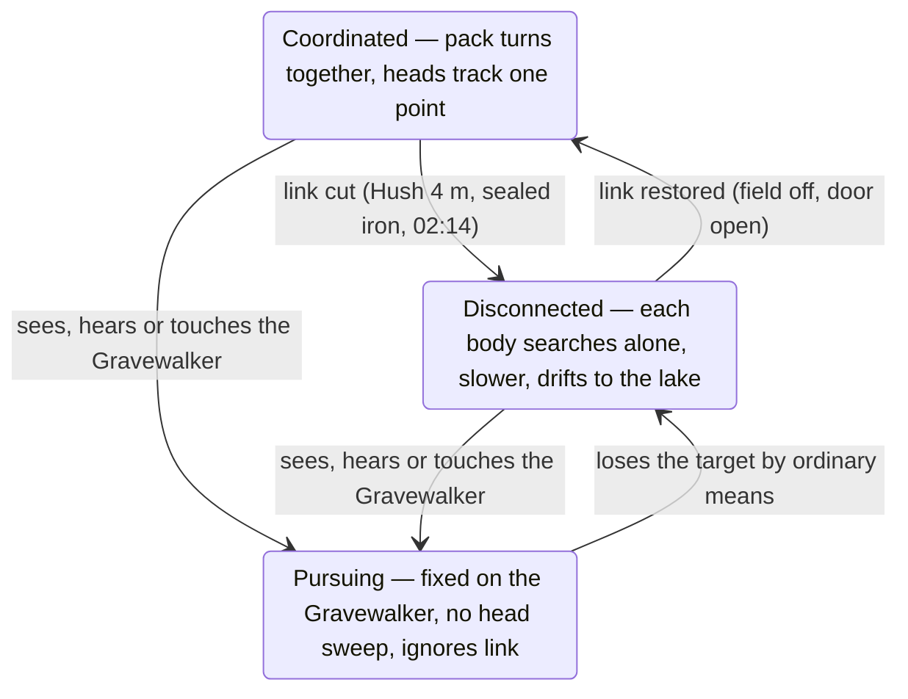

# Grave Shift — Story, Visual & Gameplay Implementation Brief

2 November 2026 · Edition 2, integrated with the 1.2 build · prepared for the Grave Shift crew board. Companion to *Grave Shift — Story and Gameplay Design* (Edition 1.1, November 2026: every soldier a man), which travels with this file. Section 8 records what Edition 2 changed and why.

## 1. Purpose and how to use this brief

This brief turns the Grave Shift story design (Edition 1.1, November 2026) into an implementation layer over the 1.2 build, resolves every loose end in that document, and places the work on the crew board as a new roadmap track. The source document stays canon for prose, dialogue and history; where this brief and the source disagree, this brief wins, because it records the decisions the source left open.

**Who this is for.** The implementing agent on the crew board, working inside the existing single-file Three.js browser game (shipped as the desktop wrapper). Nothing here requires a new engine, a new renderer, or a React rewrite. Everything is scoped to assets, scenes, data and UI that live in the current codebase.

**Where it sits on the road map (Jerry, 2 November 2026).** Nothing of this goes into 1.2 except the fixes 1.2 cannot ship without (Section 8). Track it as a separate story track (call it **S**) that runs from 1.3 to 1.5: 1.3 takes S1 Rules and S2 Surface, 1.4 takes S3 Underground, 1.5 takes S4 Investigation and dock and S5 Finale. Section 6 gives the milestone split; Section 7 gives the ordered task list and acceptance criteria.

**Three rules the agent follows throughout.**

1. Evidence before explanation. The player sees what a person built or did before learning what happened to them. No omniscient plaque, no narrator, no cutscene that tells the player a rule the world has not already shown.
2. State drives dialogue, not the reverse. Every line, board entry, map marker and report reads from one story-state object (Section 7). A missed conversation never deletes knowledge; a later conversation never claims an item that was not recovered.
3. Survivors reduce pressure; they never gate an ending. Written instructions, Ridgeline and the Gravewalker's own training are always the slower fallback.

**What is deliberately out of scope.** No new factions, no collectible currency, no caves beyond the five warrens and the Sixth Cave, no additional ending branch, no co-op hooks. The strongest returns come from the existing rooms and objects (Price's bracket, Brandt's chair, Okafor's prepared bed, the corrected 02:14 entry, the packed tag manifest).

## 2. Story and lore canon

Grave Shift is a twenty-day rescue campaign: a lone Gravewalker is dropped into a forested mountain basin to restore contact with FOB Threshold, finds the outpost abandoned mid-task, rebuilds it, recovers three living soldiers, reconstructs the deaths of nine others, and on Night 20 either flies the living out or descends beneath the lake to silence the source of the dead. The valley's story is one pattern repeated across four eras: people discover a working protection, lose the reason for it, and dismantle it under pressure. The Gravewalker wins by joining those scattered discoveries and leaving a truthful account for the next rescuer.

### Names that must stay consistent

Use these spellings in dialogue, map labels, objectives, the journal and code identifiers. Each names a different thing.

| Term | What it is | Never confused with |
| --- | --- | --- |
| PGB (Paranormal Ground Branch) | The unit Threshold belongs to; soldiers call themselves Gravewalkers | "Field containment" is an assignment, not the acronym |
| FOB Threshold | The abandoned outpost, later the player's HQ | Ridgeline |
| Ridgeline | Command and support element outside the valley (voice on the radio) | Heron |
| Heron | The extraction floatplane and its call sign | Any high-altitude support aircraft |
| The Tone | The resonance carried through Marrow, water and coupled metal; one phenomenon, two functions (sustain, coordinate) | Ordinary sound; the player never needs extreme bass to feel it |
| The Pit | The submerged sinkhole under the lake | The Sixth Cave |
| Marrow | The pale, warm mineral formation around the Pit and into the caves | Chalk |
| The Heart | The source of the Tone inside the Marrow (a cavity and mineral structure, not a creature) | Chalk |
| Chalk | The Guardian: a body the Heart assembles from Marrow paste, bone and mineralised timber | The Heart |
| The Hush | Sato's cancelling device (4 m radius) the player completes | A stealth cloak; it does not hide footsteps or eyes |
| The five warrens | Root, Shale, Iron, Wet, Hill: five views of one underground system | Five separate dungeons |
| The Sixth Cave | The Marrow chamber beneath the lake, behind the sealed stone threshold | Any warren |
| Threshold Day/Night N | The lost detachment's calendar (26 days before insertion) | Day/Night N, which is always the player's run |

### The cast

The player's soldier is the thirteenth Gravewalker (Jerry, 2 November 2026: "Marine" is old terminology; say Gravewalker, PGB soldier or the thirteenth). The Gravewalker is unnamed and ungendered in all text (see Section 5). Threshold had twelve soldiers; three live. **Every Threshold soldier is a man**, Okafor, Clarke and Ade included: he and him in every line, note, board and tag. Edition 1.1 of the source document is corrected to match. The hikers and rangers are civilians whose traces and remains the player can identify but never rescue.

| Name | Role | Status at insertion | Found at (surface trace → underground) |
| --- | --- | --- | --- |
| Spc. Evan Pike | Combat engineer, mechanic | Alive, ankle injury | Drainage refuge past the hikers' camp (Day 5 lead) |
| Sgt. Eli Brandt | Heavy weapons (M240B, broken extractor) | Alive, leg injury | Ranger pickup and screened equipment recess (Day 7 lead) |
| Cpl. Dana Okafor | Senior line medic | Alive, injuries | Trapper's iron-plated root cellar (Day 8 lead) |
| Capt. M. Hale | Commander | Dead | Duty board at HQ → Root Warren, empty sidearm locked open |
| Pvt. T. Lindqvist | Rifleman, maintainer | Dead | Annotated weapons manual, bunkroom → Root Warren, behind Hale |
| Cpl. R. Delgado | Watchtower | Dead | Half-finished rail carving → Shale Warren, collapsed chute |
| Spc. A. Mensah | Demolitions | Dead | Labelled demo locker, convoy flares → Shale Warren, damaged pillar |
| Sgt. K. Sato | Signals | Dead | Relay vault: schematic, mug, pulled fuse → Iron Warren, counter and "IT'S A WORD" |
| PFC J. Price | Generator, fabrication | Dead | Generator rain hood, bypass bracket → Iron Warren, ore-cart barricade, red wrench |
| Cpl. I. Clarke | Driver | Dead | Utility truck at the bend, tire tracks → Wet Warren, silver ring |
| Pvt. D. Kowalski (19) | Rifleman, wounded | Dead | Boots by the stove, infirmary note → Wet Warren, suture-repaired tag chain |
| Lt. S. Ade | Intelligence, historian | Dead | Red-ink binder pages at HQ → Hill Warren barrow threshold, rubbing and pouch |
| Arlen Vance | USFS acoustic technician, 1974 | Dead 52 years | Clipped to the mast at 12.5 m; boots and notebook recoverable |
| The trapper (b. 1935, d. 2018) | Kept the outer works for 66 years | Dead | Northern runoff with spilled iron and key ring; cabin almanac leads there |
| Six hikers, four rangers | Civilians (T-64 and T-60) | Harris escaped; all others dead | See Section 5 for every placement |

### The lore thread the player assembles

Each era adds one lesson the next era forgot. The player meets them out of order and the evidence table puts them back in order.

1. **The first builders** (Lithic Acoustic Culture, Ade's provisional term) learned by trial: three failed stone sockets, then the eight-stone ring that made the valley floor liveable. Their glyphs are working diagrams of a water-and-stone system, not an alphabet. Their barrow under Hill Cave is both cemetery and baffle. Rising water pushed them out gradually; nobody died in one supernatural night.
2. **Coldwater (1884 to 1899)** mined bog iron and hematite, found that joined iron quieted rooms, wrote Parish Ordinance No. 4 (iron-banded coffins), then pulled the upper adit's iron gates to brace a deeper drift and broke into the chalk seam at 190 feet. Shift B never surfaced; Shift A followed them; the returning figures spoke with the men's voices. The town plugged the inner opening with pig iron and evacuated.
3. **The trapper (1952 to 2018)** inherited the last blacksmith's routines without the theory: replace stakes, check cellar seams, warn people off the mine. The 1974 Forestry survey rebuilt the mast and left; Arlen Vance stayed to cut the tower's coupling and died on the lattice. The trapper died outside his own perimeter hauling iron, and the outer works rotted for eight years.
4. **The modern cascade** (T-64 to T-21) is the same mistake four times: hikers cut the "culvert cap" (the old adit gate) for shelter; rangers followed the hikers' route; Threshold followed the rangers' laminated map; Threshold's repeater re-coupled the mast Vance had isolated and drove the Tone into the whole basin on Threshold Night 5. Sato's fuse pull at 02:14 bought ninety seconds; three people used it.
5. **The Gravewalker** is the fifth party to arrive and the first to receive every earlier discovery at once, because each one left evidence in a place the player can reach.

### Deep chronology

Four eras, not to scale, each inheriting the works but not the reason:

- **First builders** — the eight-stone ring makes the floor liveable.
- **Coldwater 1884–1899** — iron quiets rooms; the upper gates get pulled.
- **Trapper 1952–2018** — routine kept, theory lost; Vance cuts the mast coupling in 1974.
- **Rescue cascade T-64 onward** — hikers, rangers and Threshold use one map.

The modern cascade by day (T = days before the Gravewalker's insertion; Day N = the player's run):

| Day | Event |
| --- | --- |
| T-64 | Hikers enter; Jonas cuts the adit gate at dusk |
| T-62 | Ellis struggles out over the pass |
| T-60 | Four rangers return with Ellis |
| T-59 | Harris escapes over the pass with the body camera; Ellis and three rangers are taken |
| T-26 | Threshold establishes its base |
| T-22 | Threshold Night 5 begins |
| T-21 | 02:14, after midnight: Sato pulls the driver fuse; ninety-second window; three escape. Landslide closes the road. Twenty-one days of radio silence follow |
| Day 1 | The Gravewalker drops into the landing clearing south-west of the HQ, out of its sight, and walks in on a trail that bends twice (D-105) |
| Day 3 | Diagnostic surge trips the coupling; Ridgeline verifies a living operator; recovery landing aborted |
| Night 6 | Chalk's first assault |
| Night 12 | Chalk's second assault |
| Night 18 | Chalk's third assault |
| Night 20 | Lake trough; six-hour window; the choice |

## 3. Visual direction

The valley should read as four eras of repair stacked on top of each other, with one pale, warm material (Marrow) underneath everything. The rule for every location: the player should be able to tell at a glance who worked here last, what they were protecting against, and where they gave up. This fits the existing direction that places are hidden by trees and terrain and feel like being lost in the woods by day and terrifying by night; the story layer gives each hidden place a reason to exist.

### Palette and light

| Layer | Look | Where it appears |
| --- | --- | --- |
| Forest and HQ, day | Cold greens, wet grey timber, olive canvas, rust. Low sun through mist. | Surface, Days 1 to 20 |
| Forest and HQ, night | Near-black blue, sodium-orange HQ lamps, white flashlight cone. Fog hugs the ground. | Surface, every night |
| Coldwater iron | Black wrought iron, flaking red oxide, hammer-marked straps and stakes. Always joined and bolted, never loose. | Church, mine ribbing, coffins, cellar plates, winch store |
| First-builder stone | Grey basalt, dressed, lichen-edged, glyphs cut as shallow working diagrams. | Lake ring, Hill barrow, Marrow doorway, maintenance sockets |
| Marrow | Pale cream to bone white, faintly warm (subtle emissive, no glow in daylight), weeps a salt slurry, surface "breathes" with the pulse. | Warrens (growing stronger with depth), Chalk, Sixth Cave |
| The Tone, visible | A soft pressure ripple on water and dust; the eight lake stones flare pale white in sequence at night (five active, three dark). | Lake, Wet Warren floors, any exposed Marrow |
| The quiet | When iron screening works: fog thins, the emissive on Marrow dims, dust settles. Same cue in the cellar, iron refuges and the final valley. | Okafor's cellar, Iron refuges, after Ending Two |

Night 20's lake turns to black glass. This is the one scene where the water has no ripple at all; keep every other night's lake moving so the stillness lands.

### Locations and the story object each one carries

Every named place already in the game keeps its position and its mini-game; the story layer dresses it. New places are marked.

| Location | Exists in 1.0? | Era it shows | The thing the player must be able to see |
| --- | --- | --- | --- |
| FOB Threshold (HQ) | Yes | Modern, abandoned mid-task | Duty board, roster board, evidence table, generator with Price's rain hood, relay service vault, field-telephone cabinet with a buried line |
| Eastern bend and medical convoy | Yes (ambulance jack mission) | Modern | Three sets of tire tracks, dried fuel spill, ambulance recorder, landslide that closed the road |
| Utility truck | Yes (chained toolbox mission) | Modern | Clarke's note on the dash, empty fuel line, route toward the lake service path |
| Radio mast, east hilltop | Yes (boots climb) | 1974 over modern | Vance in the service cradle at 12.5 m behind a weather shroud; Sato's lower fuse platform; two wiring paths (cut 1974 bus, new steel service frame) |
| South watchtower | Yes (one tower; agent confirms it overlooks the lake and eastern approach) | Modern | Delgado's half-finished carving on the rail, Brandt's notebook, clear view of the lake stones and eastern approach |
| Hikers' camp, south creek | Yes (bear-bag kit mission) | T-64 | Six packs, five sleeping bags plus Ellis's bivy, Priya's 1902 survey, Maya's camera |
| Ranger pickup, west approach | Yes (lockbox mission) | T-60 and 1974 | Laminated map with the red route, search board, Harris's report, the copied 1974 Vance dispatch |
| Trapper's cabin, north of river | Yes (bear-trap path mission) | 1952 to 2018 | Horseshoe line, chime wire, smelter-plate cellar with the iron bar, almanac by the stove, map with the marked runoff |
| Northern runoff | New (small) | 2018 | The trapper's remains, spilled iron stakes, key ring on his belt; no signs of a struggle |
| Coldwater churchyard, upper terrace | New | 1884 to 1899 | Church on an older boundary wall, iron-banded graves closed, one tin-strapped grave burst outward, the Gravewalker's own grave site in failure endings |
| Mine mouth (old Shaft 3 adit) | Yes (bolt cutters, "somebody cut the old bars") | 1899 cap over first-builder works | Cut iron gate (the hikers' culvert), Jonas's bolt cutters, locked maintenance grille below the gallery |
| Lake and the eight stones | Lake exists; stones new | First builders | Eight fixed monoliths around the Pit; five flare in order at night, three never do |
| Extraction dock, southeast shore | New | Modern over Coldwater | Taxi lane, lights and beacon, winch store with a heavy iron door, timber bulkhead |
| Root Warren | New | Modern collapse | Roots through the ceiling that twitch with the Tone, hanging suspension husks, Hale and Lindqvist's last stand |
| Shale Warren | New | Modern | Loose slate floor with visible stable strips, blind listener husks in recesses, Delgado's chute, Mensah's cracked pillar |
| Iron Warren | New | 1884 to 1899 | Continuous ribbing and doors beside rows of empty bolt holes, Sato's counter, Price's ore cart, the repairable fire door shortcut |
| Wet Warren | New | Under the lake | Flooded floors that lift every 40 seconds, observation ledge, raised intake edge, Clarke and Kowalski's refuge |
| Hill Warren | New | All eras in cross-section | Natural cave, then Coldwater masonry, then the dressed-stone barrow; iron pins over stone wedges; burial objects left in place |
| Threshold vestibule and station | New | Coldwater over first builders | Pig-iron gate on an anchored frame, the auxiliary pack and discharge assembly, the sealed stone door beyond (warm, then cold) |
| The Sixth Cave | New | First builders over the Pit | A pale cathedral; eight stone roots, five with exposed feed bridges, three in counterweight; the Heart as a cavity, never a face |

### Enemies

The dead keep the existing shambler and spitter models. The story layer adds readable states and three identifiable classes, not new behaviour trees.

- **Three awareness states, visible from a distance.** Coordinated: packs turn together, heads track the same point. Disconnected: each body searches its own direction, slower. Pursuing: fixed on the Gravewalker, no head sweep. The state is read from posture and head motion; no icon over the head.
- **Identifiable dead.** Threshold uniforms (olive, PGB patch), ranger uniforms (green and tan, badge), hikers (bright shell jackets, one knee brace). Putting one down near its surface trace is optional recognition, never required.
- **Suspension husks** (Root): bodies bound in calcified roots, hanging; sway when touched; mouths move with replayed sound.
- **Listener husks** (Shale): blind, eyeless, seated in recesses; react to floor noise with a rasp and a strike against stone.
- **Chalk.** A tall assembled figure: pale Marrow paste over a mineralised timber armature, bone where joints show, no face. Surface defeat: the torso fractures and runs into the soil as glowing pale slurry that always drains toward the caves. In the Sixth Cave it is bound to the five feeds; each isolated feed visibly dulls one limb. Final collapse: dull grey fragments into still water.

The current build has two guardian models. The larger is Chalk. The smaller becomes the Warden: a lesser Marrow body posted at warren thresholds and strong nodes, never on the surface, dying into the same slurry.

### UI and readability

Keep the condensed HUD and floating interaction prompts. The story layer adds four boards at HQ and one handheld meter; nothing else.

| Surface | What it shows | Rule |
| --- | --- | --- |
| Duty board | One primary daytime lead, optional work, extraction essentials with a check per item | Reads world state; never reissues a completed lead; marks "relay failure" struck through after the 02:14 reconstruction |
| Roster board | Living (rescued status), nine fallen (tag hangs below the name when recovered), civilians (identified or outstanding) | A tag is in one place only: on the board, or in the manifest pouch after packing |
| Evidence table | Five timing positions, each filled by a glyph once its warren record is found; relay log, watchtower notes, Ade's pages laid out | Empty positions stay visibly empty; shape and label carry the glyph, not colour alone |
| Journal | Type and last known location of any missing record; the version of each discovery the player actually made | Never spoils what has not been found |
| Hush meter | Two indicators: battery (drains only while active) and overload (rises only in the Marrow) | Same two indicators on the threshold station and in the final fight |

Every essential audio clue has a readable twin: receiver playback with captions and visual pulses, waveform comparison on the Day 14 investigation, a water-level meter in Wet Warren, timestamps on the relay log.

### Sound cues the story depends on

The game's sound rule applies (nothing unless immersive or impactful) and the 1.2 music direction (a track per night, per location and per event) carries these cues. Four cues are load-bearing: the low Tone under every outdoor night mix, which drops out completely inside working iron; the chime wire at the cabin going silent as the anomaly builds; the eight-second camera clip's rhythmic rasp; and the thirty seconds after the Heart dies, where the mix is only breath, gear, gravel, water and distant birds.

## 4. Gameplay design

The existing loop stays: explore and build by day, defend HQ by night, twenty nights, difficulty rising to a brutal Night 20. The story layer adds a lead system that points each day somewhere, five underground expeditions that each teach one rule, two scripted Night 20 operations, and a small set of world rules that every encounter obeys. Nothing below replaces the current wave, cash, buildable or skill systems.

### The day loop: leads, not quests

The duty board recommends one primary lead per day and lists optional work. Leads follow the gated chain already in the game (D-102, CL-285): each lead's site sits behind a physical blocker whose key comes from the lead before, and each survivor can be neither seen nor reached before his day (Pike Day 5, Brandt Day 7, Okafor Day 8). A lead left undone for two dawns lets the next one open anyway, so nobody is ever stuck; a lead never expires and recovered evidence never disappears. The chain's eight mini-games are the surface half of these leads (mapping in Section 6).

| Days | Primary leads | HQ utility or capability it unlocks | What changes at HQ |
| --- | --- | --- | --- |
| 1 to 4 | Generator, water, perimeter; convoy and bend; mast and isolated radio (Day 3 diagnostic trip) | Power, communications (Ridgeline contact), the infirmary (D-106) | Defensible outpost; a voice outside that keeps what the Gravewalker sends |
| 5 to 8 | Pike (Day 5), Brandt (Day 7), Okafor and the cellar (Day 8); trapper's key ring; Hush assembly | Plumbing, the workshop, the alarm, iron (D-106); roof defence post; Hush; warren service grille | People, routines, repaired gear |
| 9 to 13 | Root, Shale, Iron, Wet, Hill in the taught order (any order allowed once the grille is open) | One timing position per warren; the Iron fire-door shortcut | Evidence table fills; Night 12 Chalk |
| 14 to 15 | Mimicry investigation; reconstruction table; Heron's check | Challenge-response contact; the Silence plan becomes testable | "Relay failure" corrected to "Deliberate cut. Ninety seconds. Three out." |
| 16 to 19 | Dock essentials; optional Silence package; Night 18 Chalk; Day 19 free choice | Dock lane, lights, winch-store shelter; mast capacitor, five shunts, threshold power | Finale approaches change with what was repaired |
| 20 | Roster read-back, manifest packed, escort to the dock, the choice | Both operations show their real readiness | Six-hour window, narrative time only |

### World rule 1: awareness has two sources

Every corpse has its own senses (sight, hearing, touch) and may also receive shared awareness through the formation. The Hush, iron enclosures and Sato's 02:14 cut remove only the shared part. A creature that already saw the Gravewalker keeps pursuing. Implement as a per-enemy flag `linked` plus the existing detection; the Hush sets `linked=false` inside 4 m, iron enclosures set it false for the enclosed volume, and a pursuing enemy ignores the flag until it loses its target by ordinary means.



The Hush, a sealed iron enclosure and Sato's cut move bodies from Coordinated to Disconnected and never touch Pursuing; a pursuer only drops back to Disconnected when it loses the Gravewalker by ordinary means, and re-links from there if the field is off or the door is open.

### World rule 2: iron works as geometry, not as a material

Only dense, continuous, closed iron screens a space: the cellar with its bar seated, intact mine ribbing with the door shut, the winch store with its door checked, the vestibule gate when closed. A carried rifle, loose nails or a sheet held up do nothing. Iron never pushes a body; a shut door blocks it. A refuge counts only after the player closes it and nothing hostile is inside. Implement as tagged enclosure volumes with a `sealed` state driven by their door; the quiet cue (Section 3) and `linked=false` follow the state.

### World rule 3: the Hush has two meters

Battery drains only while the field is on; a calibrated pack covers one warren with margin for exploration and retreat; HQ recharges it during the day at a time cost; iron refuges let the player switch it off, they do not recharge it. Calibration is a short daily action at the HQ receiver (the Heart shifts the waveform at dawn; the five glyphs never change). Overload is separate: it rises only in the Marrow and is discharged only at the threshold station. Noise does not switch the Hush off; it causes detection.

### World rule 4: the relay has four states

| State | Connected | Effect in play |
| --- | --- | --- |
| Threshold install | Powered repeater plus unwanted ground coupling | The catastrophe of Threshold Night 5; never recreated by the player |
| After Sato's cut | Driver feed open | Shared coordination fails for ninety seconds; the deep source persists |
| Player repair (Day 3 or later) | Isolated low-power radio and receiver only | Ridgeline contact; the driver stays disconnected after the diagnostic trip |
| Inversion-ready (Day 16 or later) | Corrected coupling, capacitor, cancellation circuit, verified pattern | Night 20 Silence operation only, behind a clear warning and a separate deliberate action |

### The five warrens

Each expedition answers one question, holds two of the fallen, and returns one harmonic record. Records are rubbings or loose fragments with a receiver capture; none can be dropped, spent, destroyed or consumed by a wrong puzzle input. The pattern's order is fixed (Ladder, Eye, Gate, Cup, Star) whatever order the player collects it in.

| Warren | Mechanical lesson | Hazard | Record (position) | Fallen | Shortcut or reward |
| --- | --- | --- | --- | --- | --- |
| Root | Move around hanging bodies without touching them | Suspension husks wake on contact even under the Hush | Ladder (1) | Hale, Lindqvist; Ellis | Short return loop |
| Shale | Step only on stable strips; noise travels through rock | Listener husks strike on footfalls; outside creatures investigate the strike | Eye (2) | Delgado, Mensah; Priya | Predicting one quiet interval |
| Iron | What a sealed refuge gives you (switch the Hush off, watch the drain stop) | Removed ribbing leaves porous stretches | Gate (3) | Sato, Price; Theo and Sam | Permanent fire-door shortcut to the surface |
| Wet | Move between pulses; stillness during the surge | Water lifts every 40 s and wakes submerged bodies | Cup (4) | Clarke, Kowalski; Jonas | Explains why Heron cannot land in the active phase |
| Hill | Read three eras of repair at one weak point | Fewer enemies; the barrow is quiet by design | Star (5) | Ade; Maya | Completes the sequence; the inversion plan |

### Chalk and the night curve

Chalk assaults HQ on Nights 6, 12 and 18, each stronger. The existing difficulty curve to Night 20 is unchanged; Chalk nights are its local peaks, and Night 20 is the global peak even though Chalk does not come to the surface that night. Defeating Chalk collapses its body into slurry that drains toward the caves; by Night 18 the glow makes the route to the Sixth Cave unmistakable. Rescued survivors take fixed defence roles on assault nights (Brandt on the roof, Pike at the generator and circuits, Okafor behind an iron threshold with the wounded); they can be wounded and lose a support action the next day, and they cannot be killed during baseline assaults.

### Night 20: two operations, one checkpoint

At dusk the lake settles and Heron confirms six hours. The window is narrative time; it never counts down in menus, dialogue or pause. Survivors are escorted to the winch-store shelter before the finale in both branches.

- **Bring ours home** needs a clear taxi lane, a secured staging shelter and verified contact. The dock holdout uses what was repaired: lights make the shoreline readable, iron reinforcement narrows the gap, cleared logs give Heron a direct path. Brandt runs the belt-fed gun and calls reloads; Pike keeps the beacon and generator and pushes the gangplank; Okafor marks boarding and can bring the Gravewalker back from one downed state. Absent specialists are replaced by an automatic beacon, placed ammunition and a manual fallback, never by disembodied lines.
- **Silence** needs the dock essentials plus all five records, the completed mast circuit, five shunts and threshold power. Firing the inversion at the opening of the trough drops the surface Tone, opens the stone door and cuts Chalk's return routes. Inside, the fight runs through the five positions in the learned order: fit a shunt at the open socket, break the exposed bridge, Chalk loses regeneration and one attack. Retreat behind the gate discharges overload and holds bridge progress but closes the current window. Breaking the uncoupled core ends sustain and coordination everywhere; every body in the valley falls, and the dock team verifies it.
- A checkpoint sits at the decision and again before the first shunt. Retrying restores that checkpoint's equipment, so no attempt is ever unwinnable from depletion.

### Endings and failure

Both endings close on the same report structure: evacuated, identified, unrecovered, status of the Heart. Silence adds the thirty-second playable walk-out with no HUD, no score and no radio, then Ridgeline's quiet line, then boarding without a holdout. Failure plays an aftermath consistent with the run: a churchyard burial with iron by whoever was actually rescued, a memorial if the body cannot be reached, or the valley reclaiming the Gravewalker with a fallen radio repeating the first recorded call. Rescued survivors never appear as corpses because the player did not find them.

## 5. Loose ends resolved

Every open question in the source document now has one answer, placed where the player will meet it. These decisions are canon from this edition on; the items at the end were decided by Jerry on 1 November 2026.

| Loose end in the source | Decision | Where it shows |
| --- | --- | --- |
| "Playable cast" of 23 people | Only the Gravewalker is playable. The Gravewalker is unnamed and ungendered in every line; NPCs say "Gravewalker" or "you". The Gravewalker speaks only in radio exchanges and short evidence notes. | All dialogue, journal, reports |
| Four rangers, only Harris named | Ranger Lena Harris (escaped with the body camera); Dale Whitcomb, Marcus Fenn and Rosa Ibarra (taken). Approved 1 November 2026. | Search board at the ranger camp, Harris's report, roster civilian column |
| What happened to the three rangers' bodies | Threshold found them at the Root cave vestibule on Threshold Day 3 and moved them to the canvas morgue shelter beside the aid station (Hale's log). After the fall the shelter is torn open and empty. The three now walk as identifiable ranger dead near HQ and in Root and Shale; their badges are optional civilian identification. | Morgue shelter at HQ, ranger-uniform shamblers, roster |
| Where Ellis died | Root Warren, bound in a suspension husk, identifiable by his knee brace. His husk is the physical origin of the replayed plea (cough, three taps, clipped syllable). Isolating the buried line silences it at HQ; the husk keeps mouthing it below. | Root Warren; Day 14 investigation adds a line if Root was visited |
| Where the five hikers died | One per warren, found by their gear: Priya Raman in Shale (sample bag, rock hammer, a white sample); Theo and Sam Marsh in Iron (rope anchored to intact ribbing up a blocked shaft); Jonas Weber in Wet (headlamp, survey tape at the intake); Maya Costa in Hill (bound in the barrow's outer baffle, phone with her last clip of the glyphs). | Each warren; roster civilian column |
| Maya's eight-second clip | Her camera lies at the mine mouth where Jonas cut the gate; her phone in Hill holds the final clip. Two devices, two clips, no duplication. | Mine mouth; Hill Warren |
| Jonas's bolt cutters | They are the bolt cutters already at the mine mouth in the utility-truck mission (the note "somebody cut the old bars off this mine" stays). Add a name sticker on the handles. | Mine mouth |
| Which truck Clarke drove | The existing utility truck with the chained toolbox. The toolbox holds Pike's workshop tools (unlocks the workshop). Price's red wrench is never in it; it is underground with Price. | Eastern bend |
| The fuel depot (exists in 1.0, absent from the source) | It is Threshold's drum cache at the convoy staging. Clarke used the last cans on his three runs, which is why the truck ran dry. Jerrycans feed the HQ generator and, on Days 16 to 17, the dock's portable generator and lights. | Convoy; dock preparation |
| Where the Sixth Cave threshold is | At the bottom of old Shaft 3 (190 ft), reached through the Iron Warren's lowest drift, exactly where Shift B broke into the chalk seam in 1899. The Coldwater pig-iron plug is the vestibule's anchored, shuttable gate; the sealed stone door beyond it is the first builders' Gate threshold. | Iron Warren map; vestibule; finale |
| Three barriers that must look different | Cut adit gate at the mine mouth (hikers); locked maintenance grille below the gallery (trapper's key ring); sealed stone door at the vestibule (no key; opens only with the Night 20 inversion). Three models, three map labels. | Mine mouth, grille, vestibule |
| Night 20 is a "lull" but the curve says brutal | The lull is the lake only. The dock holdout is the densest fight of the run because everything on the surface converges on the one lit place where the living are gathered; in Silence, Chalk in the Sixth Cave is the final fight. Both branches are the hardest content. | Night 20 spawn tables |
| Who the binoculars belong to | A spare pair hangs at the watchtower (Delgado's note complains Brandt took the good pair). Brandt's pair comes home with him. The spare lets the player spot Vance from Day 3 without Brandt. | Watchtower; Brandt's recess |
| Pike's line "nearly four weeks" when found early | Compute from days since the fall (21 plus the current day) and pick the phrase: three weeks (Days 1 to 3), nearly four weeks (Days 4 to 7), over a month (Day 8 on). | Pike's rescue scene |
| Hush as an inventory item | A belt device with a toggle key and a two-bar HUD meter shown only while equipped. Not a buildable, not a weapon slot. | HUD; workshop |
| "Rune shards" | Field dialogue only. UI, journal and the evidence table say "record". | Survivor lines vs. boards |
| The trapper's name | Stays unnamed everywhere ("the trapper"). The almanac is unsigned. | Cabin; roster historical column |
| Vance on the roster | Listed under a historical column with the trapper, never among the nine fallen. | Roster board |
| Where the Day 14 second copy comes from | The ambulance recorder from the medical-convoy mission; the convoy is Threshold's own. The rare spitter sleeping in the ambulance stays. | Convoy site |
| What the trapper's cellar mission becomes | Opening the hatch is Okafor's rescue scene. The supplies the mission already gives remain; the almanac and cabin map add the key-ring lead to the northern runoff. | Trapper's cabin |
| What the mast boots climb becomes | The climb reaches Vance's cradle. The boots the player already earns are Vance's lineman's boots, now refurbished at the workshop; his notebook diagram is the second reward. | Mast |
| Survivor safety during ordinary nights | Survivors take fixed positions, can be knocked down and lose a support action next day, and are invulnerable to death outside authored, clearly avoidable danger. | Night assault logic |
| Opening of the run | Day 1 starts in the landing clearing south-west of the HQ, out of its sight (D-105); the walk in down the bending trail is the opening, no cutscene. The three-line order is on the first journal page. | Day 1 |

### Decisions made, 1 November 2026

- Guardians: the larger model is Chalk (Nights 6, 12, 18 and the Sixth Cave). The smaller becomes the Warden, a lesser Marrow body posted at warren thresholds and strong nodes, never on the surface, dying into the same slurry.
- Okafor's revive: a dock-only downed state in the Night 20 holdout (ten-second bleed-out, one revive by Okafor). Death stays as it is everywhere else.
- Every Threshold soldier is a man (Okafor, Clarke and Ade included). Every line, note, board entry and tag uses he and him; Edition 1.1 of the source document is corrected.
- Ranger names approved: Lena Harris, Dale Whitcomb, Marcus Fenn, Rosa Ibarra.
- Watchtower: the build has one tower. The agent confirms it overlooks the lake and the eastern approach and uses it as the south watchtower; if it does not, move it rather than add a second.
- HQ roof: survivors can reach it, the player cannot yet. Add player access (a ladder or stair) in S2 so the chair and the chalk marks can be inspected.

## 6. Integration with the current build and the revision list

The story layer re-dresses what 1.0 already has rather than replacing it. Every supply site keeps its mini-game and gains a story reason, a story object and an HQ utility it unlocks; the night curve, buildables, cash, skills, Training Ground, condensed HUD and the 1.2 music plan all stay as decided. The lore step forward is the underground: the five warrens, the lake ring and the Sixth Cave are the only new places of size.

### Existing features and their story role

| In the build today (1.2) | Story role from this edition | Change required |
| --- | --- | --- |
| Twenty nights, difficulty rising to a brutal Night 20 | The twenty-day lake cycle; Chalk on Nights 6, 12, 18; Night 20 dock holdout or Sixth Cave | Spawn tables for the three Chalk nights and Night 20; no change to the base curve |
| HQ with buildables | FOB Threshold, abandoned mid-task | Add duty board, roster board, evidence table, relay vault, field-telephone cabinet, morgue shelter, workshop bench with the wrench hook, aid station with Kowalski's prepared bed |
| Eight HQ utilities, one per lead (D-106, in 1.2) | Generator = power (Price's rain hood, water-separator note); relay = communications; medical run = infirmary (the aid station); the missing = plumbing (the hikers' pump at the HQ, needs power); Clarke's truck = workshop; the search = alarm; the old man = iron (horseshoes over chosen gaps); below = the Hush. The fuel depot's jerrycans also power the dock on Days 16 to 17 | Keep as built; wire each to the story-state object (Section 7); add the dock-power delivery in S4 |
| Medical convoy, jack the ambulance | Threshold's own convoy; the ambulance recorder is the Day 14 second copy; Mensah's flares and demo locker labels nearby | Place the recorder and Mensah's traces; keep the spitter |
| Ranger cache, 3-digit lockbox | The lockbox holds the rangers' incident file: Harris's report, Ellis's interview transcript, the laminated red-route map, the copied 1974 Vance dispatch | Digits unchanged; search-board date becomes the rangers' entry date; file contents added |
| Hikers' kit, shoot the bear bag | The pack also holds Priya's 1902 survey; the camp shows six packs and five bags plus Ellis's bivy | Add the survey and the bag count as inspectable objects |
| Trapper's supplies, walk the bear-trap path | The cellar hatch opens on Okafor (Day 8); the almanac and map add the runoff lead; the cellar demonstrates iron quiet | Rescue scene, almanac, map, northern runoff site, key ring |
| Fuel depot, carry the jerrycan | Threshold's drum cache; fuel for HQ and later the dock generator and lights | Add a dock delivery target on Days 16 to 17 |
| Utility truck, chained toolbox; bolt cutters at the mine mouth | Clarke's truck and note; Jonas's bolt cutters | Clarke's note, tire tracks, dry fuel line; sticker on the cutters |
| Mast boots climb | Vance's cradle, boots and notebook; Sato's fuse platform and schematic; Day 3 relay repair | Vance body at 12.5 m, two wiring paths, relay states |
| Two guardians | Chalk (larger model) and the Warden (smaller model) | Retexture to Marrow; slurry death; assault schedule |
| Shamblers, spitters, megaswarm | The valley's dead, with three readable awareness states and three identifiable classes | Posture and head-tracking per state; uniform variants |
| Training Ground (future tutorial) | Unchanged; a good place to demonstrate the three awareness states and iron enclosure once | Optional, after S3 |
| Places hidden by trees and terrain (1.2 forest groupings) | Each hidden place is one era's evidence; curiosity by day, dread by night | None; this plan and 1.2 pull the same way |
| Music per night, location and event (1.2) | The Tone under outdoor nights and its removal inside iron; cellar, lake stillness, final walk-out | Cue list in Section 3 |

### Where the work goes on the board

1.2 stays closed to Track S beyond Section 8's fixes. Track S runs from 1.3 to 1.5. Each milestone ships a playable slice, in dependency order, so Jerry can play through after any of them, and each release is measured at night 20 against the one before (D-99) before it ships.

| Milestone | Release | Delivers | Depends on | Playable check |
| --- | --- | --- | --- | --- |
| S1 Rules | 1.3 | Awareness states, iron enclosure volumes, relay states, Hush with two meters, story-state object | Nothing | Enemies read as coordinated, lost or pursuing; the cellar goes quiet; the radio never re-drives the mast |
| S2 Surface | 1.3 | HQ boards, re-dressed supply sites, three survivor rescues, Vance, trapper's runoff, churchyard, lake stones | S1 | Days 1 to 8 play end to end with leads; HQ sounds lived-in |
| S3 Underground | 1.4 | Five warrens, five records, fallen soldiers and civilians, fire-door shortcut, Chalk assaults on Nights 6 and 12 | S2 | Days 9 to 13; records collected out of order still order themselves |
| S4 Investigation and dock | 1.5 | Day 14 mimicry, Day 15 table, Days 16 to 17 dock and Silence package, Night 18 Chalk, Day 19 | S3 | Both Night 20 readiness checks show truthful state |
| S5 Finale | 1.5 | Both endings, failure aftermaths, reports, manifest pouch, thirty-second walk-out | S4 | Every continuity check in Section 7 passes |

The 1.2 music overhaul should land its night and location tracks before S2 is played through, so the Tone cue is in place when the cellar scene is tested.

## 7. Implementation plan for the agent

Build in the milestone order from Section 6; inside each milestone, do the tasks top to bottom. Rules first, then progression, then the human payoffs, then the selective effects. A task is done when its acceptance line holds in a real playthrough, not when the code compiles.

### The story-state object

One object owns everything the story remembers. Boards, markers, dialogue and reports read from it; nothing reads from dialogue history. Save it with the existing save data.

```json
{
  "day": 1,
  "survivors": { "pike": "missing|found|rescued|wounded", "brandt": "...", "okafor": "..." },
  "fallen": { "hale": { "identified": false, "tag": false, "effects": false }, "lindqvist": {}, "delgado": {}, "mensah": {}, "sato": {}, "price": {}, "clarke": {}, "kowalski": {}, "ade": {} },
  "civilians": { "ellis": false, "costa": false, "theo": false, "sam": false, "raman": false, "weber": false, "whitcomb": false, "fenn": false, "ibarra": false },
  "historical": { "vance": { "found": false, "boots": false, "diagram": false }, "trapper": { "found": false, "keys": false } },
  "records": { "ladder": false, "eye": false, "gate": false, "cup": false, "star": false },
  "relay": "threshold|cut|repaired|inversionReady",
  "contact": { "verified": false, "mimicryProven": false, "challengeResponse": false },
  "hush": { "built": false, "calibratedDay": 0 },
  "shortcuts": { "ironFireDoor": false },
  "utilities": { "electricity": false, "plumbing": false, "radio": false, "workshop": false, "aidStation": false, "dockPower": false },
  "dock": { "lane": false, "shelter": false, "lights": false, "reinforced": false },
  "silence": { "capacitor": false, "shunts": 0, "thresholdPower": false, "diagnosticPassed": false },
  "reconstruction": { "board0214": false, "tableComplete": false },
  "finale": { "choice": "none|extract|silence", "committed": false, "feedsIsolated": 0 }
}
```

### Ordered tasks

**S1 Rules**

- [ ] Add `linked` to every enemy; shared awareness only when `linked` is true; pursuit ignores `linked` once a target is held. Acceptance: a corpse with line of sight attacks inside the Hush; one without receives no new target when the Hush is on.
- [ ] Enclosure volumes with a `sealed` flag driven by their door; inside a sealed volume `linked` is false and the quiet cue plays. Acceptance: a shut cellar screens the network and an enemy already inside still attacks.
- [ ] Relay state machine with the four states; ordinary radio use can never set `threshold`. Acceptance: no path from `repaired` back to `threshold`.
- [ ] Hush device: toggle, 4 m field, battery drain only while on, daily calibration, overload meter that rises only inside Marrow-tagged volumes. Acceptance: switching off in a sealed refuge stops the drain and does not recharge.
- [ ] Story-state object, save and load. Acceptance: reloading mid-day restores every board and marker exactly.

**S2 Surface**

- [ ] Duty board with one primary lead per day and optional work; lead generation checks state before issuing. Acceptance: a finished lead is never reissued, and no survivor appears before his day (D-102).
- [ ] Roster board, evidence table, journal. Acceptance: a tag appears in one place only.
- [ ] Re-dress the seven supply sites per Section 6 and wire each utility unlock.
- [ ] Pike, Brandt and Okafor: find states, local access problems, rescue scenes, HQ routines (workshop, roof chair, aid station), wounded-but-not-killed behaviour on assault nights.
- [ ] Player access to the HQ roof (ladder or stair). Confirm the existing watchtower overlooks the lake and eastern approach and use it as the south watchtower; move it if it does not.
- [ ] Vance at the mast (12.5 m cradle, two wiring paths), the trapper's runoff and key ring, the churchyard with the burst tin-strapped grave, the eight lake stones with five-in-sequence night flares.
- [ ] Day 3 diagnostic trip and Ridgeline verification; challenge phrase computed daily for later use.

**S3 Underground**

- [ ] Maintenance grille (key ring), warren service doors, the three visually distinct barriers.
- [ ] Five warrens with their hazard, record, fallen and civilian placements, revisitable, evidence persistent through retreat.
- [ ] Records order themselves into Ladder, Eye, Gate, Cup, Star regardless of pickup order; receiver playback with captions and visual pulses.
- [ ] Iron fire-door shortcut, permanent once repaired, safe only when shut.
- [ ] Chalk: Marrow look, assault nights 6 and 12, slurry death that drains toward the caves; Warden retextured from the smaller guardian, posted at warren thresholds, never on the surface.

**S4 Investigation and dock**

- [ ] Day 14: waveform comparison, ambulance copy, field-telephone power test (conventional power and cell removed, voice continues; buried line isolated, voice stops), pack and bag count resolved, mast junction correction (faster with Vance's diagram).
- [ ] Day 15: Heron wing flash and authenticated check; reconstruction table with staged completion; the 02:14 board correction by Pike or, if absent, by the Gravewalker after Ridgeline verifies timestamps.
- [ ] Days 16 to 17: dock lane, lights, beacon, winch-store shelter, reinforcement; Silence package as one workshop job; low-power diagnostic that quiets a small sample or names the wrong position.
- [ ] Night 18 Chalk with survivor roles; Day 19 free day with the quiet acknowledgement line for tags left below.

**S5 Finale**

- [ ] Day 20 read-back, manifest pouch, escort to the shelter, choice screen showing true readiness of both plans, checkpoint at the choice.
- [ ] Bring ours home: dock holdout using every repair, specialist roles, dock-only downed state (ten-second bleed-out, one revive by Okafor), boarding count, cabin scene reading from inventory (tag, wrench or notebook, never an absent item), report.
- [ ] Silence: inversion at the trough, stone door opens, vestibule station demo, five-position fight with shunts in the learned order, retreat rhythm, core break, valley-wide collapse, rest below the exit, thirty-second walk-out with no HUD or audio but ambience, Ridgeline's line, boarding, report ending "Source silenced."
- [ ] Failure aftermaths: churchyard burial scaled to who was rescued, memorial variant, valley-reclaims variant with the fallen radio.

### Asset list

| Asset | Type | Count | Milestone |
| --- | --- | --- | --- |
| Threshold, ranger and hiker uniform variants on existing shambler rigs | Textures, mesh swaps | 3 variants, plus one knee brace | S1 to S3 |
| Posture and head-track animations for the three awareness states | Animation | 3 loops per rig | S1 |
| Suspension husk, listener husk | Models and animation | 2 | S3 |
| Chalk retexture, slurry collapse, feed-dulled limb states, grey final collapse | Model, VFX | 1 plus 6 states | S3, S5 |
| Five warrens, vestibule, Sixth Cave | Environments | 7 | S3, S5 |
| Eight lake stones with flare emissive, dock, winch store, churchyard, northern runoff, existing watchtower re-dressed | Environments and props | 6 sets | S2 |
| HQ boards (duty, roster, evidence), relay vault, telephone cabinet, morgue shelter, workshop hook, prepared bed | Props and UI textures | 9 | S2 |
| Personal objects: 9 tags, red wrench, bottle cap, pressed flower, fuse length, silver ring, suture chain, Ade's pouch and rubbing, Vance plate, boots, notebook, key ring, almanac, 1902 survey, camera, phone, bolt-cutter sticker | Props | ~22 | S2, S3 |
| Hush device and HUD meter; threshold station | Prop, UI | 2 | S1, S5 |
| Sound: Tone bed with iron drop-out, chime wire, camera rasp, lake stillness, final ambience | Audio | 5 cues | S2 onward, with 1.2 music |
| Voice: Ridgeline, Heron pilot, Pike, Brandt, Okafor, Ellis replay | Audio | 6 voices | S2 to S5 |

### Continuity checks before any content build is accepted

- [ ] No survivor can be seen or reached before his day, and a lead left undone for two dawns still lets the next one open.
- [ ] Restoring communications never reactivates the mast driver.
- [ ] A corpse with direct sight attacks inside the Hush; disconnected creatures receive no new shared target.
- [ ] A closed iron refuge screens the network but does not remove an enemy already inside.
- [ ] A warren retreat preserves evidence and allows a fresh attempt without consuming a unique item.
- [ ] The five records collected out of order produce the same verified sequence.
- [ ] Missing tags or an absent survivor never block an otherwise prepared Silence operation.
- [ ] An incomplete Silence plan leaves a clear route to the dock ending.
- [ ] Dock assistance, burial scenes, belongings and final reports match the actual roster and inventory.
- [ ] The sustaining source is visibly disabled before every reanimated body falls.
- [ ] No line refers to the Gravewalker with a gendered pronoun or a name.
- [ ] No survivor describes an assault they were not present for.
- [ ] Each tag exists in exactly one place at the final screen.

## 8. Edition 2: integration with the 1.2 build

Edition 1 was written against 1.0. Edition 2 (2 November 2026) folds it into the game as it stands in 1.2 and records each decision.

### Already in the game (1.2)

These pieces of the brief stand today; for them the work is the dressing the brief describes, not the place itself:

- The nine tags in the warrens the brief names (Root: Hale, Lindqvist; Shale: Delgado, Mensah; Iron: Sato, Price; Wet: Clarke, Kowalski; Hill: Ade).
- The eight carved stones round the lake with five flaring at night, the dock where Heron lands, Coldwater's graveyard with its church shell, the trapper's iron cellar, the bolt cutters at the mine mouth, the mast's skeleton at 12.5 m (who becomes Arlen Vance), the survivors' roof roles and both endings.
- The woods (D-103): every place hidden in its own clearing, the quarter walls and the ring round the HQ. Each hidden place becomes one era's evidence.
- The 1.2 score (D-97): a suite per night, the specials and the Training Ground motifs. The Tone bed and its drop-out inside iron join it in S2.

### Kept as built (the story explains them)

1. **The gated chain** (D-102): blockers and keys, and no survivor seen before his day. The brief's "expected dates, not locks" is replaced in Sections 4, 7 and the checks.
2. **The drop-in** (D-105): the landing clearing south-west of the HQ, out of its sight, not a parachute landing on the eastern bend.
3. **The utilities** (D-106): the eight as built, plus the brief's dock power as the fuel depot's late use.

### Taken from the brief (they replace what the game does today, when their milestone lands)

4. **The word:** fixed as Ladder, Eye, Gate, Cup, Star in every run (S3). It replaces today's five of eight glyphs in a new order each run.
5. **The Sixth Cave:** entered from the Iron Warren's lowest drift at the bottom of Shaft 3 (S3, S5). The sealed cave mouth on the surface stays as the first builders' sealed doorway, a landmark that never opens from outside.
6. **The Hush:** a battery that drains only while it is on, daily calibration and the overload meter (S1). It replaces today's one delve per charge, recharged at dawn.

### In 1.2: only what 1.2 cannot ship without

- Every soldier a man in the game's own text: Clarke's toolbox ("his"), Clarke's ring ("too small for his finger"), Delgado's poppy ("He picked it"), Okafor aboard Heron ("the ones he couldn't reach"), and the same in the story docs.
- Nothing else from this brief goes into 1.2.

### Performance

Every S milestone is measured at night 20 against the release before it, on Jerry's PC, before it ships (D-99). The awareness states and enclosure volumes run every frame for every body: budget them before they are built.
